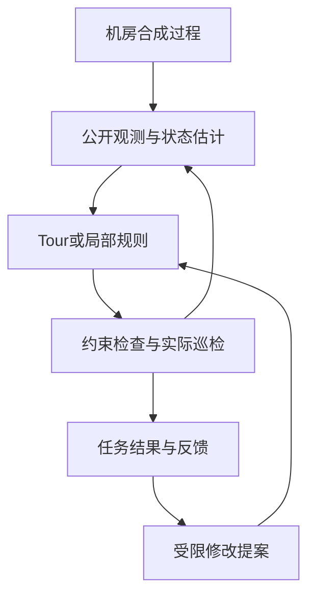

# 架构：从设备状态到巡检结果

## 1. 内循环

合成过程产生真实设备状态，观测层只发布允许获取的信息。估计器使用这些公开信息更新当前状态判断；巡检策略提出下一项任务或局部顺序。约束检查通过后，执行者消耗移动和服务时间，真正完成检查才产生专业测量。新的测量进入下一次决策，评价器在回合结束后计算结果。

默认策略是受保护的Tour。人工局部规则可以提出最多三项义务的顺序修改；执行器仍检查所属、专业资格、工时和随后完整巡回的可行性。

上面的内循环已可运行。真实模型反馈试点已执行并收束，未证明独立增益；当前[NEXT](NEXT.md)推进公开新风险的有效确认。

| 层 | 主要代码 | 主要职责与边界 |
|---|---|---|
| 场景与过程 | `facility.py`、`process.py` | 供电、液冷、控制及真实状态变化；隐藏故障信息不能进入在线决策 |
| 观测与任务 | `facility_observation.py`、`active_inspection.py`、`patrol_task.py` | 公开遥测、资格、移动与服务；到达位置或模型提示不能代替有效测量 |
| 状态估计 | `estimation.py`、可选`estimation_model.py` | 名义估计或冻结CVAE；缺少权重不能冒充已运行CVAE |
| 巡检策略 | `reorder_execution.py`、`baseline_correction.py`、`correction_execution.py` | Tour和受限局部规则；不能改物理过程、人员权限或评价标准 |
| 约束检查 | `coverage_plan.py`、`local_reorder.py`、`inspection_contracts.py` | 路程、服务、任务账本和重访义务；只覆盖声明的静态、确定时间条件 |
| 评价与入口 | `inspection_metrics.py`、`case_report.py`、`cli.py` | 漏检、等待、移动、服务、完成量和可读回看；少完成工作造成的省路程不能单报效率收益 |
| 有限研究外循环 | `feedback_study.py`、`model_proposals.py` | 冻结方案、计数与缓存、隔离反馈、有限离线提案、先封存后确认；不修改原执行核 |
| 事件确认执行 | `risk_response.py` | 风险事件账本、单项完成后重规划、新候选返回证书及有限机制试验 |

主要实现入口位于 `src/patrol_rsi/`：`facility.py`处理物理过程，`facility_observation.py`处理观测和专业任务，`coverage_plan.py`处理返回计划，`baseline_correction.py`定义受限局部修正。运行统一从 `python -m patrol_rsi` 进入，不再从历史阶段脚本选择入口。

## 2. 外循环

已完成的巡检记录可以形成经验。改进器据此提出登记范围内的修改，固定解析器检查字段、取值和修改权限，再由实际执行与评价决定是否保留。父版本、候选来源、失败和回退都应有记录。

当前 `proposal` 命令使用人工候选样例验证这条接口；它不是一次Qwen实验。未来真实模型调用必须保留原始回复，不能由解释文字人工拼成成功提案。

## 3. 工具目前扮演什么角色

| 工具 | 当前默认入口 | 可以据此宣称什么 |
|---|---|---|
| 名义状态估计 | 默认启用 | 工程示例实际使用该估计器 |
| CVAE | 可选，依赖外部冻结权重 | 历史有真实训练与推理；是否本次运行以记录为准 |
| PPO | 保留源码，不接入默认局部调度 | 有历史学习实验，不能计作当前动作贡献 |
| Qwen改进器 | 演示和验收不会自动调用 | 历史有真实提案；人工样例不算新模型调用 |
| 岭价值模型 | 保留有限证据，不接入默认调度 | 四折预实验可复核，可靠性尚未通过 |

学习工具的源码存在、发生推理、改变动作、改善任务，分别记录，不用一个“已接入”概括。

`explain`把一个固定工程案例变成独立HTML。它在原选择器的真值禁用边界内复制当前公开信息，仍由原选择器决定动作；执行结束后才附加实际温度与流量用于回看。两方案使用同一物理过程、人员、任务和观测权限。截图和图表是解释工具，不增加在线权限，也不构成新的科研确认。

## 4. 输入、输出与来源

- `configs/`：明确标注用途的示例配置和人工候选。
- `runs/`：本地命令生成的运行结果；不当作已完成的正式研究。
- `evidence/`：少量已归档、可复算的历史证据；说明见 [evidence/README.md](../evidence/README.md)。
- [evidence/provenance.json](../evidence/provenance.json)：保留材料的原路径与身份。
- [cleanup.json](../cleanup.json)：此次清理的范围及恢复依据。

“移动执行者”占用位置、专业能力和工时；“改进器”提出软件流程修改；“专业确认”来自符合任务要求的测量。三个概念不能互相替代。
