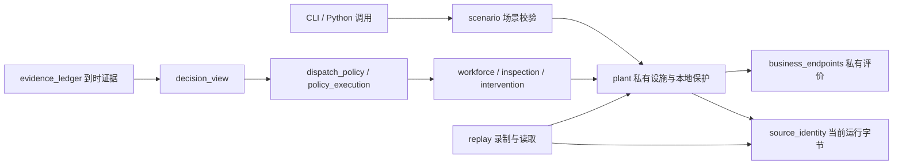

# 工作区地图

本页是代码和文件导航；研究状态仍以 [MAINLINE](MAINLINE.md)、[progress.json](mainline/progress.json)和票面为准。维护记录见 [2026-11-12 整理](maintenance/20261112-workspace/README.md)。

11.12 更新：PR #3 已合入当前39c分支；研究已切换为 [R0–R6 review 主线](mainline/review-gated/plan.md)，当前只等待 R0 review。下面的代码资产导航仍适用，历史票不再自动驱动执行。

## 从哪里进入

| 目的 | 入口 |
|---|---|
| 了解当前研究、证据边界和下一步提议 | [R0–R6 新主线提案](mainline/review-gated/plan.md) |
| 查看当前主线状态 | `python -m aegis_dc status`；安装后也可用 `aegis-dc status` |
| 看完整设施的场景契约 | `src/aegis_dc/scenario.py`、`configs/full-facility-mainline-reserve-v6.json` |
| 修改设施行为 | `src/aegis_dc/plant.py` 与对应物理模块 |
| 修改证据或调度 | `evidence_ledger.py` → `decision_view.py` → `dispatch_policy.py` / `policy_execution.py` |
| 修改录制、读取、精确重放 | `replay.py`、`replay_format.py`、`source_identity.py` |
| 查看现有工具 | [scripts 导航](../scripts/README.md) |
| 复核旧研究 | [证据入口](../evidence/README.md)、[原比较范围](mainline/preset-study-scope.json)及各原协议 |

安装、数值计算和测试使用远端资源，具体见[计算与存储规则](agents/compute-storage.md)。下文文件路径相对仓库根目录。

## 当前实现如何连接

实际状态留在设施／评估器，调度只获取可用证据。图表示软件职责，不表示现场标定或策略收益已成立。

| 代码组 | 主要模块 | 修改时需要保留的契约 |
|---|---|---|
| 设施与物理 | `plant`, `power`, `reserve`, `heat_transfer`, `thermodynamics`, `environment`, `local_control` | 八域耦合、守恒、量纲、外生需求、本地保护 |
| 场景和数值范围 | `scenario`, `runtime_contract`, `parameter_domain`, `time_coordinates`, `water_envelope` | 显式有效域、有限步长资格、域外拒绝 |
| 证据与推断 | `evidence_ledger`, `evidence_projection`, `sensor_channels`, `nonfixed_evidence`, `belief`, `condition_assessment` | 到达时刻、共享来源、缺测与真值隔离 |
| 决策与执行 | `dispatch_policy`, `policy_execution`, `policy_budget`, `problem_tasks`, `problem_actions`, `workforce`, `workforce_dispatch`, `inspection_execution`, `intervention_execution` | 资格／许可／资源和预算约束，检查与处置分开 |
| 关闭与业务评价 | `problem_closure`, `verified_closure`, `instance_reviews`, `instance_false_alarm`, `business_endpoints`, `diagnostic_endpoints`, `temporal_endpoints`, `cost_endpoints`, `cost_attribution`, `composite_endpoints` | 实例身份、管理接受与物理关闭、删失、实际成本和分母 |
| 保存与重放 | `replay`, `replay_format`, `source_identity` | 原始输入、失败留存、执行字节及解释器一致性 |
| 早期结构／风险方法 | `facility`, `risk`, `risk_scenarios`, `risk_baseline`, `action_value`, `lookahead_policy`, `risk_condition_policy` | 各自声明的合成范围；不能自动当作完整设施效果 |

## 哪些目录可以动

| 目录 | 用途与处置 |
|---|---|
| `src/aegis_dc/` | 当前实现。通过公共接口回归后做行为保持的重构。 |
| `src/patrol_rsi/` | 会前基线及兼容命令，仍有测试和研究调用；`contracts.py` 还被当前实现使用。保留。 |
| `tests/`、`configs/` | 接口测试、冻结输入、版本化场景。相近的 fixture 可能对应不同失败或协议，逐项核对后才能改变。 |
| `scripts/` | 维护、工程切片、报告生成、冻结研究脚本混合。使用索引定位，原路径保留。 |
| `evidence/` | 工程原件、研究原件、失败及交付记录。当前规范下不是可清空的缓存。 |
| `docs/mainline/`、`.scratch/full-facility-mainline/` | 主线协议、接受记录、状态和依赖票。旧快照按记录时点阅读。 |
| `paper/` | 论文结构、图和冻结／更正阅读版。原报告与新解释分开。 |
| `.work/`、`runs/`、`outputs/` | 忽略目录可能含唯一输入和私有输出，不能因 Git 不跟踪而整目录删除。 |
| `docs/reports/` | 两份本地未跟踪导师报告／生成脚本，本轮保留；不自动纳入公开交付。 |
| `__pycache__`、`.pyc`、`.pyo` | 自动运行缓存，不属于交付清单；本轮未把它们当作证据或纳入哈希。 |

## 分支与查找

维护开始时，GitHub `main` 在 `42252bf8`；当时最新 39c 分支为 `donson/mainline-39c-endpoints` 的 `add83364`，领先 main 166 个提交。维护分支已通过 PR #3 合入当前39c，合并提交 `4a9dfdbe`。维护通过不接受旧整项研究；旧进度已存入[历史快照](mainline/history/20261112-before-reset/README.md)，新主线接受条件由 R0–R6 确定。没有自动合入 main。

另一个聊天仍使用 `mainline23-intervention/Renly` 工作树。即使其分支提交已经发布，也不应删除仍作为聊天工作目录的路径。

常用只读查找：`rg --files src/aegis_dc` 查模块；`rg -n '函数名' src tests scripts` 查调用；`rg -n '脚本名' docs evidence .scratch` 查协议绑定。是否“无用”必须同时检查调用、命令入口与原件清单。
