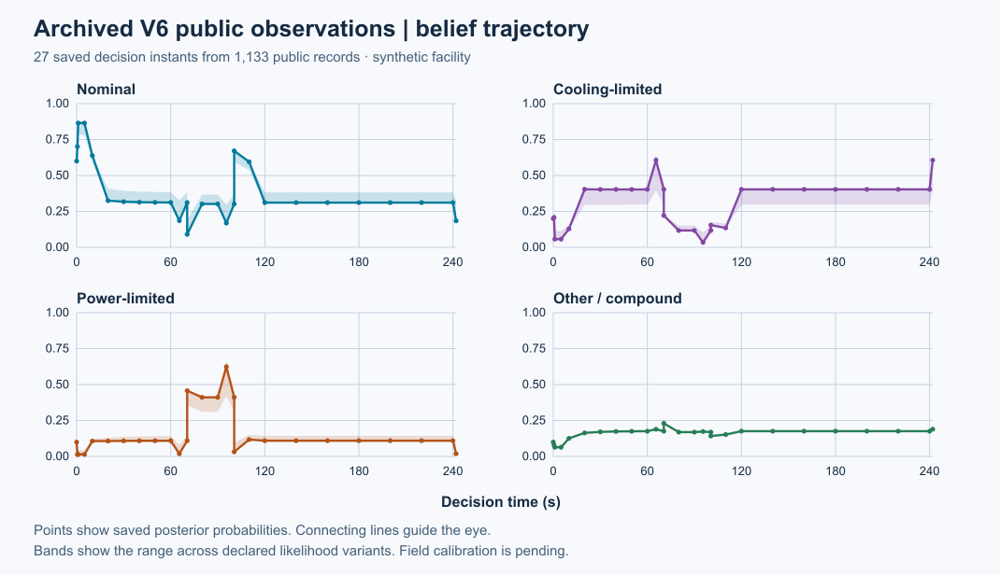
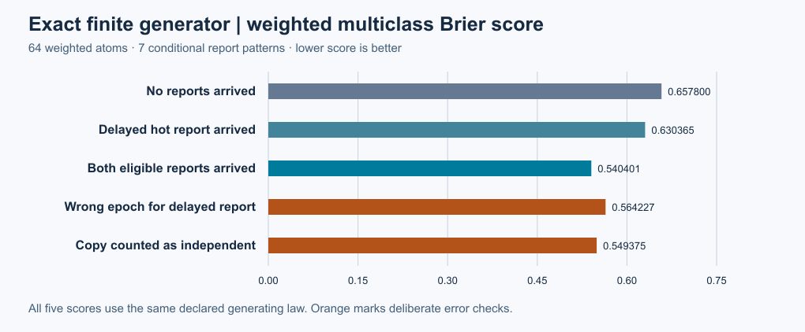
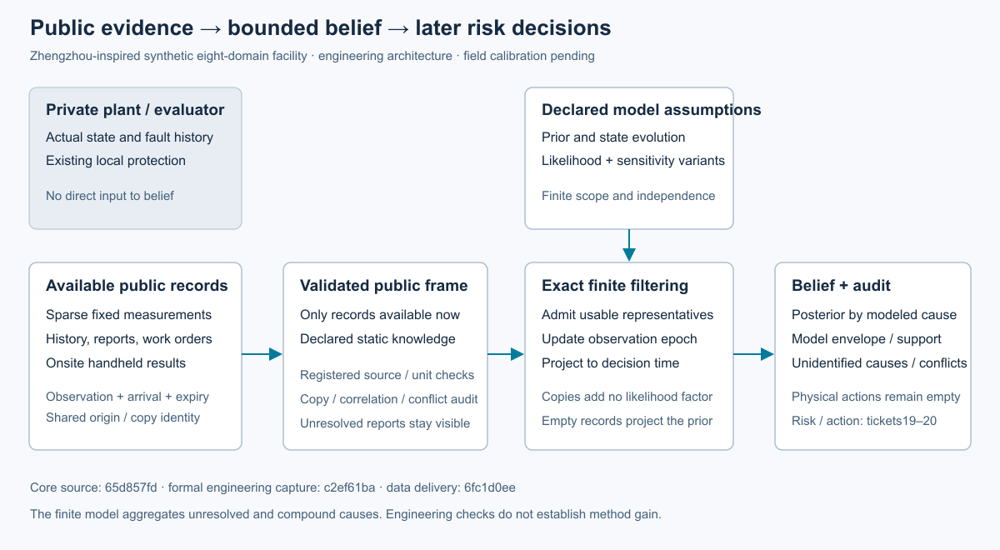

# 第18项：验收图表与复算入口

第18项已由根接受。实际集成执行源`49a40b760e6bab1a89c884e3ef466a45337a5e26`的434项测试全部执行，零失败、零错误、零跳过；599项独立断言通过。原始数据图、架构图、完整日志和两轴评审保存在[根验收包](../../evidence/mainline/engineering/18-root-acceptance/README.md)，根接受权威为[18-root.json](evidence/18-root.json)。

## 当前复算命令

在包含本页的新检出中使用：

```powershell
python -B -X utf8 scripts/verify_belief_root_delivery.py --delivery-commit <当前检出的完整提交SHA> --output <检出目录之外的新JSON路径>
```

此命令核对16个根产物、147份ZIP成员、10份作者捕获原件、229个已执行源文件的Git身份，以及图像、接受权威和阶段状态。不重新执行推断、全量回归或物理仿真。它接受13个明确旧配置路径的精确Git文本检出换行转换；其余字节差异仍失败。

原验收包提交`c3ed98b1`中的`verify_packet.py`在Windows新检出中因旧配置的LF/CRLF形式不同而失败。该脚本、包收据和首次失败记录保持原样；当前核验器是独立的更正交付。见[精确分类与原失败](evidence/18-delivery-correction.json)、[独立修正复核](evidence/18-delivery-review.json)及[新检出通过证明](evidence/18-root-delivery.json)。原包内的旧核验命令仅属于该封存版本。

## 数据解释







7组精确条件概率只校验独立声明的64原子生成法则；1,133条公开V6记录的27个时点用于接口衔接。四个潜在类别聚合排热/供电原因，保留未识别和复合原因；其敏感性包络不是统计置信区间。两类检查不证明全设施风险校准或巡检收益。当前主票19继续建立时间窗、风险情景及后果，第21票独立扩展人员执行约束；M3与完整研究目标仍在进行。
