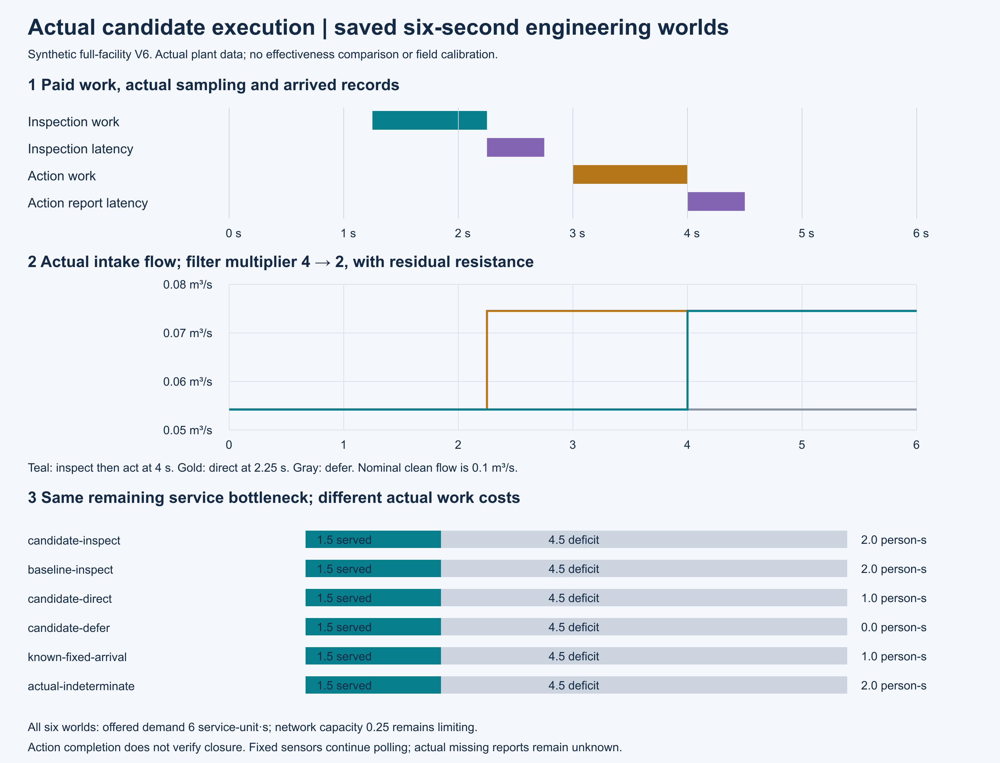
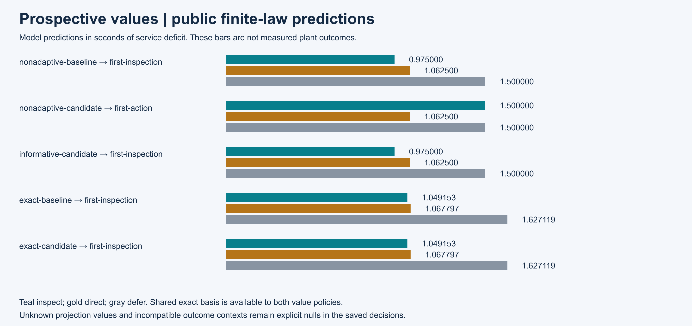
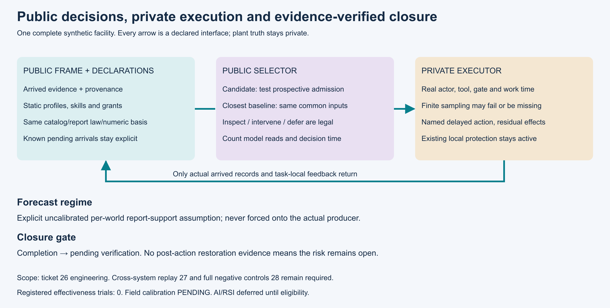

# 第26项已接受：证据一致的检查与处置候选

2026-11-07。第26项在声明的有限工程范围内接受。实际集成源 `443747aea866d35376dad51a186994bb963eb7f5` 完成564项回归，全部执行，零失败、零错误、零跳过；278份源码身份和20份历史原件通过核验。根证据包提交 `3a688d151fcae59b56393c113589d364de769143` 已在新的干净检出中通过保存交付复核。

权威状态见[26-root.json](evidence/26-root.json)，[干净交付证明](evidence/26-root-delivery.json)记录确切版本和检查范围。原[根证据包](../../evidence/mainline/engineering/26-root-acceptance/README.md)保留封包时的“待干净交付”状态与字节，随后接受由本页和权威记录确认，没有重写原件。

冻结V2执行源 `35193647`、数据交付 `53f09ff4` 保存10次独立公开选择、6次各6秒的设施运行和21个预定在线决策。候选与最近透明基线的成对输入仅改变策略名称。固定测点持续轮询，手持检查实际用时后采样，2.25秒观察的结果到2.75秒才可用于决策；处置4秒完成、4.5秒反馈到达。

清理使滤阻倍数4降至2，流量平方从1/340升至1/180，残余阻力仍在。真实网络容量0.25继续限制服务：六个工况需求均6、交付1.5、缺额4.5。直接处置、暂缓和检查后处置分别保留1、0、2人秒的实际工作账；没有从流量上升推断服务恢复。

候选只检验一个机制：预期检查报告能否进入当前声明的证据更新规则。它保留原报告概率、损失模型、异质人员和执行约束，允许检查、直接处置和暂缓。共享精确数值口径同时提供给两种价值策略。未知的未来记录或不兼容的结果分布保持未建模；“可进入更新”不等于信息一定有用。实际测量不适用时，原记录仍为缺失和未确认。

三张PNG已实际渲染并逐张观看。14份最终正向两轴审阅记录连同原发现和修订均封存。根完整回归共两次尝试：首次工具中断、未形成完整结果，18个已产生的夹具目录保存；第二次在同一源码的新目录完成564项回归。开发阶段另有30个调用目录、1个未确认结果和26项历史输入／工具来源缺口，均按原范围保留。

这项接受证明有限模型中的选择与执行接口及证据记录成立，尚未证明候选优越性或现场效果。第27项跨系统闭环、第28项完整负例仍待完成；M4及42票完整研究目标继续进行。研究效果试验在30冻结协议后开始，AI/RSI须经过38资格门槛，现场标定仍为PENDING。
