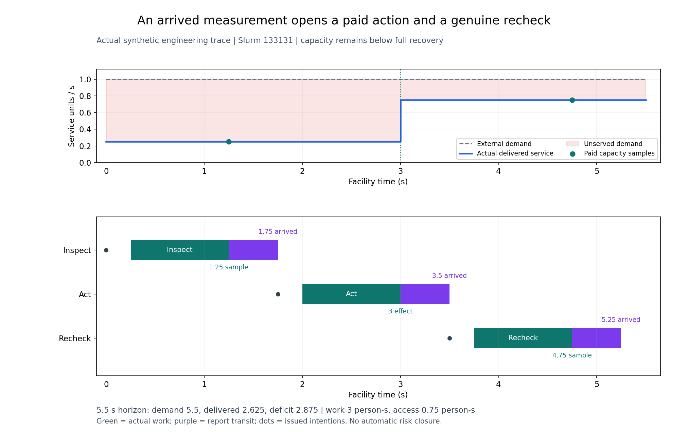
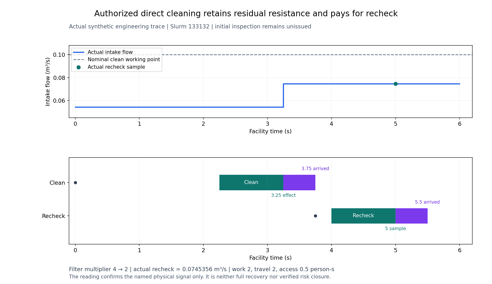
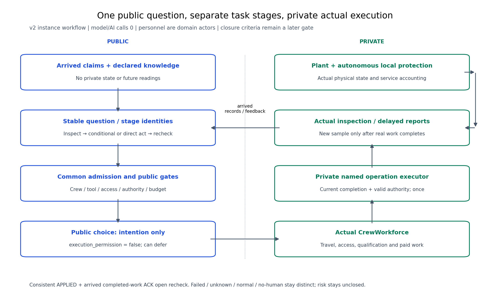

# 多系统动态检查与处置：39b验收

**到时工单现在能够生成专业检查、条件处置及后续复查；39b已按有限合成工程范围接受。** 服务器执行609项完整回归，零失败、错误或跳过，20份历史原件保持；独立Spec与Standards发现均关闭。随后一次新Git核验确认406件交付、2,208项源码身份及52份私有完整轨迹一致。

|导师关心的问题|现在的实际行为|证据边界|
|---|---|---|
|有线索后去查什么|到时工单形成独立问题/任务；冷却、供电和IT按专业、工具及共同服务上下文生成检查|共同服务路径是声明知识，风险概率未知仍为空|
|检查后能做什么|网络先测0.25，授权残余恢复到0.75，再派实际复查|实际效果不是名义完全修复，不自动关闭风险|
|是否一定先检查|允许直接清滤、暂缓和不派人工；正常或未知测量不触发条件处置|各选择的工时、工具、移动、门禁与费用分开记录|
|多人和多条线索是否真的有约束|同源副本不重复派工，新工单有新身份，共享表计占用会限制另一任务|选择只看已到达证据，隐藏状态不能绕过资质、授权或保护|
|完成回执是否可信|拒绝矛盾APPLIED；行动回执先到时等待匹配人员完成ACK|授权在完成瞬间过期时无效果，也不派成功后复查|

网络工况在5.5秒内需求5.5服务单位秒，实际交付2.625、缺额2.875；工作3人秒、门禁0.75人秒。初查1.25秒采样、1.75秒到达；处置3秒生效，复查4.75秒采样、5.25秒到达。这是一条可复算的执行轨迹，方法间收益尚需后续新协议比较。

直接清滤将阻力倍率4降到2，复查流量0.0745356m³/s，低于该工作点的名义0.1。初查未发出，仍计移动2、工作2、门禁0.5人秒。

人员是专业作业者；决策器使用公开记录，执行器依实际人员、工具、路径、访问、授权与本地保护检查可行性。真实状态仅留给设施和评价器。复查报告与处置成功均不自动等于证据核验关闭。

|验证记录|实际结果|
|---|---|
|根回归133145，源4f80bb35|609/609执行，零失败/错误/跳过，20原件、源码前后守卫通过|
|新Git核验133146，交付dfa7ab52|406文件、2,208源码核对、377当前执行文件、340原收据、24私有输入、52完整轨迹文件；PASS|
|开发记账|17设施接口调用、13完成时间窗、43返回决策、6直接公开选择；内部选择调用未插桩，根回归另列|
|保留的失败|输入133111、08完整运行后的断言失败、首次根回归133143、原审查发现、图形排版失败和输入传输失败均保留|

[权威验收](evidence/39b-root.json) · [新Git交付证明](evidence/39b-delivery.json) · [原始开发记录与CSV](../../evidence/mainline/engineering/39b-development/README.md) · [根回归原件](../../evidence/mainline/engineering/39b-root-acceptance/README.md)。这些页面中的“待验收”是各自封存时点的历史状态，以本页和权威记录为当前结论。

**下一项39c补业务端点与验证关闭，随后39d核查人员/设备时间尺度和新数值范围。** 原180次研究及NO_PRACTICAL_GAIN保持，现场标定pending，AI/RSI效果未测；原39新比较和40–42尚未完成，总目标保持active。
