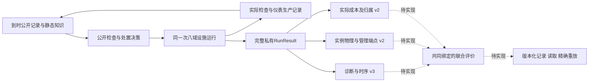

# 39c下一步：同一次运行的联合评价及重放

设计衔接记录，不是新调用预算或39c验收。原180次、失败和NO_PRACTICAL_GAIN保持。当前实例端点源8131aae0，原生审查接纳源cf7，成本源0ac5；固定版本见各协议。

## 已完成的前置

|实际有限结果|证据|
|---|---|
|原生v5接纳公开实例审查v2，旧v4及实际producer守卫保留。旧q0自身5.5秒关闭，新q1管理5.75秒接受。49失败及50输入修正分开。|[50](../../evidence/mainline/engineering/39c-development/slice-50/README.md)|
|私有实例评价v2接通完整公开assessment、自身行动／复检及报告、首次当前管理状态与另列历史记录。|[51](../../evidence/mainline/engineering/39c-development/slice-51/README.md)|
|接受后过期、无中间决策的历史接受、升级优先及实际测点支持的误报审查四例通过。历史有效不冒充实际首次选中。|[52](../../evidence/mainline/engineering/39c-development/slice-52/README.md)|
|时序／删失剩余资格、整体及逐任务实耗、失败和共享队列归属、声明边界已通过；数据图已查看。|[成本报告](39c-cost-checkpoint-20261110.md)|

当前开发捕获89进入、41完成窗口139.25秒、172返回，直接公开选择38，内部嵌套未仪器化。以上不是整票接受；云端回归另计。

## 下一个竖切片

1. 明确私有诊断v3与原生v5组合。diagnostic_endpoints.py底层只接v4；temporal_endpoints.py将v3降为诊断v2验证。放开新版组合时保留老诊断v1/v2限制。
2. 冻结闭合的联合私有程序：诊断v3、实例关闭v2、成本v2从同一实际RunResult计算。固定设施、scenario、完整dispatch及生产者声明／realizations、boundary、步长／窗口、源码。公开派工不接收该私有程序；所有组件身份与共同绑定一致，禁止拼接工况。
3. 首个联合例取得实际检查／处置／自己的复检、条件及服务样本、诊断／时序、成本和管理记录。时标先按输入手算冻结；可增加处置前真实固定测点以观察异常，不能按事后好记录挑机会分母。
4. 联合资格明确验证正的实际行走与异步集合等待、无人／服务证据不合格、同对象新实例不借旧证据。50同次成本原件观察到行走2人秒，但联合断言仍待补；rendezvous正分支尚未资格化。

红终态前不开发绿实现。失败及部分完成工况保留，修正另冻协议／输入和唯一目录。完整轨迹留私有服务器，只回传必要结果、图表与摘要。

## 记录、读取与精确重放

save_run已经保存inputs.business_program和business_evaluation，无需另拼输出。现有replay输入／attempt／declaration只有v1/v2；文档13的v3是reader修正。按真实格式新增闭合业务字段与转发，旧版仍拒绝注入字段。reader绑定冻结输入、run.inputs、组件身份、设施／窗口／源码。COMPLETED只表示重执行结束，还须独立比较语义。

只允许预先声明的非确定墙钟计时**数值路径**变化，保留字段存在/null、非负整数类型、状态／覆盖／计数。每份结果先核对原始audit副本与自身聚合和，再比较其余值。现有成本根C为run.business_evaluation；联合版须另冻精确根路径：

- run.policy_computation_audit[*].elapsed_ns
- run.policy_computation_audit[*].condition_assessment_elapsed_ns
- C.computation.audit_record_details[*].elapsed_ns
- C.computation.audit_record_details[*].condition_assessment_elapsed_ns
- C.computation.selector_elapsed_ns.value
- C.computation.condition_assessment_elapsed_ns.value

物理成本、费用、任务状态、确认时刻与模型计数严格比较，原文件哈希完整保留。[固定40e只读缺口复核](evidence/39c-joint-gap-review-20261110.md)保留原判断。

## 已复核的接口与版本选择

以下为下一片设计，尚未冻结或执行。联合程序拟将组件键固定为diagnostic、instance_closure、costs，分别只接诊断v3、实例端点v2、成本v2；拒绝未知／递归组件。共同绑定scenario、boundary和完整dispatch的规范JSON哈希，以及实际duration／maximum_step。验证层检查共同声明，再让每组件验证自己的公开profile／producer绑定；结果从同一RunResult一次性提取，保留每组件的完整原件和运行身份。

plant在验证business_program前已经得到有效duration与step，因此可显式传入实际maximum_step供共同绑定验证。私有诊断v3的底层验证需显式允许native-v5，同时保持旧诊断v1/v2的native-v4组合，避免无意放开旧输入。

2026-11-10直接复核replay.py的_inputs、执行转发与reader，以及replay_format.py：新增含dispatch_program和business_program的闭合输入v3即可表达业务记录；现有attempt/declaration-v2已经完整保存inputs及原件角色，**若不改变封套字段／文件角色，无需新造attempt/declaration版本**。实现时逐项复核origin/source/lifecycle守卫，不能简单扩schema集合，因为部分守卫以endswith-v2判断。旧输入v1/v2继续拒绝额外业务字段；输入v3读取同时核对run.inputs及组件共同绑定。

图中现有三个评价器分别可用；联合程序及业务输入重放仍为待实现接口。管理接受／升级／误报审查不回写私有物理真值，不自动改变诊断机会分母。

联合及重放资格完成后，再做整39c独立Spec／Standards、零跳过根回归、原件身份与fresh；之后39d验证时间比例、尺度／参数敏感性及新数值范围，再进原39AI协议和40–42。4090已经实际CUDA资格，可支持后续合适工作，不新增模型预算。
