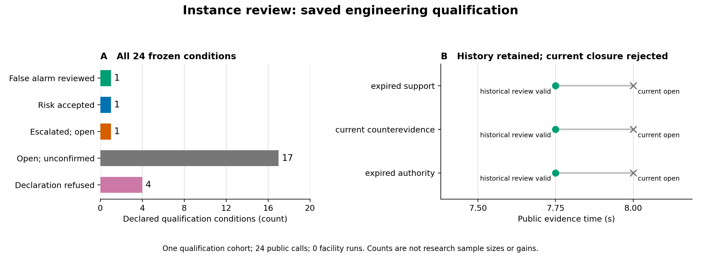
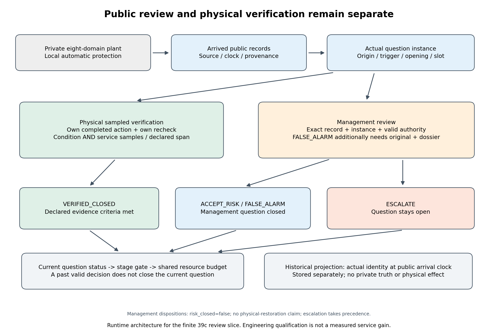

# 39c阅读检查点：问题实例、审查证据与关闭

2026年11月10日。依据[会后决策](../meetings/2026-11-03-research-reset.md)及[用户审阅采纳表](../reviews/20261109-user-review/response.md)。

本轮完成了问题实例的管理审查及24个证据资格条件：旧问题的关闭记录不能借给新问题，接受风险、升级和证据支持的误报审查分别处理。**39c仍在开发；原180次研究与`NO_PRACTICAL_GAIN`保持，AI／RSI效果未测，现场标定待完成。**

## 与导师要求的对应关系

|导师关心的问题|当前已有成果|仍需补齐|
|---|---|---|
|是否保留完整设施、多系统耦合？|同一个八域合成设施；物理、功能、控制信息及访问关系共用实体身份。01–38跨阶段审计已接受其有限覆盖。|参数来源与现场校准仍有明确缺口。|
|能否因新问题生成检查、处置和复检？|39b已完成动态问题与任务接口；39c区分同类设备上的不同问题实例，并验证实例自己的行动与复检。|将完整业务端点接入联合重放。|
|什么时候可以说问题关闭？|物理核验要求自己的处置、复检及条件／服务样本；管理审查要求精确实例、来源、授权和证据时标。|完整端点覆盖、整项独立复核、零跳过根验收及fresh交付。|
|检查是否有实际业务价值？|原180次比较已报告服务、人工和主要负结果；39c已开发诊断机会和关闭端点。|提前量、删失、实际成本及有意义时间尺度的联合评价；之后进入39d。|

原主要确认包含16个配对工况，候选平均减少服务缺额0.03515625秒，未达0.25秒门槛。详见[会后研究报告](../../paper/mainline-report-20261108/report.md)。本页新增的是工程资格证据，没有追加原研究样本。

## 实际数据：24个条件如何判定

|实际结果|条件数|含义|
|---|---:|---|
|证据支持的误报审查|1|原始疑点与当前实例一致，条件及服务证据在审查当时和当前均合格。|
|接受风险|1|有适用授权，结束该实例的管理流程；不声明物理风险消失。|
|升级处理|1|升级优先，问题继续开放。|
|保持未确认|17|证据缺失、迟到、过期、同源、复制、争议或授权不合格等情形不能关闭。|
|拒绝输入声明|4|越权绑定、重复记录、空理由或重复支持证据被明确拒绝。|
|**合计**|**24**|1项资格测试内24次公开选择；零设施运行。|

全部条件符合冻结预期，零失败、错误或跳过。三种情形特别保留“过去有效、当前不关闭”的区别：支持证据过期、出现新的反证、授权过期。记录在7.75秒到达时有效，当前8秒的问题保持开放；历史记录没有被抹去，也不能替代当前判断。逐条件结果见[摘要](../../evidence/mainline/engineering/39c-development/slice-33/conditions.json)及[冻结协议33](39c-instance-review-qualification-protocol-33.json)。这些计数用于核验边界，不是独立研究样本、检测准确率或服务收益。

## 架构：物理核验与管理流程怎样衔接

调度者只接收已经到达的公开记录和声明的静态知识。每个问题携带自身来源、触发记录、打开时间及实例身份；设施真值和本地自动保护留在设施侧。

物理核验检查本实例自己的行动／复检，以及条件和服务样本。管理流程分别处理接受风险、升级及有证据支持的误报审查；它们始终保持`risk_closed=false`，不生成物理恢复声明。误报审查还要核对原始疑点，并分别检查审查观察时刻和当前时刻的证据。历史投影只使用当时已打开的实际实例，不重造旧身份。

## 修正和失败记录

|发现|修正与核验|保留的原件|
|---|---|---|
|历史重放可从旧线索造出同号问题，借用旧审查。|协议30红／绿；绑定实际打开时间和身份。|红测、输入及独立Spec发现。|
|多个问题同时打开时，历史投影可能漏掉前一实例并报错。|协议32红／绿；保留已打开的实际实例前缀。|原错误及相同输入的修正结果。|
|runner33失败分支会把已知越界调用改记为零。|新runner35保留已知值、未知值记为null；三个纯工具夹具通过。|runner33、原成功33、静态发现及三个预期失败回执。|
|首版架构图箭头压住注释。|协议36仅调整版式，两张PNG均已查看。|首版34及其输出哈希。|

有限Spec复核通过；Standards原有1项记账发现，已用新源码、独立静态复核及远端夹具关闭。详见[reviews-10](../../evidence/mainline/engineering/39c-development/reviews-10)。本轮没有重跑原180次、已完成的物理资格或旧CI。

## 进度和下一步

协议20–33的原始执行账共16份唯一终态回执，实际执行15项测试、进入38次公开选择；其中含预期红测，全部保留。23在加载测试前失败，21在Slurm开始前取消，22／29在预检停止。后补的工具夹具35与保存数据绘图34／36单独记账。39c原有37次设施接口进入、17个完成窗口、72.5秒和81次返回决策均未增加；内部嵌套选择次数仍未插桩。见[执行账](../../evidence/mainline/engineering/39c-development/instance-review-execution-ledger.json)。

下一步按依赖顺序补提前量与删失、实际成本及联合版本化重放，再做39c整项复核、零跳过根验收和fresh交付。39d及原39–42保持前置依赖；本检查点不关闭总研究目标。
