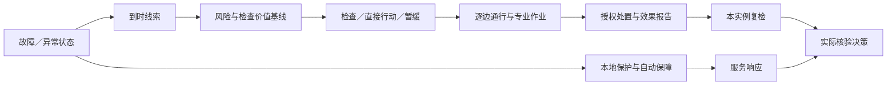

# 时间轴基础：先明确时钟，再解释提前量与关闭

本页是提前交付的最小时间基础，供用户审查；不是39d参数敏感性或新数值域验收。未新跑设施，未给现场时间作标定。

## 一条时间轴有两条并行响应链

|时钟|定义与约束|不能替代什么|
|---|---|---|
|t_fault|声明故障发生或首次观察到的异常状态；起点已存在须标左删失|初始异常不能充当已观察到的故障起始时刻|
|t_protection|本地保护／控制的真实触发、切换开始及完成分别记时|服务恢复时刻不等于保护命令触发时刻|
|t_available|线索实际到达决策者；保留原观测时刻和有效期|报障、读数到达不等于诊断或恢复|
|t_dispatch|实际决策时刻；受证据、风险／检查价值和资源限制|排队等待不能算成已经出发|
|t_arrive|逐边行走＋逐边门禁＋资源等待／团队集合；由实际轨迹给出|只看路径长度或每人只算一次门禁会漏成本|
|t_measure／t_report|作业完成／采样，与报告到达分开|采样发生不能代替决策者已收到结果|
|t_action|授权处置开始、完成及残余效果报告；允许直接行动或暂缓|检查改变信息，处置才改变物理状态|
|t_recheck|本实例自己的复检完成、报告到达及服务证据|不能借旧实例的检查关闭新问题|
|t_verified|第一条满足核验条件的实际决策；管理接受／升级另记|报告到达后尚未决策，不提前宣布已核验关闭|

本地保护可先于人员到场恢复服务。专业响应可选择检查后行动、直接行动或暂缓，不能把它们强制串成同一条线。

## 必须分开的三个时间配置

|配置|窗口／作业／路径|意义及来源|
|---|---|---|
|V6默认合成参数|600秒窗口、30秒作业、60／120秒路段、30秒柴油启动|configs/full-facility-mainline-reserve-v6.json；均非现场实测|
|原180次预设策略比较|10秒窗、1秒作业、1／2秒路径；其他过程按各冻结工况|原30协议和F2审计，不能按一个统一倍率换算成现场时间|
|39c联合工程工况|6／7秒窗、1秒作业、1／2秒路径、每边门禁0.25秒、回传0.5秒|原53／54输入和保存轨迹；是短时工程资格，不是现场响应时程|

此外，既有风险／价值算术基线只有2秒预测窗，检查0.625秒、处置0.5秒。它与默认作业30秒不对齐；只计作业时间，默认检查就已超过该风险窗15倍。不能把这个算例直接接作默认设施的操作性价值排序。

已知的无量纲比例：默认路段／作业＝2或4；压缩比较为1或2；默认柴油启动／作业＝1。风险窗与人员响应、故障演化的比例仍需统一定义。完整到场／检查时间还含门禁、排队、团队集合及回传。

数值时钟另列：现有全场运行显式使用最大步长0.01秒，M2只在各自有限见证／阶梯中接受；配置里的step_time默认值不等于所有新时程都已验证。新窗口、人员比例或备用过程变化的数值资格仍由39d后续完成。

## 保存数据给出的实际例子

|工程例|已知实际节点／秒|解释|
|---|---|---|
|27闭环|服务自动恢复4，清滤完成6，证据到达并核验8.5|说明自动保障与人员链并行；不把4秒当作保护指令起点。[原件](27-root-acceptance.md)|
|53单人|流量异常初始已存在；公开确认0.5，行动完成3.25／报告3.75，复检5／报告5.5，实际核验5.5|故障起点左删失；窗口内无服务损失，不推出预防收益|
|54双人，55纠正|控制人员经两边到场3.5，行动4.5／报告5，复检6.25／报告6.75，下一实际决策7才关闭|每边门禁合计1人秒，集合等待1.25人秒；原错误预期及FAILED保留|

响应／受损时限、备用持续／人工恢复、采样周期／故障演化、决策间隔／报告时延等关键比值，都必须有明确分子和分母；受损时刻未观察或过程未建模时填null／删失，不填0或凭短窗宣布来得及。

## 交给用户决定的下一步

选择下一项真实风险问题、工作时窗、人员／设备时间依据和可接受假设后，再扩展动态风险及检查价值；39d后半段负责敏感性、守恒／步长与新数值范围。本页前移为39c剩余时序解释的前置，不等待录制机器完善，也不自动启动新试验。
