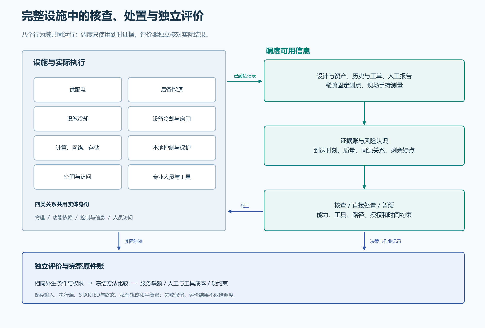
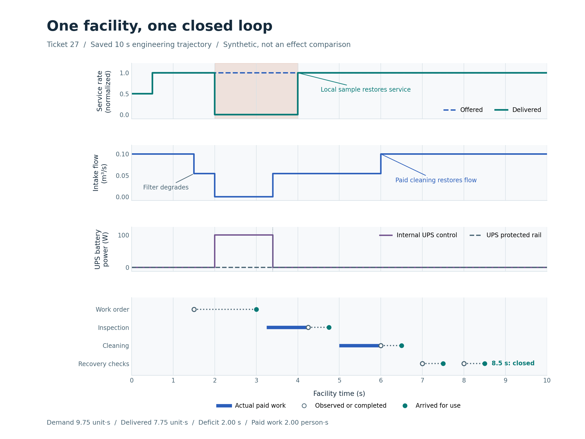
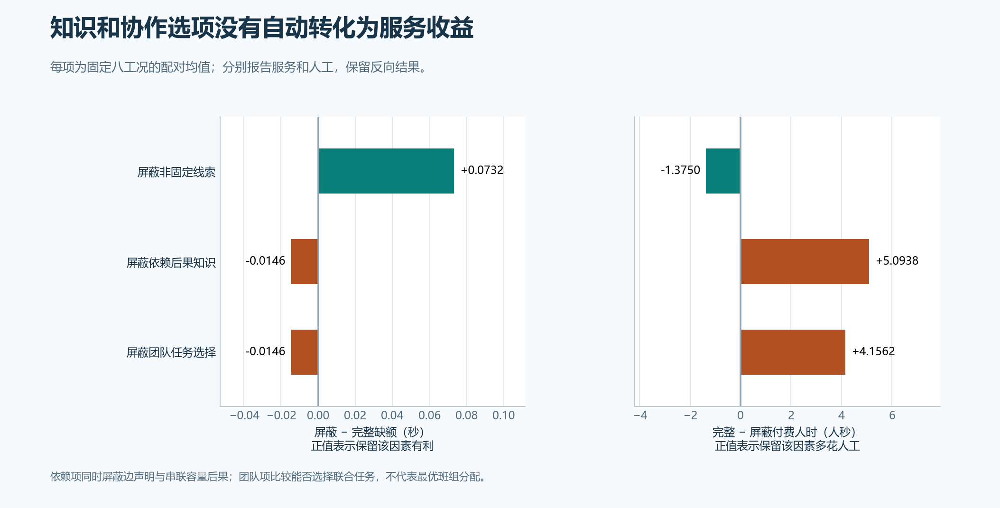

# 第35项阶段成果：完整设施闭环已建立，候选服务收益未达门槛

2026年11月8日。01–35已接受，按用户要求先在此处收尾、复核方向。**第36项尚未启动，36–42和完整研究目标未完成。**

**[下载离线阅读HTML（9张图、4份CSV）](../../evidence/mainline/research/checkpoint35/AegisDC-35-阶段研究成果.html)**。下载后用浏览器打开，全部图表和CSV内嵌，无需联网；手机和大屏均可阅读，图表可放大，提供SVG下载和打印入口。

## 与最初目标的对应

研究仍围绕同一座郑州工程参照的**合成设施**：在固定测点覆盖有限时，结合跨系统依赖、资产与历史、人工报告、工单及现场测量，安排有资质、工具和时间约束的核查与处置，评价服务保障和运维代价。

| 原目标 | 已取得的证据 | 当前边界 |
|---|---|---|
| 完整设施的跨系统运行 | 八个行为域，物理、功能、控制/信息、访问四类关系共用实体；数值与守恒见证 | 显式合成工作点，现场参数仍待标定 |
| 多源证据驱动检查 | 真实状态私有，决策只接收当前可用证据；复制、陈旧、缺测单列 | 尚未证明更广参数域的效果 |
| 异质人员核查、处置、恢复核验 | 实际移动、会合、资格、工具、授权、延迟及残余作用；处置完成与证据关闭分开 | 有限工程正/负例通过，不等于方法收益 |
| 独立机制评价 | 先冻结协议，完成开发、独立确认、机制消融；保存原件和失败 | 主确认未达到最低实际收益门槛 |
| 智能体和RSI增量 | 保留第38项资格门槛 | 本轮未调用LLM、未训练，未建立AI/RSI收益 |

[可编辑矢量架构](../../evidence/mainline/research/checkpoint35/figures/35-facility-and-evaluation-architecture.svg) · [原目标与阶段门槛](../MAINLINE.md) · [当前进度](progress.json)

## 闭环已经能运行

同场工程见证中，服务在4秒由自动机制恢复，人工清滤在6秒完成，恢复证据在8.5秒到达后才关闭风险。它说明系统能执行“证据—作业—实际作用—复查关闭”，没有把一次工程见证算作效果试验。

[完整闭环原件、原失败和重放](../../evidence/mainline/engineering/27-root-acceptance/README.md)

## 主要独立确认：NO_PRACTICAL_GAIN

16个封存工况各运行六种方法，共96次。固定主配对是“证据一致候选”相对“一步观察前瞻”；平均服务缺额减少 **0.03515625秒**，未达到预定 **0.25秒**门槛。平均人工减少 **0.96875人秒**、行走减少0.25人秒、工具占用减少0.609375工具秒，分别报告。

12个工况在共享公共信息及历史下出现首次不同选择，覆盖3个工况族；本批实际硬约束检查未发现违规。网络族的主配对平均改善为−0.1875秒，误导报告族为+0.328125秒，另外两族为零。方法确实做出了不同选择，平均服务收益仍不足。

候选与“仅自动保护”的平均服务缺额均为3.8125秒，候选额外使用1.40625人秒。这是各族相反效果抵消后的均值，逐工况并不相同。独立比较单位是16个工况；96条方法轨迹和逐时状态点不能增加独立样本数。

[六方法、分族和完整配对数据](../../evidence/mainline/research/34-paired-analysis/README.md) · [96次原始运行](../../evidence/mainline/research/33-confirmation/README.md)

## 机制消融：线索有作用，当前依赖与团队选项用法仍有限

8个独立封存工况各运行四个规划视图，共32次。真实设施、外生输入、人员能力和执行安全规则保持一致，只屏蔽规划者获得的因素。

| 保留因素的作用 | 平均服务缺额减少（秒） | 完整候选相对屏蔽臂多付人工（人秒） |
|---|---:|---:|
| 非固定线索 | +0.073242 | −1.37500 |
| 依赖后果知识 | −0.014648 | +5.09375 |
| 团队任务选择 | −0.014648 | +4.15625 |

服务列正值表示保留因素有利；人工列正值表示完整候选花费更多。保留非固定线索在本批减少缺额并节约人工；依赖后果知识与团队选项的当前用法未转化为平均服务改善，还增加人工。依赖消融同时屏蔽边声明和容量后果，团队消融评价多人任务能否被选择；不能据此否定真实设施依赖或专业协作。

[四臂、24个逐工况对比及全部原件](../../evidence/mainline/research/35-ablation/README.md)。本项不调整候选，不改变主确认结论。

## CI、账本和失败保留

本轮累计36次开发、96次确认、32次消融，**164次注册运行、1640秒模拟时间、1640次计划决策**全部完成，无注册失败、自动重试或模型调用。原180次协议中仍有16次稳健性运行未启动。开发平均服务改善为−1/24秒，单列在[第31项数据及两张图](../../evidence/mainline/research/31-development/README.md)，没有混入确认样本。

CI的历史浅检出问题已改为完整检出。准备入口、分析入口、工程检查和审查中发生的原失败及更正分别保留；它们不被隐去，也不混作注册设施试验。原尝试账、冻结输入、执行源、审查包及新检出交付证明均随各票交付。

[31发布记录](evidence/31-publication.json) · [32输入冻结与更正](32-confirmation-freeze.md) · [35权威验收](evidence/35-root.json) · [35新检出证明](evidence/35-root-delivery.json) · [报告来源清单](../../evidence/mainline/research/checkpoint35/source-manifest.json)

## 停在这里检查方向

当前成果是完整设施工程闭环与有限合成工况的可复核机制结果，主确认收益不足。现场校准仍为PENDING，参数域/结构稳健性和最终基线收束尚待36、37；智能体/RSI需经过38资格审计。第36项及后续工作等待用户复核，不为追求正结果追加条件或重用封存结果调参。
