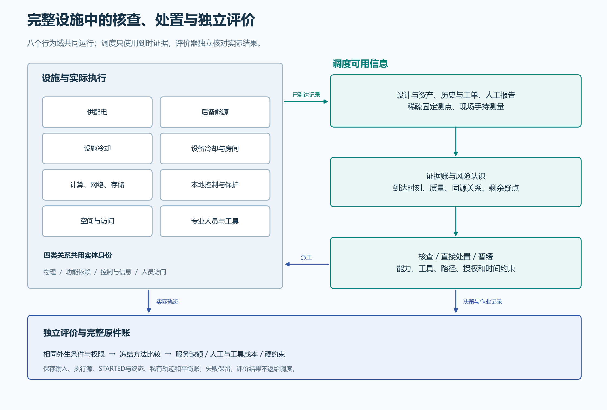

# 会后研究成果：本轮交付与仍需验证的问题

2026年11月8日。按11月3日会后决策，先复核01–35，再完成原定稳健性、报告与智能体进入条件审计。本次在38后收束，供用户与导师判断方向；39–42未完成，总目标不标完成。

**先读[8图研究报告](../../paper/mainline-report-20261108/report.md)，或下载[单文件离线HTML](../../paper/mainline-report-20261108/AegisDC-会后研究报告.html)。** 图表、113项参数和分析数据内嵌于HTML；支持静态响应式布局与打印。本次没有新增浏览器实测记录。

|导师要求|本轮能展示什么|结论与范围|
|---|---|---|
|有问题再查|由到时证据形成风险问题，选检查、直接处置或暂缓|不默认全场固定巡回；比较仍为人工编制的两个任务|
|多系统设施|8个行为域、45个实体、113项参数及4类关系；实际耦合供电、排热、服务与人员执行|合成模型；现场未标定，MV/LV为理想聚合接口|
|稀疏多源信息|历史/资产、人工/工单、固定测点、手持结果；保留时标与共同来源|迟到、过期和盲区显式处理，后台真值不直接给策略|
|风险、检查与处置价值|联合服务后果与有限检查价值演算；授权、资质、工具、工时与残余效果|工程闭环可复算；自动恢复与人工贡献分别记账|
|业务价值可检验|180次原定运行，服务、人工、工具及规则违反分列，保留消融与失效条件|主要候选服务改善未达门槛；误报/漏报、提前预防与正式比较的验证关闭未测|
|AI/RSI后置|修正后的进入条件审计：结构化AI选单可以独立比较|AI效果未测；语言理解、任务发现和RSI过程尚待定义，不判无效|
|方法可追溯|01–35逐票审查、两处修正、冻结版本、全部原件与失败、独立复核和新Git交付核验|不以任务勾选、CI或图表数量代替研究结论|

主要确认是16个独立合成工况、六种方法；96条运行不是96个独立工况。候选相对预定参照的平均服务缺额改善为 **0.03515625秒**，低于 **0.25秒**门槛；平均人工减少 **0.96875人秒**。结论为`NO_PRACTICAL_GAIN`，不是现场效果或总体显著性结论。180次注册运行无失败/重试；工程开发、审查和交付失败另有完整记录，不能据此称整个研究从未失败。

## 复核发现与修正

01–35审计修正了次要指标披露与历史证据复核时标；未定义的误报/漏报等端点继续保留未测，不补成零。原164次结果未改，随后按原协议完成16次稳健性。见[原审计及修正](audits/20261108-pre36/audit-report.md)。

38原提案曾以没有独立语言任务等理由否决AI进入。独立Spec指出，结构化求解器替换本身可以检验；该否决已撤回并保留原记录。现在的[修订判断](38-eligibility-audit-v2.md)允许设计这一窄比较，但并未证明AI收益。Standards轴的来源合规检查也没有代替科学资格判断。

## 下一步的实际边界

第39项保留未运行，需要先冻结单独AI因素、相同信息/工具/权限/动作预算、调用与失败成本，以及新的未见确认条件。原180次预算已经完成，不能用已见结果挑规则后再称独立确认。40依赖39，41/42也尚未验收；本次阅读检查点不替代这些科学门槛。

后续最有用的资料是实际巡检/处置时间、报障真值与可检测机会、复检关闭准则及新的独立工况。取得这些资料后才能扩展当前业务价值评价；现场效果与AI/RSI增量仍是待研究问题。

[38修订与验收](evidence/38-root.json) · [35项逐票矩阵](audits/20261108-pre36/ticket-matrix.md) · [原定16次稳健性](../../evidence/mainline/research/36-robustness/README.md) · [当前进度](progress.json)
