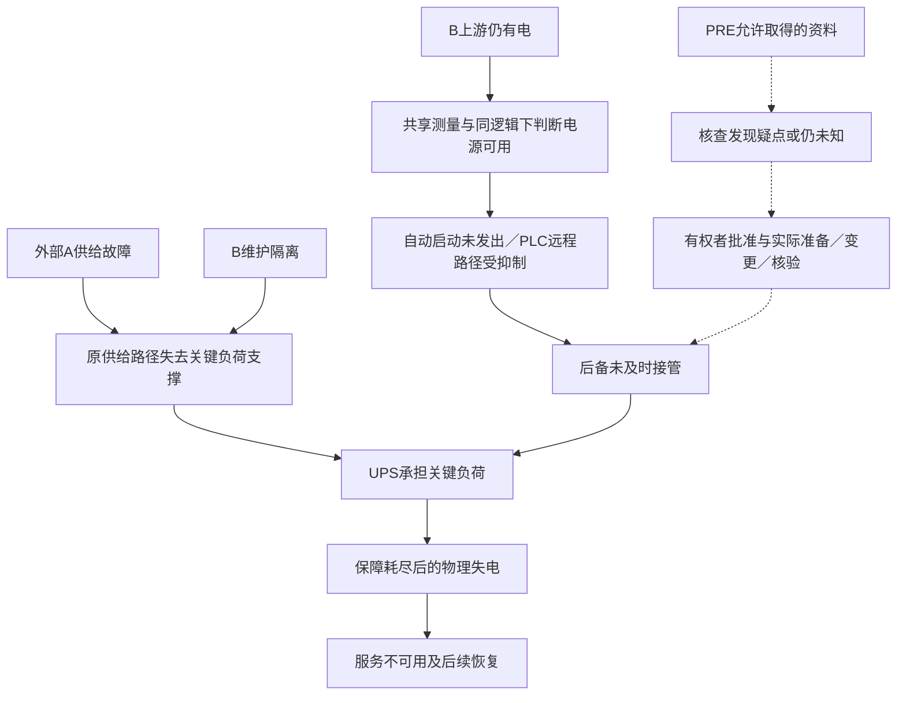

# R1：伦敦事前备用链核查的资料与可识别性

2026-11-12，**资料交付，等待用户 review**。R0 研究方向已接受；本轮只整理来源、决策信息、动作约束、最小因果接口和可识别性。没有模型实现、参数赋值、项目测试、仿真、资格试验或模型调用。R2 未授权。

本包只有三个入口：[来源台账](sources.md)、本页、[结果与完整性回执](result.json)。事实编号 `L01–L09`、`N01–N05` 均在来源台账解释；正文的接口、候选动作和假设分支属于研究设计，不冒充 Google 的实际操作规程。

## 1. R1 得到了什么结论

公开报告支持把“维护状态下，上游有电是否被误当成可向负荷供电”设为首个核查问题。它没有公开足以重建历史核查者信息集、权限及完整行动时间的记录。因此，目前能交付**有来源约束的研究接口与缺口表**；不能判定当时方法一定能发现缺陷、获批修复并在事件前完成，更不能计算历史可避免的损失或 RSI 收益。

首个任务为 **PRE：事前就绪性核查**。RESP：事中响应单独登记，不借用 PRE 的准备期或整改结果。荷兰仅登记两条机制及迁移缺口，不在本轮形成第二套模型。

| 阶段 | 本轮要明确的问题 | 决策时点的含义 | 不允许的替代 |
|---|---|---|---|
| PRE，优先 | 在维护降级状态下，是否存在需要补证、升级、补测或改变维护安排的备用链疑点？ | `τ_pre` 是待指定的实际核查时点；报告没有给出历史核查材料包 | 用未来电缆故障标签选择核查对象；默认 10 月 14 日至故障之间全是可用整改时间 |
| RESP，分开 | 触发后的合法行动是否可能在尚可挽救的窗口内完成？ | `τ_resp` 是该行动者获得证据的时点，不自动等于物理故障或产品告警时点 | 把名义 UPS 自治时长或公开时间戳之差当作操作余量；把事后修复默认成即时能力 |

两阶段分别保存输入、权限和后果；未来若研究 PRE 对 RESP 的影响，必须另定义组合干预及准备成本，不能把两个阶段各自最有利的结果直接相加。

## 2. 来源与信息权限：事实发生过，不等于当时决策者已知

所有 `Lxx/Nxx` 是本轮研究者从事后官方报告获得的事实约束。候选历史输入仍需证明**谁在何时通过什么途径取得**。证据产生、系统记录、传输到达、人员阅读是不同的时刻。

下面登记的是未来资料包需要的字段，不是一份已填好的历史输入。完整历史资料包的决策可用性尚未建立；报告零散载明的接报时刻按其行动者保留，不据此补全其他字段。目前没有可直接交给历史 PRE 策略的完整真实材料包；事后报告本身及事故后新增的能力明确不得回填其中。

| ID | 需要的决策信息 | 对应事实／问题 | 合法取得途径（待证） | 主要缺口与处理 |
|---|---|---|---|---|
| I01 | 维护状态及隔离范围 | L02；实际状态不同于名义冗余 | 生效维护工单、隔离记录、经批准的拓扑版本 | 未公开取得时刻／完整内容；不把“设计 2N”当当前保障 |
| I02 | 馈线、联络和负荷之间的可供电路径 | L01–L03 | 版本化单线图、开关状态与现场核对记录 | 完整拓扑和允许切换路径未公开；不能仅由一个断路器位置判定全站无替代路径 |
| I03 | 上游电压记录 | L03 | 原测量通道、位置与健康说明 | 上游有电不充分证明下游可供电；缺测不当作零电压 |
| I04 | 断路器位置及下游状态 | L02–L03 | 可访问的位置反馈／现场检查和下游测量 | 需通道身份、时间、质量及取得成本；事后描述不成为预先可见测量 |
| I05 | 两 PLC 的运行版本、输入映射与投票／备用关系 | L03 | 有授权的只读配置导出、接线和版本记录 | 没有公开代码或完整逻辑真值表；不能凭复盘摘要编造准确 PLC 程序 |
| I06 | 试验范围与覆盖的维护工况 | L02、L09 | 原试验方案、条件、结果和签核记录 | 报告说明曾有试验，不等于其结果充分、已提供给方法或覆盖当前工况 |
| I07 | 备用电源及转供路径的实际就绪证据 | L01、L05、L07 | 状态记录、经批准的功能测试及负荷能力资料 | “具备设备”与“本工况可用”分开；可用性、转供能力和代价未知 |
| I08 | 核查／测试／修订的授权与人员能力 | PRE 动作前置 | 角色权限、变更与作业许可、承包方责任界面 | 公共报告不提供授权矩阵；建议发出不等于操作被许可 |
| I09 | 人员、工具、等待和各项准备时间 | PRE/RESP 共同需要 | 排班、访问／安全安排、任务记录 | 无依据的分钟数、预算和概率均保持未知 |
| I10 | 当前 UPS 状态、实际负荷及可用保障余量 | L06；RESP 必需 | 有到时说明的设备状态与负荷信息 | 不能由“约五分钟”推得此时精确余量；无法量化则不能判定赶得上 |
| I11 | 触发、未启动、抑制、母线／服务影响的原始记录 | L04–L08；RESP | 对应控制／设施／业务系统的事件及人工接报记录 | 设施人员与 Google 产品团队的知情时刻不混合；报告列出的产品告警不代表最早现场告警 |
| I12 | 授权后的实际执行和复核记录 | L07、L09 | 操作回执、独立状态确认与服务核验 | 指令、接受、执行、物理恢复、服务恢复分开；禁止只凭建议文本关闭问题 |

**来源相关性有两层。** `S-LON` 的多段复盘及其旧版仍是同一官方报告家族，不能当作多份独立确认；L03 涉及的共享上游通道也不能因被两 PLC 读取就重复增加独立证据。未来数据记录应分别保留 `source_document_id` 和 `physical_provenance_group`。

I10–I11 主要属于 RESP 的当前保障／触发信息，不能回灌 PRE；I12 是本阶段实际动作之后产生的闭环记录，未到达前不参与该阶段动作选择。L07／L09 仅说明记录类别及限制，不向 PRE 提供已知成功的恢复或修订答案。

每条拟输入记录最少带：对象／位置、量或状态、观测或文件版本时刻、到达时刻、接收行动者、来源组、获取方式、质量／适用工况、权限依据及获取成本。未公开字段明确为未知；**未知、未取得、明确不可用和经证实为假**是不同状态。

## 3. 候选动作与约束

以下是研究动作类别，不是现实设备操作指令。没有授权、必要条件或时间依据时，动作状态应为“待补证／不可判定”或有证据的“不可用”，不自动视为可执行。公共材料没有给出下列动作在历史 PRE 时点的完整授权和时长，因此本轮不指定数值。

### PRE：事前核查

| ID | 候选动作 | 可能得到的结果 | 必须先有的条件 | 资源、时间与失败分支 |
|---|---|---|---|---|
| A01 | 请求／对照维护状态与供电路径资料 | 找到冲突、资料一致或仍无法判断 | 合法资料访问、版本和责任人；I01–I02 | 获取和人工核对成本未知；旧图／缺页／请求被拒仍留档 |
| A02 | 只读检查电压感知点、位置反馈与 PLC 配置依赖 | 明确哪个条件被控制逻辑使用，或暴露无法判定之处 | 可读配置、设备映射及适任人员；I03–I05 | 不修改控制器；资料缺失或不一致不能当作已检出缺陷 |
| A03 | 申请与维护工况对应的受控功能核验 | 经批准核验后的通过／不通过／未执行记录 | 正式方案、隔离与保护条件、负荷与回退安排、实施授权；I06–I09 | 申请可拒绝或推迟；核验本身可能有停机和资源成本；本轮不设计或执行试验 |
| A04 | 提出暂停／调整降级维护安排、升级风险或请求恢复保障的建议 | 管理决定或进一步作业授权 | 有权批准者、可行替代安排及风险依据 | 推迟有成本；恢复维护中的馈线可能不可行，不默认可安全闭合 |
| A05 | 提议经正式变更流程修正配置／工程设计并再验证 | 候选修订、批准／拒绝、实际修订与验证链 | OEM／设施责任方权限、具体缺陷证据、实施和回退计划 | 属于设计干预；准备和停机成本单列。不能把 L09 的事后改进复制为事前零成本成功 |

事前核查的近端输出先限定为**有依据的疑点／补证／升级建议**。从“能提出疑点”到“真实事故后果可避免”，还须证明批准、准备、实施、验证和生效均完成；这条链目前缺数据。

### RESP：事中响应，独立于 PRE

| ID | 候选类别 | 不可省略的约束 | 当前资料判定 |
|---|---|---|---|
| B01 | 获取当前电源、启动及抑制记录并升级给设施责任方 | 接报时点、通信／获取延迟、权限与当前剩余保障 | I10–I11 未补齐，不能推定处置余量 |
| B02 | 由具备权限者评估批准的备用启动／转供路径 | 当时可用路径、联锁、负荷能力、许可和人员；不绕过保护 | L05 约束已报道的 PLC 远程路径受到抑制，不允许模型让同一路径无条件成功；其他路径须另证 |
| B03 | 经授权的负荷优先级调整／服务处置 | 实际可控制对象、设备与数据保护、外生需求计账 | 不是报告确认的本方法历史能力；未服务需求仍计损失，不能靠删需求制造收益 |
| B04 | 执行后复核供电、设备和服务状态 | 独立到时记录及恢复条件 | L07–L08 说明恢复环节需要区分，但未给足本研究的完整响应模型 |

任何潜在获益必须落在某条可执行路径；同样合法且更快的直接处置也是未来对照候选。核查耗时可能使结果更差，这一分支不能删掉。

## 4. 最小因果接口：只界定责任和缺口

这里没有模拟器、方程参数、控制程序或可执行配置。接口意在防止未来把实际状态、观测、建议和执行混成一个变量。

| ID | 概念接口／变量组 | 谁持有 | R1 已有的约束；尚缺什么 |
|---|---|---|---|
| C01 | 外部扰动：馈线供给状态与事件时刻 | 固定外生输入／评估器 | L04 提供事件性质；不让方法修改外部电缆故障或提前获知其标签 |
| C02 | 维护及电气连通：断路器、联络、隔离与可供电路径 | 设施实际状态 | L02 提供一个工况；完整拓扑／所有允许状态未知，名义 2N 不是实际可用能力 |
| C03 | 感知：上游电压、位置／下游记录及共享来源 | 设施生成记录，按权限／时刻交给决策者 | L03 提供错位机制；观察模型、噪声、缺测及历史接收时点未知 |
| C04 | 控制：配置版本、输入映射、启动与抑制状态 | 既有本地控制／评估器 | L03、L05 给出已报道工况的约束；不能把摘要扩成任意状态下的完整逻辑 |
| C05 | 后备执行：设备就绪、指令接受、启动／同步／接管及转供 | 授权执行器与设施 | L01、L05、L07 限定设备和路径概念；时间、容量和失败关系未识别 |
| C06 | 保障消耗：UPS 状态、关键负荷与供能 | 私有设施／评估器 | L06 不能当精确能量、全时段续航或当前剩余量；实际轨迹缺失 |
| C07 | 物理供电、设备保护与服务需求／交付／恢复 | 私有设施和独立评价器 | L07–L08 说明事件顺序；需求、部分损失与恢复积分未给出 |
| C08 | 决策信息包：`as_of`、接收者、记录引用、未知项 | 决策者 | 只允许已到达且有权限的信息；I01–I12 目前是资料需求，不是已知历史输入 |
| C09 | 建议／请求：动作类别、依据、目标与所需授权 | 方法输出 | A/B 动作类别不是执行；批准和接受必须另有回执 |
| C10 | 授权执行及资源占用、失败与复核 | 人员／工具／审批及执行记录 | 权限、准备、等待、作业、验证与并行关系分别描述，未知时长不填零 |

最小结构可以表示为下图。实线概括来源所述的机制关系；虚线仅表示拟研究的干预链，不代表它历史上可行或已经产生效果。

图中没有给出所有替代路径，B 隔离也不单独推出全站失电。未来模型需显式表达实际拓扑和剩余路径；反事实只改获准的干预因素。`A → Q` 的效果需要另外证明，不能因画了箭头就设为成功。

**荷兰迁移边界。** N01 的供电转移／过载链和 N02 的控制器／泵／冷却链分别保留；最少还需区分 DRUPS 接管、行级供电、控制电源、泵与流量、备用冷却施工状态、热状态及保护。N03 是恢复过程的信息，不能默认其动作更早可得、必定及时或能解除另一条供电链。本轮不复用伦敦 UPS／控制参数，也不建立荷兰数值模型。

## 5. 可识别性与补证优先级

| 拟主张 | 现有证据支持到哪里 | 阻断进一步结论的缺口 | 当前判定 |
|---|---|---|---|
| 官方报告记载了维护、感知／控制与后备失效之间的链条 | L01–L07 的报告事实，可追溯到所选版本 | 独立原日志与完整配置未公开 | `REPORTED_MECHANISM`，不是本方法的验证结果 |
| PRE 方法在历史时点能够发现备用链问题 | I01–I06 定义需要的信息与获取途径 | G01–G03、G05；实际输入与方法输出均未观测 | `NOT_IDENTIFIED` |
| PRE 的建议能使事件前保障条件改变 | A04/A05 是候选作用链 | G04–G05、G08；审批、工期、有效修订及验证未知 | `NOT_IDENTIFIED` |
| 真实伦敦失电或服务损失原本可避免 | 公开机制允许提出此反事实问题 | 上述缺口加 G06–G07；无可核验配对反事实 | `NOT_IDENTIFIED`，不能填避免率或节约秒数 |
| RESP 某路径来得及避免耗尽 | L05–L08 提供有限路径／顺序约束 | G03–G07；不是精确可行动窗口 | `NOT_IDENTIFIED`，不借 PRE 准备收益 |
| 未来条件合成模型能检验一项明确机制 | C01–C10 可作为模型责任划分草案 | 用户先选择限定范围、未知处理和资格标准 | `CONDITIONAL_SCOPE_REQUIRES_REVIEW`；R2 未开始 |
| 方法胜过有能力的固定检查／直接处置基线 | R0 规定必须比较 | G10 与 R3/R4 协议及结果尚无 | `NOT_EVALUATED` |
| RSI 有独立增量 | R0 区分策略和改进器 | G09–G10 及 R5 固定改进器／同预算比较尚无 | `NOT_EVALUATED` |

| 缺口 | 所需原始材料／决定 | 影响与允许的下一种处理 |
|---|---|---|
| G01 拓扑与版本 | 设施责任方的适用单线图、隔离／联络和负荷映射 | 决定物理可供电路径；若无法补证，只能由用户接受明确的合成拓扑范围 |
| G02 控制与测量 | OEM／设施方的配置版本、接线／输入映射、传感器与位置反馈 | 决定核查能否区分真实机制；不从短复盘推造完整 PLC 逻辑 |
| G03 到时信息与行动者 | 原工单、告警、传输／接收、人工核查及产品团队时间记录 | 决定 PRE/RESP 信息集；报告发布时间不是当时可用时间 |
| G04 权限与合法路径 | 责任界面、审批／变更／作业流程及可用替代路径 | 未知授权不能变成允许；取得不了时，反事实只作声明权限下的合成问题 |
| G05 实际占用和准备期 | 资料获取、核查、批准、准备、实施、复核与等待记录 | 不推造五天整改期或几分钟救援窗；未知分支先保留，不开展数值比较 |
| G06 保障与物理轨迹 | UPS 状态／负荷、设备就绪与接管记录 | 支持真实时间或能量界；名义数据只作带范围说明的描述 |
| G07 后果口径 | 外生需求、实际交付、部分失效、保护及恢复记录 | 支持服务缺额；公共影响时段不足以给出完整损失积分 |
| G08 干预有效性 | 批准后的实际修改／核验记录与适用工况 | 防止把申请、修订或试验通过直接等同于未来保障成功 |
| G09 独立确认与污染 | 新确认条件的来源、生成／封存责任与接触记录 | 两个已读事故不作未见确认样本；模型预训练接触风险仍披露 |
| G10 方法和强基线 | 当时可行的流程依据，未来固定方法、改进器与预算的明确版本 | 不用全知对手或只有零行动的弱对照；这些设计待后继关卡冻结 |

补证清单不代表已经获得这些资料，也不请求未经授权的设施访问。若只能取得公开复盘，应明确接受“声明条件下的合成机制研究”范围；历史实际可避免性与现场收益继续未识别。未知项的存在不妨碍 R1 如实交付，但它会限制下一关能提出的结论。

## 6. R1 交审与 R2 前置条件

| 检查项 | 本包状态 |
|---|---|
| 两份官方来源的版本、位置、抓取身份及时间歧义 | 已登记；原始网页留私有存储，见 sources/result |
| PRE 优先、RESP 单列，不混合准备时间和权限 | 已登记 |
| 事后事实与历史决策可得性分开；未知不当作否定 | 已登记；历史实际可得性仍未建立 |
| 候选动作有批准、执行、失败、成本和验证位置 | 文档接口已列；授权／时长等仍未知 |
| 最小因果接口区分真实状态、观测、建议与执行 | 文档接口已列；没有实现或数值赋值 |
| 可识别／不可识别范围及补证来源 | 已列，未宣称方法／事故预防／RSI 有效 |
| R1 的用户接受与 R2 授权 | **等待用户 review；没有 R2 授权** |

进入 R2 之前，需要用户接受 R1，并明确选择要支持的主张及缺口处理：继续补历史材料，或接受受限合成假设下的机制资格。任何关键假设都需标明哪些结论因此不能支持，不能在实现中悄悄补齐。具体数值和实验不在本轮制定。

本轮到此停止。原 39c 票、源代码、配置、测试、冻结原件、历史快照和原 180 次结果保持原状。此次资料交付不接受 R2，也不自动恢复旧队列。
