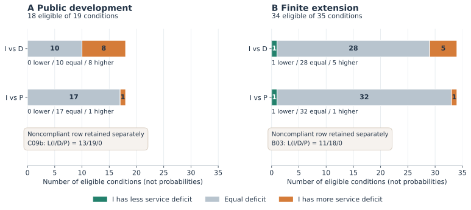
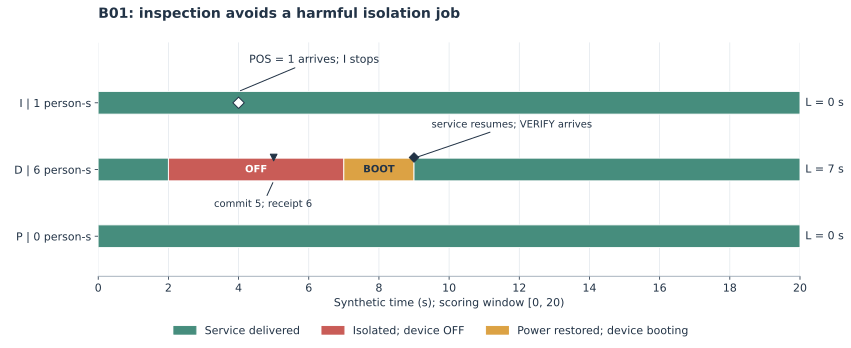
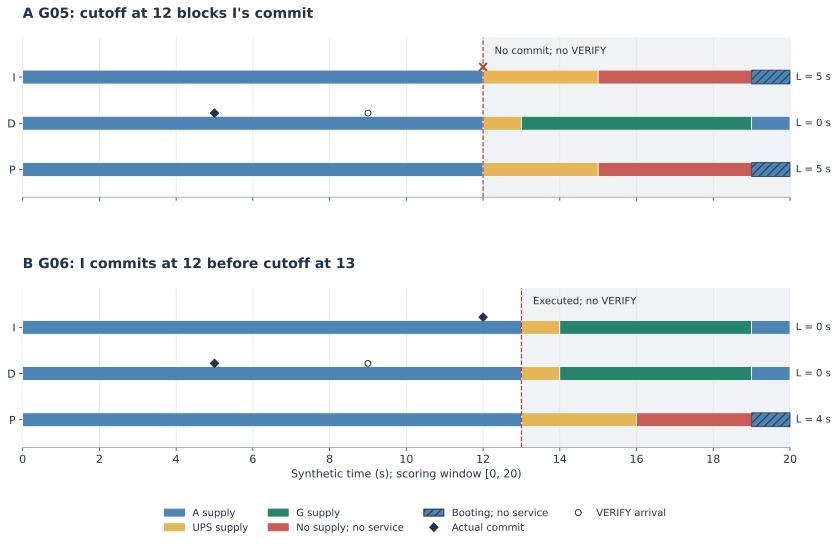
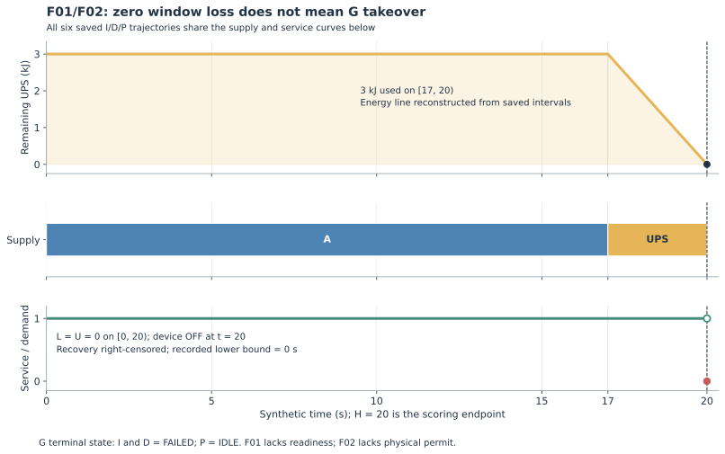

# 维护降级条件下，事前核查何时值得等待？

## 伦敦式合成实例中固定策略的配对比较：服务、工时与合法关闭

**中文研究工作稿 v1.1 · 2026 年 11 月 18 日**\
本版修订自 `d5f86fb7`。研究证据取自 `cf666ec5`，两批条件分别报告。

## 摘要

事前核查能够发现无需处置的情形，也会消耗实施处置的时间和资源。两种作用同时存在时，“获得更多信息”是否改善服务后果，需要与可合法执行的直接处置比较。本文以公开事故报告中的维护断开、上游电压与后备启动抑制机制为动机，研究一个有限的伦敦式合成事前保障实例。固定三种处理：按到时证据核查的 I、合法直接修订的 D、保留既有保护的 P；各组共享外生条件和获取信息的机会，分别承担自身行动成本。服务评价覆盖完整半开窗口，并将人员工时、工具工时、实际实施和合法复核关闭分开。公开开发面板 19 个条件中有 18 行合规，I 相对 D 的服务缺额较小、相同、较大分别为 0、10、8 行；随后预先冻结的同账号有限扩展面板 35 个条件中有 34 行合规，对应为 1、28、5 行。唯一较小行 B01 在已有公开工程见证的基础上增加了外部预约。有效位置证据使 I 避开 D 的隔离作业及启动恢复，I、D、P 的缺额分别为 0、7、0 秒。另两个条件中，I 完成同一读取链并在同一时刻申请修订。故障触发的事前截止与名义提交同刻时，提交被截断。截止推迟一秒后，提交生效，复核仍未完成。窗口端点案例还表明，零服务缺额可与后备接管失败同时成立。进一步对既定六项策略目录和逐行晋级规则作静态分析：合法关闭义务与资源不增条件分别排除所有替代项，故正常完整选择必保留 I。该命题不依赖新策略运行，也不证明 I 的普遍最优性。本文提供的是有限条件下的信息、行动时序和后果的可追溯分析，不识别真实事故可避免性、总体平均收益或递归自改进增量。

**关键词：** 事前核查；信息价值；维护降级；合法处置；服务缺额；有限合成研究；静态晋级判定

## 1　引言

备用路径上游有电，并不充分说明这条路径已经连接到负载、具备支撑能力或能够在故障后完成接管。Google Cloud 的伦敦事故复盘描述了一种具体机制：维护期间 B 路断路器断开，A 路随后发生外部供电故障；相同的控制逻辑依赖共享上游电压信息，使仍带电的 B 路上游信号抑制了后备启动。[[1]](#ref-1) 这个机制提出了一个可研究的事前问题：当正常供给仍在维持服务时，核查者应继续获取位置、电压和配置证据，还是直接申请已有权限内的标准化修订？

核查和处置都不是没有后果的建议。核查需要等待采样和材料到达；取得的证据可能无结论、失效或受权限限制。修订需要批准、准备、实际提交、安全退出及与执行回执分离的配置复核，有时还会隔离负荷。即便核查准确地识别了问题，之后也可能来不及提交；即便直接修订技术上可行，也可能对本无需修订的状态造成额外停机。比较因此必须让两条路线共享合法行动机会，并同时计入信息成本、时间约束、作业副作用和服务后果。

本文回答两个有明确边界的问题。第一，在预先给定的有限合成条件下，固定核查策略 I 相对合法直接修订 D，何时减少、维持或增加服务缺额？第二，在这些已见面板、一个六项策略目录和既定逐行晋级偏好下，是否仍存在可严格替代 I 的候选？第一问由已经执行的两批配对记录回答；第二问由必要条件的静态证明回答。两者的证据类型不同，本文不把未运行候选的推导值写成实验结果。

工作包含三个具体成果：在两个各自保留分母的面板上报告三处理后果；用隔离、提交截止、资源窗口和 UPS 端点的实际轨迹解释结果；在扩大执行前，证明既定改进任务的可晋级集合为空。研究没有估计事故发生分布，没有把合成秒数转换为现场收益，也没有提出一个经过总体比较的新优化算法。它关注的是：什么证据能够支持一个有限结论，什么机制会使看似合理的核查或改进失去预期作用。

## 2　相关工作与研究定位

信息收集的价值取决于它改变了什么决策、付出了什么代价。Howard 的信息价值理论将不确定性与经济后果共同纳入决策讨论。[[2]](#ref-2) 这一视角为本文提供问题定位：较多信息或较确定的判断，并不直接等于较少服务缺额。本文没有给条件附加发生概率或货币效用，因此不估计总体期望信息价值，而是报告固定条件下三种处理的逐行后果。

决策论排障把观察和修复纳入同一行动序列。Heckerman 等以恢复设备功能与期望行动成本组织观察和修复；Breese 与 Heckerman 进一步区分直接观察、修复后观察及改变配置后观察。[[3]](#ref-3) [[4]](#ref-4) 本文承接“取得证据与改变系统须一起计价”的问题意识，没有复现其概率推断算法。在本实例中，PRE 截止、审批、实际提交、安全退出和具有执行身份的复核均被显式记录，使成功实施、真实服务与合法关闭成为可分别核对的结果。

部分可观察决策研究将环境状态与行动者观测分离。[[5]](#ref-5) 本文采用这一信息边界原则：固定策略只接收已到达、有效、有权限的公共记录与公开可行计划，不能用未来故障时刻、物理后备状态或未发布执行结果选择动作。这里没有信念状态求解或 POMDP 最优性主张。维护研究也会联合考虑检查日程、维护阈值与成本；例如 Grall 等研究随机劣化系统中的检查与更换策略。[[6]](#ref-6) 本文的时间范围和目标不同，只研究有限合成条件中的一次事前行动链，不采用该文的随机磨损模型或长期成本目标。

最后，实现核验、用途限定的模型有效性与用途认证需要区别对待。Sargent 对这些概念的区分提示，若干检查通过并不支持整个应用域的有效性。[[7]](#ref-7) 本文据此分别报告工程资格、既有运行结果与静态推导。同账号冻结可以提供版本和顺序记录，不能仅凭换目录、换代理或提前写下哈希称为独立确认。相关文献用于解释研究问题和证据边界，不用于替代本文结果，也不支持算法首创性声明。

## 3　研究对象、处理与评价

### 3.1　从事故机制到有限合成实例

研究对象是一个聚合关键服务、两条普通供电路径、有限能量 UPS 与后备机组 G。模型区分上游有电、路径连接、实际支撑、控制请求、请求接受和后备实际接管。普通供给不足时，旧控制族可能因上游仍有电而不产生请求；修订控制族依据已声明的本地条件提出请求。请求存在或被接受均不足以证明接管，后备还须满足就绪、连接、物理许可与执行条件。UPS 在实际保障不足时供给，耗尽或失供引起设备停止，供给恢复后仍可能需要启动恢复时间。[模型规格][spec]

这是对机制的受限实例化。时间窗 H＝20 秒、各动作的合成时长、权限、UPS 能量和预算均来自已接受的合成定义，不是伦敦现场参数估计。官方报告的事件表与部分产品影响段对 22:53、23:00 的叙述存在不同起点；约五分钟 UPS 自主时间也不等于事故时的剩余能量。因此既不能由七分钟差值定义真实可用处置窗口，也不能据本文秒数判断现场事故本可避免。[[1]](#ref-1) · [来源及可识别性登记][r1]

模型只允许故障前 PRE 行动。外生截止到达后，不再开展新的事中处置，但已经发生的隔离、资源占用、安全退出、自动保护和恢复过程仍继续影响完整窗口内的评价。外源故障区间采用半开形式；同刻故障和恢复可以使故障区间为空，同时仍触发 PRE 截止。这一建模约定使“处置机会结束”与“实际失供持续多久”成为不同问题。[有限扩展协议][protocol]

### 3.2　公开信息、动作和三个处理

每个处理拥有独立的设施状态、预算、请求、观察和回执。策略使用当前 v2 公共视图与处理标识，在固定公共时钟上调用。公开材料包括到时且仍有效的观察、可信权限、剩余预算和按公开配方投影得到的可行计划。实际作业方式 `work_mode`、未来故障时刻、真实后备父条件、原始预约表和未公开结果不会直接传给策略。预约只通过公共计划影响可行性；一种作业方式的服务副作用可以用于评价端分层，但不能作为策略已经掌握的免费信息。[公共接口与固定策略][runner]

观察记录绑定对象、来源、动作、采样时刻、到达时刻和失效时刻。执行回执另有实际执行身份和目标配置版本；复核观察必须绑定同组真实执行及该目标版本。方法不能借用另一处理的读取或回执。成功提交、方法收到提交回执、复核通过、服务恢复具有不同发生时刻，也可能只发生其中一部分。[类型与事件规则][relations]

**表 1　三处理的行为与公平比较边界。**

| 处理 | 决策规则 | 信息和成本 | 目标关闭 |
|---|---|---|---|
| I：证据核查 | 顺序读取位置 POS、电压 VOLT、配置 CONFIG；有效否定则短路停止；支持材料齐备且完整链合法可行时申请 EVIDENCE 修订 | 只使用自身合法到达材料；每次读取、实施和复核分别付费 | 可由有效否定及相应停止决定关闭当前问题，或由实际实施及绑定身份的复核通过关闭 |
| D：合法直接修订 | 在同一公共许可、完整链资源和时间约束下申请 DIRECT；成功实施后请求复核 | 没有诊断读取；使用相同审批、准备、提交、退出与复核机制 | 不能以没有实施或仅提出请求代替关闭；直接许可不足时保留不可行 |
| P：既有保护 | 不新增人工请求，保留相同自动保护 | 不承担新增人工核查或修订成本 | 用作服务背景，不作为 R5 的可晋级候选 |

I 的待核查前件为 POS＝0、VOLT＝1、CONFIG＝`LEGACY_LINE`。这里“否定”指合法证据否定这个特定前件，因而无需实施本范围的控制修订；它不证明整座设施安全。D 可以更早行动，但仍要经过权限、预算、预约、窗口和联锁，不能绕过拒绝分支。三个处理共享外生条件、资产、既有保护、信息获取机会及初始预算；它们实际取得什么材料、占用多少资源和形成什么后果，由各自行动决定。[正式协议][formal]

### 3.3　服务、资源与关闭分别计量

令 d(t) 为评价端冻结的外生需求，s(t) 为实际服务交付，满足 0≤s(t)≤d(t)。在完整窗口 [0,H) 上，主要指标为归一化服务缺额时间：

$$
L=\int_0^H \ell(t)\,\mathrm{d}t,\qquad
\ell(t)=\begin{cases}(d(t)-s(t))/d(t),&d(t)>0,\\0,&d(t)=0.\end{cases}
$$

未服务量为：

$$
U=\int_0^H (d(t)-s(t))\,\mathrm{d}t.
$$

L 的单位为秒，U 的单位为规范化服务单位乘秒。两面板的需求恒为 1，故二者数值相同，但并非同一量纲。人员秒与工具秒各计实际占用；排队、审批等待和发布延迟影响行动时点，不额外算成实际作业。完整链准入的预留可能大于正常成功路径的实际消耗，不能用预留量替代工时。[评分及成本定义][formal]

主比较符号定义为 ΔL＝L_D−L_I，正值表示 I 的缺额较小；背景比较为 L_I−L_P，负值表示 I 的缺额较小。正文同时给出原始三臂值，避免两种符号方向混淆。成本按人员和工具分别报告，不将工时与服务秒任意合成为一个效用分数，也不在缺乏实际阈值时将任何非零差值称为有实用意义。

若截至 H 已发生停机而仍未恢复，恢复时刻记为 null，恢复时长右删失并保留下界 H−停机时刻；无停机对应规格术语 `NO_OUTAGE`。扩展结果表以 `service_recovery_status` 的取值 `NO_RECORDED_SERVICE_OUTAGE` 记录这类情况，两者均无须填写恢复时长。只要完整轨迹覆盖 [0,H)，L/U 仍能完整计算。若评分轨迹自身缺失，则应另记不完整，不能以删失名义填零。合法关闭也单独报告：配置已改变不等于完成目标复核，服务正常也不等于目标已关闭。[恢复规格][recovery-spec] · [扩展状态字段][costs]

### 3.4　两个面板及证据等级

公开开发面板 `dev19` 包含 19 个完整条件，I/D/P 各执行一次；有限扩展面板 `ext35` 包含 35 个事先冻结的条件，覆盖正常短路、隔离副作用、信息不足、权限、流程失败、后备限制、时间、预算、窗口、排队、空故障区间及不恢复。扩展清单以覆盖要求与公开静态顺序构造，并按公开完整配置去重；它不是从事故总体抽样，亦不声称排除了所有机制相似性。两批都已被开发方看到，扩展采用同账号流程，独立确认义务仍未成立。[开发记录][d19] · [扩展输入与承接][transfer]

**表 2　两个面板分别保留的执行与有效比较分母。**

| 面板 | 条件／处理运行 | 完整评分 | 合规条件 | 非合规原行 | 证据性质 |
|---|---:|---:|---:|---|---|
| dev19 | 19／57 | 57 | 18 | C09b | 公开开发；6 个完整配置与先前运行器工程见证重合 |
| ext35 | 35／105 | 105 | 34 | B03 | 预先冻结的同账号有限扩展；35 项指定阶段均实际到达 |

合规比较要求所涉三处理均完整且满足声明约束。两条非合规行的原始输出、服务后果和资源消耗均留在完整表中，但不计为有效获益。适用性不按事后批准、成功提交、复核通过或恢复成功筛选。“指定阶段已到达”包括相应拒绝或失败阶段，不能读成全部处置成功。开发的 19 和扩展的 35 不合并作发生率、总体均值、置信区间或显著性检验；57 与 105 个处理运行也不是相应数量的独立事故。[开发原表][d19-table] · [扩展原表][e35-table]

本文区分来源报告所述事实、已归档合成运行、书面规则推导及未检验假说。工程资格为规定接口和有限输入提供支持；保存结果核对不产生新的研究样本；本次写作仅读取已有记录并制作图表，没有再次调用设施、策略或评分器。完整版本身份、图表来源和已知复核限度见[复现附录](../london-pre-manuscript-v1/reproducibility.md)。

## 4　两面板的服务后果与条件机制

### 4.1　先保留全部比较，再解释个别正例

在 dev19 的 18 个合规条件中，I 相对 D 没有服务缺额更低的行；相同 10 行、更高 8 行。I 相对 P 相同 17 行、更高 1 行。在 ext35 的 34 个合规条件中，I 相对 D 更低 1 行、相同 28 行、更高 5 行；相对 P 更低 1 行、相同 32 行、更高 1 行。前一面板没有合规正例，是该有限清单的观察；后一面板的反例改变了“所有合规条件都没有优势”的断言，并不估计核查优势在现实中的频率。[开发原表][d19-table] · [扩展命题记录][e35-prop]

**图 1　分别报告两个面板的 I/D 与 I/P 服务比较。** 数值由既有完整配对表提取，条件行是比较单位；非合规 `dev19.C09b`、`ext35.B03` 独立标示，不加入有效获益计数。颜色表示有限条件上的方向，不代表概率或统计显著性。来源与字段映射见[图表映射](../london-pre-manuscript-v1/figure-map.md)。

ext35 中，I 相对 D 的唯一较低行是 B01；五个较高行是 G03、G04、G05、K02、L02。I 相对 P 的较低行是 G06，较高行是 B02。两批各自的全部合规条件中，I 的人员和工具实耗都高于 P。P 的比较因而保留了一个重要背景：核查相对 D 节省资源或服务，并不自动意味着相对既有保护也更优。

### 4.2　有效否定何时只省工，何时还避免服务中断

`ext35.A01` 和 `ext35.A02` 分别在第 4、8 秒取得能够否定目标前件的证据，停止时记录仍有效；相应失效时刻为第 15、19 秒。I 与 D 的服务缺额均为零，但 I 相对 D 的人员与工具实耗分别各少 5 秒、3 秒。dev19 的 C02、C03 也分别存在同量工时差，属于另一面板的已执行观察。[扩展实际阶段][stage] · [开发原表][d19-table]

A01 与 B01 仅改变作业方式。I 在两行都读到 POS＝1，并在第 4 秒停止；B01 的 D 却因修订作业在 [2,7) 隔离负荷，随后还需两秒恢复启动，到第 9 秒才恢复服务。因此 B01 的 L(I,D,P)＝0/7/0。7 秒缺额由五秒隔离和两秒恢复构成，I 避免了这条不必要的作业链。作业方式对 I 隐藏，它在两行根据同一合法位置否定停止。[冻结配对输入][inputs] · [逐臂记录][e35-data]

B01 的机制已有公开工程见证 X02。逐字段比较两份完整输入，B01 仅增加 [0,2) 的外部预约。X02 和 B01 中，I、D、P 的缺额均为 0、7、0 秒。B01 检验了这一已知机制在预约改变后能否重现，并构成扩展面板内对“合规行中 I 的服务缺额均不低于 D”的有效反例。X02 只计入原工程资格。[X02 工程记录][x02] · [工程输入][x02-input] · [扩展输入][inputs]

**图 2　ext35.B01 的核查短路与直接修订后果。** I 在第 4 秒收到有效位置否定后停止；D 的隔离及启动恢复使服务在 [2,9) 缺失。横轴为合成秒，区间来自已保存实际轨迹。P 同样全窗供给。图中是增加外部预约后的 B01 研究记录，服务差异出现在 I 与 D 之间。

这个机制也有边界。在 B02 中，I 没有获得否定，两个处置链都进入隔离，L(I,D,P)＝7/7/0。B03 的原始 L 为 11/18/0，表面上同样有 ΔL＝+7，但 I、D 均未在预留内完成退出；人员、工具两项按 I/D/P 顺序均为 14/18/0 秒，因而不能算作第二个有效反例。dev19.C09b 的 13/19/0 及原始 +6 也按同一原则保留为非合规后果。有效获益的判定由声明的约束和完整分母决定，不能仅由差值符号决定。[开发完整表][d19-table] · [扩展完整表][e35-table]

### 4.3　同一核查链能否在截止前完成提交

两行的冻结输入仅有 A 源故障起点 `tF` 不同，分别为 12、13 秒。A 源均在第 19 秒恢复。I 在两行依次于第 4、6、8 秒收到相同的位置、电压和配置证据，在第 8 秒提出修订申请，名义提交时刻均为第 12 秒。G05 在同刻先执行 PRE 截断，提交记录为 `NOT_ATTEMPTED`，L(I,D,P)＝5/0/5。G06 在第 12 秒实际提交，第 13 秒截止时尚未发出复核请求。I、D 经 UPS 过渡后由 G 在 [14,19) 供给，L(I,D,P)＝0/0/4。[G05/G06 实际记录][stage]

**图 3　同一读取链和申请时刻下的提交与截断。** G05 的第 12 秒标记是被同刻截止阻止的名义提交。G06 的 I 已提交，截止时尚未请求 VERIFY。该行 I 和 D 均全窗满足需求，P 有四秒缺额。

G06 说明实际供给可以在合法复核完成前改变，不能据此认为复核没有价值或应被取消。复核证明的是本次执行身份和目标配置下的关闭条件；服务结果还取决于外源、UPS、物理就绪和本地控制。两行固定了读取的项数、次序和到达时间，因而不能估计多读一项证据的边际代价。移动 `tF` 还改变了 A 源故障持续时间。比较可定位提交与截止的先后关系，服务后果须按各行自己的外生条件解释。

### 4.4　预算、窗口和排队约束不等于实际工时

预算与时间边界可改变同一规则是否还有合法行动。H03 与 H04 仅将两种资源预算由各 7 秒改为各 8 秒，D 从初态无法提出完整链变为完成复核。J03 与 J04 仅将窗口末由 17 秒改为 18 秒，I 从补齐材料后不可行变为成功核验；这两行采用较长的复核配方，不能把其阈值推广到其他配方。公开计划区分结果发布须早于窗口末与资源预留末可以等于窗口末，边界关系不能混用。[冻结输入][inputs] · [时序规则][relations]

**表 3　几个可直接对照的有限边界。**

| 条件对或单行 | 已声明差别 | 实际行为／后果 | 可以支持的解释 |
|---|---|---|---|
| ext35.H03 → H04 | 人员／工具预算各 7 → 8 | D 从不发请求到成功实施并复核 | 预留须覆盖完整链，正常实际工时小于预算门槛不构成矛盾 |
| ext35.J03 → J04 | 窗口末 17 → 18 | I 从补证后不可行到第 17 秒复核发布 | 发布的严格边界与预留结束的相等边界分别生效 |
| ext35.K02 | 合法排队后第 13 秒截止 | L(I,D,P)＝4/0/4 | 准入可以合法，仍可能来不及完成实际提交 |
| dev19.C07b | 完成核查后完整链预算不足 | I 各用 3 秒，D 各用 6 秒；L 为 5/0/5 | 少用工来自未完成处置，不能单独解释成效率提高 |

表中每个时间和成本都有其具体配方。跨条件直接比较“用了多少秒”而忽略取得的服务与关闭结果，会把未行动误作高效率，或把较高预留误作较高实际消耗。本文不为这种不可排序的成本／服务权衡事后补权重。

## 5　流程关闭与保障端点

### 5.1　零缺额不能替代合法关闭

`ext35.D01` 的直接许可为拒绝，而读取、证据申请和复核许可仍允许。I 在第 4、6、8 秒收到 POS＝0、VOLT＝1、CONFIG＝`LEGACY_LINE`，在第 8 秒以 EVIDENCE 申请；第 12 秒实际提交，第 14 秒请求复核，第 16 秒收到绑定本组 `ex-1` 与配置 epoch 1 的通过记录。D 在初态因直接许可不足而停止，没有请求，也没有有效否定证据。三臂 L/U 均为零，但只有 I 建立了这里要求的目标关闭。[D01 原记录][e35-data] · [静态判定的定位][r5-proof]

其他条件保留了流程中不同的失败：E01 的审批被拒；E02 实际尝试提交后失败；E03 写入联锁阻止提交尝试；E04 实施后复核失败；E05 实施后复核无结论。它们不能合并成同一个“失败”，也不能因无故障背景下 L＝0 就改称问题已经解决。G06 则是实际修订已经生效而未完成核验的对照。

全批已保存结果中，33 次 VERIFY 请求与 33 条发布的复核记录均可绑定本组实际执行身份和目标版本；在 F4 的 22 个适用条件中，I 未成功修订且作业方式为 ONLINE，I/P 的供给和服务轨迹逐段吻合。F5 的技术核对覆盖 37 条成功提交回执、754 个策略调用包，450 次同处理、同公开包的重复出现给出相同决定。这些是所观测路径的信息与身份一致性证据，不是 450 个独立试验，也不把完整 Q11、全参数域或整个 R2 自动认证为通过。[冻结命题与保存核对][e35-prop]

### 5.2　UPS 恰好支撑到窗口末时会发生什么

F01 缺少后备就绪条件，F02 缺少物理许可。两行 I/D 都完成了控制修订和配置复核，但 G 的实际终态为 `FAILED`，P 的 G 保持 `IDLE`。三处理均在 [0,17) 由 A 供给，在 [17,20) 由 UPS 供给。UPS 交付 3 kJ 后于 H＝20 恰好耗尽，设备在端点转为 OFF；然而半开窗口内不存在正时长服务缺额，因此 L/U 都为零。[F01/F02 端点专表][stage]

**图 4　零窗内缺额与端点失供可以同时成立。** F01/F02 的 I/D 后备失败，P 未启动；全部六条已运行处理轨迹在窗口内均由 A 接 UPS 维持服务。空心点 (20,1) 表示服务的左侧极限，实心点 (20,0) 表示 OFF 端点状态。能量曲线依据保存的 UPS 供电区间、冻结功率与初始能量分段重建，供给、服务与终态直接取自记录，未新增设施运行。恢复记录为右删失，下界为 0；这不是立即恢复，也不给出 H 之后何时恢复。

这个例子直接限制了对“零缺额”的解读。它只说明选定窗口内的需求得到满足，不能单独证明后备接管、长期可持续保障或流程正确。在 L01 中，A 故障与恢复都发生在第 12 秒，故障区间为空，PRE 截止却仍发生，三臂缺额为零。L02 同样在第 12 秒发生故障，但 A 在窗口内不恢复；I/P 用尽 UPS 后各有五秒缺额，D 由 G 接管而缺额为零。外源恢复、设备恢复、后备状态和完整窗积分应分别保留。[供给与恢复记录][costs]

## 6　既定 R5 目录上的不可晋级命题

### 6.1　选择问题及两个必要条件

已经观察到条件差异，不等于一个给定改进任务仍有可实现的晋级。R5 v1 以 I 为初始策略 π₀，目录为 I、D、H1a、H1k、H2a、H2k，P 仅为背景。H1 只读 POS，H2 再读 VOLT；a 在已结算但无结论时仍可转合法 DIRECT，k 在未知时停止。四种 H 均没有 CONFIG 读取和 EVIDENCE 修订分支。H1a 是事先公开的人工候选，所有改进组共同获得，不能算作某组自主发现。[v1 策略目录][r5-policy]

选择使用已见的 dev19、ext35 两个面板。M 是由原 I/D/P 均完整合规的条件确定的固定掩码，不因候选表现改变。候选须先满足每个原行的违规集合不比 I 增加；若要严格晋级 p≻I，还至少要同时满足：其 L、U、人员实耗和工具实耗在两面板每个原行均不大于 I；M 内凡 I 合法关闭的目标，p 也须合法关闭。严格收益和并列规则另有规定，但违反任一必要条件就足以否决晋级。[v1 晋级规则][r5-improvement]

这里的关闭既包括实际实施后绑定身份的复核通过，也包括停止时仍有效的合法否定及相应 `NO_ACTION_CURRENT_SCOPE` 决定。单纯停止、无请求或无服务损失均不自动算关闭。该偏好要求逐行保留多项目标，未允许一行的工时节省补偿另一行的服务或关闭退化。

**命题。** 在 R5 v1 的目录、双面板、必要条件和空前沿规则保持不变，并正常完整完成选择时，终局必为 π*＝I；U1 的采纳条件不能成立。

### 6.2　D01 的关闭否决

ext35.D01 在 M 内，既有 I 已实际实现合法关闭，D 没有。对四种 H，POS＝0 与 VOLT＝1 均支持其读取前缀，不存在合法否定；它们不读 CONFIG，不能走 EVIDENCE 路径，又因 `direct=DENY` 无法合法完成 DIRECT。因此无论 a/k 如何处理未知，这一行都不能取得符合定义的目标关闭。D 与四种 H 各自违反“保留 I 已关闭目标”的必要条件。该推导不调用 H，不借用 I 的材料或回执，也不依赖其他行结果。

### 6.3　A02 的独立资源否决

ext35.A02 同样在 M 内。既有 I 在配置读取合法到达后发现目标已是 `REVISED_LOCAL`，第 8 秒短路，人员和工具实耗各 3 秒；D 完成同一正常 DIRECT 及复核链，各用 6 秒。四种 H 的位置、电压前缀均无否定，而本行权限、预算、窗口和无故障条件允许其继续正常 DIRECT。

按 v1 书面配方，DIRECT 的准备、提交、退出、复核实耗分别为 2、1、2、1 秒，合计每种资源 6 秒；H1 加一次读取，每种为 7 秒；H2 加两次读取，每种为 8 秒。H1/H2 的名义复核发布分别为 12/14 秒，预留末分别为 13/15 秒，均在该行窗口内。预留完整链的 8 秒不等于实际耗费 8 秒；审批等待和发布延迟不加到占用中。上述 H 时点和工时都是书面推导，不是运行结果。[完整配方证明][r5-proof]

**表 4　两条彼此独立的必要条件否决。**

| 候选 | ext35.D01 合法关闭 | ext35.A02 人员秒／工具秒 | 证据类型 | 能否严格晋级 I |
|---|---|---:|---|---|
| I | 是 | 3／3 | 已执行参照 | 不能严格优于自身 |
| D | 否 | 6／6 | 已执行结果 | 两条均否决 |
| H1a、H1k | 否 | 7／7 | v1 规则与正常链配方推导，未运行 | 两条均否决 |
| H2a、H2k | 否 | 8／8 | v1 规则与正常链配方推导，未运行 | 两条均否决 |

A02 的资源否决不需要使用 D01 的权限和关闭结论。即使只用这一个条件，全部五个替代项仍违反实耗逐项不增。反过来，即便不考虑工时，D01 也足以排除它们。因此 {p∣p≻I} 为空；I 不严格优于自身，P 不参选，按空前沿保留 π₀ 的规则得到 π*＝I。证毕。

### 6.4　这一命题对改进器比较意味着什么

原目录只有四项新 H 策略，而各组有四张新候选票。固定改进器、强枚举搜索与允许改变提案优先序的对照，在完整运行后都会取得相同候选结果，使用相同终局规则。这个较弱的设计结论只能确定它们终局相同；双行否决进一步确定终局身份为 I。U1 还要求 p_new≻p_old 且 p_new≻π₀，后一个必要项已不可能满足，因而不存在本版可采纳的 U1 更新。

这不是一次真实的更新后拒绝事件，也没有新策略收益曲线可报告。原 216 个开发回合和最多 105 个最终评估回合均未执行；拟议 21 槽的完整输入未生成，该历史预算没有转拨为本稿研究。本命题只对这六项、这两个面板和这套偏好成立，不证明 I 逐行支配所有策略，不证明一般普通改进无效，也不证明递归自改进不可能。[R5 静态处置][r5-proof]

## 7　讨论

### 7.1　核查的条件价值由行动机会和副作用共同决定

B01 中，合法位置否定使 I 在处置前停止，已有工程见证中的隔离副作用也出现在带预约的扩展条件中。G05 和 G06 则保留同一读取链和申请时刻。前者在名义提交时被截断，后者在截止前完成提交。由此可见，证据能否转化为服务改善，还取决于随后能执行的动作、作业副作用和剩余窗口。A01/A02 则显示，服务相同的条件下仍可以存在资源节省。评价服务、资源和关闭的独立维度，比用单一“成功率”概括更能保留这些关系。

评价端能解释一个条件为何有利，不意味着固定策略能事先识别并利用该条件。A01/B01 的作业方式在当前接口中不可直接见，未来截止和真实后备父条件也不能进入策略。按条件编号或事后机制挑选 I/D 中较好的一项，等同使用额外信息，不能作为部署策略的收益。若未来任务确实允许获取作业方式或其他材料，必须说明取得途径、权限、时点、成本及其接口资格，再评价改变后的策略。

### 7.2　硬约束与保守偏好会缩小可改善空间

R5 的空集合不是由样本不足估计出来的，而由已知条件与既定必要要求直接推出。保留每个已关闭目标，同时对每个原行的服务和两种资源都不允许退化，是一种很强的偏好；目录又不允许 H 使用 I 的 EVIDENCE 分支或配置否定，故其失败有具体结构。这个结论提醒后续设计先检查任务是否有尚未被必要条件排除的合法选择，再分配候选评价预算。

如果实际任务允许某种服务／工时取舍，新的权重、约束或门槛应来自任务需求，并在看新结果前另立规则。不能为了让 H 晋级而事后删除 D01、改写 A02、弱化强基线或重命名关闭条件。扩大目录也需有操作意义；增加条件编号特判或把评价端隐藏状态作为输入，不能回答原问题。

### 7.3　有效性与外推边界

首先，公开事故报告是事后机制来源。本文缺少现场当时的配置、工单、权限、实际剩余能量、操作耗时和服务轨迹，不能识别历史可避免性。其次，有限合成条件并无总体抽样依据；19 与 35 的计数描述覆盖清单，不是现实频率，两批也不能组成一个独立确认样本。第三，采用相同核心实现可以控制比较版本，却不保证未覆盖参数组合正确，有限工程资格不能升级为完整 Q11、R2 或现场认证。

第四，指标窗口限制了结论。F01/F02 说明 H20 内零缺额可能掩盖端点之后尚未观测的损失；报告右删失保留了未知，没有解决无限时域可靠性。第五，流程目标本身有限：一次审批转交、具体实施及绑定目标版本的复核，不代表所有组织升级或完整整改闭环。第六，研究由同一账号环境推进；预先固定、保留失败和独立预期有助于审计，但不构成开发方不可接触结果的外部独立确认。

最后，本文没有测量普通自改进或递归自改进的经验增量。文稿编写和数据整理使用的 AI 辅助，也不属于被评价的策略或改进器。所有这类未成立结论均作为边界保留，而不因论文完成而改变状态。

### 7.4　继续研究所需的可辨识任务

普通受限策略改进的后继任务应首先包含一个实质可改变的决策：合法可得的信息可以区分至少两个仍有机会满足目标的选择，而已知必要条件尚未将其全部排除。随后才需要冻结候选、反馈、预算和评价面板，保留失败及不可排序取舍。新任务既不能拿已见条件冒充未见确认，也不能因本版无晋级就自动取消原独立确认义务。

若研究递归增量，还需使改进程序的变化有可辨识后果：在相同已付反馈、权限和预算下，固定改进器与修改后的改进器应能给出可验证的不同后续选择，且后续仍有非平凡决策供其影响；强搜索应获得相同候选和资源。终局判据若事先把各组映成同一输出，换序或多轮更新本身就不能测量额外终局收益。这是另立研究时的设计条件，本稿未据此扩大候选或启动新的实验。

## 8　结论

在当前伦敦式有限合成实例中，核查的价值取决于取得的证据、处置链的时间与资源可行性以及作业副作用。两个分别报告的面板同时保留了避免不必要隔离、错过提交窗口、服务与成本取舍以及未闭合流程。ext35.B01 是扩展面板中唯一 I/D 服务优势，定位为改变预约后对 X02 已知机制的有限检验。G05/G06 显示同一核查链在两种故障起点下的提交边界，G06 的服务改善仅相对于既有保护 P。F01/F02 则表明，完整窗口内的零缺额不充分证明后备接管或长期恢复。

对已固定的 R5 v1，ext35.D01 的合法关闭与 ext35.A02 的资源条件各自排除所有非 I 候选，故正常完整选择必保留 I，无需新增 H 运行即可关闭本版的晋级研究用途。本文由此完成对有限结果与静态命题的共同论证，结论限于已声明的合成模型、两个面板、策略目录及偏好。真实事故可避免性、现场收益、一般普通改进、递归增量和外部独立确认仍需各自的证据。

## 数据、代码与写作说明

两批结果、完整输入、原失败、版本身份和接受记录均保留在 AegisDC 仓库对应历史目录。本稿图表只从既有机器可读结果提取，使用标准绘图工具重绘，不调用项目模型、策略或评分器。可编辑正文为本文件，独立参考书目见 [references.bib](../london-pre-manuscript-v1/references.bib)，逐图映射见 [figure-map.md](../london-pre-manuscript-v1/figure-map.md)，数据与可复建入口见[复现附录](../london-pre-manuscript-v1/reproducibility.md)。

初稿使用 ChatGPT／Codex 辅助整理结构、起草文字、查阅文献和编写出版制图脚本。本次小修由用户与现有账号下的 Codex 按公开记录推进。图表、条件、历史结果和初稿身份可分别追溯。当前版本供用户进行科学内容与写作 review，没有替用户或其他人工作者登记最终稿已获认可，也没有向期刊或会议提交。

## 参考文献

[1] Google Cloud. *Multiple services were experiencing issues in the europe-west2 region: Incident Report*. 2026. 采用 2026-11-04 13:15 PST 修订。[官方报告](https://status.cloud.google.com/incidents/Xs2XTHzAVC9YnafnPyzj)。

[2] Howard, R. A. Information Value Theory. *IEEE Transactions on Systems Science and Cybernetics*, 1966, 2(1):22–26. [doi:10.1109/TSSC.1966.300074](https://doi.org/10.1109/TSSC.1966.300074).

[3] Heckerman, D., Breese, J. S., Rommelse, K. Decision-Theoretic Troubleshooting. *Communications of the ACM*, 1995, 38(3):49–57. [doi:10.1145/203330.203341](https://doi.org/10.1145/203330.203341).

[4] Breese, J. S., Heckerman, D. *Decision-Theoretic Troubleshooting: A Framework for Repair and Experiment*. Microsoft Research, MSR-TR-96-06, 1996, revised May 1996. [机构作者稿](https://www.microsoft.com/en-us/research/wp-content/uploads/1996/03/Decision-Theoretic-Troubleshooting-A-Framework-for-Repair-and-Experiment.pdf).

[5] Kaelbling, L. P., Littman, M. L., Cassandra, A. R. Planning and Acting in Partially Observable Stochastic Domains. *Artificial Intelligence*, 1998, 101(1–2):99–134. [doi:10.1016/S0004-3702(98)00023-X](https://doi.org/10.1016/S0004-3702(98)00023-X).

[6] Grall, A., Bérenguer, C., Dieulle, L. A Condition-Based Maintenance Policy for Stochastically Deteriorating Systems. *Reliability Engineering & System Safety*, 2002, 76(2):167–180. [doi:10.1016/S0951-8320(01)00148-X](https://doi.org/10.1016/S0951-8320(01)00148-X).

[7] Sargent, R. G. Verification and Validation of Simulation Models. *Proceedings of the 2010 Winter Simulation Conference*, 2010:166–183. [doi:10.1109/WSC.2010.5679166](https://doi.org/10.1109/WSC.2010.5679166).

参考条目的实际读取范围、版本差异及只读到出版者摘要的项目均记于[来源核对](../london-pre-manuscript-v1/references.md)。

[r1]: https://github.com/DonsonHH/AegisDC/blob/cf666ec5c3f390ecb3b07818365cf4be2c475cde/docs/mainline/review-gated/R1/sources.md
[spec]: https://github.com/DonsonHH/AegisDC/blob/cf666ec5c3f390ecb3b07818365cf4be2c475cde/docs/mainline/review-gated/R2/extensions/e1-e4-v2/README.md
[relations]: https://github.com/DonsonHH/AegisDC/blob/cf666ec5c3f390ecb3b07818365cf4be2c475cde/docs/mainline/review-gated/R2/extensions/e1-e4-v2/relations.md
[formal]: https://github.com/DonsonHH/AegisDC/blob/cf666ec5c3f390ecb3b07818365cf4be2c475cde/docs/mainline/review-gated/R3/formal-protocol-v1/README.md
[runner]: https://github.com/DonsonHH/AegisDC/blob/cf666ec5c3f390ecb3b07818365cf4be2c475cde/docs/mainline/review-gated/R3/runner-v1/README.md
[protocol]: https://github.com/DonsonHH/AegisDC/blob/cf666ec5c3f390ecb3b07818365cf4be2c475cde/docs/mainline/review-gated/R4/finite-extension-v1/protocol.md
[transfer]: https://github.com/DonsonHH/AegisDC/blob/cf666ec5c3f390ecb3b07818365cf4be2c475cde/docs/mainline/review-gated/R4/finite-extension-v1/qualification.md
[inputs]: https://github.com/DonsonHH/AegisDC/blob/cf666ec5c3f390ecb3b07818365cf4be2c475cde/docs/mainline/review-gated/R4/finite-extension-v1/conditions.json
[d19]: https://github.com/DonsonHH/AegisDC/blob/cf666ec5c3f390ecb3b07818365cf4be2c475cde/docs/mainline/review-gated/R4/public-development-v1/README.md
[d19-table]: https://github.com/DonsonHH/AegisDC/blob/cf666ec5c3f390ecb3b07818365cf4be2c475cde/docs/mainline/review-gated/R4/public-development-v1/paired-results.md
[e35-table]: https://github.com/DonsonHH/AegisDC/blob/cf666ec5c3f390ecb3b07818365cf4be2c475cde/docs/mainline/review-gated/R4/finite-extension-study-v1/paired-results.md
[e35-data]: https://github.com/DonsonHH/AegisDC/blob/cf666ec5c3f390ecb3b07818365cf4be2c475cde/docs/mainline/review-gated/R4/finite-extension-study-v1/paired-results.json
[e35-prop]: https://github.com/DonsonHH/AegisDC/blob/cf666ec5c3f390ecb3b07818365cf4be2c475cde/docs/mainline/review-gated/R4/finite-extension-study-v1/propositions.json
[stage]: https://github.com/DonsonHH/AegisDC/blob/cf666ec5c3f390ecb3b07818365cf4be2c475cde/docs/mainline/review-gated/R4/finite-extension-study-v1/actual-stage-coverage.md
[costs]: https://github.com/DonsonHH/AegisDC/blob/cf666ec5c3f390ecb3b07818365cf4be2c475cde/docs/mainline/review-gated/R4/finite-extension-study-v1/costs-and-recovery.md
[r5-policy]: https://github.com/DonsonHH/AegisDC/blob/cf666ec5c3f390ecb3b07818365cf4be2c475cde/docs/mainline/review-gated/R5/bounded-improvement-v1/policy.md
[r5-improvement]: https://github.com/DonsonHH/AegisDC/blob/cf666ec5c3f390ecb3b07818365cf4be2c475cde/docs/mainline/review-gated/R5/bounded-improvement-v1/improvement.md
[r5-proof]: https://github.com/DonsonHH/AegisDC/blob/cf666ec5c3f390ecb3b07818365cf4be2c475cde/docs/mainline/review-gated/R5/v1-static-disposition.md

[x02]: https://github.com/DonsonHH/AegisDC/blob/d5f86fb74c8550621a0b7a3531a440f73188e3f6/docs/mainline/review-gated/R4/confirmation-entry-v1/README.md?plain=1#L29
[x02-input]: https://github.com/DonsonHH/AegisDC/blob/d5f86fb74c8550621a0b7a3531a440f73188e3f6/docs/mainline/review-gated/R4/confirmation-entry-v1/inputs.json
[recovery-spec]: https://github.com/DonsonHH/AegisDC/blob/d5f86fb74c8550621a0b7a3531a440f73188e3f6/docs/mainline/review-gated/R2/extensions/e1-e4-v2/relations.md?plain=1#L156
