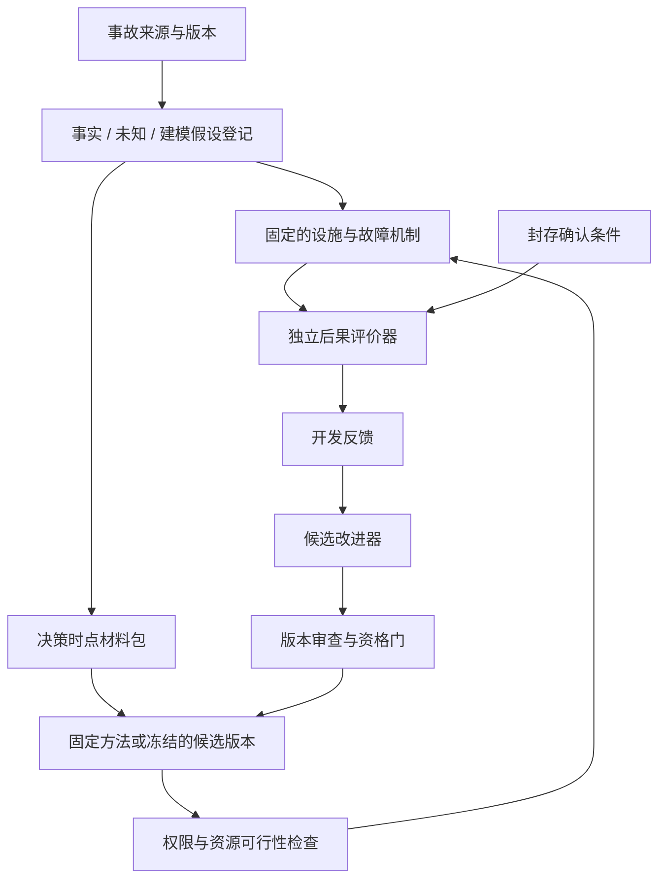

# 研究主线：从事故机制到可验证的方法与 RSI 增量

版本：2026-11-12 / R0 方向接受后的 R1。用户已接受研究方向，授权资料型 R1，限于来源、决策信息、动作约束、最小因果接口与可识别性整理；R1 完成后等待 review，R2 与实验仍未授权。方向接受不代替后续具体模型、方法、数值标准和实验协议的审查。状态由[进度账](../progress.json)唯一维护。

## 1. 要回答的问题

**在存在维护降级、相关失效与不完备信息的设施中，基于可用证据的核查和受约束处置，能否在声明条件下阻断事故升级或减少服务损失？在相同反馈规则、信息获取机会、权限和预定预算下，后续自改进是否带来可复核的额外收益？**

外部电缆故障或电网暂降作为外生触发保持固定。目标是服务后果的避免或减轻；不宣称方法能阻止电网故障本身。真实事故提供机制和约束，反事实结论来自经过资格核验的模型与对照，现场有效性需要更强数据。

两起已读 Google 事故是**开发与机制核对案例**，不能再充当未见过的确认集。伦敦机制提示维护状态下对供电可用性的误判；荷兰机制提示控制电源／泵恢复依赖与其他供电故障叠加。事实、版本和缺口见[来源研究](../../research/20261112-incident-counterfactual-method.md)，不将这两站直接拼成同一真实设施。

用户已确认伦敦式维护状态下的备用链就绪性核查优先，事中响应分开。荷兰式供电／冷却问题本轮仅作来源和迁移边界整理，不表示伦敦现场更容易挽救，也不把第二个已读案例改称独立确认。

## 2. 三条相互分开的主张

| 主张 | 需要的证据 | 当前结论 |
|---|---|---|
| M：核查／处置方法有效 | 相同外生条件、外生信息、合法信息获取机会和动作权限下，相比强透明基线改善预注册后果，含正常、不可行和有代价条件 | 尚未验证 |
| C：某类事故后果可能避免 | 原机制可复现；反事实动作在证据、权限、耗时和物理上可行；结论对未知参数范围有明确适用域 | 官方报告支持提出假说，不能直接判定已避免 |
| R：RSI 有独立增量 | 与固定方法、固定改进器的普通反馈改进、同预算搜索比较；版本留痕；未见任务和独立评价 | 尚未测量，不能由 M 或 C 自动推出 |

旧 180 次研究仍按原限定解释，其结果不作为新 M/C/R 的正证据或确认样本。旧里程碑编号和通过数量不再驱动新主线。

## 3. 先固定方法，再选择实现

每次决策使用一个**决策时点材料包**：已声明拓扑、维护／隔离状态、来源可追踪的到时信号、剩余资源、动作授权，以及明确的未知项。事故后的根因说明只供评估器或事后分析使用；若事前配置审查本可取得某项信息，必须记录取得它的途径和成本。

固定方法 M0 的逻辑为：

1. 根据供电、冷却、控制和服务依赖识别当前保障条件及证据冲突；共用传感器或相同控制逻辑不能当作独立冗余证据。
2. 形成可反驳的风险问题，列明缺失条件和能消除不确定性的核查。正常与无需核查结果同样保留。
3. 对暂缓、核查、授权直接处置、核查后处置、升级、经授权的降载等动作筛选可行性。计入许可、人员／工具、路程、等待、通信、动作和复核时间。
4. 在固定时限和预算下选动作。优先使用明确规则或可解的小规模优化作为透明基线；具体目标和 tie-break 在 R3 冻结。未知概率不随意填数；可用区间或情景稳健性分析，但须明示假设。
5. 使用执行后实际得到的证据核验后果，区分发现问题、实际处置、物理恢复、管理接受与服务恢复。

先定义两种不同的决策任务，分别评价：

- **事前保障核查**：在维护降级或变更后，验证备用路径和控制条件，决定是否允许继续该工况、补做测试或采取已有授权的准备措施。模拟中由已声明检查取得缺陷信息，不能直接向算法提供根因。
- **事中应急处置**：触发后根据到时信号，在剩余保障窗口内执行合法行动。不能把事后才有的修复、设备或授权当作事中现成能力。

把控制逻辑修复、增配 UPS 或恢复冗余当作设计干预时，必须另列准备周期和成本，并让比较组具有相同部署机会。方法只建议升级且无法取得授权，或行动晚于损失起点时，保留“不能避免”的结果。

## 4. 反事实验证的最小架构

封存确认的具体数据和得分不回流开发反馈；图中的评价器是同一冻结规范下的分离实例。改进器不能修改真值、评分、确认集或安全约束。

为每个事故机制先建立未干预基线，再只改变声明的决策／干预因素。必须复现的是因果链及可观察后果，不是通过调参把公开报道中每个时间点都拟合到零误差。模型不足以支持的数值结论暂不计算。

伦敦模型至少区分电源上游电压、断路器位置、下游可供电、两 PLC 的共享逻辑／来源、备用路径和 UPS 耗尽。荷兰模型至少区分供电转移、过载保护、控制器可用、泵运行、冷却流量与热状态；不能用“发电机可用”或“冷却功率开关”一个布尔量替代全部故障链。现有 V6／reserve 模块是待适配资产，并非已经复刻两站。

## 5. 有效性标准与失败标准

在 R3/R4 执行前，冻结数值阈值、样本单位、场景数、计算预算、置信区间方法及失败规则；R0 不填便利的数字冒充已注册参数。

| 项目 | 必须满足的规则 |
|---|---|
| 主要结果 | 在冻结服务需求及窗口下的服务缺额时间；不同服务的量纲、聚合及优先级事先定义。设备保护与数据完整性单独作硬约束。 |
| 辅助结果 | 未避免／部分减轻／避免升级的分类、误报／漏报、实际人时与工具／处置成本、停机恢复时长；不把不同量纲随意加总。 |
| 比较公平 | 相同外生轨迹、资产与既有保护、外生信息流／观察模型、合法信息获取机会、授权和预定预算。主动核查产生的结果与到达时刻由本组动作决定并计成本，不能把另一组取得的证据复制过来；干预后的下游轨迹可自然不同。 |
| 强基线 | 合法直接处置、现有自动保护＋固定应急规则、固定证据驱动方法。零行动仅作有意义的额外参照，不能是唯一对手。 |
| 反事实可行性 | 每个改变后果的动作都有事前可得证据、授权、操作条件、占用和完成时刻。安全保护、锁定与联锁不得被算法绕过。 |
| 未知项 | 提供来源范围或标记无法识别；敏感性覆盖不利值。一个有利假设点不支持“真实事故本来不会发生”。 |
| 正常／负例 | 无故障、无可行动信息、备用真实失效、许可不足、到达过晚、核查有害、错误提案均计入分母。 |
| 独立性 | 单位是预注册的事故机制／外生场景族及配对条件。密集仿真步、同一事故的参数扰动不冒充独立真实事故。 |
| 已公开案例污染 | 两份报告已为人和模型所知；遮住报告正文也不能证明无预训练记忆。它们用于开发；确认使用未披露变体／新机制并披露与真实事故的差别。 |
| 停止／否定 | 无可执行改变、超过时间窗、对强基线无增益、收益仅来自额外预算／泄漏或未知参数时，结论分别为不可行、无增益或未识别；保留失败后再提出协议修订。 |

## 6. RSI 必须具体改变什么

沿用词表的严格区分：策略版本更新是自改进；**改进过程本身被经验改变，并比固定改进器更有效**，才检验递归增量。以下为已接受方向中的候选操作定义，具体可修改对象、对照和预算仍须 R3/R5 review：

- 策略版本 \(P_k\)：证据检查规则、任务优先级或受约束处置方案。
- 改进器 \(U_k\)：根据开发失败归因产生、筛选和验证下一策略的规则。普通反馈组固定 \(U_0\)，RSI 候选允许对 \(U_k\) 作限定、可审查的版本修改。
- 每次变化保存 `P_k / U_k → 提案 → 开发验证 → 接受或拒绝 → 下一版本`。外部评价器、约束检查器、封存条件、总预算始终固定。
- 比较至少含：固定 \(P_0\)；固定 \(U_0\) 的普通反馈改进；同预算搜索／反思；允许改进 \(U_k\) 的候选。多人专业规则或人工修订若参与，单列其时间和信息成本。
- 各组具有相同外生训练资料、反馈规则、信息获取机会及总预算；具体候选的评价反馈随本组候选与执行结果产生并计成本，不要求内生反馈内容相同。固定反馈数据集对照若使用，须另行冻结内容和用途。报告每轮变化、拒绝率、累计成本、跨机制迁移及未见条件退化，而不只选最好一轮。

如果最终只实现提示词、记忆或策略的多轮更新，应按实际机制报告普通自改进／反馈学习，RSI 结论保持未成立。不能把 Google 自身事故后的整改清单归因于本方法的 RSI。

## 7. 唯一执行顺序：每关等待用户 review

| 关卡 | 交付物 | 通过条件 | 当前状态 |
|---|---|---|---|
| **R0 方向与底线** | 本计划、11.12 meeting、事故可验证性说明 | 用户接受方向；具体模型／协议／RSI 操作标准留给后续 review | **方向已接受** |
| R1 事实与可识别性 | [来源、决策信息、动作约束、最小因果接口、可识别性材料](R1/README.md) | 伦敦事前优先，事中分开；按下列前置条件辨认未知与可证明范围 | **资料已交付，等待用户 review；不继续执行** |
| R2 模型资格 | 明确授权范围的原因链、未干预轨迹、解析／守恒／故障注入及公开负例 | 能区分本关授权机制及相应正常／负例；评价与方法隔离；独立核验通过并经用户接受。荷兰迁移与 RESP 依各自另行授权范围推进 | 未授权 |
| R3 固定方法与实验协议 | M0、强基线、动作契约、主要结果及预算、开发／确认隔离 | 无事后真值泄漏，比较公平，数字标准全部冻结；用户接受 | 未授权 |
| R4 方法与反事实效果 | 配对结果、不确定性范围、失败与正常条件、机制消融 | 只在被证据支持的域内判定避免／减轻／无效；用户接受；不预设收益为正 | 未授权 |
| R5 自改进与 RSI 增量 | 固定改进器／同预算搜索／候选递归改进对照与完整版本账 | 未见条件上增量可归因，预算与约束相同；负结果如实记录；用户接受 | 未授权 |
| R6 论文论证 | 主张—证据矩阵、图表、局限及论文正文 | 每个结论对应前述证据；不能用测试通过代替研究结果；用户接受 | 未授权 |

任何关卡的交付不是下一关的授权。用户的“review 通过”只接受该关；启动后继还需明确指向下一关的指令。中途发现底线或模型不成立，应返回该关提出修订，保留原件，不能越过 gate 以增加代码或实验数量替代。

### 7.1 按 review 补充的关卡前置条件

| 后继关卡 | 启动前必须交审的材料／决定 |
|---|---|
| R2 | 用户接受 R1 并明确授权；来源版本和时间冲突有登记；决策输入有获取路径、时点、来源组和缺测语义；动作有授权与不可用条件；最小因果接口区分外生／真实状态／可观察记录／建议／执行／后果；每个关键未知已决定补证或采用明确受限的合成假设。历史可避免性缺口未补齐时，不能把合成机制建模称作历史重建。 |
| R3 | R2 资格经 review；模型只支持已通过的范围；评价器／约束隔离；强透明基线、合法信息获取机会和反馈规则明确；主动检查与候选评价反馈由各组自身动作产生并计成本；安全与服务后果的口径先固定。 |
| R4 | R3 协议经 review；数值阈值、预算、样本单位、停止／重试规则以及开发与封存确认划分已冻结；已读事故只作开发，现场可得信息和假设输入分开；每个待比较动作在声明条件中有合法执行链。 |
| R5 | R4 结果经 review，允许负结果但须先确认任务存在可改变且可评价的决策；策略与改进器的修改对象、固定改进器及同预算搜索对照、外部冻结评价器和资源账已冻结；不能以多轮更新本身充当递归增量。 |
| R6 | 前述必要关卡已 review；每条主张有对应证据，未成立的 RSI／现场效果明确保留；论文表述不得超过实际验证范围。 |

前置条件用于决定研究范围，不要求把所有未知伪装成已知。允许用户选择受限的合成机制研究，但必须先接受其假设和不能支持的历史／现场结论。本轮仅整理这些接口和缺口，不选数值、不实现模型、不进行资格试验。

## 8. 旧资产如何使用

旧八域设施可作为合成研究背景与实现库。是否复用具体模块由 R1/R2 的事故机制映射决定，不默认要求先跑完旧 39c–42 队列，也不默认两起事故已被八域模型覆盖。研究报告的范围只到实际验证的机制与服务后果。

原 39c 的未关闭问题作为已知风险输入：如新研究依赖事件分母、原始输入来源或移动成本，就必须在相应新关卡满足契约；无需在没有关系的旧票上继续堆切片。三份 slice 57 冻结文件及正式研究原件保持原字节。

## 9. 论文结构先保留骨架

暂定题目：**事故机制驱动的算力设施核查与处置：反事实验证及受约束自改进**。章节按问题与真实动机、方法、模型资格与协议、固定方法效果、独立自改进增量、局限与结论组织。R4/R5 之前不填写收益结论，不以两份事故报告数量代替独立验证规模；RSI 未成立时据实调整标题和贡献。
