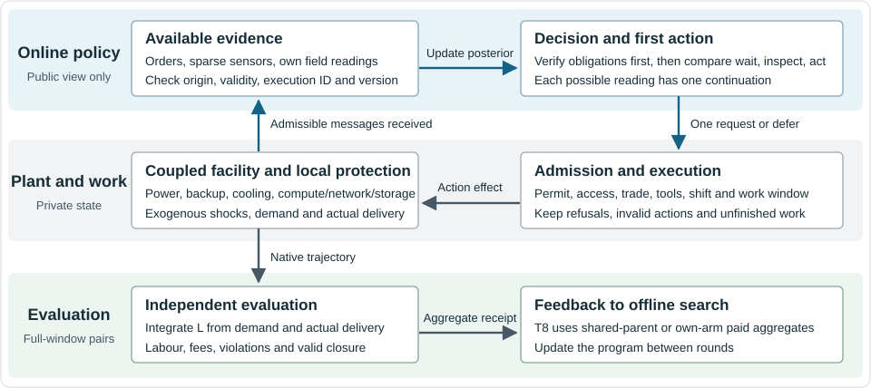
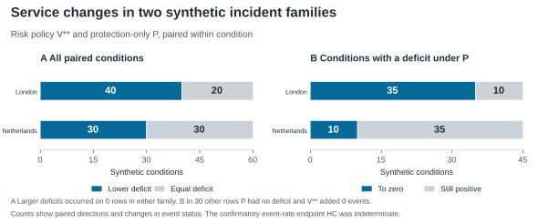
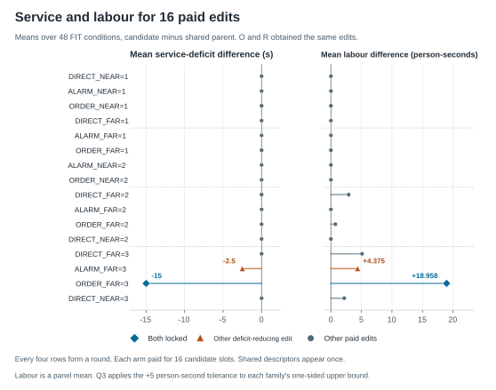

# When is a paid inspection worth waiting for during maintenance-induced degradation?

**A paired simulation study of sparse evidence, work windows and service loss in a coupled computing facility**

## Abstract

Maintenance can reduce backup capacity. Acting directly on the wrong component can increase service loss, while inspecting first can leave too little time to act. We modelled power distribution, backup, cooling, IT service and field work on a common clock. A decision policy receives only evidence available at dispatch and chooses inspection, direct action or deferral subject to permits and resources. Preregistered comparison H2 isolated access to initial inspection by running two copies of the frozen policy independently from the same initial state. Across six families and 144 paired conditions, access reduced the mean full-window normalized service deficit by **55.83 s**. The paired difference was **−55.83 s (two-sided 95% interval [−110.00, −11.61])**. Against a strong transparent direct-action rule, the full policy's mean difference was −343.90 s, including effects of action ordering and deferral. In a development case a reading avoided an unnecessary write. In a counterexample waiting delayed necessary action. In London-style and Netherlands-style synthetic incidents, the policy reduced mean deficit relative to existing protection and to alarm response. Zero between-block variance left the event-frequency endpoint indeterminate. Ordinary and rewrite-capable search locked the same policy under equal budgets. The Netherlands labour difference already exceeded its tolerance on the selection panel. An independent service benefit from recursive rewriting was not established.

**Keywords**　Computing facilities, value of inspection information, partially observable decisions, maintenance windows, service reliability

## 1　Research question

A reading of upstream voltage leaves open whether the backup feeder is connected. A power-restoration receipt leaves open whether a pump has restarted. A field inspection can resolve such ambiguity, at the cost of staff travel, work authorization and report delivery. Even an accurate reading can do little for service already lost if it leaves the next action unchanged or arrives too late to complete that action. Under what conditions is it worth paying for an additional observation?

We bring cross-system service consequences, evidence arrival, feasible work windows and verification tied to the execution being checked into the same decision. Our three comparisons isolate the contribution of information acquisition by disabling initial inspection in the same method, estimate the full-policy difference against transparent rules, and test whether development feedback improves subsequent policies. Two public incidents provide documented fault mechanisms. Site event rates, the authority of the historical shift and outcomes under alternative historical actions require separate evidence.

## 2　Related work and contribution

In Howard's value-of-information (VoI) framework, an observation has value through the actions it can change and their expected consequences [1]. Memarzadeh and Pozzi apply this reasoning to inspections, permanent monitoring and system-level scheduling [2]. Andriotis and Papakonstantinou incorporate risk and resource constraints in partially observable maintenance decisions [3]. Fauriat and Zio use expected information value to choose when to inspect or replace next [4]. Here H2 compares full-window service deficit with paid initial inspection available or disabled in the same frozen policy. The paired mean across all 144 conditions was −55.83 s (Table 2). This contrast includes changes in subsequent action and any service lost when waiting for a report outlasts the permit window.

Yanes Luis et al. use variational estimators and shared multi-agent deep reinforcement learning to schedule repeated visits in aquatic environments of unknown spatial importance [5]. Both tasks involve choosing where to gather evidence. Here we score named work orders by the time integral of undelivered service. The policy can skip the initial inspection and must handle refusals, expiry and obligations left open after intervention. The patrol score and our deficit in seconds have different dimensions. ParamILS illustrates an established alternative for parameter search, using a fixed configuration procedure to select candidates [6]. We track changes to the candidate policy and changes to the program proposing candidates. The subsequently evaluated candidates, each charged to its arm, distinguish the two.

<!-- page -->

## 3　Facility and information boundaries

Public measurements of Frontier's power, temperature and flow provide a scale reference [7]. ExaDigiT couples power and transient thermal-fluid models and evaluates its model by replaying Frontier telemetry [8]. Our engineering model focuses on permitted inspections and interventions. A day of measurements can check power and cooling magnitudes. Calibrating the field benefit of inspection also requires contemporaneous dispatch, authorization and service-delivery records. We distinguish sources, assumptions, solution methods and the scope of validation in line with the empirical simulation reporting guidelines [9].

Bennaceur and Kloul use formal models to study how electrical, thermal and network dependencies affect data-centre reliability [10]. We distinguish sampling, report arrival, the effect of a write and verification of that execution on a common facility clock. Physical, functional-dependency, control/information and spatial-access relations describe energy transfer, service bottlenecks, publication of records and access to work locations, respectively. The model covers eight domains: power distribution, backup, facility cooling, equipment cooling and environment, IT service, controls and monitoring, spatial access, and staffing and tools. Existing automatic protection operates in every arm. Electrical, thermal and IT capacity support a common service. Simultaneous bottlenecks count once, through actual delivery. Each arm has its own facility state, evidence, budget and receipts. [Facility boundaries and engineering references](../t9-submission-r1/evidence.md#model)

*Figure 1. Available evidence enters the online policy. A request can change the facility only after the executor admits and completes the work. The offline evaluator sees actual demand and delivery. The online policy learns outcomes through the prescribed observations or receipts.*

### 3.1　Choosing a feasible first action from the evidence

Let d(t) denote exogenous demand and y(t) actual service delivery. The primary endpoint L integrates the unmet fraction over times of positive demand, L = ∫d(t) &gt; 0 [d(t) − y(t)] / d(t) dt, in seconds. Unserved quantity U integrates the absolute shortfall. We report person-seconds, tool-seconds, fee units and valid closure separately. Paired differences are candidate minus comparator. A negative L difference means less service lost.

The online policy uses the public asset and job catalogues and the current view h. It deduplicates records copied from a common source and filters them by sampling, arrival and expiry times. Paid records must match the policy's own job, execution identity and version. Public design priors and record likelihoods update weights on a finite set of possible worlds. If none remain supported, the policy retains the reason for the conflict. Feasible plans π are ranked by **J(π | h) = E[L | h, π] + λ {E[Tstaff | h, π] + κ E[F | h, π]}**. F counts fee units incurred on issue. Tools have a hard budget. Predictions guide action choice. The full-window facility record supplies the actual score.

<!-- page -->

> **Algorithm 1. Frozen online policy** (execution role `V_COST`)
>
> 1. At a public decision time, check the catalogue and view, reject future records, and update evidence and posterior weights. First try any authorized own-execution verification R or follow-up X.
> 2. Issue required work if it is ready. Otherwise defer, recording the reason, if a purchased initial inspection I is awaiting a receipt or the posterior has no support.
> 3. For an open primary order, enumerate deferral, permitted direct action A and permitted optional initial inspection I. For each continuation, check travel, staff and tool occupancy, shifts, permits and the time for own-execution verification.
> 4. For inspection, group possible worlds by the report that would be available. Each group shares one continuation. Retain an UNKNOWN branch that defers optional intervention and preserves prior obligations. Weight each branch's J by its report probability.
> 5. Choose the first action minimizing expected J. Break ties by labour and fees, then favour deferral and use stable identifiers. Defer if no complete branch is admissible. Issue at most one request per decision time.
> 6. The executor independently checks admission and publishes the actual outcome. Refusals, invalid work, timeouts and expiries remain in the original denominators. Decide again at the next public decision time. At window end the evaluator scores actual demand, delivery and work records.

### 3.2　Sources of priors, prices and engineering assumptions

| Quantity or mechanism | Frozen value or convention | Basis and use |
|---|---|---|
| Prior catalogue | In the general architecture, each of the four water, access, network and backup families has weight 1/4. Each of the two incident architectures marginalizes over 12 registered combinations. | The online policy knows the generation law. It receives no realized cause, seed or next fault time. These are synthetic design priors. [Prior catalogue](../t9-submission-r1/evidence.md#p-prior) |
| Evidence quality | Designated fixed sensors use a matching parameter of 0.95. Optional initial inspection reserves a 1/32 branch for an uninterpretable report. | The former parameter bounds likelihood matching and the latter limits the reliability of a report branch. Both are frozen settings. [Likelihood and UNKNOWN](../t9-submission-r1/evidence.md#p-evidence) |
| Work and report clocks | The window is 3,600 s, the decision step 60 s and the native physical step 0.25 s. Records are checked separately for arrival, expiry and version. | Arms within a condition share clocks and exogenous inputs. Planned receipts serve prediction. Actual verification requires an arrived record. [Clocks and qualification](../t9-submission-r1/evidence.md#p-clock) |
| Online prices | λ = 1 deficit-second per person-second and κ = 30 person-seconds per fee unit issued. Failed work incurs its actual charge. | These ranking weights were fixed in advance. Labour and fees are measured separately. A field monetary valuation has yet to be established. [Prices](../t9-submission-r1/evidence.md#p-price) |
| v3 maintenance exposure | Public maintenance durations are 0, 600 and 1,200 s, with four of each in every twelve-row block. Limited support is capped at 0.50. Permit recovery adds 180 s. | An actual write triggers capacity loss during maintenance. Overlapping bottlenecks contribute through common service delivery. [Maintenance rules](../t9-submission-r1/evidence.md#p-exposure) |
| Promotion and labour tolerance | In T8 a compliant candidate replaces its parent only if total L strictly decreases. Among candidates tied on L, compare total person-seconds and then descriptor. Registered Q3 requires each family's one-sided upper bound on the labour difference to be ≤ +5. | Promotion uses development feedback. Q3 is a separately registered utility criterion. Staff availability is a hard constraint at execution. |

*Table 1. Parameter categories and provenance. Values come from executed settings or engineering protocols. Frontier observations and Google reports constrain magnitudes or mechanisms. Priors, labour tolerances and staff arrival times come from separate design settings.* [Sources and code locations](../t9-submission-r1/evidence.md#parameters)

<!-- page -->

## 4　Comparisons and statistical units

The service comparisons use the frozen six-family synthetic holdout, with 24 conditions per family and 144 in total. Each arm starts in its own state instance. P retains existing protection alone, alarm response dispatches on arrived alarms, and periodic patrol follows a schedule. The strong transparent rule B orders open, admissible jobs and requests direct action. B_cost can also schedule operations using public maintenance terms. Only the same-policy purchase ablation preserves the rest of V\*\*'s decision logic. The evaluator alone uses an omniscient schedule to check an attainable lower bound within the declared action set.

The ablation disables I only at public admission. It can still defer, act directly and carry out its own R and X. It runs from the common initial state, so removing a report can change subsequent job order. The algorithm corresponds to scientific source `c5ecb743`, with native facility core `0e5afde1`. The frozen bundle and per-file digests identify the implementation. [Execution identity and code locations](../t9-submission-r1/evidence.md#method)

The three comparisons were tested on the same panel in the order H1, H2, H3. Within each family we resampled whole conditions with replacement, keeping all their arms together. We pooled families in each of 10,000 registered resamples. Progression required the upper end of the two-sided 95% percentile interval to be strictly below zero. Duration strata and family tables are descriptive. We present H2 first because it directly addresses the total conditional value of optional initial inspection. The registered test order and thresholds govern the decisions. [Frozen protocol and contrasts](../t9-submission-r1/evidence.md#confirmation)

## 5　When is a paid inspection worth waiting for? (C1)

**The engineering assumptions determine the room for improvement.** Under v2, on the 72 development conditions, direct rule B had already attained the admissible service-deficit lower bound on 72/72 rows. In v3 we introduced the maintenance bypass and permit interval in Table 1. A direct write that temporarily puts a serving facility on limited support can increase loss if issued early. This change preceded the formal holdout. The v3 confirmation concerns panels with this mechanism. [Versions and earlier lower bound](../t9-submission-r1/evidence.md#sensitivity)

| Frozen comparator (all differences V\*\* minus comparator) | Pairs | Mean L difference, s | Two-sided 95% interval, s | Scope |
|---|---:|---:|---|---|
| H2　Same policy, optional initial inspection disabled | 144/144 | **−55.83** | **[−110.00, −11.61]** | Increment from access to initial inspection, MET |
| H1　Strong transparent direct-action rule B | 144/144 | −343.90 | [−445.94, −244.22] | Full-policy difference, MET |
| H3　Cost-aware transparent rule B_cost | 144/144 | −390.48 | [−488.63, −292.83] | Against another fixed rule, MET |

*Table 2. H2 retains conditions in which inspection was available but unused. The estimated effect averages over the whole panel. It cannot be interpreted as 55.83 s saved per purchase. H1 also includes deferral, ordering and direct action.* [Three registered comparison results](../t9-submission-r1/evidence.md#confirmation)

On the same H2 panel, mean staff occupancy was 128.92 person-seconds with initial inspection available and 107.57 with it disabled. The service improvement incurred a labour cost.

**The observed trade-off varied with public maintenance duration.** Against the same ablation, the point estimate was slightly above zero at 0 s, the interval lay entirely below zero at 600 s, and the interval crossed zero at 1,200 s. Each of the three strata contained 48 conditions. The within-stratum intervals describe uncertainty in each estimate. They do not test an interaction or establish a universal duration threshold.

| Public maintenance duration | 0 s | 600 s | 1,200 s |
|---|---:|---:|---:|
| Mean L difference, inspection available minus disabled (s) | +0.62 | −86.16 | −81.97 |
| Two-sided 95% interval (s) | [0.00, +1.88] | [−179.79, −15.99] | [−197.32, +14.65] |

*Table 3. Prespecified descriptive strata of the six-family holdout. In a separate development sensitivity comparison on 36 conditions, joint setting S0 removed the extra permit interval and set maintenance exposure to zero. The optional-inspection difference was +1.25 [0.00, +3.75] s. This joint change does not identify an individual parameter effect.* [Strata and development sensitivity](../t9-submission-r1/evidence.md#sensitivity)

Two limited-backup development trajectories illustrate the reversal. In condition 3-03, a report arrived at 50 s and supported omitting a network write. With inspection disabled, a direct write at 60 s produced L of 600 s. With inspection available, L was 0 s. In condition 3-02 a report also arrived at 50 s, but intervention was necessary. Waiting delayed dispatch from 0 to 60 s and L rose from 326.25 s under the ablation to 371.25 s. Across the panel V\*\* improved on B in 54 conditions, tied in 76 and did worse in 14. A mean improvement can coexist with losses on individual conditions. [Development witnesses and counterexample denominators](../t9-submission-r1/evidence.md#witness)

<!-- page -->

## 6　Synthetic confirmation in two incident families (C2)

Google's London report describes a disconnected backup path, an energized upstream supply and a controller that did not issue a start signal [11]. The Netherlands report describes overload during transfer and pumps that failed to restart after a controller went offline [12]. We retain these two bounded mechanisms. The counterfactual intervention replaces only a permitted action in the synthetic environment. Historical operator permissions and the consequences of alternative actions at either site remain undocumented here.

Each family had 60 conditions in five blocks of twelve. Arms were paired within conditions and the two family means received equal weight. **The primary analysis retained all 120 rows, including 16 with run inputs overlapping an earlier panel.** The subset excluding overlaps is descriptive. Table entries give marginal two-sided 95% intervals. The three two-sided p-values were Holm-adjusted together. An arm experienced a synthetic event if its unrounded L > 0. [Denominators, overlap and registered analysis](../t9-submission-r1/evidence.md#incidents)

| Endpoint | Contrast | Estimate | Interval and decision |
|---|---|---:|---|
| HA　Service deficit | V\*\* minus P | −580.00 s | [−595.52, −564.48] s, MET |
| HB　Service deficit | V\*\* minus alarm response | −582.08 s | [−612.65, −551.51] s, MET |
| HC　Event rate | V\*\* minus P | −37.50 percentage points | Interval not established, INDETERMINATE |

*Table 4. HA and HB measure full-window service-loss severity. The HC estimate is the paired event-rate difference with equal weight for the two families.* [Confirmation and event denominators](../t9-submission-r1/evidence.md#incidents)

*Figure 2. Each family has 60 conditions. The left panel compares deficit magnitudes. The right panel includes only conditions with a deficit under P. Of the 90 rows with a deficit under P, 45 reached zero. In the other 30 rows, P had no deficit and the number of new events was 0. The paired event-rate differences had zero between-block variance in both families. HC was indeterminate under the registered rule.*

Two original development cases distinguish the opportunity to obtain a reading in time from actual acquisition. In London case 5-01, V\*\* directly restored the backup path at 720 s. Its first paid reading arrived at 830 s as verification of its own intervention. In Netherlands case 6-02, the evaluator established 540 s as the latest necessary start. V\*\* was still waiting then and first attempted a pump restart at 2,040 s, with no paid reading in the window. Both family contrasts concern the full policy. Site event rates remain unestablished. An earlier native filter-cleaning comparison exposed a different trade-off. Service tied in all 17 primary pairs. The 3 rows that saved labour, tools and fees also lost the verified closure achieved by the comparator. [Evidence available in the representative cases](../t9-submission-r1/evidence.md#incidents)

<!-- page -->

## 7　Transfer and cost of ordinary improvement (C3)

A fixed proposal procedure can use development feedback to select policies. Selecting a hand-written anchor, mutating a root vector and selecting a winner on an old panel answer different questions. The early v1 main track reduced development-panel loss by 49.64 s. The winning vector came from the initial hand-written batch. In v2, feedback updated mutation-operator scores, but candidates were always generated from the root and the search did not climb from the current winner. The expanded-candidate diagnostic in v3a was inconclusive. In v3b, recombining domain blocks lost 352.96 s more service than the best complete vector. In v3c, public selector S reduced loss by 141.13 s across halves of the old panel. On 36 new conditions it lost **80.49 s [41.31, 123.48]** more than frozen winner W, improving on 0 rows, tying on 26 and doing worse on 10. The registered transfer advantage was not supported. [Version comparisons and counterexamples](../t9-submission-r1/evidence.md#improvement)

In T8, on the 48 conditions used for selection (FIT), ordinary search O and rewrite-capable search R started from a common parent. Each arm had four rounds of four proposals. **Promotion required a strict decrease in total L. Labour broke ties only among candidates with equal L.** Each arm paid for 768 evaluation positions, with a shared parent evaluation on 48 rows. Figure 3 lists a descriptor once if both arms proposed it. Compared with the parent, each arm reduced mean service deficit by 15 s at an additional **18.958333 person-seconds**. Labour also had an observed failure condition. The Netherlands FIT increase of 36.458333 person-seconds already exceeded the registered family allowance of +5. Table 5 gives the observed means of the two blocks and the subsequent conditional projections. [Promotion and paired receipts](../t9-submission-r1/evidence.md#fit)

*Figure 3. Full-panel FIT mean differences after a single-coordinate edit. Each row represents a distinct paid edit. `ORDER_FAR=3` gave the largest service improvement. `ALARM_FAR=3` changed the panel mean deficit by −2.5 s and labour by +4.375 person-seconds. Ordinary search also found both edits.*

<!-- page -->

## 8　Attribution and qualification of recursive rewriting (C4)

Attributing a service benefit to recursive self-improvement (RSI) requires a program rewrite that changes the subsequent candidates actually paid for and enters the parent lineage of the final selected policy. No single-coordinate candidate strictly lowered the parent's deficit in the first three rounds. R therefore failed to trigger a rewrite three times in succession. In the fourth round both arms selected slot 3, `ORDER_FAR=3`, and locked it. **Rewriting added 0 paid candidates. The R−O differences in deficit and labour were both 0.** Equivalence of the two procedures under other feedback remains untested.

All four twelve-row blocks had distinct structural signatures. Among the 16 scored single-coordinate edits, only `ORDER_FAR=3` attained the measured minimum deficit on 48/48 rows. All edits tied on 42 rows. Differences were confined to 6 Netherlands rows. Two single-coordinate edits, `ALARM_NEAR=3` and `ORDER_NEAR=3`, remained unscored. The resulting service saturation applies only to the scored single-coordinate menu on this panel. [Minimizers and unscored edits](../t9-submission-r1/evidence.md#fit)

### The labour failure condition was already present on FIT

Mean labour was 98.645833 person-seconds for the common parent and 117.604167 for the locked O and R policies. Registered Q3 required the one-sided 95% upper bound on the labour difference relative to the parent to be ≤ +5 person-seconds in each family. **Even before attributing a benefit to rewriting, the observed Netherlands FIT point difference for both locked policies exceeded that allowance.** The pooled +18.96 person-seconds concealed the difference between London and the Netherlands. The simulated executions recorded 0 hard-constraint violations. The utility tolerance was assessed separately.

| Labour difference (child minus parent, person-seconds) | Observed FIT mean | Means of the two FIT blocks | One-sided upper bound if 38 independent blocks repeat the FIT mean and block variance |
|---|---:|---:|---:|
| London | +1.458333 | 0, +2.916667 | +2.023 |
| Netherlands | **+36.458333** | +40.833333, +32.083333 | **+38.152** |

*Table 5. Both arms produced the same results on the same conditions. The last column is a scenario projection. The Netherlands result alone would fail the joint qualification in that scenario. T8 closed at FIT. The separate qualification panel (DEV) was not scored.* [Tolerance, block variance and upper bounds](../t9-submission-r1/evidence.md#staff)

Even if the evaluator retrospectively chose the least labour-intensive edit among those with the same minimum deficit on each row, mean Netherlands labour would still exceed the parent's by **26.25 person-seconds**. Giving another procedure credit for the same service result cannot remove the measured labour shortfall. A rewrite candidate that was never produced has no score against which to judge the tolerance.

## 9　Discussion and conclusions

C1 was partially supported for the preregistered panel mean. A reading can reduce deficit when it prevents a wrong action, and increase it when waiting consumes the work window. C2 has confirmatory support for severity differences in two synthetic families. The synthetic event-rate test was indeterminate and field event rates remain unidentified. The specific C3 transfer claim was not supported. An independent C4 increment was not established. [Complete comparisons, counterexamples and accepted versions](../t9-submission-r1/evidence.md#record)

<!-- page -->

### Limitations

Block structure constrains each family's event counts. The T7 severity intervals describe mean differences under the specified structures. HC was indeterminate because between-block variance was zero. The six-family and two-family panels used quotas. Their design means lack the exposure denominators needed to infer field incident rates. T8 used a shared account for procedural overlap checking. A PASS receipt exists. Personal authorization for the delegated signature is disputed and has not been independently verified. The two public incident reports predate the synthetic families and policy design. Historical site counterfactuals still require contemporaneous shift records, permissions and operating logs. [Boundaries and sources for the four claims](../t9-submission-r1/evidence.md#limits)

### Future work

Under the same labour constraint, can RSI find low-cost edits identifiable from public information earlier than ordinary search? On 4 existing rows, labour can still be saved at the same deficit. Retrospective row-wise selection would save a pooled mean of 5.83 person-seconds. Another measured edit, `ALARM_FAR=3`, reduced the Netherlands mean deficit by 5 s while increasing labour by 4.375 person-seconds in each of the two families. A subsequent test needs new material and a new overlap check, with the same labour objective and search budget and records of the rewrite, subsequent paid evaluations, selected lineage and benefit relative to O. [Labour headroom and a paid alternative](../t9-submission-r1/evidence.md#staff)

### Data and code availability

The facility, rules, measurement and plotting code are public. Each results table and figure can be traced to a public aggregate at a specified commit. Study seeds, native per-position trajectories and private access records remain under their existing custody arrangements. Public verification can reconstruct table values and check implementation identity and figures. Rerunning the facility is a separate operation. No new experiment was conducted for this manuscript. [Versions, available materials and verification](../t9-submission-r1/evidence.md#availability)

## References

[1] Howard RA. Information Value Theory. *IEEE Transactions on Systems Science and Cybernetics*, 2(1), 22–26, 1966. [DOI](https://doi.org/10.1109/TSSC.1966.300074)

[2] Memarzadeh M, Pozzi M. Value of information in sequential decision making: Component inspection, permanent monitoring and system-level scheduling. *Reliability Engineering & System Safety*, 154, 137–151, 2016. [DOI](https://doi.org/10.1016/j.ress.2016.05.014)

[3] Andriotis CP, Papakonstantinou KG. Deep reinforcement learning driven inspection and maintenance planning under incomplete information and constraints. *Reliability Engineering & System Safety*, 212, 107551, 2021. [DOI](https://doi.org/10.1016/j.ress.2021.107551)

[4] Fauriat W, Zio E. Optimization of an aperiodic sequential inspection and condition-based maintenance policy driven by value of information. *Reliability Engineering & System Safety*, 204, 107133, 2020. [DOI](https://doi.org/10.1016/j.ress.2020.107133)

[5] Yanes Luis S, Basilico N, Antonazzi M, Gutiérrez-Reina D, Toral Marín S. Variational model-based Deep Reinforcement Learning for Non-Homogeneous Patrolling aquatic environments with multiple unmanned surface vehicles. *Expert Systems with Applications*, 270, 126483, 2025. [DOI](https://doi.org/10.1016/j.eswa.2025.126483)

[6] Hutter F, Hoos HH, Leyton-Brown K, Stützle T. ParamILS: An Automatic Algorithm Configuration Framework. *Journal of Artificial Intelligence Research*, 36, 267–306, 2009. [DOI](https://doi.org/10.1613/jair.2861)

[7] Sun J, Gao Z, Grant D, et al. Energy dataset of Frontier supercomputer for waste heat recovery. *Scientific Data*, 11, 1077, 2024. [DOI](https://doi.org/10.1038/s41597-024-03913-w)

[8] Brewer WH, Maiterth M, Kumar V, et al. A Digital Twin Framework for Liquid-cooled Supercomputers as Demonstrated at Exascale. *SC24*, 324–341, 2024. [DOI](https://doi.org/10.1109/SC41406.2024.00029)

[9] Monks T, Currie CSM, Onggo BS, Robinson S, Kunc M, Taylor SJE. Strengthening the reporting of empirical simulation studies: Introducing the STRESS guidelines. *Journal of Simulation*, 13(1), 55–67, 2019. [DOI](https://doi.org/10.1080/17477778.2018.1442155)

[10] Bennaceur WM, Kloul L. Formal models for safety and performance analysis of a data center system. *Reliability Engineering & System Safety*, 193, 106643, 2020. [DOI](https://doi.org/10.1016/j.ress.2019.106643)

[11] Google Cloud. Incident report, europe-west2-b, 19–20 October 2026. Report issued 4 November 2026. [Official report](https://status.cloud.google.com/incidents/Xs2XTHzAVC9YnafnPyzj)

[12] Google Cloud. Incident report, europe-west4-a, 15–16 July 2026. Report issued 25 July 2026. [Official report](https://status.cloud.google.com/incidents/3BvH3LVGcupoYqV6F4Nw)
