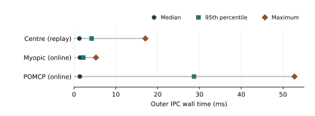

# Cost-aware value-of-information scheduling of inspections and interventions in maintenance-degraded computing facilities

## Abstract

A maintenance crew can inspect a backup path before intervening, but the time spent obtaining a reading can consume the permit window for the work it recommends. We developed an online scheduler that weighs this delay against the service consequences of acting on incomplete evidence. It maintains a finite distribution over facility states, groups states that would give the same inspection report, and chooses the next feasible job under staff, tool and access constraints. An independent evaluator measures undelivered service over the entire window. Across 144 paired synthetic conditions, mean normalized service deficit fell by 343.90 s relative to a transparent direct-action rule. Enabling initial inspection in the same scheduler gave a paired difference of −55.83 s (95% interval [−110.00, −11.61]), with higher staff occupancy. In synthetic incident families, the scheduler reduced mean deficit relative to existing protection and alarm response. The event-rate contrast remained indeterminate. On a previously used development panel, myopic inspection produced the same deficit on every condition. A finite-budget tree planner used more labour and verified more completed interventions, with an uncertain service difference. These comparisons identify the conditional value of access to inspection and the resources it consumes. Estimating annual site losses also requires the frequency of maintenance exposures and the distribution of conditions within them.

**Keywords**　Value of information, inspection scheduling, decision support, maintenance, computing facilities, partially observable planning

## 1. Decision support during maintenance

A supply monitor can report voltage while a backup path is disconnected. A receipt can establish that a transfer succeeded while a cooling pump remains stopped. In either case, a dispatcher must decide whether to send a technician, authorize corrective work directly, or keep capacity available for another job. The next reading matters only through the actions that remain possible when it arrives. Walking time, an occupied tool or a shared change permit can reverse the choice. Our question is which job to issue now when the criterion is service delivered over the maintenance window.

Formal models of data centres connect electrical, thermal and network failures (Bennaceur & Kloul, 2020; Sanusi & Yusuf, 2022; Y. Wang et al., 2024). Measurements from Frontier and its liquid-cooling digital twin illustrate what a facility model can check against instrumented power, heat and flow (Brewer et al., 2024; Sun et al., 2024). Studies of hybrid air–liquid cooling, integrated heat pipes and immersion cooling characterize changes in support capacity (Huang et al., 2024; N. Wang et al., 2026; Zhu & Lin, 2024). Work on multiple cooling sources and water-side free cooling likewise connects operating mode to energy performance (Mi et al., 2023; S. Zou et al., 2025). Our model couples subsystem limits at the point of service delivery, then adds the work needed to change those limits. An operator’s attempt to restore cooling can be late, refused or ineffective, even when the physical model predicts a benefit from a successful repair.

The model represents power distribution, backup, facility cooling, equipment cooling and environment, IT service, controls and monitoring, spatial access, and staff and tools. Separate graphs describe physical transfer, functional dependence, information and control, and access for field work. Existing local protection operates in every arm. Exogenous demand and fault conditions are paired. Each arm owns its evolving facility state, evidence, budget and receipts. Overlapping bottlenecks constrain a single delivered service. A lost unit of service enters the score once even when both power and cooling constrain it.

### Decision state and endpoints

Let *x(t)* denote the private plant state, including delivery capacity, pending events and physical action effects. Dispatch receives a static catalogue *u* and a public history *h*. The catalogue gives job types, routes, shifts, permit windows and budget rules. History contains only records sampled and delivered by the decision time, records of the dispatcher's own work, and valid execution receipts. Observations can expire. A copy carries its original provenance. A paid reading binds to the work order, worker, tool, execution identity and configuration it observed. Demand and delivered service, the next private event, and the evaluator's hindsight schedule remain private.

The horizon is 3,600 s, with public decisions every 60 s and native physical updates every 0.25 s. Write *d(t)* for demand and *y(t)* for delivery. The evaluator integrates the shortfall relative to simultaneous demand over times of positive demand. The resulting *L* is measured in equivalent seconds of completely unmet demand. It also records the unnormalized quantity *U*, staff and tool occupation, fees, and the validity of work-order closure.

L = ∫_{d(t)&gt;0} [(d(t) − y(t))/d(t)] dt,     U = ∫ (d(t) − y(t)) dt

### Computational demand of a dispatch decision

Let *N* be the number of possible worlds, *r* the number of records, *s* the number of relevant subjects and outstanding obligations, and *m* the number of remaining primary writes within their windows. At most one deferral and an inspection and direct action for each eligible subject form the root menu. For a candidate inspection, *g* distinct report signatures partition the supported worlds. Enumerating all prefixes of length up to *m* produces *Pm* possible write sequences, including the empty sequence. With belief-update cost *Cb*, root count *F*, calendar-check cost *C*cal and single-world scoring cost *C*eval, the time bound per public decision is

Pₘ = ∑_{j=0}^m m!/(m−j)!,     time = O(Cᵦ + F Pₘ (g+1)(Ccal + N Ceval))

The factorial term limits use when many orders are open. The calendar scans the remaining public decision times, checking priority work, travel and occupation. Matching records by source and recomputing predictions can require quadratic work in the number of records. The interval-based service forecast can also incur quadratic work in uncached curve segments. Streaming root plans requires space for the posterior, candidate sequences, report-conditioned continuations and the bounded forecast caches. These are bounds on the implemented search. Section 6 reports the measured cost on the study's catalogue.

## 2. Choosing the next inspection or intervention

The value of an observation is the change it permits in subsequent decisions and their consequences (Howard, 1966). In sequential maintenance, component inspection, permanent monitoring and system scheduling can each change the action taken (Memarzadeh & Pozzi, 2016). Aperiodic inspection models choose a time for inspection or replacement from its expected information value (Fauriat & Zio, 2020). Here the crew must finish the ensuing job and verify its effect before the corresponding permission expires. Results showing that a negative inspection can itself have value, and that imperfect inspection and repair can have different effects, motivate separate records for the report and the completed intervention (G. Zou & Kolios, 2022; Lin et al., 2022; Tekin et al., 2025).

### Updating the belief from public records

The scheduler starts with design priors over a finite catalogue of possible worlds. The ordinary architecture gives equal prior mass to the water, network, reserve and cooling-access families. Each incident architecture marginalizes over 12 prescribed combinations. Only the catalogue appropriate to the public architecture is available. The realized cause and family label are hidden. At each decision the policy recomputes weights from the prior using eligible records, so that retaining an old record across decisions cannot count it twice.

A registration hint and an alarm contribute likelihoods for arrival or silence when their channel could have delivered a record. A returned permit, an interpretable paid reading or a completed write can exclude inconsistent worlds. Fixed sensors often share a bottleneck. For *mₛ* valid sensor types, of which *k* match a world, the scheduler applies one mixture likelihood, (1 − *p*) + (2*p* − 1)*k/mₛ*. With no such reading its likelihood is neutral. Write R and A for the record and alarm likelihoods, I for consistency with returned permits, paid reports and writes, and S for the shared fixed-sensor likelihood. Given prior mass *b*0, the normalized posterior is

b(w | h) = b₀(w)R(w)A(w)I(w)S(w) / Σᵥ b₀(v)R(v)A(v)I(v)S(v)

Only surviving worlds can contribute positive posterior mass. The fixed-sensor matching parameter *p* is 0.95. An unsupported posterior results in a recorded deferral. Time-varying monitoring quality, state-dependent inspection errors and dependent component failures motivate keeping these observation assumptions explicit (J. Wang et al., 2023; N. Zhang et al., 2022; Ulansky & Raza, 2025; W.-H. Zhang et al., 2023). Sensor placement and maintenance planning with Bayesian networks address related choices about what can be observed (Chadha et al., 2024; Hlaing et al., 2022; Morato et al., 2022).

### Scoring and admitting a field job

An eligible primary order can receive an initial paid inspection (*I*) or a direct intervention (*A*). An applied intervention creates a verification obligation (*R*) tied to that execution. A follow-up inspection (*X*) is available only when its prerequisites hold. Staff location, travel time, shift, tool occupation, the shared permit and remaining budgets must permit the work. An issued stage cannot be issued twice. An open verification obligation can consume resources that would otherwise be available for a new intervention.

For a feasible continuation π, the policy minimizes the expected predicted service deficit plus the price of labour and issued fees. The caret distinguishes the scheduler's forecast from the score the evaluator subsequently obtains.

J(π | h) = Eᵦ[L̂ + λ(T̂staff + κ F̂)]

The fixed price λ is 1 deficit-second per person-second. The fee equivalent κ is 30 person-seconds per issued fee unit. Tools also have a hard capacity constraint. These prices affect which action is chosen. Labour, tools and fees remain separate outcomes in evaluation.

For a possible inspection *i*, the predicted report at the planned sampling time groups the worlds by the public signature *z*. Its posterior mass is μz. All worlds yielding that report share one feasible continuation. With probability *q* = 1/32, a planned report is uninterpretable. On that branch optional writes stop while already committed obligations remain. If *C* includes the first job and its continuation, *bz* is the posterior conditional on the report, and ∅ denotes no further optional write, the inspection score is

Q(i) = (1−q) ∑_{z: μᶻ&gt;0} μᶻ min_{σ∈Sᵢ,ᶻ} C(i,σ;bᶻ) + q C(i,∅;b)

**Dispatch procedure.** At each public decision, process newly available evidence and attempt any due verification or follow-up first. Defer while awaiting an issued initial inspection or when evidence supports no world. Otherwise enumerate deferral and every admitted first inspection or intervention. For each candidate, schedule the remaining writes and mandatory checks, retaining a complete feasible plan for every positive-mass report branch. Rank candidates by expected cost, staff occupation and fees, then by the specified preference for deferral and stable job identities. Issue only the winning first request. The executor applies its own admission check and returns the actual receipt. At the next decision the scheduler plans again from the evidence then available.

Partially observable Markov models describe belief as a sufficient planning state (Kaelbling et al., 1998). Predictive and time-dependent observation models, continuous corrosion states, and joint spare inventory decisions address distinct maintenance problems (Deep et al., 2023; Guo & Liang, 2022; Ogura et al., 2025; Wari et al., 2023). Constrained deep reinforcement learning offers another way to choose inspection and maintenance actions under incomplete information (Andriotis & Papakonstantinou, 2021). Learned rail, manufacturing, balanced-system and repair policies likewise address coordinated intervention (Liu et al., 2024; Mohammadi & He, 2022; Najafi & Lee, 2023; Ye et al., 2023). Our scheduler exposes each report-conditioned continuation and admits it against a job calendar. The same-calendar online comparators in Section 6 let us ask whether that additional continuation search changes delivered service.

Inspection routing studies account for synchronized vehicles, energy and persistent resource coverage (Bucci et al., 2026; Coffey & Pierson, 2025; Naveed et al., 2025), connectivity on patrol cycles and alternative patrolling algorithms (Li & Ma, 2023; Scherer et al., 2022). In this journal, learning a patrol over unknown spatial importance, routing an inspection robot through a constrained environment and planning multi-site safety inspections make the cost of reaching information explicit (Cai et al., 2026; D. Zhang et al., 2025; Yanes Luis et al., 2025). Here travel competes with a corrective job for the same crew and permit. Related expert systems coordinate maintenance across manufacturing levels or dependent components, reschedule work after a prediction, use feedback to select wafer inspections and allocate workers under precedence constraints (Dekhovich et al., 2025; Do et al., 2024; Su et al., 2022; Teng et al., 2024; Y. Zhang et al., 2025). We evaluate the whole sequence through delivered service and execution-linked receipts.

## 3. Preregistered service comparisons

The confirmation panel contained 24 conditions in each of six families, 144 in total. Families covered water-side heat, network power, reserve transfer, cooling access and the two incident analogues. Within a condition, each policy started from a separate copy of the common initial state. Direct rule B ordered publicly eligible jobs and requested intervention. The cost-aware direct rule also used public maintenance terms. The same-policy ablation removed permission to buy the initial reading, retaining deferral, direct action, verification and follow-up. Both arms ran from the start. Deleting a reading from a completed trace would have kept decisions made using that reading. The accompanying STRESS checklist locates the model logic, inputs, sampling units and execution records (Monks et al., 2019).

Table A reports the contrasts in their registered order. Each within-family draw resampled the complete condition with all of its arms. The protocol pooled families over 10,000 paired resamples and required the upper two-sided 95% percentile limit to be strictly below zero before proceeding. The contrast is scheduler minus comparator. The estimated difference for access to inspection includes conditions on which no inspection was bought.

**Table A. Preregistered paired differences in normalized service deficit.** All intervals are in deficit-seconds.

| Test and comparator | Pairs | Mean difference (s) | Interval (s) | Registered result |
|---|---:|---:|---|---|
| H1 · transparent direct action | 144/144 | −343.90 | [−445.94, −244.22] | Met |
| H2 · same scheduler, initial inspection disabled | 144/144 | −55.83 | [−110.00, −11.61] | Met |
| H3 · cost-aware direct action | 144/144 | −390.48 | [−488.63, −292.83] | Met |

The middle contrast isolates access to initial inspection under this decision rule. Mean staff occupancy was 128.92 person-seconds with access and 107.57 without it. Whole-policy differences against the direct rules also include when to wait and which job to issue first. Against B, the scheduler recorded less deficit on 54 conditions, tied on 76 and lost more service on 14. A favourable mean thus coexisted with individual conditions in which direct action delivered more service.

## 4. Waiting for a reading across maintenance durations

The synthetic maintenance mechanism makes an early intervention consequential. A qualifying write during maintenance can cap support at 0.50 of capacity. The shared change permit adds a 180 s recovery interval. These are frozen synthetic mechanisms. The durations were public at dispatch. Table B reports the original descriptive strata for access to a paid initial reading. The sampling units and the comparator are the same as in the middle row of Table A.

**Table B. Within-stratum paired differences, initial inspection available minus disabled.** The brackets give marginal 95% percentile intervals.

| Public maintenance duration (s) | Conditions | Mean difference [interval], s |
|---:|---:|---|
| 0 | 48 | +0.62 [0.00, +1.88] |
| 600 | 48 | −86.16 [−179.79, −15.99] |
| 1,200 | 48 | −81.97 [−197.32, +14.65] |

The middle stratum's interval lay below zero. The long-duration interval spanned zero. These estimates describe three subsets of the original panel. A threshold rule for future maintenance windows would require a between-stratum comparison and evidence under the weights of the intended operating site.

Two earlier development traces show how the same reporting delay can have opposite consequences. In case 3-03, a reading at 50 s allowed the crew to omit a network write. With the read disabled, direct intervention at 60 s produced 600 deficit-seconds. With the inspection available, the deficit was 0. In case 3-02, intervention was needed. Waiting for the report delayed dispatch from 0 to 60 s. The deficit rose from 326.25 to 371.25 s. The useful information in the first case was the reason to leave the device alone. In the second case, its cost included service lost before the necessary job could start.

## 5. Two synthetic incident families

The London report describes a disconnected backup path and an upstream indication that inhibited automatic start. The Netherlands report describes a transfer overload and pumps that failed to restart after their controllers went offline (Google Cloud, 2026a; Google Cloud, 2026b). These accounts constrain which causal pathways are credible. They do not supply the shift's original work permits, evidence at dispatch or action times. We therefore instantiated the mechanisms in the synthetic facility. In the London family, the crew can restore backup readiness before a challenge. In the Netherlands family, regrouping supply and recovering cooling are distinct operations. A successful transfer alone does not certify pump service.

Each family contributed 60 conditions. Each policy had its own evidence and resources. All 120 rows, including 16 realized inputs overlapping earlier work, entered the original analysis. Family means were equally weighted. The severity endpoint was mean *L*. A synthetic service event occurred when unrounded *L* was positive. The registered analysis used marginal two-sided intervals with Holm adjustment of the hypothesis tests. Block structure governs the uncertainty in this comparison.

**Table C. Confirmatory incident-family comparisons.** Severity differences are in seconds. The event-rate difference is in percentage points.

| Test and comparator | Endpoint | Difference [marginal interval] | Decision |
|---|---|---|---|
| HA · existing protection | Deficit | −580.00 [−595.52, −564.48] | Met |
| HB · response to arrived alarms | Deficit | −582.08 [−612.65, −551.51] | Met |
| HC · existing protection | Event rate | −37.50 pp, interval indeterminate | Indeterminate |

Of 90 conditions with a deficit under existing protection, 45 reached zero under the scheduler. Among the 30 conditions without an event under protection there were no new events. Paired event-rate differences had zero between-block variance in both families. The event-count point estimate is observable, but the registered interval and directional test are indeterminate. The severity comparisons support a whole-policy effect in these synthetic families. They leave both field event frequencies and the historical incidents' avoidability unidentified.

The records also explain why earlier action is difficult. In a London development case, the scheduler directly restored the backup path at 720 s. Its first paid reading at 830 s verified that intervention. In a Netherlands development case, the evaluator identified 540 s as the latest necessary start. The scheduler was still waiting then and first attempted to restart a pump at 2,040 s, without buying a reading during the window. A deadline reconstructed by the evaluator was unavailable as a dispatch signal.

## 6. Alternative online planners and sensitivity (post hoc, nonconfirmatory)

The supplementary panel reused 72 development conditions whose outcomes under the centre policy had already been observed. The two online comparators and the parameter changes used the same inputs and scoring rules. Each had independent state, receipts and resources. The frozen centre retained its archived scores. The additional arms yielded 720 complete, compliant positions. The interpretation table and the supplementary protocol were fixed before their execution. The earlier confirmatory comparisons keep their original comparators and decisions.

The myopic value-of-information (VoI) rule prices delay and labour over the same full window. After an optional inspection it considers at most one elective intervention, with the same verification obligations. The tree comparator uses Partially Observable Monte Carlo Planning (POMCP) with public action–observation histories. It samples a world from the root belief for each simulation, shares feasible actions across indistinguishable histories, and charges service, work and fees at the leaf. Unmodelled future free channels supply no new simulated evidence. The budget is 128 simulations per elective decision and depth 4. Monte Carlo tree planning, risk-aware shielding, graph search and online model adaptation offer different ways to spend such a budget (Kocsis & Szepesvári, 2006; Mazzi et al., 2023; Silver & Veness, 2010; You et al., 2025; Zuccotto et al., 2024). The comparison here pertains to the particular public model, budget and fixed random stream used.

### Service, resource use and completed verification

The service deficit was identical on all 72 conditions for the centre and myopic VoI. The 3 conditions with different issued request sequences also differed in personnel, tool occupation and fees. Equal service delivery on this panel therefore coexisted with different decisions and costs.

**Table D. Centre minus comparator on the development panel.** Brackets give paired marginal 95% intervals. Fee units are charged on issue.

| Comparator | Deficit (s) | Staff occupation (person-s) | Fees (units) |
|---|---|---|---|
| Myopic VoI | 0.00 [0.00, 0.00] | +1.46 [−0.97, +4.38] | +0.04 [−0.03, +0.12] |
| Finite-budget POMCP | −57.50 [−118.06, +9.36] | −72.78 [−93.96, −52.71] | −1.35 [−1.69, −1.00] |

For POMCP, the service interval crossed zero. POMCP used more staff time and incurred more fees. It also closed more work orders with valid verification of its own completed intervention at window end (PV). Across 207 named work orders in each arm, the count was 36 for the centre and 52 for POMCP. Of 4,392 POMCP decisions, 903 entered elective search (VALUE). Another 3,156 returned NO_COMPLETE_ADMITTED_BRANCH when no complete elective branch passed admission. The remainder followed other registered decision paths. A median over all calls includes these much cheaper returns. The development panel showed no additional service advantage over either online comparator. Their ranking under a larger search budget remains open.

Two descriptive slices illustrate the variation across this panel. Among 24 development conditions with 1,200 s of maintenance, centre minus POMCP was −200.96 [−296.92, −103.75] deficit-seconds. In the reserve-transfer family (12 conditions), it was −150.00 [−282.50, −32.50] s. These are post hoc marginal intervals for subsets of a reused panel. The design established neither an interaction nor a conditional selection rule. Supplement B includes all family and duration rows.

### Sensitivity and decision latency

Each one-at-a-time variant changed a planning assumption while keeping the physical facility and its accounting fixed. Raising λ from 1 to 2 shifted the mean deficit by +58.81 [+6.67, +124.69] s and staff occupation by −42.22 [−57.85, −27.78] person-s, both expressed as variant minus centre. This was the only service interval among the eight variants that excluded zero. Charging more for staff time led the scheduler to save labour at a cost in service. The comparison describes the engineering trade-off at the specified price. The centre used in confirmation retains its original price. Supplement B gives both sides of each registered parameter change.

**Table E. Outer interprocess communication (IPC) wall time per returned decision.** The centre was measured by isolated replay in job 135631. The original worker's internal CPU clock was unavailable. The other rows are live timings from the supplementary study.

| Method and clock source | Timed calls | Median (ms) | 95th percentile (ms) | Maximum (ms) |
|---|---:|---:|---:|---:|
| Centre · isolated public-worker replay | 4,392 | 1.292 | 4.200 | 17.065 |
| Myopic VoI · online | 4,392 | 1.434 | 2.218 | 5.246 |
| Finite-budget POMCP · online | 4,392 | 1.390 | 28.697 | 52.730 |

*Figure A. Outer IPC wall time from request serialization through parsing the response. The centre's points come from isolated public-worker replay in job 135631. Internal CPU time for the original worker was unavailable. The other points come from the online runs. Markers show the median, 95th percentile and maximum on a common millisecond scale.*

### Interpreting the clocks

Replaying archived public histories reproduced their proposal digests without creating new centre scores. On the active POMCP search path, median tree time was 9.664 ms and median terminal-evaluation time was 11.807 ms. These clocks measure components on calls that actually entered search. The online full-call medians above describe a different denominator. Computational feasibility at a larger catalogue size remains to be measured.

## 7. Conditional risk per maintenance exposure

A facility operator deciding whether to staff an inspection needs both its consequence if used and the frequency with which the relevant circumstance arises. Following the frequency–consequence decomposition used in FEMA's National Risk Index (Federal Emergency Management Agency, n.d.), we take entry into a maintenance-degraded window as the exposure unit. Let πf be the assumed probability of family *f* conditional on entry. Let Ȳfa be the archived mean of a consequence for policy *a* within that family. Its conditional expectation is the sum of πfȲfa across families. Multiplying by a measured annual exposure rate ν would yield an annualized expectation in the same physical units. Joint bottlenecks have already contributed once to service delivery within each window.

Table F applies three prespecified hypothetical mixtures to the same development records. Within each family, the 12 conditions receive equal weight. The family order is water-side heat, network power, reserve transfer, cooling access, London analogue and Netherlands analogue. Personnel and service retain their own units.

**Table F. Reweighting released development means.** The six entries are mixture numerators with a common denominator of 60. Differences are inspection available minus disabled, per maintenance exposure.

| Assumed mixture | Weights in family order | Mean deficit difference (s/window) | Mean staff difference (person-s/window) |
|---|---|---:|---:|
| Balanced | 10, 10, 10, 10, 10, 10 | −53.67 | +23.33 |
| Ordinary architectures emphasized | 12, 12, 12, 12, 6, 6 | −59.91 | +24.79 |
| Incident analogues emphasized | 3, 3, 3, 3, 24, 24 | −31.85 | +18.23 |

Changing the assumed mix altered the size of the service difference. Staff occupation increased in all three scenarios. Field annualization requires a maintenance log with an exposure denominator, the distribution of initiating conditions, actual demand and a mapping from lost service to consequences at the site. The synthetic quotas and public incident narratives supply none of these frequencies. The estimates in Table F are conditional finite-panel means.

## 8. Boundaries of feedback-based improvement

A selector developed using previous outcomes transferred poorly. On 36 fresh conditions it lost 80.49 s more service than its frozen comparator (interval [41.31, 123.48]). The registered transfer advantage was unsupported. Under an equal evaluation budget, ordinary search and a search procedure capable of rewriting its proposal rule selected the same edit. Rewriting added no paid candidate. Their service and labour differences were both zero. On the selection panel the Netherlands mean labour increase over the parent was +36.458333 person-s, above the registered allowance of +5. The study ended at selection. An independent benefit from recursive rewriting remains unestablished. The historical selection panel used a shared account for procedural overlap checking (Supplement C).

### Conclusions

For these paired synthetic conditions, giving a cost-aware dispatcher the option to inspect reduced average service deficit at a labour cost. The intervention the reading can still change, the resources it occupies and the time the permit remains open determine its operational meaning. The two synthetic incident mechanisms supported severity comparisons. On the reused development panel, myopic inspection matched the centre's service deficit on every condition. The direction of the service difference with finite-budget tree search remained unresolved. An operator considering deployment would need the site's exposure and service records to convert these conditional results into an annual consequence.

### Data and code availability

The implementation, frozen protocols and aggregate results are publicly versioned. Supplements A and B identify the released inputs, comparators, score summaries and limits of public reproduction. Native trajectories and custody material are held separately. The public tables are sufficient to verify the numerical statements in this article.

### Declaration of generative AI and AI-assisted technologies

OpenAI Codex and AI writing tools assisted with English drafting, revision, code and document preparation. Human authors retain responsibility for the manuscript and its submission.

## References

Andriotis, C. P., & Papakonstantinou, K. G. (2021). Deep reinforcement learning driven inspection and maintenance planning under incomplete information and constraints. *Reliability Engineering & System Safety*, *212*, 107551. [https://doi.org/10.1016/j.ress.2021.107551](https://doi.org/10.1016/j.ress.2021.107551)

Bennaceur, W. M., & Kloul, L. (2020). Formal models for safety and performance analysis of a data center system. *Reliability Engineering & System Safety*, *193*, 106643. [https://doi.org/10.1016/j.ress.2019.106643](https://doi.org/10.1016/j.ress.2019.106643)

Brewer, W., Maiterth, M., Kumar, V., Wojda, R., Bouknight, S., Hines, J., Shin, W., Greenwood, S., Grant, D., Williams, W., & Wang, F. (2024). A digital twin framework for liquid-cooled supercomputers as demonstrated at exascale. *SC24: International Conference for High Performance Computing, Networking, Storage and Analysis*, 1–18. [https://doi.org/10.1109/sc41406.2024.00029](https://doi.org/10.1109/sc41406.2024.00029)

Bucci, A., Cecchi, L., & Ridolfi, A. (2026). Cooperative multi-robot routing for AUV–UAV inspection with inter-vehicle synchronization. *Ocean Engineering*, *365*, 127392. [https://doi.org/10.1016/j.oceaneng.2026.127392](https://doi.org/10.1016/j.oceaneng.2026.127392)

Cai, R., Liu, X., Tan, Y., Li, J., Tang, J., Tang, D., & Chen, X. (2026). Vision-based multi-site safety inspection path planning using multi-agent system in large-scale work environment. *Expert Systems with Applications*, *303*, 130663. [https://doi.org/10.1016/j.eswa.2025.130663](https://doi.org/10.1016/j.eswa.2025.130663)

Chadha, M., Hu, Z., Farrar, C. R., & Todd, M. D. (2024). A value-of-information-based optimal sensor placement design framework for cost-effective structural health monitoring (with application to miter gate monitoring). *Structural Health Monitoring*, *24*(4), 2091–2124. [https://doi.org/10.1177/14759217241275643](https://doi.org/10.1177/14759217241275643)

Coffey, M., & Pierson, A. (2025). Persistent multi-resource coverage with heterogeneous multi-robot teams. *Autonomous Robots*, *49*(4), 26. [https://doi.org/10.1007/s10514-025-10207-6](https://doi.org/10.1007/s10514-025-10207-6)

Deep, A., Zhou, S., Veeramani, D., & Chen, Y. (2023). Partially observable Markov decision process-based optimal maintenance planning with time-dependent observations. *European Journal of Operational Research*, *311*(2), 533–544. [https://doi.org/10.1016/j.ejor.2023.05.022](https://doi.org/10.1016/j.ejor.2023.05.022)

Dekhovich, A., Soloviev, O., & Verhaegen, M. (2025). Sequential wafer map inspection via feedback loop with reinforcement learning. *Expert Systems with Applications*, *275*, 126996. [https://doi.org/10.1016/j.eswa.2025.126996](https://doi.org/10.1016/j.eswa.2025.126996)

Do, P., Nguyen, V.-T., Voisin, A., Iung, B., & Neto, W. A. F. (2024). Multi-agent deep reinforcement learning-based maintenance optimization for multi-dependent component systems. *Expert Systems with Applications*, *245*, 123144. [https://doi.org/10.1016/j.eswa.2024.123144](https://doi.org/10.1016/j.eswa.2024.123144)

Fauriat, W., & Zio, E. (2020). Optimization of an aperiodic sequential inspection and condition-based maintenance policy driven by value of information. *Reliability Engineering & System Safety*, *204*, 107133. [https://doi.org/10.1016/j.ress.2020.107133](https://doi.org/10.1016/j.ress.2020.107133)

Federal Emergency Management Agency. (n.d.). *National Risk Index technical documentation*. [Risk methodology](https://www.fema.gov/sites/default/files/documents/fema_national-risk-index_technical-documentation.pdf)

Google Cloud. (2026a, July 25). *Incident report for europe-west4-a*. [Service Health](https://status.cloud.google.com/incidents/3BvH3LVGcupoYqV6F4Nw)

Google Cloud. (2026b, November 4). *Incident report for europe-west2-b*. [Service Health](https://status.cloud.google.com/incidents/Xs2XTHzAVC9YnafnPyzj)

Guo, C., & Liang, Z. (2022). A predictive Markov decision process for optimizing inspection and maintenance strategies of partially observable multi-state systems. *Reliability Engineering & System Safety*, *226*, 108683. [https://doi.org/10.1016/j.ress.2022.108683](https://doi.org/10.1016/j.ress.2022.108683)

Hlaing, N., Morato, P. G., Nielsen, J. S., Amirafshari, P., Kolios, A., & Rigo, P. (2022). Inspection and maintenance planning for offshore wind structural components: Integrating fatigue failure criteria with Bayesian networks and Markov decision processes. *Structure and Infrastructure Engineering*, *18*(7), 983–1001. [https://doi.org/10.1080/15732479.2022.2037667](https://doi.org/10.1080/15732479.2022.2037667)

Howard, R. (1966). Information value theory. *IEEE Transactions on Systems Science and Cybernetics*, *2*(1), 22–26. [https://doi.org/10.1109/tssc.1966.300074](https://doi.org/10.1109/tssc.1966.300074)

Huang, Y., Liu, B., Xu, S., Bao, C., Zhong, Y., & Zhang, C. (2024). Experimental study on the immersion liquid cooling performance of high-power data center servers. *Energy*, *297*, 131195. [https://doi.org/10.1016/j.energy.2024.131195](https://doi.org/10.1016/j.energy.2024.131195)

Kaelbling, L. P., Littman, M. L., & Cassandra, A. R. (1998). Planning and acting in partially observable stochastic domains. *Artificial Intelligence*, *101*(1-2), 99–134. [https://doi.org/10.1016/s0004-3702(98)00023-x](https://doi.org/10.1016/s0004-3702(98)00023-x)

Kocsis, L., & Szepesvári, C. (2006). Bandit based Monte-Carlo planning. *Lecture Notes in Computer Science*, 282–293. [https://doi.org/10.1007/11871842_29](https://doi.org/10.1007/11871842_29)

Li, X., & Ma, Y. (2023). Analysis of multi-robot patrolling algorithms. *Journal of Physics: Conference Series*, *2419*(1), 012100. [https://doi.org/10.1088/1742-6596/2419/1/012100](https://doi.org/10.1088/1742-6596/2419/1/012100)

Lin, C., Song, J., & Pozzi, M. (2022). Optimal inspection of binary systems via value of information analysis. *Reliability Engineering & System Safety*, *217*, 107944. [https://doi.org/10.1016/j.ress.2021.107944](https://doi.org/10.1016/j.ress.2021.107944)

Liu, H., Li, B., Yao, F., Hu, G., & Xie, L. (2024). Maintenance optimization of multi-unit balanced systems using deep reinforcement learning. *Reliability Engineering & System Safety*, *244*, 109921. [https://doi.org/10.1016/j.ress.2023.109921](https://doi.org/10.1016/j.ress.2023.109921)

Mazzi, G., Castellini, A., & Farinelli, A. (2023). Risk-aware shielding of partially observable Monte Carlo planning policies. *Artificial Intelligence*, *324*, 103987. [https://doi.org/10.1016/j.artint.2023.103987](https://doi.org/10.1016/j.artint.2023.103987)

Memarzadeh, M., & Pozzi, M. (2016). Value of information in sequential decision making: Component inspection, permanent monitoring and system-level scheduling. *Reliability Engineering & System Safety*, *154*, 137–151. [https://doi.org/10.1016/j.ress.2016.05.014](https://doi.org/10.1016/j.ress.2016.05.014)

Mi, R., Bai, X., Xu, X., & Ren, F. (2023). Energy performance evaluation in a data center with water-side free cooling. *Energy and Buildings*, *295*, 113278. [https://doi.org/10.1016/j.enbuild.2023.113278](https://doi.org/10.1016/j.enbuild.2023.113278)

Mohammadi, R., & He, Q. (2022). A deep reinforcement learning approach for rail renewal and maintenance planning. *Reliability Engineering & System Safety*, *225*, 108615. [https://doi.org/10.1016/j.ress.2022.108615](https://doi.org/10.1016/j.ress.2022.108615)

Monks, T., Currie, C. S. M., Onggo, B. S., Robinson, S., Kunc, M., & Taylor, S. J. E. (2019). Strengthening the reporting of empirical simulation studies: Introducing the STRESS guidelines. *Journal of Simulation, 13*(1), 55–67. [https://doi.org/10.1080/17477778.2018.1442155](https://doi.org/10.1080/17477778.2018.1442155)

Morato, P. G., Papakonstantinou, K. G., Andriotis, C. P., Nielsen, J. S., & Rigo, P. (2022). Optimal inspection and maintenance planning for deteriorating structural components through dynamic Bayesian networks and Markov decision processes. *Structural Safety*, *94*, 102140. [https://doi.org/10.1016/j.strusafe.2021.102140](https://doi.org/10.1016/j.strusafe.2021.102140)

Najafi, S., & Lee, C.-G. (2023). A deep reinforcement learning approach for repair-based maintenance of multi-unit systems using proportional hazards model. *Reliability Engineering & System Safety*, *234*, 109179. [https://doi.org/10.1016/j.ress.2023.109179](https://doi.org/10.1016/j.ress.2023.109179)

Naveed, K. B., Agrawal, D. R., Kumar, R., & Panagou, D. (2025). Adaptive ergodic search with energy-aware scheduling for persistent multi-robot missions. *Autonomous Robots*, *49*(4), 27. [https://doi.org/10.1007/s10514-025-10215-6](https://doi.org/10.1007/s10514-025-10215-6)

Ogura, N., Kasuya, M., & Jin, L. (2025). Joint optimal policy for maintenance, spare unit selection and inventory control under a partially observable Markov decision process. *Mathematics*, *13*(3), 406. [https://doi.org/10.3390/math13030406](https://doi.org/10.3390/math13030406)

Sanusi, A., & Yusuf, I. (2022). Reliability assessment and profit analysis of distributed data center network topology. *Life Cycle Reliability and Safety Engineering*, *11*(1), 75–86. [https://doi.org/10.1007/s41872-022-00186-3](https://doi.org/10.1007/s41872-022-00186-3)

Scherer, J., Schoellig, A. P., & Rinner, B. (2022). Min-max vertex cycle covers with connectivity constraints for multi-robot patrolling. *IEEE Robotics and Automation Letters*, *7*(4), 10152–10159. [https://doi.org/10.1109/lra.2022.3193242](https://doi.org/10.1109/lra.2022.3193242)

Silver, D., & Veness, J. (2010). Monte-Carlo planning in large POMDPs. *Advances in Neural Information Processing Systems*. [Proceedings](https://proceedings.neurips.cc/paper/2010/hash/edfbe1afcf9246bb0d40eb4d8027d90f-Abstract.html)

Su, J., Huang, J., Adams, S., Chang, Q., & Beling, P. A. (2022). Deep multi-agent reinforcement learning for multi-level preventive maintenance in manufacturing systems. *Expert Systems with Applications*, *192*, 116323. [https://doi.org/10.1016/j.eswa.2021.116323](https://doi.org/10.1016/j.eswa.2021.116323)

Sun, J., Gao, Z., Grant, D., Nawaz, K., Wang, P., Yang, C.-M., Boudreaux, P., Kowalski, S., & Huff, S. (2024). Energy dataset of Frontier supercomputer for waste heat recovery. *Scientific Data*, *11*(1), 1077. [https://doi.org/10.1038/s41597-024-03913-w](https://doi.org/10.1038/s41597-024-03913-w)

Tekin, S., Bakır, N. O., & Keleş, B. (2025). Maintenance policies for protection systems with imperfect inspection and imperfect repair. *Reliability Engineering & System Safety*, *257*, 110798. [https://doi.org/10.1016/j.ress.2025.110798](https://doi.org/10.1016/j.ress.2025.110798)

Teng, H., Liu, A., Gui, J., Song, H., Wang, T., & Zhang, S. (2024). CMRS: A digital twin enabled workers recruitment and task scheduling scheme for future crowdsourcing networks under precedence constraints. *Expert Systems with Applications*, *243*, 122914. [https://doi.org/10.1016/j.eswa.2023.122914](https://doi.org/10.1016/j.eswa.2023.122914)

Ulansky, V., & Raza, A. (2025). A historical survey of condition-based maintenance models with imperfect inspections: Cases of constant and non-constant probabilities of inspection outcomes. *Reliability Engineering & System Safety*, *254*, 110544. [https://doi.org/10.1016/j.ress.2024.110544](https://doi.org/10.1016/j.ress.2024.110544)

Wang, J., Zhou, S., Peng, R., Qiu, Q., & Yang, L. (2023). An inspection-based replacement planning in consideration of state-driven imperfect inspections. *Reliability Engineering & System Safety*, *232*, 109064. [https://doi.org/10.1016/j.ress.2022.109064](https://doi.org/10.1016/j.ress.2022.109064)

Wang, N., Li, J., Tian, B., Liu, Y., Wei, Z., & Shao, S. (2026). Surrogate-assisted synergistic optimization of data center air-liquid hybrid cooling servers considering cooling power consumption and thermal reliability. *International Communications in Heat and Mass Transfer*, *178*, 111683. [https://doi.org/10.1016/j.icheatmasstransfer.2026.111683](https://doi.org/10.1016/j.icheatmasstransfer.2026.111683)

Wang, Y., Fan, W., Fan, J., Zhou, J., & Cheng, B. (2024). Subsystem reliability analysis of data center network BCube. *IEEE Transactions on Reliability*, *73*(4), 1946–1957. [https://doi.org/10.1109/tr.2024.3381160](https://doi.org/10.1109/tr.2024.3381160)

Wari, E., Zhu, W., & Lim, G. (2023). A corrosion maintenance model using continuous state partially observable Markov decision process for oil and gas pipelines. *Algorithms*, *16*(7), 345. [https://doi.org/10.3390/a16070345](https://doi.org/10.3390/a16070345)

Yanes Luis, S., Basilico, N., Antonazzi, M., Gutiérrez-Reina, D., & Toral Marín, S. (2025). Variational model-based deep reinforcement learning for non-homogeneous patrolling aquatic environments with multiple unmanned surface vehicles. *Expert Systems with Applications*, *270*, 126483. [https://doi.org/10.1016/j.eswa.2025.126483](https://doi.org/10.1016/j.eswa.2025.126483)

Ye, Z., Cai, Z., Yang, H., Si, S., & Zhou, F. (2023). Joint optimization of maintenance and quality inspection for manufacturing networks based on deep reinforcement learning. *Reliability Engineering & System Safety*, *236*, 109290. [https://doi.org/10.1016/j.ress.2023.109290](https://doi.org/10.1016/j.ress.2023.109290)

You, Y., Thomas, V., Schutz, A., Skilton, R., Hawes, N., & Buffet, O. (2025). Partially observable Monte-Carlo graph search. *Proceedings of the International Conference on Automated Planning and Scheduling*, *35*(1), 279–287. [https://doi.org/10.1609/icaps.v35i1.36129](https://doi.org/10.1609/icaps.v35i1.36129)

Zhang, D., Yin, Y., Xiong, G., & Zou, S. (2025). A bi-level hybrid algorithm for solving multi-target inspection path planning problem of mobile robot in complex radioactive indoor environment. *Expert Systems with Applications*, *266*, 126095. [https://doi.org/10.1016/j.eswa.2024.126095](https://doi.org/10.1016/j.eswa.2024.126095)

Zhang, N., Cai, K., Zhang, J., & Wang, T. (2022). A condition-based maintenance policy considering failure dependence and imperfect inspection for a two-component system. *Reliability Engineering & System Safety*, *217*, 108069. [https://doi.org/10.1016/j.ress.2021.108069](https://doi.org/10.1016/j.ress.2021.108069)

Zhang, W.-H., Qin, J., Lu, D.-G., Liu, M., & Faber, M. H. (2023). Quantification of the value of condition monitoring system with time-varying monitoring performance in the context of risk-based inspection. *Reliability Engineering & System Safety*, *231*, 108993. [https://doi.org/10.1016/j.ress.2022.108993](https://doi.org/10.1016/j.ress.2022.108993)

Zhang, Y., Cai, B., Gao, C., Zhao, Y., Shao, X., & Yang, C. (2025). A system-centred predictive maintenance re-optimization method based on multi-agent deep reinforcement learning. *Expert Systems with Applications*, *274*, 127034. [https://doi.org/10.1016/j.eswa.2025.127034](https://doi.org/10.1016/j.eswa.2025.127034)

Zhu, H., & Lin, B. (2024). Digital twin-driven energy consumption management of integrated heat pipe cooling system for a data center. *Applied Energy*, *373*, 123840. [https://doi.org/10.1016/j.apenergy.2024.123840](https://doi.org/10.1016/j.apenergy.2024.123840)

Zou, G., & Kolios, A. (2022). Quantifying the value of negative inspection outcomes in fatigue maintenance planning: Cost reduction, risk mitigation and reliability growth. *Reliability Engineering & System Safety*, *226*, 108668. [https://doi.org/10.1016/j.ress.2022.108668](https://doi.org/10.1016/j.ress.2022.108668)

Zou, S., Liu, J., & Dai, Y. (2025). Performance of a multi-cooling sources cooling system with photovoltaics and waste heat recovery in data center. *Energy Conversion and Management*, *324*, 119319. [https://doi.org/10.1016/j.enconman.2024.119319](https://doi.org/10.1016/j.enconman.2024.119319)

Zuccotto, M., Fusa, E., Castellini, A., & Farinelli, A. (2024). Online model adaptation in Monte Carlo tree search planning. *Optimization and Engineering*, *26*(4), 2477–2498. [https://doi.org/10.1007/s11081-024-09896-2](https://doi.org/10.1007/s11081-024-09896-2)
