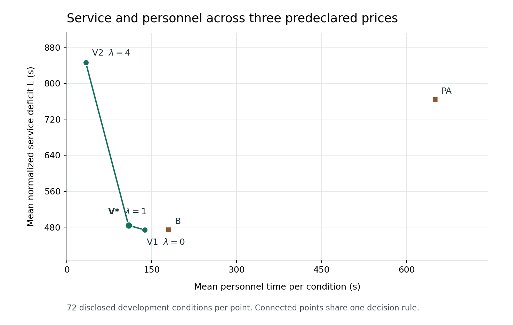

# T4a　风险驱动核查处置与组合现状的公开开发结果

**在六族 72 条已公开开发条件上，事前指定的 V*（V3，λ=1）相对组合现状 PA，平均每条减少 279.2 秒归一化服务缺额，少占用 541.7 人秒。** V* 和 PA 的平均 L 分别为 483.9、763.2 秒。以条件为单位、在族内配对重抽 10,000 次，V*−PA 的均差为 −279.2 秒，95% 区间为 [−423.1, −147.9]。逐条件为 13 行降低、56 行持平、3 行升高。平均人员占用为 109.1 对 650.8 秒。开发面板上，预设的服务和人力两个要求均满足。144 条留出仍待另行确认。[机器可读结果](development-result.json.gz) · [确认协议](confirmation-protocol.md)

**透明直接处置 B 提供了更严格的服务参照。** B 在全部 72 行达到 T3 给出的合法最小 L，平均 473.9 秒。V* 相对 B 有 64 行持平、8 行缺额更大，平均多 10.0 秒，95% 区间为 [4.4, 15.8]，同时少用 71.2 人秒。按单纯服务排序的 V1 也逐行达界，实际自选初检为零。开发数据支持风险驱动方法相对当前组合流程的服务和人力收益，支持 V* 相对 B 的人力节省。单独归因于购买信息的服务增量仍缺少专门的对照。[三版源码与设置](../../../src/aegis_risk_dispatch) · [逐条件原件和作业索引](receipt.json)

| 处理 | λ | 平均 L（秒） | 人秒／行 | 工具秒／行 | 发行费／行 | 实际初检次数 | 相对 PA 的平均 ΔL（95% 区间） |
|---|---:|---:|---:|---:|---:|---:|---|
| V1 | 0 | 473.9 | 137.7 | 137.7 | 2.83 | 0 | −289.2 [−434.6, −156.0] |
| V2 | 4 | 845.8 | 33.7 | 33.7 | 0.82 | 5 | +82.7 [−107.6, +273.7] |
| **V3（V*）** | **1** | **483.9** | **109.1** | **109.1** | **2.31** | **27** | **−279.2 [−423.1, −147.9]** |
| PA 组合现状 | — | 763.2 | 650.8 | 650.8 | 12.04 | 97 | 参照 |
| B 透明直接处置 | — | 473.9 | 180.3 | 180.3 | 3.61 | 0 | — |

图中各点是同一批 72 个条件的实际均值。连线依价格 0、1、4 的次序连接三个观测点，区间内其他价格尚未测量。每行内人员与工具的实际占用在本次作业配方下相等。一个发行费用单位代表一次请求。[可缩放的 PDF 图](service-personnel.pdf)

## 哪些条件改变了判断

- **两条网络目标行揭示了行动本身的价值。** 2-02 中，V* 在 0 秒发出核查，35 秒采样、50 秒收到读数，180 秒发出修正，240 秒复核。2-12 中它在 180 秒直接修正。两条的 L 均为 0，PA 分别为 1500 和 1200 秒，B 两条也均为 0。第三条预登记目标 5-07 只能部分挽回，V*、PA、B 均到达 360 秒的合法下界。
- **伦敦孪生条件展示了证据如何改变实际动作。** 5-04 与 5-10 在仅有既有保护时全程具有相同的 61 个公共帧。V* 在两行均于 0 秒请求 LB 核查，结果在 50 秒合法到达，读数中释放许可分别为真、假。5-04 在 720 秒申请恢复 LB 路径，5-10 同时点申请 LG 预启动，各自取得执行后的复核。两行 V*、PA、B 的服务缺额均为 0。此例展示了读取后发生的派工差异，服务下界也能由直接规则到达。
- **V* 相对 PA 较差的三行全部保留。** 有限备用 3-02 的 L 为 416.25 对 371.25 秒，V* 先核查再处置。荷兰式 6-02、6-09 各为 120 对 0 秒，V* 仅在后段申请泵操作。伦敦式全族的 V*−PA 为 −90.0 秒 [−225.0, 0.0]，荷兰式为 −645.0 秒 [−1095.0, −215.0]，各 12 行。水侧／热和冷却／通行两族均差为 0。
- **0000 和 1100 说明了不同的代价。** 在既有保护零损失的 18 条 0000 条件中，V* 在 12 行有支出，累计 11 次初检和 1 次等值写入，平均 49.4 人秒，服务差为零。有余量且缺少两类及时信息机会的 8 条 1100 条件中，V* 8 行的服务均优于 PA，累计 2 次初检、8 次处置，平均 109.4 人秒。B 在同一层的服务仍更好，V*−B 平均为 +39.4 秒。这些层号与合法最晚启动时刻只在评价端使用。
- **服务与有效关闭给出不同排序。** 每个角色有 204 个具名工单实例。H 末 V* 取得 NA 9 个、PV 33 个，PA 为 15、44，B 为 0、66。相对 P 与 T3 合法最小 L 之间的总余量，V* 仍有 720.0／56,240.25＝1.28% 的剩余差距。以 PA 作分母时为 720.0／20,825.0＝3.46%。完整四时点及首次关闭均在下表与逐行记录中。[逐条件服务、费用和工单记录](development-result.json.gz)

## 方法、价格与开发变更

V 每 60 秒接收上一时刻以来已合法到达的记录、公开工单、付费读数、本人回执和公开配方。它合并同源副本，按工单更新原因后验。行动集合含暂缓、检查后按读数续决策及当下合法的具名处置。每个可行读数只配一条共同的续决策，再对完整一小时的预测缺额及成本取期望。成功分支需满足占用、路径、许可、截止和本人复核要求。实际动作由独立设施运行和评分。T3 的生成分布、先验与通道似然属于**设计知识**，包含近似的冷热、需求和退化关系。热过程预测使用有限代理。数据适用域为公开、同账号的八域合成设施开发面板。[方法与信息边界](protocol.md) · [续决策实现](../../../src/aegis_risk_dispatch/planning.py)

PA 在同一真实人员、工具和派工时钟上合并固定巡检与报警响应，办理到期本人复核，报警在巡检冲突时优先。B 对合法资料和工单按固定优先级直接申请有权操作。二者均以独立状态从共同输入运行。PA 的实际均值 763.1771 秒恰与先看完两条旧基线后逐行择优的均值相同。所有 PA 比较使用新运行的 72 份实际轨迹。[两条对照的决策入口](../../../src/aegis_risk_dispatch/policy.py)

三个版本共用源码，只改变 λ。目标函数为 E[L] + λ ×（E[人秒] + 30 × E[发行费]），工具按硬预算检查，人员与费用的换算属于事前设计价格。V1 在 27 行出现未生效或等值写入，16 行在 P 零损失时仍付费。记录这些行后，V2 按计划把 λ 提到 4，相应数字降到 4 和 2，但 19 行的 L 高于 PA、27 行高于合法最小。记录这组失败后，执行事前指定的中间价格 V3。V3 的上述写入问题出现在 6 行，P 零损失时有支出的为 12 行，L 高于合法最小的为 8 行。三个版本均保留全部 72 行，价格选择与行号无关。[事前协议](protocol.md) · [版本转换和作业记录](receipt.json)

## 执行身份、算力与停止点

- 科学程序、分析及参数在 `fb3bf150` 固定。第一次设施启动前，作业 `134799` 已用相同公开历史、不同私有输入对三版分别核对 61 个时点；完整决策与理由逐点一致，另有付费证据改变后验、同源副本、超前输入拒绝和具名复核正例。见证发布于 `8483b053`。[隔离见证](isolation-witness.json) · [逐时点摘要](isolation-ticks.json.gz)
- 六族各一个 V1 试点，计入正式分母。最大完整时间为 93.21 秒，据此将剩余每个位置的申请定为 3 分钟，预计 29 个作业、67,620 预留 CPU 秒。两个版本转换均在前一版完整返回并记录失败类别后执行。最终 360 个原生位置使用 360 个独立决策进程，产生 21,960 次公共决定。上一批的周期巡检、报警、P、全知直接读取 T3 封存结果。[输入与源码冻结](freeze.json) · [T3 验收](../t3-prior-information-v2/acceptance-20261122.json)
- 作业 `134827` 仅从保存结果重抽、核对原件并制表，读取所有原始轨迹的决策首部并重新核对完整文件的 SHA-256。作业 `134828` 从同一份均值调整图中文字位置，另申领 60 CPU 秒。原图与修订图均留存。合计 30／40 个作业、67,680／108,000 预留 CPU 秒，即 **18 小时 48 分／30 小时**。Slurm 按作业墙时乘分配核数合计 36,369 秒。全部作业正常退出，设施位置重跑 0，未执行后缀为空。评估端保留实际拒绝、失败写入和缺少关闭的结果。[单份完整性与作业回执](receipt.json)
- 最终冻结角色为 V3。144 条留出按六族各 24 条预登记。主终点要求 V*−PA 的平均 L 差 95% 区间上界严格小于零，且 V* 的平均人员秒不超过 PA。当前为开发交付待审。留出只沿用 T3 已登记的 32 字节种子公开承诺，生成、运行及结果访问均为 0。普通改进和 RSI 执行数也均为 0。[V* 完整冻结](vstar-freeze.json) · [已锁定的留出协议](confirmation-protocol.md) · [原种子承诺](../t3-prior-information-v2/holdout-commitment.json)

## 配对结果与资源账

所有差值均为 V 减该对照。L 用归一化服务缺额秒，U 用未交付服务单位·秒。每条条件的全部角色共享同一重抽索引。负的服务差有利于 V。区间由 10,000 次族内配对重抽取得。

| 版本 | 对照 | ΔL [95% 区间] | ΔU [95% 区间] | L 较低／同／较高 | Δ人秒 | Δ工具秒 | Δ发行费 |
| --- | --- | --- | --- | --- | --- | --- | --- |
| V1 | 周期巡检 | -476.9 [-641.0, -313.6] | -476.9 [-641.0, -313.6] | 20/52/0 | -490.4 | -490.4 | -8.3 |
| V1 | 报警响应 | -481.2 [-652.1, -317.4] | -481.2 [-652.1, -317.4] | 27/45/0 | 43.2 | 43.2 | 1.1 |
| V1 | PA | -289.2 [-434.6, -156.0] | -289.2 [-434.6, -156.0] | 13/59/0 | -513.1 | -513.1 | -9.2 |
| V1 | B | 0.0 [0.0, 0.0] | 0.0 [0.0, 0.0] | 0/72/0 | -42.6 | -42.6 | -0.8 |
| V2 | 周期巡检 | -105.0 [-308.2, 102.9] | -105.0 [-308.2, 102.9] | 15/39/18 | -594.4 | -594.4 | -10.3 |
| V2 | 报警响应 | -109.3 [-271.0, 50.0] | -109.3 [-271.0, 50.0] | 9/58/5 | -60.8 | -60.8 | -0.9 |
| V2 | PA | 82.7 [-107.6, 273.7] | 82.7 [-107.6, 273.7] | 9/44/19 | -617.1 | -617.1 | -11.2 |
| V2 | B | 371.9 [234.8, 525.2] | 371.9 [234.8, 525.2] | 0/45/27 | -146.6 | -146.6 | -2.8 |
| V3 | 周期巡检 | -466.9 [-629.0, -305.7] | -466.9 [-629.0, -305.7] | 20/50/2 | -519.0 | -519.0 | -8.8 |
| V3 | 报警响应 | -471.2 [-641.9, -308.0] | -471.2 [-641.9, -308.0] | 25/46/1 | 14.6 | 14.6 | 0.6 |
| V3 | PA | -279.2 [-423.1, -147.9] | -279.2 [-423.1, -147.9] | 13/56/3 | -541.7 | -541.7 | -9.7 |
| V3 | B | 10.0 [4.4, 15.8] | 10.0 [4.4, 15.8] | 0/64/8 | -71.2 | -71.2 | -1.3 |

## 四个业务点和工单分母

四联数依次对应 900、1800、2700、3600 秒。NA 表示有合法证据关闭且未处置，PV 表示处置后经过具名复核关闭。每个数字计当前有效的工单实例。同一实例可在不同业务点出现。曾达列在每一类型内各去重一次。

| 角色 | 平均 L | 平均 U | 人秒／行 | 工具秒／行 | 发行费／行 | 工单实例 | 曾达 NA／PV | 当前 NA | 当前 PV |
| --- | --- | --- | --- | --- | --- | --- | --- | --- | --- |
| V1 | 473.9 | 473.9 | 137.7 | 137.7 | 2.8 | 204 | 0/54 | 0/0/0/0 | 12/45/51/52 |
| V2 | 845.8 | 845.8 | 33.7 | 33.7 | 0.8 | 204 | 1/13 | 1/1/1/1 | 5/4/11/11 |
| V3 | 483.9 | 483.9 | 109.1 | 109.1 | 2.3 | 204 | 9/35 | 9/9/9/9 | 8/26/32/33 |
| 周期巡检 | 950.9 | 950.9 | 628.1 | 628.1 | 11.1 | 204 | 24/28 | 24/22/24/24 | 25/28/26/27 |
| 报警响应 | 955.1 | 955.1 | 94.5 | 94.5 | 1.7 | 204 | 0/28 | 0/0/0/0 | 14/26/26/26 |
| PA | 763.2 | 763.2 | 650.8 | 650.8 | 12.0 | 204 | 19/46 | 15/13/15/15 | 33/44/43/44 |
| B | 473.9 | 473.9 | 180.3 | 180.3 | 3.6 | 204 | 0/68 | 0/0/0/0 | 52/59/65/66 |
| P | 1255.1 | 1255.1 | 0.0 | 0.0 | 0.0 | 204 | 0/0 | 0/0/0/0 | 0/0/0/0 |
| ORACLE | 473.9 | 473.9 | 81.5 | 81.5 | 1.7 | 204 | 0/37 | 0/0/0/0 | 6/29/35/36 |

## 分族与实际信息层

四位编码顺序为既有保护有损失、存在合法可挽回余量、报警在截止前可用、事前记录或付费读数在截止前可用。一个格内保留原有的族组成和条件数。只有一行或各行全相同时，重抽区间可以退化。
下表给出 ΔL／ΔU 及各自区间。两组数值及区间完全相同的单元格合写一次。

| 范围 | 条件数 | 版 | 相对周期巡检 | 相对报警响应 | 相对 PA | 相对 B |
| --- | --- | --- | --- | --- | --- | --- |
| 冷却／通行 | 12 | V1 | -125.3 [-376.0, 0.0] | -403.2 [-819.9, 0.0] | 0.0 [0.0, 0.0] | 0.0 [0.0, 0.0] |
| 冷却／通行 | 12 | V2 | 403.2 [-111.8, 931.7] | 125.3 [0.0, 376.0] | 528.5 [125.3, 945.2] | 528.5 [125.3, 945.2] |
| 冷却／通行 | 12 | V3 | -125.3 [-376.0, 0.0] | -403.2 [-819.9, 0.0] | 0.0 [0.0, 0.0] | 0.0 [0.0, 0.0] |
| 伦敦式 | 12 | V1 | -90.0 [-225.0, 0.0] | -290.0 [-425.0, -135.0] | -90.0 [-225.0, 0.0] | 0.0 [0.0, 0.0] |
| 伦敦式 | 12 | V2 | 245.0 [105.0, 400.0] | 45.0 [0.0, 135.0] | 245.0 [105.0, 400.0] | 335.0 [195.0, 470.0] |
| 伦敦式 | 12 | V3 | -90.0 [-225.0, 0.0] | -290.0 [-425.0, -135.0] | -90.0 [-225.0, 0.0] | 0.0 [0.0, 0.0] |
| 荷兰式 | 12 | V1 | -695.0 [-1160.0, -260.0] | -865.0 [-1325.0, -420.0] | -695.0 [-1160.0, -260.0] | 0.0 [0.0, 0.0] |
| 荷兰式 | 12 | V2 | -495.0 [-1065.0, 100.0] | -665.0 [-1110.0, -240.0] | -495.0 [-1065.0, 100.0] | 200.0 [30.0, 500.0] |
| 荷兰式 | 12 | V3 | -645.0 [-1095.0, -215.0] | -815.0 [-1265.0, -375.0] | -645.0 [-1095.0, -215.0] | 50.0 [20.0, 80.0] |
| 网络／供电 | 12 | V1 | -812.5 [-1312.5, -325.0] | -412.5 [-875.0, 0.0] | -412.5 [-875.0, 0.0] | 0.0 [0.0, 0.0] |
| 网络／供电 | 12 | V2 | -625.0 [-1087.5, -212.5] | -225.0 [-550.0, 0.0] | -225.0 [-550.0, 0.0] | 187.5 [0.0, 562.5] |
| 网络／供电 | 12 | V3 | -812.5 [-1312.5, -325.0] | -412.5 [-875.0, 0.0] | -412.5 [-875.0, 0.0] | 0.0 [0.0, 0.0] |
| 有限备用 | 12 | V1 | -1138.9 [-1806.6, -534.2] | -537.9 [-1138.9, 0.0] | -537.9 [-1138.9, 0.0] | 0.0 [0.0, 0.0] |
| 有限备用 | 12 | V2 | -801.2 [-1402.2, -200.3] | -200.3 [-801.2, 400.6] | -200.3 [-801.2, 400.6] | 337.6 [0.0, 805.0] |
| 有限备用 | 12 | V3 | -1128.9 [-1791.7, -527.9] | -527.9 [-1125.1, 0.0] | -527.9 [-1125.1, 0.0] | 10.0 [0.0, 21.2] |
| 水侧／热 | 12 | V1 | 0.0 [0.0, 0.0] | -378.6 [-768.2, 0.0] | 0.0 [0.0, 0.0] | 0.0 [0.0, 0.0] |
| 水侧／热 | 12 | V2 | 642.8 [250.7, 1073.2] | 264.2 [0.0, 653.8] | 642.8 [250.7, 1073.2] | 642.8 [250.7, 1073.2] |
| 水侧／热 | 12 | V3 | 0.0 [0.0, 0.0] | -378.6 [-768.2, 0.0] | 0.0 [0.0, 0.0] | 0.0 [0.0, 0.0] |
| 0000 | 18 | V1 | 0.0 [0.0, 0.0] | 0.0 [0.0, 0.0] | 0.0 [0.0, 0.0] | 0.0 [0.0, 0.0] |
| 0000 | 18 | V2 | 0.0 [0.0, 0.0] | 0.0 [0.0, 0.0] | 0.0 [0.0, 0.0] | 0.0 [0.0, 0.0] |
| 0000 | 18 | V3 | 0.0 [0.0, 0.0] | 0.0 [0.0, 0.0] | 0.0 [0.0, 0.0] | 0.0 [0.0, 0.0] |
| 1000 | 14 | V1 | 0.0 [0.0, 0.0] | 0.0 [0.0, 0.0] | 0.0 [0.0, 0.0] | 0.0 [0.0, 0.0] |
| 1000 | 14 | V2 | 0.0 [0.0, 0.0] | 0.0 [0.0, 0.0] | 0.0 [0.0, 0.0] | 0.0 [0.0, 0.0] |
| 1000 | 14 | V3 | 0.0 [0.0, 0.0] | 0.0 [0.0, 0.0] | 0.0 [0.0, 0.0] | 0.0 [0.0, 0.0] |
| 1100 | 8 | V1 | -1665.6 [-1808.9, -1459.7] | -1665.6 [-1808.9, -1459.7] | -1665.6 [-1808.9, -1459.7] | 0.0 [0.0, 0.0] |
| 1100 | 8 | V2 | -1013.4 [-1351.4, -412.5] | -1013.4 [-1351.4, -412.5] | -1013.4 [-1351.4, -412.5] | 652.2 [446.2, 1047.2] |
| 1100 | 8 | V3 | -1626.2 [-1767.7, -1418.4] | -1626.2 [-1767.7, -1418.4] | -1626.2 [-1767.7, -1418.4] | 39.4 [30.0, 46.9] |
| 1101 | 16 | V1 | -168.8 [-187.5, -150.0] | -1032.6 [-1232.1, -890.1] | -168.8 [-187.5, -150.0] | 0.0 [0.0, 0.0] |
| 1101 | 16 | V2 | 695.1 [552.6, 892.9] | -168.8 [-187.5, -150.0] | 695.1 [552.6, 892.9] | 863.8 [723.6, 1063.6] |
| 1101 | 16 | V3 | -153.8 [-180.0, -127.5] | -1017.6 [-1232.1, -867.6] | -153.8 [-180.0, -127.5] | 15.0 [0.0, 22.5] |
| 1110 | 2 | V1 | -2403.8 [-2403.8, -2403.8] | 0.0 [0.0, 0.0] | 0.0 [0.0, 0.0] | 0.0 [0.0, 0.0] |
| 1110 | 2 | V2 | -1201.9 [-2403.8, 0.0] | 1201.9 [0.0, 2403.8] | 1201.9 [0.0, 2403.8] | 1201.9 [0.0, 2403.8] |
| 1110 | 2 | V3 | -2381.2 [-2403.8, -2358.8] | 22.5 [0.0, 45.0] | 22.5 [0.0, 45.0] | 22.5 [0.0, 45.0] |
| 1111 | 14 | V1 | -964.8 [-1190.1, -771.7] | -342.9 [-385.7, -321.4] | -342.9 [-385.7, -321.4] | 0.0 [0.0, 0.0] |
| 1111 | 14 | V2 | -583.8 [-960.6, -219.8] | 38.2 [-209.7, 280.0] | 38.2 [-209.7, 280.0] | 381.1 [146.0, 610.6] |
| 1111 | 14 | V3 | -956.3 [-1179.4, -763.1] | -334.3 [-385.7, -295.7] | -334.3 [-385.7, -295.7] | 8.6 [0.0, 25.7] |

### 各范围的资源与关闭

资源为每行实耗均值。初检数计实际发行的具名 I 请求。操作列在三版 V、PA、B 中计收到物理写入结果的 A 操作，在原巡检和报警账中计实际发行的 A 请求。各版与四条对照均使用相同的条件和工单分母。

| 范围 | 条件／工单 | 角色 | 人秒 | 工具秒 | 发行费 | 初检／操作 | 曾达 NA／PV | 当前 NA | 当前 PV |
| --- | --- | --- | --- | --- | --- | --- | --- | --- | --- |
| 冷却／通行 | 12/31 | V1 | 187.5 | 187.5 | 2.5 | 0/10 | 0/9 | 0/0/0/0 | 0/9/9/9 |
| 冷却／通行 | 12/31 | V2 | 37.5 | 37.5 | 0.5 | 0/2 | 0/2 | 0/0/0/0 | 0/2/2/2 |
| 冷却／通行 | 12/31 | V3 | 152.9 | 152.9 | 2.1 | 1/8 | 0/7 | 0/0/0/0 | 0/7/7/7 |
| 冷却／通行 | 12/31 | 周期巡检 | 472.9 | 472.9 | 10.1 | 9/8 | 1/6 | 1/1/1/1 | 6/6/6/6 |
| 冷却／通行 | 12/31 | 报警响应 | 168.8 | 168.8 | 2.2 | 0/9 | 0/6 | 0/0/0/0 | 6/6/6/6 |
| 冷却／通行 | 12/31 | PA | 505.0 | 505.0 | 11.0 | 9/12 | 0/9 | 0/0/0/0 | 9/9/9/9 |
| 冷却／通行 | 12/31 | B | 225.0 | 225.0 | 3.0 | 0/12 | 0/9 | 0/0/0/0 | 9/9/9/9 |
| 伦敦式 | 12/36 | V1 | 110.8 | 110.8 | 3.2 | 0/16 | 0/11 | 0/0/0/0 | 0/11/10/11 |
| 伦敦式 | 12/36 | V2 | 0.0 | 0.0 | 0.0 | 0/0 | 0/0 | 0/0/0/0 | 0/0/0/0 |
| 伦敦式 | 12/36 | V3 | 99.2 | 99.2 | 2.8 | 7/8 | 3/8 | 3/3/3/3 | 0/8/7/8 |
| 伦敦式 | 12/36 | 周期巡检 | 548.3 | 548.3 | 15.7 | 30/13 | 6/12 | 6/6/6/6 | 10/12/11/12 |
| 伦敦式 | 12/36 | 报警响应 | 40.8 | 40.8 | 1.2 | 0/6 | 0/4 | 0/0/0/0 | 0/4/4/4 |
| 伦敦式 | 12/36 | PA | 557.1 | 557.1 | 15.9 | 30/16 | 6/13 | 4/4/4/4 | 10/13/12/13 |
| 伦敦式 | 12/36 | B | 192.5 | 192.5 | 5.5 | 0/27 | 0/19 | 0/0/0/0 | 12/19/18/19 |
| 荷兰式 | 12/36 | V1 | 165.4 | 165.4 | 3.8 | 0/17 | 0/14 | 0/0/0/0 | 0/9/14/14 |
| 荷兰式 | 12/36 | V2 | 49.6 | 49.6 | 1.4 | 0/7 | 0/5 | 0/0/0/0 | 0/0/5/5 |
| 荷兰式 | 12/36 | V3 | 83.3 | 83.3 | 2.1 | 3/8 | 2/6 | 2/2/2/2 | 0/1/6/6 |
| 荷兰式 | 12/36 | 周期巡检 | 1457.1 | 1457.1 | 14.2 | 30/5 | 13/4 | 13/11/13/13 | 3/4/3/3 |
| 荷兰式 | 12/36 | 报警响应 | 57.5 | 57.5 | 0.8 | 0/3 | 0/3 | 0/0/0/0 | 0/3/2/2 |
| 荷兰式 | 12/36 | PA | 1406.2 | 1406.2 | 14.6 | 30/7 | 13/6 | 11/9/11/11 | 3/6/5/5 |
| 荷兰式 | 12/36 | B | 264.2 | 264.2 | 5.2 | 0/23 | 0/19 | 0/0/0/0 | 10/14/19/19 |
| 网络／供电 | 12/31 | V1 | 70.0 | 70.0 | 2.0 | 0/12 | 0/0 | 0/0/0/0 | 0/0/0/0 |
| 网络／供电 | 12/31 | V2 | 46.7 | 46.7 | 1.3 | 4/6 | 0/0 | 0/0/0/0 | 0/0/0/0 |
| 网络／供电 | 12/31 | V3 | 64.2 | 64.2 | 1.8 | 8/7 | 0/0 | 0/0/0/0 | 0/0/0/0 |
| 网络／供电 | 12/31 | 周期巡检 | 400.0 | 400.0 | 8.0 | 10/0 | 0/0 | 0/0/0/0 | 0/0/0/0 |
| 网络／供电 | 12/31 | 报警响应 | 52.5 | 52.5 | 1.5 | 0/9 | 0/0 | 0/0/0/0 | 0/0/0/0 |
| 网络／供电 | 12/31 | PA | 452.5 | 452.5 | 9.5 | 10/9 | 0/0 | 0/0/0/0 | 0/0/0/0 |
| 网络／供电 | 12/31 | B | 70.0 | 70.0 | 2.0 | 0/12 | 0/0 | 0/0/0/0 | 0/0/0/0 |
| 有限备用 | 12/40 | V1 | 105.0 | 105.0 | 3.0 | 0/12 | 0/12 | 0/0/0/0 | 12/8/10/10 |
| 有限备用 | 12/40 | V2 | 49.6 | 49.6 | 1.4 | 1/5 | 1/5 | 1/1/1/1 | 5/1/3/3 |
| 有限备用 | 12/40 | V3 | 102.1 | 102.1 | 2.9 | 7/8 | 4/8 | 4/4/4/4 | 8/4/6/6 |
| 有限备用 | 12/40 | 周期巡检 | 411.7 | 411.7 | 8.3 | 9/0 | 4/0 | 4/4/4/4 | 0/0/0/0 |
| 有限备用 | 12/40 | 报警响应 | 78.8 | 78.8 | 2.2 | 0/9 | 0/9 | 0/0/0/0 | 3/7/8/8 |
| 有限备用 | 12/40 | PA | 478.8 | 478.8 | 10.2 | 9/9 | 0/9 | 0/0/0/0 | 3/7/8/8 |
| 有限备用 | 12/40 | B | 105.0 | 105.0 | 3.0 | 0/12 | 0/12 | 0/0/0/0 | 12/8/10/10 |
| 水侧／热 | 12/30 | V1 | 187.5 | 187.5 | 2.5 | 0/10 | 0/8 | 0/0/0/0 | 0/8/8/8 |
| 水侧／热 | 12/30 | V2 | 18.8 | 18.8 | 0.2 | 0/1 | 0/1 | 0/0/0/0 | 0/1/1/1 |
| 水侧／热 | 12/30 | V3 | 152.9 | 152.9 | 2.1 | 1/8 | 0/6 | 0/0/0/0 | 0/6/6/6 |
| 水侧／热 | 12/30 | 周期巡检 | 478.8 | 478.8 | 10.2 | 9/9 | 0/6 | 0/0/0/0 | 6/6/6/6 |
| 水侧／热 | 12/30 | 报警响应 | 168.8 | 168.8 | 2.2 | 0/9 | 0/6 | 0/0/0/0 | 5/6/6/6 |
| 水侧／热 | 12/30 | PA | 505.0 | 505.0 | 11.0 | 9/12 | 0/9 | 0/0/0/0 | 8/9/9/9 |
| 水侧／热 | 12/30 | B | 225.0 | 225.0 | 3.0 | 0/12 | 0/9 | 0/0/0/0 | 9/9/9/9 |
| 0000 | 18/54 | V1 | 138.6 | 138.6 | 2.6 | 0/18 | 0/13 | 0/0/0/0 | 3/13/13/13 |
| 0000 | 18/54 | V2 | 3.9 | 3.9 | 0.1 | 2/0 | 0/0 | 0/0/0/0 | 0/0/0/0 |
| 0000 | 18/54 | V3 | 49.4 | 49.4 | 1.2 | 11/1 | 8/1 | 8/8/8/8 | 0/1/1/1 |
| 0000 | 18/54 | 周期巡检 | 654.4 | 654.4 | 11.1 | 26/4 | 19/4 | 19/18/19/19 | 4/4/4/4 |
| 0000 | 18/54 | 报警响应 | 150.3 | 150.3 | 2.6 | 0/17 | 0/13 | 0/0/0/0 | 5/13/13/13 |
| 0000 | 18/54 | PA | 688.9 | 688.9 | 12.8 | 26/19 | 15/15 | 11/10/11/11 | 8/15/15/15 |
| 0000 | 18/54 | B | 223.6 | 223.6 | 4.1 | 0/28 | 0/21 | 0/0/0/0 | 15/21/21/21 |
| 1000 | 14/38 | V1 | 85.7 | 85.7 | 1.7 | 0/9 | 0/3 | 0/0/0/0 | 3/2/2/2 |
| 1000 | 14/38 | V2 | 20.0 | 20.0 | 0.6 | 2/2 | 1/1 | 1/1/1/1 | 1/0/0/0 |
| 1000 | 14/38 | V3 | 78.2 | 78.2 | 1.5 | 3/6 | 1/2 | 1/1/1/1 | 2/1/1/1 |
| 1000 | 14/38 | 周期巡检 | 505.4 | 505.4 | 9.7 | 15/5 | 1/0 | 1/1/1/1 | 0/0/0/0 |
| 1000 | 14/38 | 报警响应 | 133.9 | 133.9 | 2.4 | 0/12 | 0/3 | 0/0/0/0 | 0/2/2/2 |
| 1000 | 14/38 | PA | 547.9 | 547.9 | 10.9 | 15/12 | 0/3 | 0/0/0/0 | 0/2/2/2 |
| 1000 | 14/38 | B | 133.9 | 133.9 | 2.4 | 0/12 | 0/3 | 0/0/0/0 | 3/2/2/2 |
| 1100 | 8/25 | V1 | 135.6 | 135.6 | 3.9 | 0/12 | 0/9 | 0/0/0/0 | 3/5/8/8 |
| 1100 | 8/25 | V2 | 52.5 | 52.5 | 1.5 | 0/4 | 0/4 | 0/0/0/0 | 2/0/3/3 |
| 1100 | 8/25 | V3 | 109.4 | 109.4 | 3.1 | 2/8 | 0/7 | 0/0/0/0 | 3/3/6/6 |
| 1100 | 8/25 | 周期巡检 | 628.8 | 628.8 | 10.0 | 2/0 | 0/0 | 0/0/0/0 | 0/0/0/0 |
| 1100 | 8/25 | 报警响应 | 0.0 | 0.0 | 0.0 | 0/0 | 0/0 | 0/0/0/0 | 0/0/0/0 |
| 1100 | 8/25 | PA | 628.8 | 628.8 | 10.0 | 2/0 | 0/0 | 0/0/0/0 | 0/0/0/0 |
| 1100 | 8/25 | B | 161.9 | 161.9 | 4.6 | 0/14 | 0/11 | 0/0/0/0 | 7/7/10/10 |
| 1101 | 16/44 | V1 | 160.0 | 160.0 | 3.1 | 0/19 | 0/14 | 0/0/0/0 | 0/14/13/14 |
| 1101 | 16/44 | V2 | 13.1 | 13.1 | 0.4 | 0/4 | 0/0 | 0/0/0/0 | 0/0/0/0 |
| 1101 | 16/44 | V3 | 160.0 | 160.0 | 3.1 | 7/16 | 0/12 | 0/0/0/0 | 0/12/11/12 |
| 1101 | 16/44 | 周期巡检 | 705.6 | 705.6 | 13.3 | 32/17 | 3/16 | 3/2/3/3 | 14/16/15/16 |
| 1101 | 16/44 | 报警响应 | 0.0 | 0.0 | 0.0 | 0/0 | 0/0 | 0/0/0/0 | 0/0/0/0 |
| 1101 | 16/44 | PA | 690.0 | 690.0 | 13.3 | 32/17 | 3/16 | 3/2/3/3 | 14/16/15/16 |
| 1101 | 16/44 | B | 191.9 | 191.9 | 3.8 | 0/23 | 0/17 | 0/0/0/0 | 15/17/16/17 |
| 1110 | 2/7 | V1 | 105.0 | 105.0 | 3.0 | 0/2 | 0/2 | 0/0/0/0 | 2/1/2/2 |
| 1110 | 2/7 | V2 | 52.5 | 52.5 | 1.5 | 0/1 | 0/1 | 0/0/0/0 | 1/0/1/1 |
| 1110 | 2/7 | V3 | 122.5 | 122.5 | 3.5 | 1/2 | 0/2 | 0/0/0/0 | 2/1/2/2 |
| 1110 | 2/7 | 周期巡检 | 400.0 | 400.0 | 8.0 | 2/0 | 0/0 | 0/0/0/0 | 0/0/0/0 |
| 1110 | 2/7 | 报警响应 | 105.0 | 105.0 | 3.0 | 0/2 | 0/2 | 0/0/0/0 | 2/1/2/2 |
| 1110 | 2/7 | PA | 505.0 | 505.0 | 11.0 | 2/2 | 0/2 | 0/0/0/0 | 2/1/2/2 |
| 1110 | 2/7 | B | 105.0 | 105.0 | 3.0 | 0/2 | 0/2 | 0/0/0/0 | 2/1/2/2 |
| 1111 | 14/36 | V1 | 168.9 | 168.9 | 3.4 | 0/17 | 0/13 | 0/0/0/0 | 1/10/13/13 |
| 1111 | 14/36 | V2 | 95.7 | 95.7 | 2.0 | 1/10 | 0/7 | 0/0/0/0 | 1/4/7/7 |
| 1111 | 14/36 | V3 | 156.4 | 156.4 | 3.0 | 3/14 | 0/11 | 0/0/0/0 | 1/8/11/11 |
| 1111 | 14/36 | 周期巡检 | 660.7 | 660.7 | 11.1 | 20/9 | 1/8 | 1/1/1/1 | 7/8/7/7 |
| 1111 | 14/36 | 报警响应 | 143.9 | 143.9 | 2.6 | 0/14 | 0/10 | 0/0/0/0 | 7/10/9/9 |
| 1111 | 14/36 | PA | 693.2 | 693.2 | 12.0 | 20/15 | 1/10 | 1/1/1/1 | 9/10/9/9 |
| 1111 | 14/36 | B | 178.9 | 178.9 | 3.6 | 0/19 | 0/14 | 0/0/0/0 | 10/11/14/14 |

## 1100 与 0000 的动作复查

1100 有可挽回损失且两类及时信息机会均缺失。0000 的既有保护损失为零。NO_EFFECT 是操作未产生写入，等值写入是收到 APPLIED 而目标值相同。显式分开有费用的核查与物理写入；处置未降低服务缺额也可能产生有效关闭。

| 层 | 条件 | 角色 | 有支出行 | 有支出且 L 未低于 P 的行 | 初检 | 全部处置 | NO_EFFECT | 等值写入 | 人秒／行 |
| --- | --- | --- | --- | --- | --- | --- | --- | --- | --- |
| 1100 | 8 | V1 | 8 | 0 | 0 | 12 | 2 | 0 | 135.6 |
| 1100 | 8 | V2 | 4 | 0 | 0 | 4 | 0 | 0 | 52.5 |
| 1100 | 8 | V3 | 8 | 0 | 2 | 8 | 0 | 0 | 109.4 |
| 1100 | 8 | PA | 8 | 8 | 2 | 0 | 0 | 0 | 628.8 |
| 1100 | 8 | B | 8 | 0 | 0 | 14 | 2 | 0 | 161.9 |
| 0000 | 18 | V1 | 16 | 16 | 0 | 18 | 2 | 14 | 138.6 |
| 0000 | 18 | V2 | 2 | 2 | 2 | 0 | 0 | 0 | 3.9 |
| 0000 | 18 | V3 | 12 | 12 | 11 | 1 | 0 | 1 | 49.4 |
| 0000 | 18 | PA | 18 | 18 | 26 | 19 | 1 | 14 | 688.9 |
| 0000 | 18 | B | 18 | 18 | 0 | 28 | 4 | 18 | 223.6 |

## 事前登记的三行及伦敦孪生对

三个 T3 目标行和两条同公开前缀的孪生行全部在下。所列时间是派工时刻；付费列分别给采样与合法到达时刻。L* 为该条件的全知合法评价界。

| 行 | 版本／对照 | 实际 L | L* | 人秒 | 实际派工（秒） | 初检采样／到达（秒） |
| --- | --- | --- | --- | --- | --- | --- |
| 2-02 | V1 | 0.0 | 0.0 | 70.0 | 0 N/n0::A，60 N/n0::R | 无 |
| 2-02 | V2 | 0.0 | 0.0 | 70.0 | 180 N/n0::A，240 N/n0::R | 无 |
| 2-02 | V3 | 0.0 | 0.0 | 105.0 | 0 N/n0::I，180 N/n0::A，240 N/n0::R | N/n0::I 35/50 |
| 2-02 | PA | 1500.0 | 0.0 | 400.0 | 0 C/c0::V0，180 N/n0::I，900 C/c0::V1，960 N/n0::V1，1800 C/c0::V2，1860 N/n0::V2，2700 C/c0::V3，2760 N/n0::V3 | N/n0::I 215/230 |
| 2-02 | B | 0.0 | 0.0 | 70.0 | 0 N/n0::A，60 N/n0::R | 无 |
| 5-04 | V1 | 0.0 | 0.0 | 105.0 | 600 LB::A，660 LB::R，1680 LB::X | 无 |
| 5-04 | V2 | 540.0 | 0.0 | 0.0 | 无 | 无 |
| 5-04 | V3 | 0.0 | 0.0 | 140.0 | 0 LB::I，720 LB::A，780 LB::R，1680 LB::X | LB::I 35/50 |
| 5-04 | PA | 0.0 | 0.0 | 700.0 | 0 LC::I，60 LC::A，120 LC::R，180 LB::I，240 LB::A，300 LB::R，360 LG::I，420 LG::A，480 LG::R，900 LC::V1，960 LB::V1，1020 LG::V1，1680 LB::X，1740 LC::X，1800 LC::V2，1860 LB::V2，1920 LG::V2，2700 LC::V3，2760 LB::V3，2820 LG::V3 | LC::I 35/50，LB::I 215/230，LG::I 395/410 |
| 5-04 | B | 0.0 | 0.0 | 280.0 | 60 LC::A，120 LC::R，180 LB::A，240 LB::R，300 LG::A，360 LG::R，1680 LB::X，1740 LC::X | 无 |
| 5-07 | V1 | 360.0 | 360.0 | 105.0 | 720 LC::A，780 LC::R，1680 LC::X | 无 |
| 5-07 | V2 | 600.0 | 360.0 | 0.0 | 无 | 无 |
| 5-07 | V3 | 360.0 | 360.0 | 140.0 | 60 LB::I，720 LC::A，780 LC::R，1680 LC::X | LB::I 95/110 |
| 5-07 | PA | 360.0 | 360.0 | 525.0 | 0 LC::I，60 LC::A，120 LC::R，180 LB::I，240 LG::I，900 LC::V1，960 LB::V1，1020 LG::V1，1680 LC::X，1800 LC::V2，1860 LB::V2，1920 LG::V2，2700 LC::V3，2760 LB::V3，2820 LG::V3 | LC::I 35/50，LB::I 215/230，LG::I 275/290 |
| 5-07 | B | 360.0 | 360.0 | 105.0 | 60 LC::A，120 LC::R，1680 LC::X | 无 |
| 5-10 | V1 | 0.0 | 0.0 | 140.0 | 600 LB::A，720 LG::A，780 LG::R，1680 LG::X | 无 |
| 5-10 | V2 | 540.0 | 0.0 | 0.0 | 无 | 无 |
| 5-10 | V3 | 0.0 | 0.0 | 140.0 | 0 LB::I，720 LG::A，780 LG::R，1680 LG::X | LB::I 35/50 |
| 5-10 | PA | 0.0 | 0.0 | 630.0 | 0 LC::I，60 LC::A，120 LC::R，180 LB::I，240 LG::I，300 LG::A，360 LG::R，900 LC::V1，960 LB::V1，1020 LG::V1，1680 LC::X，1740 LG::X，1800 LC::V2，1860 LB::V2，1920 LG::V2，2700 LC::V3，2760 LB::V3，2820 LG::V3 | LC::I 35/50，LB::I 215/230，LG::I 275/290 |
| 5-10 | B | 0.0 | 0.0 | 245.0 | 60 LC::A，120 LC::R，180 LB::A，240 LG::A，300 LG::R，1680 LC::X，1740 LG::X | 无 |
| 2-12 | V1 | 0.0 | 0.0 | 70.0 | 180 N/n0::A，240 N/n0::R | 无 |
| 2-12 | V2 | 0.0 | 0.0 | 70.0 | 180 N/n0::A，240 N/n0::R | 无 |
| 2-12 | V3 | 0.0 | 0.0 | 70.0 | 180 N/n0::A，240 N/n0::R | 无 |
| 2-12 | PA | 1200.0 | 0.0 | 400.0 | 60 C/c0::V0，240 N/n0::I，900 C/c0::V1，960 N/n0::V1，1800 C/c0::V2，1860 N/n0::V2，2700 C/c0::V3，2760 N/n0::V3 | N/n0::I 275/290 |
| 2-12 | B | 0.0 | 0.0 | 70.0 | 60 N/n0::A，120 N/n0::R | 无 |

## 付费核查的事前选择与后续实际动作

各版按已登记批次、位置和时钟顺序，取第一次实际选中的初检。候选分支数会包括同一条件在多个时点上的评估。预期续决策按合法读数分组；真实到达后按当时全部公共材料重新选择。

| 版本 | 实际初检次数 | 有读数依赖的候选分支次数 | 零支持时点 | 首个实际初检 | 读数到达后首个派工点 |
| --- | --- | --- | --- | --- | --- |
| V1 | 0 | 720 | 0 | 无 | — |
| V2 | 5 | 243 | 0 | 2-03，60s N/n0::I | 120s WAIT |
| V3 | 27 | 368 | 0 | 2-02，0s N/n0::I | 60s WAIT |

**V2 的第一份初检决策。** 该行 2-03 在 60 秒选择 N/n0::I。下表为该首步所承诺的条件续决策及其预计全窗损失与人秒。

| 可能读数 | 事前概率 | 条件续处置 | 预期 L | 预期人秒 |
| --- | --- | --- | --- | --- |
| CONFIG | 0.4306 | N/n0 | 0.0 | 105.0 |
| LIMIT | 0.5382 | 暂缓 | 1620.0 | 35.0 |
| UNKNOWN | 0.0312 | 暂缓 | 1650.0 | 35.0 |

**V3 的第一份初检决策。** 该行 2-02 在 0 秒选择 N/n0::I。下表为该首步所承诺的条件续决策及其预计全窗损失与人秒。

| 可能读数 | 事前概率 | 条件续处置 | 预期 L | 预期人秒 |
| --- | --- | --- | --- | --- |
| CONFIG | 0.2422 | N/n0 | 179.7 | 122.5 |
| LIMIT | 0.1211 | 暂缓 | 1050.0 | 35.0 |
| OK | 0.6055 | 暂缓 | 1395.0 | 70.0 |
| UNKNOWN | 0.0312 | 暂缓 | 1521.1 | 35.0 |

[全部逐条件结果、各指标未舍入区间及族×层交叉格](development-result.json.gz) · [实际授权、源码、输入和每个位置的原件索引](receipt.json)
