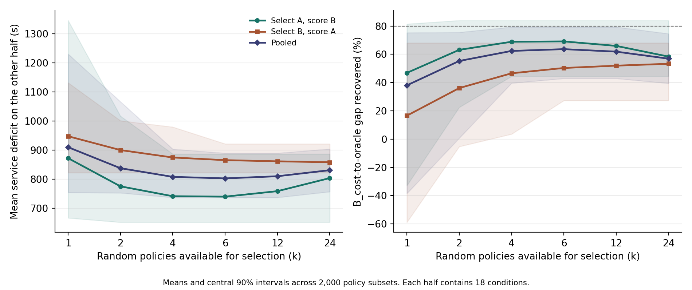

# T5 v3a　策略空间地形与余量诊断

**双向合并的余量回收率在 k=6 时为 63.63%，中央 90% 区间 [42.90%, 79.30%]，在 k=24 时为 56.89%，区间 [39.43%, 74.56%]。预注册判读为「不确定」。** k=6 的期望回收率处于 60% 至 80% 之间。把候选数从 6 增至 24，回收率点估计下降 6.74 个百分点，配对差的中央 90% 区间为 [−28.15, +15.84] 个百分点。后继分支留待审查。

全知动态见证的全板平均 L 为 650.45 秒，认证 36/36。剩余余量以每条平均高于全知的缺额秒计。B_cost、V\*\*、M、M_hot 分别为 **418.77、100.22、214.65、90.22 秒**。v2 锁定的 R 种子 1／2／3 分别为 **183.02／171.06／82.03 秒**，U 种子依次为 418.77／106.32／163.82 秒。各随机向量和参照的逐族分解见下表。

## 跨半板选优与迁移

A、B 各有 18 条条件，六族各三条。每次从 48 个向量中无放回抽取子集，只在选择半板按 L 最小选定向量，然后查它在另一半的真实平均 L。每个 k 共享相同的 2,000 个随机排列。方括号内为不同子集返回值的第 5、95 百分位。两个方向按各自的 B_cost 至全知距离合并。

[矢量图](landscape.pdf)

| k | A 选、B 评 L（秒） | B 选、A 评 L（秒） | 双向合并 L（秒） | A→B 回收 | B→A 回收 | 双向回收 |
| --- | --- | --- | --- | --- | --- | --- |
| 1 | 872.21 [666.99, 1345.36] | 947.64 [822.19, 1131.44] | 909.93 [754.20, 1230.22] | 46.85% [−32.84%, 81.41%] | 16.58% [−58.83%, 68.05%] | 38.04% [−38.45%, 75.23%] |
| 2 | 775.52 [652.04, 1016.82] | 900.07 [822.19, 1000.97] | 837.79 [752.95, 1066.34] | 63.13% [22.49%, 83.93%] | 36.10% [−5.30%, 68.05%] | 55.26% [0.69%, 75.52%] |
| 4 | 741.54 [652.04, 886.68] | 874.58 [822.19, 979.36] | 808.06 [737.12, 903.41] | 68.85% [44.41%, 83.93%] | 46.55% [3.57%, 68.05%] | 62.36% [39.59%, 79.30%] |
| 6 | 740.08 [652.04, 886.68] | 865.44 [822.19, 921.50] | 802.76 [737.12, 889.58] | 69.10% [44.41%, 83.93%] | 50.30% [27.30%, 68.05%] | 63.63% [42.90%, 79.30%] |
| 12 | 758.90 [652.04, 886.68] | 861.45 [822.19, 921.50] | 810.17 [737.12, 889.58] | 65.93% [44.41%, 83.93%] | 51.94% [27.30%, 68.05%] | 61.86% [42.90%, 79.30%] |
| 24 | 803.81 [652.04, 886.68] | 858.17 [822.19, 921.50] | 830.99 [756.99, 904.09] | 58.37% [44.41%, 83.93%] | 53.29% [27.30%, 68.05%] | 56.89% [39.43%, 74.56%] |

A、B 半的 B_cost 均值分别为 988.06 和 1150.39 秒，对应全知均值为 744.31 和 556.60 秒。48 个随机向量在这两半上的平均 L 排名的 Spearman 相关系数为 **0.7173**。

以下按族从 A 取等量条件，在全部 48 个向量中选优，报告所选向量在整个 B 上的平均 L。使用原先固定的接受序号破平。

| A 子集条件数 | 分层子集数 | B 平均 L 的期望与中央 90% 区间（秒） |
| --- | --- | --- |
| 6 | 729 | 743.02 [666.99, 886.68] |
| 12 | 729 | 788.48 [666.99, 886.68] |
| 18 | 1 | 886.68 [886.68, 886.68] |

整块 A 的最优向量在 B 上取得 886.68 秒，超过六条件子集选优后的平均 743.02 秒。A 到 B 的回收率从 k=6 的 69.10% 降至 k=24 的 58.37%，同期 B 到 A 的回收率从 50.30% 升至 53.29%。

## 随机向量的服务分布

| 全板平均 L 的分位数 | 5% | 25% | 50% | 75% | 95% |
| --- | --- | --- | --- | --- | --- |
| 秒 | 754.98 | 789.92 | 851.02 | 937.09 | 1227.81 |

M 的全板平均 L 为 865.10 秒。严格低于 M 的随机向量有 **28/48（58.33%）**，相同值不计入分子。

## 每个策略相对全知的剩余缺额

全板以 36 条条件等权，各族各有 6 条。每格取同一批条件的策略 L 减认证 L* 的均值。未决格保留其原分母。

| 角色 | 有效位置／36 | 全板 L | 全板剩余 | 水侧与热 | 网络与供电 | 有限备用 | 冷却与通行 | 伦敦式 | 荷兰式 |
| --- | --- | --- | --- | --- | --- | --- | --- | --- | --- |
| B_cost | 36/36 | 1069.22 | 418.77 | 228.67 | 747.92 | 1134.79 | 0.00 | 0.00 | 401.25 |
| V\*\* | 36/36 | 750.67 | 100.22 | 373.83 | 57.92 | 109.58 | 0.00 | 0.00 | 60.00 |
| M | 36/36 | 865.10 | 214.65 | 981.83 | 32.92 | 22.50 | 250.67 | 0.00 | 0.00 |
| M_hot | 36/36 | 740.67 | 90.22 | 373.83 | 57.92 | 109.58 | 0.00 | 0.00 | 0.00 |
| MAIN-U-1 | 36/36 | 1069.22 | 418.77 | 228.67 | 747.92 | 1134.79 | 0.00 | 0.00 | 401.25 |
| MAIN-U-2 | 36/36 | 756.77 | 106.32 | 502.50 | 57.92 | 17.50 | 0.00 | 0.00 | 60.00 |
| MAIN-U-3 | 36/36 | 814.27 | 163.82 | 0.00 | 62.92 | 130.00 | 0.00 | 180.00 | 610.00 |
| MAIN-R-1 | 36/36 | 833.47 | 183.02 | 502.50 | 0.00 | 505.63 | 0.00 | 90.00 | 0.00 |
| MAIN-R-2 | 36/36 | 821.51 | 171.06 | 753.17 | 0.00 | 22.50 | 250.67 | 0.00 | 0.00 |
| MAIN-R-3 | 36/36 | 732.48 | 82.03 | 273.83 | 0.00 | 12.50 | 0.00 | 0.00 | 205.83 |
| Q01 | 36/36 | 752.95 | 102.50 | 502.50 | 0.00 | 22.50 | 0.00 | 90.00 | 0.00 |
| Q02 | 36/36 | 801.08 | 150.62 | 502.50 | 32.92 | 72.50 | 0.00 | 90.00 | 205.83 |
| Q03 | 36/36 | 1076.28 | 425.83 | 0.00 | 732.92 | 792.71 | 479.33 | 180.00 | 370.00 |
| Q04 | 36/36 | 1344.43 | 693.98 | 1449.75 | 347.92 | 1066.88 | 529.33 | 270.00 | 500.00 |
| Q05 | 36/36 | 774.76 | 124.31 | 502.50 | 0.00 | 67.50 | 0.00 | 0.00 | 175.83 |
| Q06 | 36/36 | 821.94 | 171.49 | 502.50 | 0.00 | 410.63 | 0.00 | 90.00 | 25.83 |
| Q07 | 36/36 | 898.92 | 248.47 | 981.83 | 0.00 | 12.50 | 250.67 | 90.00 | 155.83 |
| Q08 | 36/36 | 791.06 | 140.61 | 731.17 | 0.00 | 62.50 | 0.00 | 0.00 | 50.00 |
| Q09 | 36/36 | 794.12 | 143.67 | 731.17 | 0.00 | 15.00 | 0.00 | 90.00 | 25.83 |
| Q10 | 36/36 | 900.72 | 250.26 | 1070.50 | 32.92 | 147.50 | 250.67 | 0.00 | 0.00 |
| Q11 | 36/36 | 790.03 | 139.58 | 702.50 | 32.92 | 102.08 | 0.00 | 0.00 | 0.00 |
| Q12 | 36/36 | 794.24 | 143.79 | 564.42 | 0.00 | 22.50 | 0.00 | 90.00 | 185.83 |
| Q13 | 36/36 | 808.70 | 158.25 | 731.17 | 0.00 | 22.50 | 0.00 | 0.00 | 195.83 |
| Q14 | 36/36 | 756.42 | 105.97 | 502.50 | 0.00 | 17.50 | 0.00 | 90.00 | 25.83 |
| Q15 | 36/36 | 964.63 | 314.18 | 564.42 | 47.92 | 132.08 | 300.67 | 270.00 | 570.00 |
| Q16 | 36/36 | 875.67 | 225.22 | 853.17 | 32.92 | 164.58 | 250.67 | 0.00 | 50.00 |
| Q17 | 36/36 | 1230.22 | 579.77 | 842.25 | 722.92 | 804.79 | 228.67 | 180.00 | 700.00 |
| Q18 | 36/36 | 863.80 | 213.35 | 753.17 | 67.92 | 22.50 | 250.67 | 0.00 | 185.83 |
| Q19 | 36/36 | 789.40 | 138.94 | 731.17 | 0.00 | 12.50 | 0.00 | 90.00 | 0.00 |
| Q20 | 36/36 | 788.22 | 137.76 | 731.17 | 32.92 | 62.50 | 0.00 | 0.00 | 0.00 |
| Q21 | 36/36 | 786.42 | 135.97 | 502.50 | 0.00 | 17.50 | 0.00 | 90.00 | 205.83 |
| Q22 | 36/36 | 737.12 | 86.67 | 502.50 | 0.00 | 17.50 | 0.00 | 0.00 | 0.00 |
| Q23 | 36/36 | 758.37 | 107.92 | 502.50 | 0.00 | 55.00 | 0.00 | 90.00 | 0.00 |
| Q24 | 36/36 | 789.56 | 139.11 | 373.83 | 32.92 | 162.08 | 0.00 | 90.00 | 175.83 |
| Q25 | 36/36 | 1060.12 | 409.67 | 1151.92 | 67.92 | 147.50 | 300.67 | 90.00 | 700.00 |
| Q26 | 36/36 | 754.20 | 103.75 | 200.00 | 32.92 | 189.58 | 0.00 | 90.00 | 110.00 |
| Q27 | 36/36 | 890.59 | 240.14 | 981.83 | 0.00 | 22.50 | 250.67 | 0.00 | 185.83 |
| Q28 | 36/36 | 887.84 | 237.39 | 931.17 | 32.92 | 119.58 | 250.67 | 90.00 | 0.00 |
| Q29 | 36/36 | 1065.81 | 415.36 | 1176.92 | 32.92 | 431.67 | 300.67 | 180.00 | 370.00 |
| Q30 | 36/36 | 1146.89 | 496.44 | 753.17 | 675.00 | 939.79 | 250.67 | 90.00 | 270.00 |
| Q31 | 36/36 | 915.48 | 265.03 | 931.17 | 32.92 | 169.58 | 250.67 | 0.00 | 205.83 |
| Q32 | 36/36 | 763.17 | 112.72 | 473.83 | 32.92 | 169.58 | 0.00 | 0.00 | 0.00 |
| Q33 | 36/36 | 855.40 | 204.94 | 753.17 | 0.00 | 50.00 | 250.67 | 0.00 | 175.83 |
| Q34 | 36/36 | 927.91 | 277.46 | 938.25 | 32.92 | 147.08 | 250.67 | 90.00 | 205.83 |
| Q35 | 36/36 | 1157.33 | 506.88 | 506.50 | 712.92 | 1071.88 | 0.00 | 180.00 | 570.00 |
| Q36 | 36/36 | 870.05 | 219.60 | 753.17 | 67.92 | 0.00 | 250.67 | 90.00 | 155.83 |
| Q37 | 36/36 | 1223.33 | 572.88 | 981.83 | 675.00 | 939.79 | 250.67 | 90.00 | 500.00 |
| Q38 | 36/36 | 846.65 | 196.19 | 753.17 | 0.00 | 17.50 | 250.67 | 0.00 | 155.83 |
| Q39 | 36/36 | 845.98 | 195.53 | 702.50 | 32.92 | 97.08 | 250.67 | 90.00 | 0.00 |
| Q40 | 36/36 | 841.09 | 190.64 | 753.17 | 0.00 | 50.00 | 250.67 | 90.00 | 0.00 |
| Q41 | 36/36 | 776.62 | 126.17 | 731.17 | 0.00 | 0.00 | 0.00 | 0.00 | 25.83 |
| Q42 | 36/36 | 837.34 | 186.89 | 753.17 | 0.00 | 27.50 | 250.67 | 90.00 | 0.00 |
| Q43 | 36/36 | 842.58 | 192.13 | 250.67 | 0.00 | 495.63 | 250.67 | 0.00 | 155.83 |
| Q44 | 36/36 | 1281.31 | 630.85 | 1259.67 | 675.00 | 939.79 | 250.67 | 90.00 | 570.00 |
| Q45 | 36/36 | 1132.29 | 481.84 | 981.83 | 675.00 | 667.71 | 250.67 | 90.00 | 225.83 |
| Q46 | 36/36 | 1209.53 | 559.08 | 753.17 | 675.00 | 939.79 | 250.67 | 180.00 | 555.83 |
| Q47 | 36/36 | 857.03 | 206.58 | 931.17 | 32.92 | 119.58 | 0.00 | 0.00 | 155.83 |
| Q48 | 36/36 | 860.47 | 210.01 | 753.17 | 57.92 | 22.50 | 250.67 | 0.00 | 175.83 |
| 全知见证 | 36/36 | 650.45 | 0.00 | 0.00 | 0.00 | 0.00 | 0.00 | 0.00 | 0.00 |

## 身份重合和预算

按冻结 v2 空间的坐标均匀抽取 48 次，公开 183 帧回放丢弃 0 个同轨候选，得到 48 个签名不同的向量。面板抽样拒绝了 1 个整包或实际设施输入身份冲突的候选。共同面板各条件从独立的初态和工单记录开始。[面板、向量和回放摘要](panel-and-strategies.json)

| 旧公开摘要 | 条件数 | 新面板整包重复 | 新面板实际输入重复 |
| --- | --- | --- | --- |
| T4b | 144 | 0 | 0 |
| T5-v1 | 84 | 0 | 0 |
| T5-v2 | 36 | 0 | 0 |

本面板 A/B 之间的整包与实际输入重合分别为 0、0。H2 的生成、读取和派生次数均为 0。

阶段 A 于 `de9a56ed` 冻结，面板与策略身份于 `c423071a` 在设施启动前发布。六个试点的 36 个位置计入预注册分母，按实测吞吐投影为 68 个作业和 69 小时 52 分预留核时。全包实际使用 69 个作业、69 小时 56 分预留核时，低于 90 个作业和 75 CPU 小时的上限。Slurm `TotalCPU` 实耗 60 小时 34 分 32 秒。主清单的 2,124 个位置和两条独立 P 见证均取得评分，原生设施运行合计 2,126 次。本次运行止于 v3a 诊断。[逐位置结果与完整性证据](results.json.gz) · [单份回执](receipt.json)

首次辅助作业 `135420` 的两个 P 子进程均在查找工作进程时触发 `KeyError: P`，进入设施数和评分数均为零。修正映射的第一次登录节点提交又发现导入路径错误，Slurm 提交数为零。更正后作业 `135421` 用冻结的无动作工作进程取得两份辅助见证，额外预留 1 核 4 分钟。首次日志和恢复原件按各自作业留存。主清单科学位置重跑数为零。[辅助恢复记录](auxiliary-recovery.json)
