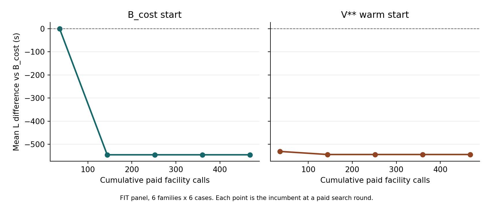

# T5　普通改进的付费开发结果

**主轨最终策略达到预注册开发门槛。** 在 48/48 个 DEV 配对上，相对 B_cost 的平均 L 差及双侧 95% 区间为 **−366.46 [−506.52, −233.07] 秒**。相对冻结 V\*\* 为 **−49.64 [−122.03, −6.25] 秒**。门槛分别要求上界低于 0、以及上界不超过 +30 秒。

**热启动轨道的三类残余失效**为错过预防性重分组窗口 0/8（起点 4/8），核查后非适应性写入实际造成降容 0/48（起点 0/48），核查延迟同一必要处置并增加缺额 1/48（起点 1/48）。各计数来自原生配对和公开处置时间的核对，预防重分组仅适用荷兰式条件。

## 新情景开发配对

两条最终参数向量已在 Slurm 作业 135174 锁定，之后才提交 48 条 DEV、每条八臂的开发评分。L 是整窗归一化服务缺额秒。下表的区间按候选减参照计算，负值有利于候选。[锁定向量](locked.json) · [逐行结果](results.json.gz)

| 轨道 | 配对对照 | 有效配对 | 平均 L 差与双侧 95% 区间 | 人员秒均差 |
| --- | --- | --- | --- | --- |
| 主轨最终策略 | B_cost | 48/48 | −366.46 [−506.52, −233.07] | −90.10 |
| 主轨最终策略 | V\*\* | 48/48 | −49.64 [−122.03, −6.25] | 9.17 |
| 热启动最终策略 | B_cost | 48/48 | −326.82 [−461.93, −196.09] | −90.52 |
| 热启动最终策略 | V\*\* | 48/48 | −10.00 [−17.50, −2.50] | 8.75 |

| 角色 | 有效位置 | 平均 L | 平均 U | 人秒／条 | 工具秒／条 | 发行费用／条 | 实际初检 | H 末 NA／PV |
| --- | --- | --- | --- | --- | --- | --- | --- | --- |
| B_cost | 48 | 884.06 | 884.06 | 235.62 | 235.62 | 4.06 | 0 | 0／44 |
| 热启动最终策略 | 48 | 557.24 | 557.24 | 145.10 | 145.10 | 3.00 | 23 | 10／28 |
| 主轨最终策略 | 48 | 517.60 | 517.60 | 145.52 | 145.52 | 3.08 | 20 | 5／30 |
| V\*\* | 48 | 567.24 | 567.24 | 136.35 | 136.35 | 2.75 | 23 | 10／24 |

## 付费学习曲线

横轴为各自轨道购买的累计设施调用数。纵轴为每轮保留的候选在共同 FIT 面板上相对 B_cost 的平均 L 差。

| 轨道 | 轮次 | 累计调用 | 入选向量来源 | 相对 B_cost 的 FIT 平均 L 差（秒） |
| --- | --- | --- | --- | --- |
| 主轨最终策略 | 0 | 36 | MAIN-root | 0.00 |
| 主轨最终策略 | 1 | 144 | MAIN-r01-c03 | −545.45 |
| 主轨最终策略 | 2 | 252 | MAIN-r01-c03 | −545.45 |
| 主轨最终策略 | 3 | 360 | MAIN-r01-c03 | −545.45 |
| 主轨最终策略 | 4 | 468 | MAIN-r01-c03 | −545.45 |
| 热启动最终策略 | 0 | 36 | HOT-root | −530.87 |
| 热启动最终策略 | 1 | 144 | HOT-r01-c01 | −544.20 |
| 热启动最终策略 | 2 | 252 | HOT-r01-c01 | −544.20 |
| 热启动最终策略 | 3 | 360 | HOT-r01-c01 | −544.20 |
| 热启动最终策略 | 4 | 468 | HOT-r01-c01 | −544.20 |

默认 U 在每轨最多购买 4 轮、每轮 3 个候选。每个候选在 36 条共同条件上评分，每轨上限 468 个位置。探索系数为 30 秒，随机探索概率 0.34，耐心为 4 轮，最小接受降幅 0.01 秒。候选随机源为 PCG64，输入与重抽的随机域分开。两轨都用同一份静态 U。两轨的最终向量均在首轮入选，后续各 324 次付费调用都保留了首轮的父策略。因此，曲线支持付费选择首轮候选的效果，未观察到后续自适应提案带来的额外入选增益。[U 完整默认值](U.json) · [排程与评分协议](protocol.md)

主轨锁定了 0.7 的公开预测权重，并在八类工单上采用 90 秒截止优先权重、90 秒排他占用代价和第 2 档写前证据规则。热启动的入选向量只改变了预防重分组的三项参数，将触发支持度设为 0.30、激励窗口设为 120 秒、优先权重设为 330 秒。这与仅有预防窗口失效计数下降的观察一致。[锁定向量](locked.json)

69 个三档参数形成 3^69 个主轨参数向量。热启动仅开放 27 个与已登记失效相关的三档坐标。两个初始向量在三段 61 帧公开历史上分别逐帧复现 B_cost 和 V\*\*。基数统计以参数向量为单位。同一个面板上的实际行为可能相同。[参数定义](parameter-space.json) · [初始向量](initial-policies.json)

## 重合核对和执行账

从 84 条已保存条件重新计算整包和实际输入身份。与 T4b 的 144 条公开身份摘要核对，FIT 与 DEV 各有 0 个整包重合和 0 个实际输入重合，两块开发面板之间亦为 0。采样阶段拒绝 5 个身份冲突候选。核对使用公开摘要，H2 文件访问及派生次数均为 0。[输入承诺](inputs.json)

阶段 A 冻结于 `bd956c7b`，条件摘要发布于 `e42a9d5b`。试点的 24 个位置计入训练分母，完整墙时 100.04 秒。全包有效评分 **1,320** 次。Slurm 共 49/90 个作业，预留 56 小时 8 分 0 秒，TotalCPU 实耗 37 小时 9 分 18 秒，分配核数乘墙时为 37 小时 50 分 20 秒。非正常退出作业为 0 个。[单份执行与完整性回执](receipt.json)

只读统计作业通过独立入口按路径加载 T4b 的已冻结统计与失效判别函数，避免同名模块遮蔽。原统计实现、参数、现场调用和评分均以既有哈希核对。[只读入口记录](analysis-entry.json)

本交付到开发自检为止。T6 之后用 H2 的最终比较负责确认改进。
