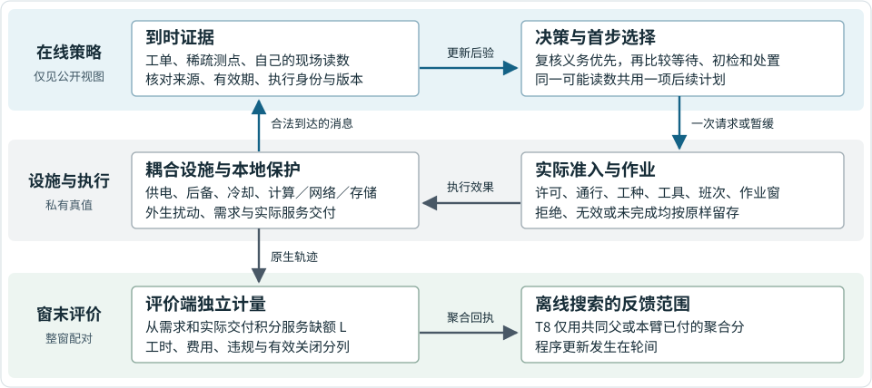
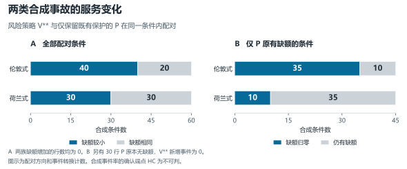
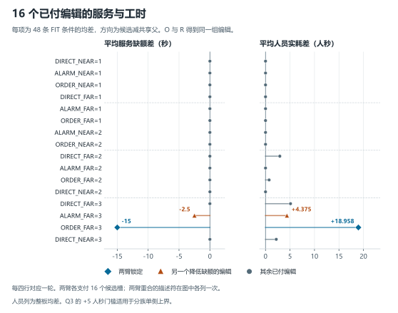

# 维护降级时，何时值得等待一次付费核查？

**耦合算力设施中稀疏证据、作业窗口与服务损失的配对仿真研究**

## 摘要

维护可能削弱备用容量。直接处置可能在错误对象上造成额外损失，先查再处置又可能错过仍可执行的窗口。我们将供配电、后备、冷却和 IT 服务与现场作业置于同一时钟。决策者只接收到时证据，在许可与资源约束下选择核查、直接处置或等待。为隔离主动获取信息的价值，预注册 H2 将同一冻结策略的初检开关作为唯一干预，两臂从共同初态独立运行。在六族 144 个配对条件上，允许初检使平均全窗归一化服务缺额减少 **55.83 秒**，配对差为 **−55.83 秒，双侧 95% 区间 [−110.00, −11.61]**。整套策略相对强透明直接规则的均差为 −343.90 秒，其中还包含处置排序与暂缓的作用。已测正例中，读数避免了一次不必要的写入。反例中，等待读数延迟了必要处置。伦敦式与荷兰式合成事故确认了冻结策略相对既有保护、报警响应的平均减损，事件频率端点因块间方差为零而不可判。等预算普通搜索和可改写搜索锁定同一策略，荷兰族工时均差在选优面板上已超过容许量，递归改写的独立服务增量未建立。

**关键词**　算力设施、检查的信息价值、部分可观测决策、维护窗口、服务可靠性

## 1　研究问题

一个“上游有电”的读数，未必说明备用馈线已连接。一个“电源恢复”的回执，也未必说明泵已重启。现场核查可以区分解释，但需要人员到场、作业许可和报告传递。若读数不会改变下一步行动，或到达后没有时间完成行动，即使它完全准确，也难以挽回本窗已经失去的服务。本文问的是，在这些条件下何时值得付费获得一次额外观察。

我们把跨系统服务后果、证据到达时刻、实际可作业窗口和与本次执行绑定的复核放进同一项决策。比较分三层进行：首先用同方法禁购初检隔离信息获取的增量，再用透明规则估计整套策略之差，最后检验开发反馈能否改善后继策略。两个公开事故提供可核对的故障机制。真实场站的频率、当班权限和历史替代处置仍是独立的识别问题。

## 2　相关工作与贡献定位

Memarzadeh 与 Pozzi 将检查、持续监测与系统级排程放入序贯决策，以后续行动价值衡量信息收益 [1]。Andriotis 与 Papakonstantinou 在部分可观测的工程维护问题中同时处理风险、不确定性与资源约束 [2]。本文沿用这类信息价值问题。研究对象的具体差异在于，电热与 IT 容量共同决定一项服务，采样、报告到达、写入生效和本人复核发生在不同时刻。即使某项观察能区分原因，只要返回时合法工单已失效，它对本窗的作用就可能改变方向。

Yanes Luis 等使用变分估计器和共享多智能体深度强化学习，在未知重要度的水域环境中优化持续重访 [3]。两项任务都要决定到哪里取证。我们用未交付服务的时间积分评价具名作业，可以选择不做初检，处理拒绝、过期和处置后的开放义务。原巡检分数与本文的缺额秒没有共同量纲。参数搜索另有成熟范式，例如 ParamILS 通过固定配置程序选择候选 [4]。本文分别追踪候选策略的改变和生成候选的程序的改变，由实际付费的后继候选识别两者。

Frontier 的公开功率、温度和流量数据提供了设施量级参照 [5]。ExaDigiT 将功率与瞬态热流体模型耦合，并用 Frontier 的遥测回放核验其模型 [6]。本研究的重点是有限工程模型中可合法执行的检查和处置。单日实测可核对功率与冷却的量级，缺少同期的派工、授权和服务交付，无法据此标定现场核查收益。以下分别说明来源、假设、求解和验证范围，便于按经验仿真报告原则复核 [7]。

<!-- page -->

## 3　设施与信息边界

物理、功能依赖、控制／信息和空间通行分别描述能量传递、服务瓶颈、记录发布和到场可行性。模型覆盖供配电、后备、设施冷却、设备冷却与环境、IT 服务、控制监控、空间通行及人员工具八域，原有自动保护在所有比较臂持续运行。多种瓶颈同时发生时，以实际交付的共同服务计算一次损失。每个比较臂独立拥有设施状态、证据、预算和回执。[设施边界与工程参照](evidence.md#model)

*图 1　可到达的证据进入在线策略。一次请求只有经过执行器准入并实际完成，才可能改变设施。离线评价端可读真实需求和交付，在线策略只通过规定的观测或回执获知结果。*

### 3.1　从证据到一个可执行的第一步

令 d(t) 为外生需求，y(t) 为实际服务交付。主端点 L 是有需求时未满足比例的时间积分，L = ∫d(t) &gt; 0 [d(t) − y(t)] / d(t) dt，单位为秒。未服务量 U 按未交付量积分，人员秒、工具秒、收费单位和有效关闭分别报告。配对差取候选减对照，L 差为负表示少损失服务。

在线工人使用公开资产与作业目录及当前视图 h。对共同来源的复制记录去重，按采样、到达和失效时钟筛选。付费记录须与自己的任务、执行身份和版本相符。按公开设计先验及记录似然更新有限假设世界的权重。没有可支持的世界时保留冲突原因。对可行计划 π，排序评分为 **J(π | h) = E[L | h, π] + λ {E[T人 | h, π] + κ E[F | h, π]}**。F 是发行费用单位数，工具受硬预算约束。预测分只用于选动作。实际成绩来自整窗设施记录。

> **算法 1　冻结在线策略**（执行角色 `V_COST`）
>
> 1. 在公开决策时刻检验目录和视图，拒绝未来记录，更新当前证据和后验。先尝试有权的本人复核 R 与续核 X。
> 2. 若已有可发的必需作业，发出它。否则，已购初检 I 的回执未到或后验无支持时暂缓，记录原因。
> 3. 对仍开放的主工单，列出暂缓、许可的直接处置 A 和许可的自选初检 I。枚举可行后续动作，检查行走、人员工具占用、班次、许可窗及处置后本人复核能否排入。
> 4. 对初检，把假设世界按届时可收到的同一报告分组。同一组只选一套后续安排。留出 UNKNOWN 分支，暂缓自选处置，同时保留已承诺义务。按报告概率加权各分支的 J。
> 5. 按最低预期 J 选第一步。同分先比较人秒和费用，再优先暂缓、按稳定标识破平。无可接纳的完整分支时暂缓。每时点最多发一个请求。
> 6. 执行器独立检查准入并发布实际结果。拒绝、无效、超时和过期均留在原分母。下一公开时点重新决策。窗末由评价端以实际需求、交付与作业记录算分。

<!-- page -->

### 3.2　先验、价格和工程假设的来源

| 量或机制 | 冻结值／计算口径 | 建模依据与用途 |
|---|---|---|
| 先验目录 | 一般架构的水、通行、网络、备用四族各占 1/4。两种事故架构各按 12 种登记组合边际化。 | 在线端共享生成律的设计知识，不接收本行的原因、种子或下一故障时刻。这些先验来自合成设计。[先验目录](evidence.md#p-prior) |
| 证据质量 | 指定固定测点的匹配参数 0.95。自选初检留有 1/32 的不可解释报告分支。 | 前者用于有限似然匹配，后者限制信息分支的可靠性。两者均取冻结设定。[似然与 UNKNOWN](evidence.md#p-evidence) |
| 作业与报告时钟 | 整窗 3,600 秒，决策步长 60 秒，原生物理步长 0.25 秒。到时、过期和版本按记录分别检查。 | 同一条件的各臂共用时钟和外生输入。计划回执仅供预测，实际复核须有到达记录。[时钟与资格](evidence.md#p-clock) |
| 在线价格 | λ = 1 缺额秒／人秒，κ = 30 人秒／发行费用单位。失败作业按实际计费。 | 事前固定的排序换算。人员与费用另行计量，现场货币估值未建立。[价格设定](evidence.md#p-price) |
| v3 维护暴露 | 公开维护时长 0、600、1,200 秒，每十二行各四条。有限支撑上限 0.50，额外许可恢复间隔 180 秒。 | 维护期间的容量损失由实际写入触发。重叠瓶颈只按共同交付计量。[维护规则](evidence.md#p-exposure) |
| 搜索的晋级和工时门槛 | T8 候选合规且总 L 严格下降才替换父策略。候选间同 L 比总人秒，再比描述符。登记 Q3 要求两族人秒差的单侧上界分别 ≤ +5。 | 晋级使用开发反馈。Q3 是另行登记的效用资格门槛，与作业当时的人员硬预算分别核对。 |

*表 1　参数种类及来源。数值来自执行版设定或工程协议。Frontier 的设施观测和 Google 复盘约束量级或机制，不提供表中先验、工时门槛或人员到场时间。* [来源与文件行号](evidence.md#parameters)

## 4　比较设计与统计单位

服务比较使用冻结的六族合成留出面板，每族 24 条，共 144 条。每个条件的各臂从独立状态开始。P 只保留既有保护，报警响应根据已到报警派工，周期巡检按排程执行。强透明规则 B 对已打开且合法的工单排序并直接申请处置。B_cost 还能利用公开维护条款安排操作。只有同方法禁购消融保持 V\*\* 的其余决策逻辑一致。全知排程只供评价端在声明的行动集合内核实可达下界。

同方法禁购版仅在公开准入处禁用 I，仍可暂缓、直接处置、办理本人的 R 和 X。它从共同初态重新运行，作业顺序可随缺少报告而改变。算法框对应科学源码 `c5ecb743`，原生设施核心为 `0e5afde1`。冻结包和逐文件摘要见[执行身份与代码行](evidence.md#method)。

三项比较在同一面板上依 H1、H2、H3 顺序检验。各族内有放回抽取同一条件的全部比较臂，再合并各族，按冻结规则重抽 10,000 次。双侧 95% 百分位区间上界严格小于零才进入下一项。维护时长和分族表为描述性分析。本文先解释 H2，因为它直接回答自选初检总的条件价值，协议的检验顺序与判断阈值按原登记执行。[冻结协议与比较定义](evidence.md#confirmation)

<!-- page -->

## 5　何时值得等待一次付费核查（C1）

**工程前提决定可改善的空间。** 在旧 v2 的 72 个开发条件上，直接规则 B 在 72/72 行已达到合法服务缺额下界。v3 引入表 1 的维护旁路与许可间隔。如果一次直接写入让正在服务的设施暂时转为有限支撑，提前行动也可能扩大损失。这个改动先于正式留出。v3 的确认结论针对有此机制的面板。[版本和旧版下界](evidence.md#sensitivity)

| 冻结比较（均为 V\*\* 减对照） | 配对数 | 平均 L 差，秒 | 双侧 95% 区间，秒 | 范围 |
|---|---:|---:|---|---|
| H2　同一方法禁购自选初检 | 144/144 | **−55.83** | **[−110.00, −11.61]** | 自选初检能力增量，MET |
| H1　强透明直接规则 B | 144/144 | −343.90 | [−445.94, −244.22] | 整套策略差，MET |
| H3　成本感知透明规则 B_cost | 144/144 | −390.48 | [−488.63, −292.83] | 对另一固定规则，MET |

*表 2　H2 同时保留了“允许但不购买”的条件。表中均差是全板每条件的效应，不能解释为每购买一次都节省 55.83 秒。H1 还包含暂缓、排序与直接处置的影响。* [三项确认结果](evidence.md#confirmation)

在 H2 的同一面板上，允许初检和禁购版的平均人员占用分别为 128.92 和 107.57 人秒。减损要与实际付出的作业成本一并解释。

**公开维护时长改变了观察到的取舍。** 对同一个禁购对照，0 秒档点估计略高于零，600 秒档的区间全在零以下，1,200 秒档跨零。三档各有 48 条。组内区间描述的是各组估计的不确定性，并未检验组间交互或给出通用时长阈值。

| 公开维护时长 | 0 秒 | 600 秒 | 1,200 秒 |
|---|---:|---:|---:|
| 允许初检减禁购版的平均 L 差（秒） | +0.62 | −86.16 | −81.97 |
| 双侧 95% 区间（秒） | [0.00, +1.88] | [−179.79, −15.99] | [−197.32, +14.65] |

*表 3　六族留出中的预定描述性分层。在另一次 36 条开发敏感性比较中，组合设置 S0 去掉额外许可间隔并将维护暴露归零，自选初检差为 +1.25 [0.00, +3.75] 秒。联合设置不识别单一参数的因果效应。* [分层表与开发敏感性](evidence.md#sensitivity)

两条有限备用开发轨迹解释了符号为什么会反转。条件 3-03 的报告在 50 秒到达，支持免去一次网络写入。禁购版在 60 秒直接写入，L 为 600 秒。允许初检时 L 为 0 秒。条件 3-02 同样在 50 秒得到报告，这次应当执行处置。等待把派工从 0 推迟到 60 秒，L 从禁购版的 326.25 秒升到 371.25 秒。全板 V\*\* 相对 B 的 54 行改善、76 行持平、14 行变差，也表明平均优势不保证逐行优势。[正反见证与反例分母](evidence.md#witness)

<!-- page -->

## 6　两类事故机制的合成确认（C2）

Google 伦敦复盘记载了备用路径实际断开、上游仍带电而控制器未发启动信号。荷兰复盘记载了转供过载及控制器离线后泵未重启 [8,9]。我们分别保留这两类有限机制。反事实干预只替换合成环境内有许可的处置，真实场站的操作权限和历史替代处置后果仍缺资料。

伦敦、荷兰各有 60 个条件，每族五个十二行块。同一条件内配对，再对两族均差等权。**120 行主分析包含 16 行与旧面板运行输入重合的条件**，继续保留原分母。剔除重合输入的子集仅用于描述。下表为边际双侧 95% 区间，三项双侧 p 值一起作 Holm 校正。对每臂，未舍入的 L > 0 记为发生一次合成事件。[分母、重合与分析登记](evidence.md#incidents)

| 端点 | 比较 | 点估计 | 区间与结论 |
|---|---|---:|---|
| HA　服务缺额 | V\*\* 减 P | −580.00 秒 | [−595.52, −564.48] 秒，MET |
| HB　服务缺额 | V\*\* 减报警响应 | −582.08 秒 | [−612.65, −551.51] 秒，MET |
| HC　事件率 | V\*\* 减 P | −37.50 个百分点 | 区间未建立，INDETERMINATE |

*表 4　HA 和 HB 衡量全窗服务严重程度。HC 的点估计是两族等权的配对事件率差。* [确认表及事件分母](evidence.md#incidents)

*图 2　每族 60 个条件。左侧比较缺额大小，右侧只统计 P 已有缺额的条件。P 有缺额的 90 行中，45 行归零。P 原无缺额的另 30 行中，新增事件为 0。两族的块间事件率配对差方差均为零，HC 依登记规则不可判。*

两条代表性的原开发条件还区分了“来得及买到读数”和“真的买到了”。伦敦 5-01 中，V\*\* 在 720 秒直接恢复备用路径，首份付费读数在 830 秒到达，属于处置后的本人复核。荷兰 6-02 中，540 秒是评价端的最晚必要启动点，V\*\* 此时仍等待，到 2,040 秒才尝试复泵，全窗没有付费读数。两站确认量衡量整套方法，现场频率端未建立。较早的原生清滤比较还有另一种取舍。17 个主配对服务均持平，省人员、工具和费用的 3 行同时失去对照取得的本人复核关闭。[代表条件的到时证据](evidence.md#incidents)

<!-- page -->

## 7　普通改进的迁移与成本（C3）

固定提案程序可以用开发反馈选择策略。手写锚点被选中、从根向量变异、在旧板挑到赢家，分别回答不同的问题。早期 v1 主轨在开发板少损失 49.64 秒，胜出向量来自手写首批。v2 用反馈更新算子得分，但每次从根生成候选，未实现沿当前赢家爬山。v3a 的扩充候选诊断为不确定。v3b 的域块重组相对最佳完整向量多损失 352.96 秒。v3c 的公开选择器 S 在旧板跨半比较少损失 141.13 秒，却在 36 条新条件上比冻结赢家 W 多损失 **80.49 秒 [41.31, 123.48]**，其中 0 行更优、26 行持平、10 行更差。登记的迁移优势不成立。[各版比较与反例](evidence.md#improvement)

在 T8 的 48 条 FIT 条件上，普通搜索 O 与可改写搜索 R 从同一父策略出发，每臂四轮，每轮四个提案。**搜索晋级按总 L 严格下降决定。工时只在候选 L 相同时参与破平。** 两臂独立支付 768 个评价位置，另有一份 48 行共享父评分。图 3 将两臂重复出现的同一描述符只列一次。相对父策略，每臂平均少损失 15 秒服务，多用 **18.958333 人秒**。成本另有一项实测失效条件。荷兰 FIT 实测增加 36.458333 人秒，已高于登记的分族 +5 人秒容许量。两块的实际均差与后续情景上界见表 5。[晋级程序与同条件回执](evidence.md#fit)

*图 3　改动一个坐标后的整板 FIT 均差。每行是一个不同的已付编辑。`ORDER_FAR=3` 服务减损最多，`ALARM_FAR=3` 的整板缺额差为 −2.5 秒、工时差为 +4.375 人秒。两个编辑也都由普通搜索找到。*

<!-- page -->

## 8　递归改写的归因与资格（C4）

递归改写要能改变后续实际付费的候选，并沿选中候选的父链到达最终策略。前三轮没有单点候选严格降低父策略的缺额，R 连续三次未触发改写。第四轮两臂都选中第 3 槽 `ORDER_FAR=3` 并锁定。**改写新增的付费候选为 0 个，R−O 的缺额差与工时差均为 0。** 两种程序在其他反馈下是否等价，仍未经检验。

四个十二行块的结构签名互不相同。在 16 个已评分单点编辑中，只有 `ORDER_FAR=3` 在 48/48 行均取得最低缺额。42 行全部并列，差异集中在荷兰 6 行。尚有 `ALARM_NEAR=3`、`ORDER_NEAR=3` 两个单点编辑未评分。由此得到的服务饱和仅限本面板已评分的单点集合。[最优集合与未测项](evidence.md#fit)

### 工时失效条件在 FIT 上已出现

共同父的平均工时为 98.645833 人秒，O、R 锁定策略均为 117.604167 人秒。登记的 Q3 针对两族分别要求相对父的工时差单侧 95% 上界 ≤ +5 人秒。**即使暂不讨论改写归因，这两个实际锁定策略在荷兰 FIT 上的工时点差已经越线。** 整板 +18.96 人秒掩盖了伦敦与荷兰的不同。本批模拟执行的硬约束违例记录为 0，效用容许量另行判定。

| 工时差（子减父，人秒） | FIT 实测均差 | FIT 两块均差 | 若 38 个独立块复现 FIT 均差和块方差，单侧上界 |
|---|---:|---:|---:|
| 伦敦 | +1.458333 | 0，+2.916667 | +2.023 |
| 荷兰 | **+36.458333** | +40.833333，+32.083333 | **+38.152** |

*表 5　两臂在相同条件上得到相同结果。右列是情景预测。荷兰单项即足以使该情景下的联合资格不通过。T8 止于 FIT，正式 DEV 资格没有观测值。* [门槛、块方差和上界](evidence.md#staff)

在既有菜单内，即使评价端事后逐行选择“同样最低缺额下最省工”的编辑，荷兰平均工时仍比父多 **26.25 人秒**。因此，给同一个服务结果换一个程序归因，无法消除已经测到的工时缺口。一个从未产生的改写候选能否满足门槛，当前没有成绩可以判断。

## 9　讨论与结论

C1 在预注册整板均值上部分成立。最能回答题目的现象，是读数能避免错误行动时可以减少缺额，而读取本身耗去窗口时也会增加缺额。C2 的两个合成族严重程度差有确认支持，合成事件率检验与现场频率均未建立。C3 的特定迁移命题不成立。C4 的独立增量未建立。[完整对照、反例及既有验收版](evidence.md#record)

<!-- page -->

### 局限

每族的事件计数受块结构制约，T7 的严重程度区间刻画既定结构中的平均差，HC 因块间方差为零而不可判。六族与两族面板按配额抽取，设计均值缺少映射到现场事故频率所需的暴露分母。T8 采用同账号程序性查重，留有 PASS 回执，代签的个人授权归属有异议、未独立证实。两起公开事故的复盘早于合成族与策略的设计，现场历史反事实仍缺当班材料、授权和操作记录。[四项边界及来源](evidence.md#limits)

### 未来工作

相同工时约束下，递归改写能否比普通搜索更早找到公开信息足以辨认的低成本编辑？现有 4 行在相同缺额下仍可节省人力，事后逐行取优在整板平均可省 5.83 人秒。另一个实测编辑 `ALARM_FAR=3` 使荷兰平均缺额少 5 秒，两族各多用 4.375 人秒。后继检验需要新材料和新的查重门，并在相同工时目标与搜索预算下记录改写、后继实际付费、入选谱系及相对 O 的收益。[工时余量和已付替代方案](evidence.md#staff)

### 数据与代码可用性

设施、规则、计量和作图源码公开。每张结果表及图可追至指定提交的公开汇总。研究保管的种子、逐位置原生轨迹和私有访问记录按原范围留存。公开复核入口可重建表值、检查实现身份与图件，作用范围与再次运行设施分别说明。本文未新增实验。[版本、可用材料与复核入口](evidence.md#availability)

## 参考文献

[1] Memarzadeh M, Pozzi M. Value of information in sequential decision making: Component inspection, permanent monitoring and system-level scheduling. *Reliability Engineering & System Safety*, 154, 137–151, 2016. [DOI](https://doi.org/10.1016/j.ress.2016.05.014)

[2] Andriotis CP, Papakonstantinou KG. Deep reinforcement learning driven inspection and maintenance planning under incomplete information and constraints. *Reliability Engineering & System Safety*, 212, 107551, 2021. [DOI](https://doi.org/10.1016/j.ress.2021.107551)

[3] Yanes Luis S, Basilico N, Antonazzi M, Gutiérrez-Reina D, Toral Marín S. Variational model-based Deep Reinforcement Learning for Non-Homogeneous Patrolling aquatic environments with multiple unmanned surface vehicles. *Expert Systems with Applications*, 270, 126483, 2025. [DOI](https://doi.org/10.1016/j.eswa.2025.126483)

[4] Hutter F, Hoos HH, Leyton-Brown K, Stützle T. ParamILS: An Automatic Algorithm Configuration Framework. *Journal of Artificial Intelligence Research*, 36, 267–306, 2009. [DOI](https://doi.org/10.1613/jair.2861)

[5] Sun J, Gao Z, Grant D, et al. Energy dataset of Frontier supercomputer for waste heat recovery. *Scientific Data*, 11, 1077, 2024. [DOI](https://doi.org/10.1038/s41597-024-03913-w)

[6] Brewer WH, Maiterth M, Kumar V, et al. A Digital Twin Framework for Liquid-cooled Supercomputers as Demonstrated at Exascale. *SC24*, 324–341, 2024. [DOI](https://doi.org/10.1109/SC41406.2024.00029)

[7] Monks T, Currie CSM, Onggo BS, Robinson S, Kunc M, Taylor SJE. Strengthening the reporting of empirical simulation studies: Introducing the STRESS guidelines. *Journal of Simulation*, 13(1), 55–67, 2019. [DOI](https://doi.org/10.1080/17477778.2018.1442155)

[8] Google Cloud. Incident report, europe-west2-b, 19–20 October 2026. Report issued 4 November 2026. [官方复盘](https://status.cloud.google.com/incidents/Xs2XTHzAVC9YnafnPyzj)

[9] Google Cloud. Incident report, europe-west4-a, 15–16 July 2026. Report issued 25 July 2026. [官方复盘](https://status.cloud.google.com/incidents/3BvH3LVGcupoYqV6F4Nw)
