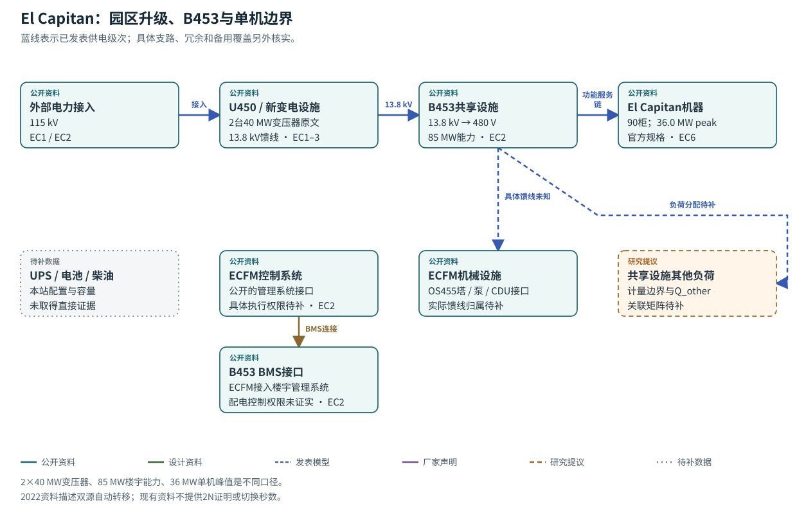
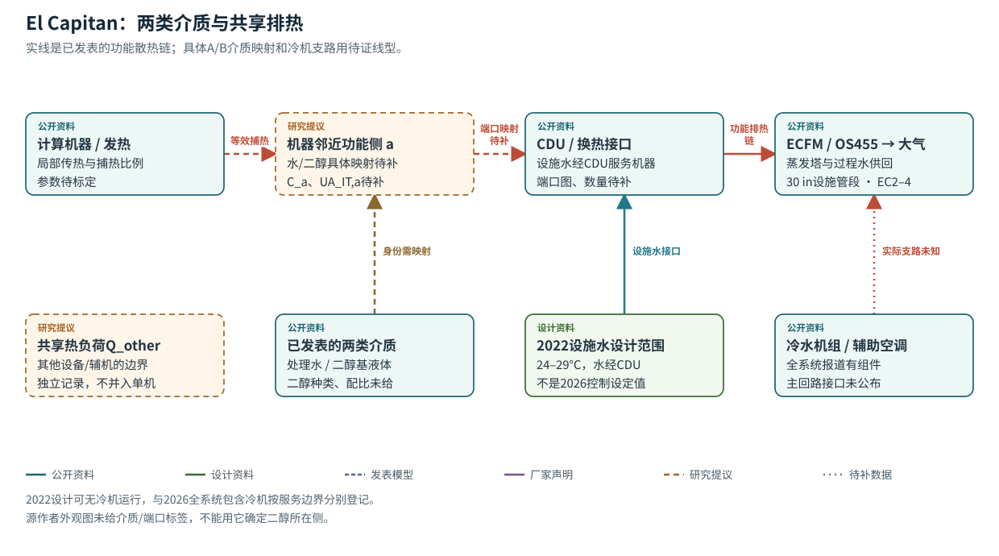

# El Capitan · LLNL

先把85 MW共享楼宇与单台El Capitan分开，再看设施水、CDU和二醇基介质的接口。公开资料能确定功能层级，端口与介质归属仍需P&ID。

- ECFM服务B453共享设施：电力能力45→85 MW，液冷能力10000→28000 refrigeration ton（EC2）。
- 官方硬件指南列90计算柜、11520节点、36.0 MW峰值（EC6）；历史预测、调试参照与当前概览另分列。
- 2022设计说明给设施水24–29°C并经CDU供机器；2026报道确认处理水与二醇基液体两类回路。

**读图：** 从115 kV读到B453再到单机。下方保留机械和其他负荷，提醒读者先划计量边界，再写总功率平衡。

**读图：** 先读顶部的功能排热链，再看两类介质如何映射到a/b侧这一待补问题。没有带端口的P&ID，就先保留功能侧命名。

## 参数表

|ID|量|公开原值/缺值|单位|状态|来源与性质|模型用途/缺口|
|---|---|---|---|---|---|---|
|ec_p01|高压接入电压|115|kV|有来源记录|`published_site`，EC1/EC2页2|电压层级参照；保护和电网暂态未闭合。|
|ec_p02|二次馈线电压|13.8|kV|有来源记录|`published_site`，EC2页2|保持馈线层级。|
|ec_p03|B453低压配电|480|V|有来源记录|`published_site`，EC2页2|具体线电压/支路图仍需电气图确认。|
|ec_p04|新站变压器配置|2×40|MW，沿用原文单位|有来源记录|`design_capacity`，EC1变电站段|不擅改为MVA，不据此推2N或楼宇总功率。|
|ec_p05|B453升级前/后电力能力|45 / 85|MW|有来源记录|`design_capacity`，EC2页1–2|共享设施能力，不作El Capitan负荷输入。|
|ec_p06|B453升级前/后液冷能力|10000 / 28000|refrigeration ton|有来源记录|`design_capacity`，EC2页1–2|热移除额定值，未给环境额定条件；不是电耗。|
|ec_p07|新增冷却塔配置|6×3000|refrigeration ton|有来源记录|`design_capacity`，EC1塔段|总增18000与EC2相容；串并联及冗余工况未知。|
|ec_p08|设施到B453过程水管径|30|in|有来源记录|`published_site`，EC2页2|名义管段标识，不反推有效内径和总水量。|
|ec_p09|机房下部管径|20|in|有来源记录|`commissioning`，EC3页1|与30in分别列项。|
|ec_p10|架空地板高度|4|ft|有来源记录|`commissioning`，EC3页1|空间参照，不作为全楼层高。|
|ec_p11|机房下配水能力|10000|GPM，原文未在此明示加仑制|有来源记录|`commissioning`，EC3页1|用于35MW调试描述；不当所有工况恒定流量，SI换算须注明US gallon约定。|
|ec_p12|调试参照计算负荷|35|MW|有来源记录|`commissioning`，EC3页1|工程参照，非此次运行曲线。|
|ec_p13|实际使用的局部负载箱|5|MW|有来源记录|`commissioning`，EC3页1|局部热负荷外推，不声称全35MW实载验收。|
|ec_p14|El Capitan系统发布峰值|36.0|MW|有来源记录|`published_hardware`，EC6 ATS-4表|与历史预测/调试参照分别保存，未作为实测均值。|
|ec_p15|计算机柜数|90|柜|有来源记录|`published_hardware`，EC6 ATS-4表|不包含所有楼宇设施对象；各CDU服务柜组未知。|
|ec_p16|计算节点数|11520|节点|有来源记录|`published_hardware`，EC6 ATS-4表|IT规模参照，不自动产生热参数。|
|ec_p17|机柜功率密度说明|约400|kW/柜|有来源记录|`published_site`，EC4 rack段|约数，与90×0.4＝36MW仅数量级相容，不是逐柜测量。|
|ec_p18|2021部署前单机峰值预测|30–35|MW|有来源记录|`design_capacity`，EC1部署段|保留历史预测，不替代EC6或实际电表曲线。|
|ec_p19|ASC概览峰值描述|约30（正文）/约35（清单）|MW|口径待对齐|`published_site`，EC8 Siting/details|同页口径差异未解，不统一成校准点。|
|ec_p20|通常设施供水温度|24–29|°C|有来源记录|2022设计说明，EC5 Designing for the Future；`official_indexed_text`|不是2026现场设定值；可作为历史设计范围参照。|
|ec_p21|W32/W40表述|32/40分类端点|°C|有来源记录|2022设计分类说明，EC5|不是机器停机阈值或连续正常控制带。|
|ec_p22|2026新闻水温原始值|约85；温标`null`|degrees（原文）|部分缺失|EC4蒸发排热段|保留原文，不默认°F，也不将85输入SI模型。|
|ec_p23|总管路长度描述|>2000|ft|有来源记录|EC4组件段|集合长度，不是单程流长、回路容积或人员行程。|
|ec_p24|处理水/二醇基介质|两类；二醇种类/浓度`null`|类型、质量分数|部分缺失|EC4 two loops段|密度ρ、比热cp、黏度μ须按侧别/温度/配比另取。|
|ec_p25|CDU数量及柜组映射|`null`|台、关联表|缺失 null|`missing`，已核查EC3/EC4/EC5|阻止确定共享故障域和并联支路。|
|ec_p26|回路有效存水/存液量|`null`|kg或m³|缺失 null|`missing`；EC4仅有定性水量|阻止热惯性/失冷时间估计。|
|ec_p27|IT/液体/换热器有效热容C|`null`|J/K|缺失 null|`missing`|不由36MW或柜数反推C。|
|ec_p28|IT到液体、跨回路UA|`null`|W/K|缺失 null|`missing`|阻止动态温升和换热闭合。|
|ec_p29|泵曲线、阀阻力、扬程/压差|`null`|Pa、kg/s或m³/s|缺失 null|`missing`|10000GPM不能替代泵曲线。|
|ec_p30|风机/泵/执行器时间常数|`null`|s|缺失 null|`missing`|不将保护“快速”翻成某个秒数。|
|ec_p31|湿球温度/塔性能/结垢|`null`|°C、W、模型参数|缺失 null|`missing`|阻止季节容量与失冷余量计算。|
|ec_p32|冷机实际服务边界/COP|`null`|关联表、无量纲|缺失 null|`missing`；有组件存在与无冷机设计两个年代说明|不得默认为主回路常开冷机。|
|ec_p33|UPS/电池/发电机覆盖与容量|`null`|关联表、kWh、kW、s|缺失 null|`missing`|不生成未经证实的后备路径。|
|ec_p34|传感器误差、覆盖、采样和时延|`null`|°C、Pa、s等|缺失 null|`missing`；EC4仅确认测量类别|阻止观测模型/误报漏报校准。|
|ec_p35|保护阈值、减载和重启逻辑|`null`|°C、Pa、s、状态机|缺失 null|`missing`|采用可配置的离散模式，规则待证。|
|ec_p36|真实步行/门禁/检查耗时|`null`|m、min、权限|缺失 null|`missing`|不从管路长度生成巡检路线。|

[CSV](parameters/el-capitan.csv) · [本站状态方程](state-equations.md) · [完整来源核查](../source-review/el-capitan.md)

## 最小补数

- 水/二醇介质逐端口映射、CDU数与柜组表
- 两侧库存、IT/换热器热容和UA
- 泵/阀/塔曲线，冷机实际服务边界
- 保护/降载、双源切换与备用覆盖
- 同步负荷及四端温度、流量、压差
