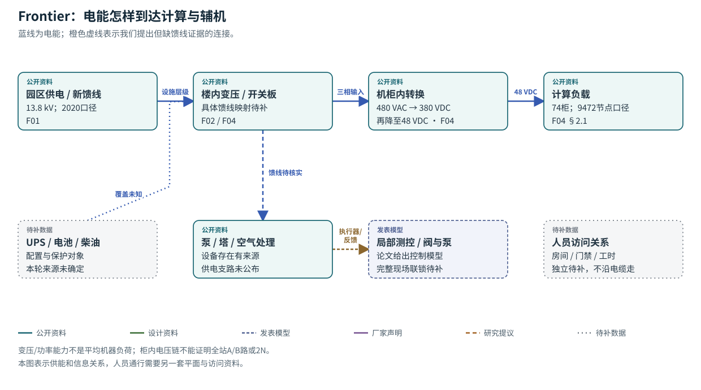
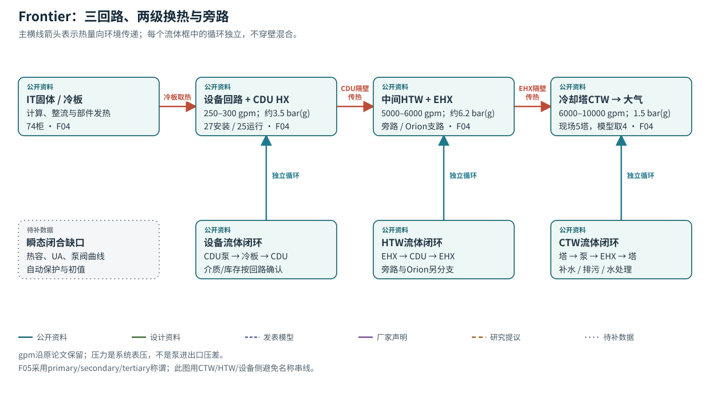

# Frontier · ORNL

先看三种隔离流体，再看共享电源与旁路。技术论文把已安装、运行和模型删减分别说明，适合据此建立分层模型。

- 74个计算柜；27台CDU已安装、25台运行；每台最多3柜，部分带2柜（F04 §2.1）。
- F04描述现场5塔/5EHX，而其简化模型只纳4塔/4EHX。F05的4塔和节点数差异另保留来源。
- 已读取Figshare v4原件表头及前19个时间戳，导出层该样本为10分钟间隔；全年缺失与原始采集过程仍待核查。

**读图：** 顺着上方蓝线读供电级次；再看下方辅机是否与IT共享电源。共享失效域需要单线图，不能只凭设备都在同一园区判定。

**读图：** 先沿热箭头从机柜读到大气；再逐个看下方闭环。CDU与EHX各自把两种流体隔开，传递热量而不传递质量。

## 参数表

|ID|量|公开原值/缺值|单位|状态|来源与性质|模型用途/缺口|
|---|---|---|---|---|---|---|
|f_p01|新增馈线电压|13.8|kV|有来源记录|`published_site`，F01|带2020年代；不自动覆盖所有设施。|
|f_p02|新增馈线长度|约2.5|mile|有来源记录|`published_site`，F01|土建参照；不作为通行距离。|
|f_p03|机房供电基础设施|>40|MW电功率|有来源记录|`design_or_capability`，F02|不是机器平均负荷。|
|f_p04|机械厂电力基础设施|8|MW电功率|有来源记录|`design_or_capability`，F02|与热移除能力分列。|
|f_p05|楼内新增变压器|9×4|台×MW|有来源记录|`published_site`，F02|未取得馈线映射；9×4不用于“修正”>40MW能力。|
|f_p06|机械厂支持计算热负荷|40；可扩至70|MW热功率|有来源记录|`design_or_capability`，F02|扩容上限不等于现装容量。|
|f_p07|建设报道系统水温|90|°F|有来源记录|`design_or_capability`，F02|不是所有回路的统一设定温度；换算约32.2°C仅单位转换。|
|f_p08|建设报道总水量|约85000|US gallon|有来源记录|`published_site`，F02|跨系统总量不能直接赋给某一热容节点。|
|f_p09|建设报道泵能力|4×350；每台最高10000|台×hp；US gpm|有来源记录|`design_or_capability`，F02|额定能力与运行点分开。|
|f_p10|机柜输入/变换电压|480AC→380DC→48DC|V|有来源记录|`published_site`，F04 §2.1，物理页2|转换效率曲线仍缺。|
|f_p11|计算柜数量|74|柜|有来源记录|`published_site`，F04 §2.1|不扩成75。|
|f_p12|CDU安装/运行|27/25|台|有来源记录|`published_site`，F04 §2.1|数量与逐台可用状态分开。|
|f_p13|每CDU柜组|最多3；部分2|柜/CDU|有来源记录|`published_site`，F04 §2.1|完整柜组映射仍`missing`。|
|f_p14|CDU换热能力|约1.6|MW热功率/CDU|有来源记录|`design_or_capability`，F04 §2.1|不等于每台实时负荷。|
|f_p15|CTW塔/每塔单元|5/4|台/单元|有来源记录|`published_site`，F04 §2.1|该文模型只4塔；F05不同原文口径另列。|
|f_p16|HTWP/EHX数量|4/5|台|有来源记录|`published_site`，F04 §2.1|模型只纳4EHX，扩展至8为设计能力。|
|f_p17|CTWP数量|4|台|有来源记录|`published_site`，F04 §2.1|运行投切日志缺；不假定4台同时运行。|
|f_p18|CTW大致流量/压力|6000–10000/约1.5|US gpm/bar(g)|有来源记录|`published_site`，F04 §2.1，物理页3|范围不用于推断各泵/各塔独立流量。|
|f_p19|HTW大致流量/压力|5000–6000/约6.2|US gpm/bar(g)|有来源记录|`published_site`，F04 §2.1|流量是回路描述，包含旁路/其他负载。|
|f_p20|CDU设备侧大致流量/压力|250–300/约3.5|US gpm/bar(g)|有来源记录|`published_site`，F04 §2.1|不是25台同时各取上限的已测总流量。|
|f_p21|HTW过程冷却温度范围|约12–32|°C|有来源记录|`design_or_capability`，F04 §2.1|范围不等于控制设定值和容许温升。|
|f_p22|CDU泵控制|双泵同速且总在运行|逻辑|有来源记录|`published_model`，F04 §2.3|是近似，不是全工况规程。|
|f_p23|模型启动延迟|1.0|s|有来源记录|`published_model`，F04 §2.3|数值初始化延迟，不当作设备启动/保护延迟。|
|f_p24|电转换效率|0.96、0.98；合成约0.94|无量纲|有来源记录|`published_model`，F03 §III-B1|文中简化，真实随负载变化。|
|f_p25|热/电换算与CDU泵功率|0.945；8.7|无量纲；kW/CDU|有来源记录|`published_model`，F03 §III-B2|数据拟合/固定近似，不直接套入新场景。|
|f_p26|2023机器功率统计|均值12.2、idle8.5、peak28.5|MW|有来源记录|`published_site`，F05 Technical Validation|论文统计口径；未独立复算全年分母。|
|f_p27|2023导出表间隔|Readme称10；前19时间戳确为10|min|口径待对齐|F06有限原件核对；F05另称historian15min|原始采样、聚合/插值过程仍需说明。|
|f_p28|2023缺失时长|约440|h|有来源记录|`published_site`，F05 Data Records|原文值，未从工作簿全量重算。|
|f_p29|用于余热计算的物性|ρ1060；cp3.5；水/乙二醇50/50|kg/m³；kJ/(kg·K)；比例|有来源记录|`published_model`/计算依据，F05 Data Records|与F04“加少量添加剂、近似水”不同，不推广至三回路。|
|f_p30|各容积、金属热容、传热UA/ε曲线|缺值|m³、J/K、W/K|缺失 null|`missing`|阻止可信瞬态温升和停冷缓冲时间预测。|
|f_p31|泵曲线、阀Cv/阻力、管段长度与惯性|缺完整值|Pa、m³/s等|缺失 null|`missing`；F04称部分来自厂商/遥测，未逐项公开|阻止水力网络闭合与快瞬态复现。|
|f_p32|PID、死区、延时、保护阈值、人工覆盖|缺完整值|s、K、Pa等|缺失 null|`missing`，F04 §2.3、§3.2|阻止控制/故障切换的现场重放。|
|f_p33|环境湿球、房间露点的完整边界时序|缺本轮已校验输入|°C、时间戳|缺失 null|`missing`|阻止塔性能和凝露裕量的定量验证。|
|f_p34|UPS/电池/柴油覆盖、故障率、检查检出率|缺值|kWh、s、h、概率等|缺失 null|`missing`|不能据PUE或设备计数反推可靠性/巡检收益。|
|f_p35|原文节点数差异|F04/F03：9472；F05：9402|节点|口径待对齐|F04 §2.1 / F03 §III；F05 Methods；原文差异未对齐|不自动纠正来源或拼成同一时点配置；待原作者/资产版本核对|

[CSV](parameters/frontier.csv) · [本站状态方程](state-equations.md) · [完整来源核查](../source-review/frontier.md)

## 最小补数

- 三回路介质与有效液量/金属热容
- 27台CDU与74柜逐台映射及维修状态
- 泵/阀/HX曲线与旁路、Orion支路同步数据
- 自动保护和控制规程、原始时序质量标志
- UPS/备用能源覆盖、人员访问图和检查性能
