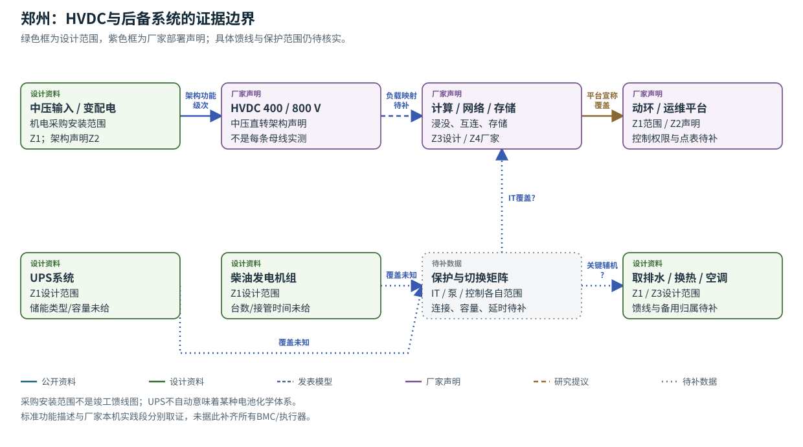
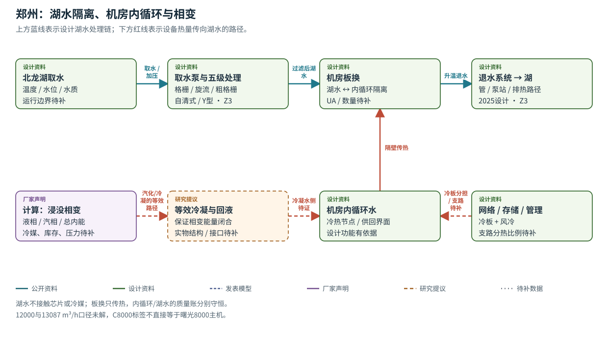

# 郑州核心节点 / 曙光8000

湖水与机房内循环由板换隔开；内循环再服务计算相变散热与网络/存储冷板。电源与备用系统有项目范围资料，具体保护负载仍缺单线图。

- 2025设计文件给湖水加压、过滤、板换、内循环和退水链，原图列五级过滤工艺（Z3物理40–41、48）。
- 400/800 V HVDC、浸没相变、scaleFabric和ParaStor来自2026厂家公开声明；UPS与柴油属于2025机电采购安装范围。
- 总取水量约12000 m³/h，C8000/C7000两支路为8513与4574 m³/h；合计13087的差异未解，标签与主机型号映射也未解。

**读图：** 先读上方系统范围，再看下方后备连接矩阵。只有知道UPS和柴油分别保护哪些负载，才能计算断电后散热是否继续。

**读图：** 先读湖水怎么处理和返回，再从相变槽逆向追热量如何到湖。虚线冷凝节点是为守恒提出的等效模块，实际结构仍待图纸确认。

## 参数表

|ID|量|公开原值/缺值|单位|状态|来源与性质|模型用途/缺口|
|---|---|---|---|---|---|---|
|zz_p01|最大夏季取水量|约12000 m³/h|m³/h|口径待对齐|设计；Z3物理40、49|总量参照；与分支总量冲突，暂不作一致的容量约束|
|zz_p02|C8000支路用水量|8513 m³/h|m³/h|有来源记录|设计；Z3物理40|支路标签本身不证明主机型号|
|zz_p03|C7000支路用水量|4574 m³/h|m³/h（原文m³h）|有来源记录|设计；Z3物理41；原单位印作m³h|待原设计确认单位与同时工况|
|zz_p04|取水泵组系统数|2套|套|有来源记录|设计；Z3物理40|不能据此推导独立失效域|
|zz_p05|C8000取水泵|5台，4用1备；单泵2200 m³/h|台；m³/h|有来源记录|设计；Z3物理40|不含扬程、功率、效率或泵曲线|
|zz_p06|C7000取水泵|5台，4用1备；单泵1150 m³/h|台；m³/h|有来源记录|设计；Z3物理41|与上项相同；不把N+1直接当可用率|
|zz_p07|取水管|3根，D1020×10|根；D1020×10（原标记）|有来源记录|设计；Z3物理40|按原标记保留；水力内径／长度／粗糙度待核实|
|zz_p08|旋流分离井|3座，单座设计1.1 m³/s，内径3.6 m|座；m³/s；m|有来源记录|设计；Z3物理40|只能作设计装置规模，非流量实测|
|zz_p09|排水管|约500 m，D2020×16|m；D2020×16（原标记）|有来源记录|设计；Z3物理41|模型需另取标高、粗糙度、局部阻力|
|zz_p10|排水泵站|2座，单站设计1.65 m³/s|座；m³/s|有来源记录|设计；Z3物理41|总设计规模与单泵名义和不同，不替代性能曲线|
|zz_p11|每排水站泵数|3台，2用1备|台|有来源记录|设计；Z3物理41|未给共同供电／检修影响|
|zz_p12|排水单泵额定量|0.85 m³/s、8 m扬程、110 kW|m³/s；m；kW|有来源记录|设计；Z3物理41|名义工点，不能把110kW全作为传入水的水力功|
|zz_p13|HVDC电压级|400／800 V|V|有来源记录|厂家架构声明；Z2先行实践|馈线对应、实际母线电压／容差未知|
|zz_p14|主机机柜布局|80多组，12道环形阵列|组；环|有来源记录|央视简介；Z6第1集|近似描述；不是电气或水力分组数量|
|zz_p15|主机空间|2000余m²|m²|有来源记录|央视／平台描述；Z6、Z5|不是园区面积或巡检平面图|
|zz_p16|单柜功率密度|MW级能力|MW/柜（能力级别）|有来源记录|厂家能力声明；Z4|不能当每柜运行负荷，更不能乘机柜数当站点总功耗|
|zz_p17|PUE|厂家称低至1.04；2025设计文档称不高于1.2|无量纲|有来源记录|Z2：2026厂家低值声明；Z3物理48：2025设计目标；两值兼容、口径未统一|1.04与不高于1.2数值兼容，年代/统计边界不同；不据此推运行改善或设校准点|
|zz_p18|北龙湖边界水温T_lake(t)|missing，°C|°C|缺失 null|无已核实运行曲线|阻止季节排热裕度估计；需取水口温度／气象／水位记录|
|zz_p19|湖水泵曲线、η_p|missing，Pa–m³/s，无量纲|Pa–m³/s；无量纲|缺失 null|取水扬程／功率未给；排水仅名义点|阻止功耗和失流工况计算；需铭牌、泵曲线、现场压差流量|
|zz_p20|过滤阻力K_f(t)|missing，Pa·s²/m⁶|Pa·s²/m⁶|缺失 null|未给清洁／堵塞压降|阻止堵塞到流量衰减映射；需过滤器规格与压差记录|
|zz_p21|板换UA／ε|missing，W/K／无量纲|W/K；无量纲|缺失 null|已知类型、未知规模与工况|阻止供水温度与污垢后果计算；需选型书、流量、四端温度|
|zz_p22|内循环热容C_h、C_c|missing，J/K|J/K|缺失 null|未给存水量／管壁／流量|阻止失冷升温时间估计；需水量与材质台账或阶跃数据|
|zz_p23|冷媒身份与u、ρ、h_fg、p_sat|missing，J/kg、kg/m³、J/kg、Pa|J/kg；kg/m³；Pa|缺失 null|厂家只称国产冷媒|阻止相变能量／压力闭合；需流体物性与安全资料|
|zz_p24|冷媒M_l、M_v、槽体V与允许液位|missing，kg、m³、m|kg；m³；m|缺失 null|无库存与几何资料|阻止干涸、泄漏和汽相压力计算；需设备图与液位标定|
|zz_p25|等效冷凝UA与回液路径|missing，W/K、kg/s|W/K；kg/s|缺失 null|内部结构未公开|阻止相变槽向内循环排热闭合；需冷凝器／回液P&ID|
|zz_p26|IT负荷P_IT(t)、液冷捕热比例χ|missing，W、无量纲|W；无量纲|缺失 null|未取得带时间戳电能及分热数据|阻止温升／失冷后果；需负荷日历、功率／热量计量边界|
|zz_p27|整流效率η_rect、母线C_dc／损耗|missing，无量纲、F、W|无量纲；F；W|缺失 null|电压架构不含动态参数|阻止负载突变与电压跌落仿真；需电气设计和受控测试|
|zz_p28|UPS储能E_max／功率／覆盖|missing，J或kWh、W|J或kWh；W|缺失 null|仅有设计模块|阻止后备时间及冷却共因计算；需资产表、单线图、放电试验|
|zz_p29|柴油功率、启动／接管t_start|missing，W、s|W；s|缺失 null|仅有设计模块|阻止断电持续时间／转供评价；需启动测试、ATS逻辑及燃料台账|
|zz_p30|备用冷却塔容量与切换时间|missing，W、s|W；s|缺失 null|仅有Z1备用冷源模块|阻止湖水失效场景的续冷估计；需P&ID与切换试验|
|zz_p31|检查性能与耗时|missing，Se/Sp、min|无量纲；min|缺失 null|无现场检查规程／盲检记录|阻止检查价值实测校准；需检查点表、独立真值和工时|
|zz_p32|缺陷、维修与共同根因|missing，每设备小时、h、条件概率|每设备小时；h；条件概率|缺失 null|无故障分母和维修工单|阻止可靠性及风险数值化；需设备小时、工单、共因记录|

[CSV](parameters/zhengzhou.csv) · [本站状态方程](state-equations.md) · [完整来源核查](../source-review/zhengzhou-sugon8000.md)

## 最小补数

- C8000/C7000身份、总/支路同时工况与竣工P&ID
- 冷媒物性、库存、槽体/冷凝/回液与压力边界
- 湖水季节边界、过滤/泵/板换性能
- UPS/柴油保护矩阵及备用冷源切换
- 实际负荷、检查性能、缺陷与维修分母
