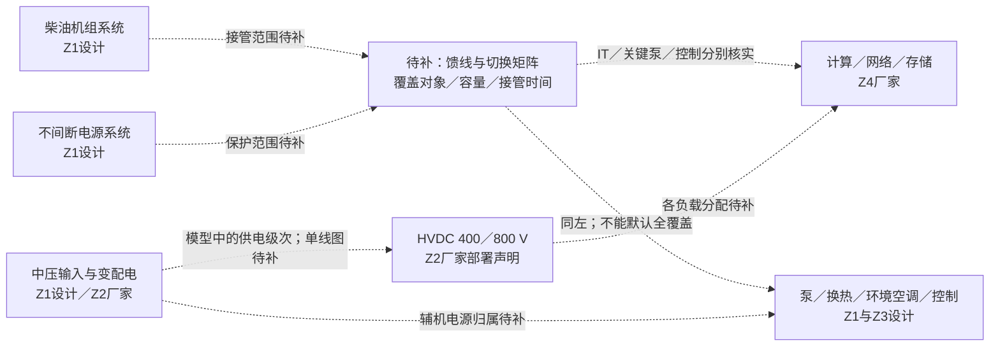
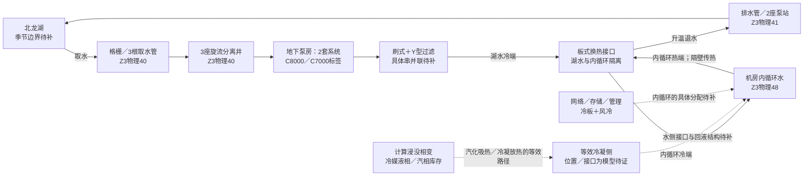

# 郑州核心节点／曙光8000：独立设施模型来源核查

核查日期：2026-11-04。对象为郑东新区国家超算互联网核心节点及曙光8000；不合并郑州大学旧“嵩山”主机参数。本文把设施设计、厂家部署声明和本研究的状态方程分开，供三案例拓扑与参数台账使用。

## 1. 来源及证据规则

|编号|主来源、日期与定位|本次实际读取范围|
|---|---|---|
|Z1|[中国建筑：核心节点配套工艺机电工程中标](https://www.cscec.com.cn/xwzx_new/zqydt_new/202508/3897038.html)，2025-08-04，正文第2段|官网正文已打开；属采购安装范围，记为`design_document`，不作为竣工清单。|
|Z2|[中科曙光：三项高性能计算机行业标准发布](https://www.sugon.com/cut?id=2980)，2026-09-09，“曙光8000：切合新标准的先行实践”|官网正文已打开；本机部署表述记为`vendor_published`。上部标准功能要求与下部本机声明分别处理。带`nav_id`的URL超时，去掉该参数后读取成功。|
|Z3|[河南政府公开合并PDF](https://xcoss.henan.gov.cn/typtfile/20250919/120aa0eb3bf64fc097452a6f4bc83099.pdf)，内含《郑州市郑东新区中原科技城龙湖取排水配套基础设施项目收益与融资自求平衡专项债财务评估报告》，2025年4月|原PDF15,148,660字节、605页；读取物理35、40、41、48、49、50页。物理35为封面，40/41对应印刷3/4页，48/49对应11/12页。总报告另以Poppler渲染并视觉核对物理41和48页，包括五级过滤工艺及湖水/内循环板换边界；正文事实记为`design_document`。|
|Z4|[中科曙光：曙光8000正式落成](https://www.sugon.com/cut?id=2927&nav_id=48)，2026-07-10，“原生超智融合，全链路自研”|官网正文已打开；记为`vendor_published`，包括浸没相变、scaleFabric、ParaStor及单柜MW级能力表述。|
|Z5|[超算互联网：核心节点与中国算力突围](https://www.scnet.cn/home/news/213920.html)，2026-10-24，正文首两段|平台正文已打开，直接将郑州核心节点与曙光8000对应；记为`operator_published`。|
|Z6|[央视《破重关》](https://tv.cctv.com/2026/09/25/VIDExntSmiV2kRh9yXsVYD0x260925.shtml)，2026-09-25；[央视《探极境》](https://tv.cctv.com/2026/09/26/VIDEAtlzOWqrh6KG7P2z8G3t260926.shtml)，2026-09-26，分集简介|官网文字简介已读，未观看全片或取得逐字稿。记为`official_program_description`，只用于主机规模与子系统范围。|

`model_proposal`表示本文提出的物理抽象或连接；`missing`表示已读来源未给所需数据，不能填0。公开发表的数值保留其年代、量纲与设计／能力／指标性质；厂家声明不升级为独立现场测量。

## 2. 场地事实与模型对象

Z3物理48明确将取排水工程用于国家超算互联网核心节点：计算部分采用浸没相变液冷，网络、存储、管理采用冷板液冷加风冷；湖水加压、过滤后输送至机房换热间，经板式换热器与机房内循环水换热，再退回龙湖。这个接口足以建立**湖水与内循环隔离**的结构。[Z3，物理48–49](https://xcoss.henan.gov.cn/typtfile/20250919/120aa0eb3bf64fc097452a6f4bc83099.pdf#page=48)

|对象ID|对象与证据等级|已知边界|缺失的实例信息|
|---|---|---|---|
|zz_grid_distribution|中压输入、变配电；Z1设计＋Z2厂家部署声明|可建立上游供电域|单线图、电压级转换器数量、容量、A/B路与母联|
|zz_hvdc|中压直转、HVDC400/800V；Z2厂家部署声明|400/800V是架构表述|每类电压馈线、实际负载映射、容许电压与保护整定|
|zz_ups|不间断电源系统；Z1设计|设备采购安装范围有依据|储能类型、容量、覆盖负载及后备时间|
|zz_diesel|柴油发电机组；Z1设计|设备采购安装范围有依据|台数、额定功率、启动／接管及燃料续航|
|zz_lake_intake|湖水、格栅、取水管、旋流井；Z3物理40|取水工程的功能顺序有正文依据|竣工接口、季节水位／水温／水质曲线|
|zz_intake_pumps|地下取水泵房的两套系统；Z3物理40–41|各接C8000、C7000换热系统|两个标签与主机型号的对应、泵扬程与功率|
|zz_filters|全自动刷式＋Y型过滤；Z3物理41|两种过滤工艺有依据|具体串并联、旁路、阀位、清洗逻辑、压降曲线|
|zz_lake_plate_hx|机房换热间板式换热器；Z3物理48|湖水向机房内循环传热，介质隔离|台数、面积、UA、流量分配、污垢与备用逻辑|
|zz_internal_water|机房内循环水；Z3物理48|冷却水作为设备与湖水间的热媒|实际回路数量、存水量、泵阀、供回温与流量|
|zz_two_phase_it|计算浸没相变；Z3物理48＋Z4厂家声明|计算散热路线有依据|冷媒身份、槽体／密封、冷凝器、回液结构、库存和液位|
|zz_network_storage|网络／存储／管理冷板加风冷；Z3物理48；scaleFabric／ParaStor为Z4厂家声明|可分别建立液体与空气散热支路|冷板／风冷分热比例、设备位置和故障隔离域|
|zz_aux_cooling|高温水、低温水、冷却塔备用冷源、新风和多联机；Z1设计|项目安装范围有依据|与湖水回路的切换接口、冷机类型及容量|
|zz_monitoring|动环；Z1设计；全域数字孪生运维为Z2厂家声明|设施存在监控运维功能的依据|现场点表、精度、采样、报警／控制权限及通信分区|

没有从上述来源核实电池间、专门蓄冷罐、完整消防／排水分区或人员通行图。它们可留作待取资产，不放进“已确认竣工房间”层。

## 3. 两幅架构图与连接证据

### 3.1 电力服务范围图

框表示已发表的系统范围；虚线表示拟建模型的连接或仍缺馈线资料。供电图不表示人员能沿边通行。

Z2支持“中压直转＋HVDC400/800V架构”，但不公开供电单线图；因此上图把**系统存在**与**具体馈线连接**分开。Z1没有说明UPS在柴油接管前保护整机、只保护控制，还是保护某些泵，这些边均待补。标准页提到的BMC液位／压力／电磁阀能力属于标准要求，不能直接列作该站完整已装点表。[Z1正文第2段](https://www.cscec.com.cn/xwzx_new/zqydt_new/202508/3897038.html)、[Z2“先行实践”](https://www.sugon.com/cut?id=2980)

### 3.2 湖水—内循环—相变散热图

实线为Z3给出的设计功能链；双向热接口不表示两种流体混合。相变槽到等效冷凝器的虚线为本研究的能量闭合抽象，实际结构待补。

两个泵组对应C8000／C7000换热系统是Z3设计事实；**C8000不是已经确证的“曙光8000”别名**。过滤器位于加压后、冷却装置前的功能链有正文依据；具体串并联、每支路分配与旁路须核对原流程图／P&ID。图中没有把湖水画成直接进入浸没槽，也没有把冷却塔备用冷源擅自接入某个阀组。[Z3物理40–41、48](https://xcoss.henan.gov.cn/typtfile/20250919/120aa0eb3bf64fc097452a6f4bc83099.pdf#page=40)

物理41页工艺小图经总报告视觉复核，依次列出50mm格栅、旋流分离、5mm粗格栅、1–1.5mm自清式过滤、0.25mm Y型过滤保护板换。这是设计工艺级次，仍不提供竣工阀组、并联设备或旁路图。[Z3物理41，印刷4页](https://xcoss.henan.gov.cn/typtfile/20250919/120aa0eb3bf64fc097452a6f4bc83099.pdf#page=41)

|连接ID|关系|等级／定位|尚需补证|
|---|---|---|---|
|zz_e01|湖水→格栅／取水管→旋流分离|设计；Z3物理40|竣工标高与旁路|
|zz_e02|旋流分离→加压泵→过滤→冷却接口|设计；Z3物理40–41|每支路过滤分配／阀组|
|zz_e03|湖水侧↔板换↔机房内循环|设计；Z3物理48；此处箭头指换热，不是流体互通|实际板换数量及UA|
|zz_e04|升温湖水→退水管／泵站→龙湖|设计；Z3物理40–41、49–50|退水温限、短路回流及运行水位|
|zz_e05|内循环↔计算相变液冷／网络冷板|设计文件共同供水功能有依据；具体设备接口是模型建议|冷凝水路、支路泵／阀、风冷分担|
|zz_e06|中压／HVDC→具体IT负载|厂家公开架构＋模型级馈线映射；Z2|单线图与保护范围|
|zz_e07|UPS／柴油→IT、冷却、控制|模块有设计依据；连接为`missing`|负载保护与切换矩阵，不能默认全站保障|
|zz_e08|湖水↔备用冷却塔|模块有设计依据；互备连接为`missing`|P&ID、阀组、切换测试及剩余容量|
|zz_e09|运维平台→设备控制／现场检查知识|监控平台有厂家声明；执行控制和研究观察接口为`model_proposal`|点表、权限、时间戳、数据质量|

## 4. 参数表：公开量、设计量与缺项

|参数ID|量／符号|值与单位|性质、来源与适用范围|用途或缺失影响|
|---|---|---|---|---|
|zz_p01|最大夏季取水量|约12000 m³/h|设计；Z3物理40、49|总量参照；与分支总量冲突，暂不作一致的容量约束|
|zz_p02|C8000支路用水量|8513 m³/h|设计；Z3物理40|支路标签本身不证明主机型号|
|zz_p03|C7000支路用水量|4574 m³/h|设计；Z3物理41；原单位印作m³h|待原设计确认单位与同时工况|
|zz_p04|取水泵组系统数|2套|设计；Z3物理40|不能据此推导独立失效域|
|zz_p05|C8000取水泵|5台，4用1备；单泵2200 m³/h|设计；Z3物理40|不含扬程、功率、效率或泵曲线|
|zz_p06|C7000取水泵|5台，4用1备；单泵1150 m³/h|设计；Z3物理41|与上项相同；不把N+1直接当可用率|
|zz_p07|取水管|3根，D1020×10|设计；Z3物理40|按原标记保留；水力内径／长度／粗糙度待核实|
|zz_p08|旋流分离井|3座，单座设计1.1 m³/s，内径3.6 m|设计；Z3物理40|只能作设计装置规模，非流量实测|
|zz_p09|排水管|约500 m，D2020×16|设计；Z3物理41|模型需另取标高、粗糙度、局部阻力|
|zz_p10|排水泵站|2座，单站设计1.65 m³/s|设计；Z3物理41|总设计规模与单泵名义和不同，不替代性能曲线|
|zz_p11|每排水站泵数|3台，2用1备|设计；Z3物理41|未给共同供电／检修影响|
|zz_p12|排水单泵额定量|0.85 m³/s、8 m扬程、110 kW|设计；Z3物理41|名义工点，不能把110kW全作为传入水的水力功|
|zz_p13|HVDC电压级|400／800 V|厂家架构声明；Z2先行实践|馈线对应、实际母线电压／容差未知|
|zz_p14|主机机柜布局|80多组，12道环形阵列|央视简介；Z6第1集|近似描述；不是电气或水力分组数量|
|zz_p15|主机空间|2000余m²|央视／平台描述；Z6、Z5|不是园区面积或巡检平面图|
|zz_p16|单柜功率密度|MW级能力|厂家能力声明；Z4|不能当每柜运行负荷，更不能乘机柜数当站点总功耗|
|zz_p17|PUE|厂家称低至1.04；2025设计文档称不高于1.2|Z2声明；Z3物理48设计|年代及口径不同，均未取得计量边界与时间序列|
|zz_p18|北龙湖边界水温T_lake(t)|missing，°C|无已核实运行曲线|阻止季节排热裕度估计；需取水口温度／气象／水位记录|
|zz_p19|湖水泵曲线、η_p|missing，Pa–m³/s，无量纲|取水扬程／功率未给；排水仅名义点|阻止功耗和失流工况计算；需铭牌、泵曲线、现场压差流量|
|zz_p20|过滤阻力K_f(t)|missing，Pa·s²/m⁶|未给清洁／堵塞压降|阻止堵塞到流量衰减映射；需过滤器规格与压差记录|
|zz_p21|板换UA／ε|missing，W/K／无量纲|已知类型、未知规模与工况|阻止供水温度与污垢后果计算；需选型书、流量、四端温度|
|zz_p22|内循环热容C_h、C_c|missing，J/K|未给存水量／管壁／流量|阻止失冷升温时间估计；需水量与材质台账或阶跃数据|
|zz_p23|冷媒身份与u、ρ、h_fg、p_sat|missing，J/kg、kg/m³、J/kg、Pa|厂家只称国产冷媒|阻止相变能量／压力闭合；需流体物性与安全资料|
|zz_p24|冷媒M_l、M_v、槽体V与允许液位|missing，kg、m³、m|无库存与几何资料|阻止干涸、泄漏和汽相压力计算；需设备图与液位标定|
|zz_p25|等效冷凝UA与回液路径|missing，W/K、kg/s|内部结构未公开|阻止相变槽向内循环排热闭合；需冷凝器／回液P&ID|
|zz_p26|IT负荷P_IT(t)、液冷捕热比例χ|missing，W、无量纲|未取得带时间戳电能及分热数据|阻止温升／失冷后果；需负荷日历、功率／热量计量边界|
|zz_p27|整流效率η_rect、母线C_dc／损耗|missing，无量纲、F、W|电压架构不含动态参数|阻止负载突变与电压跌落仿真；需电气设计和受控测试|
|zz_p28|UPS储能E_max／功率／覆盖|missing，J或kWh、W|仅有设计模块|阻止后备时间及冷却共因计算；需资产表、单线图、放电试验|
|zz_p29|柴油功率、启动／接管t_start|missing，W、s|仅有设计模块|阻止断电持续时间／转供评价；需启动测试、ATS逻辑及燃料台账|
|zz_p30|备用冷却塔容量与切换时间|missing，W、s|仅有Z1备用冷源模块|阻止湖水失效场景的续冷估计；需P&ID与切换试验|
|zz_p31|检查性能与耗时|missing，Se/Sp、min|无现场检查规程／盲检记录|阻止检查价值实测校准；需检查点表、独立真值和工时|
|zz_p32|缺陷、维修与共同根因|missing，每设备小时、h、条件概率|无故障分母和维修工单|阻止可靠性及风险数值化；需设备小时、工单、共因记录|

**矛盾台账。** Z3的支路用水量合计为8513＋4574＝13087m³/h，与约12000m³/h总取水量不一致。三座分离井名义和为3.3m³/s＝11880m³/h；两排水站设计总规模也为3.3m³/s；每站两台0.85m³/s泵的名义和则为1.70m³/s而非单站设计1.65m³/s。这些是不同口径的设计数字，未经版本／同时工况核对不合并成容量模型。物理50财务利用率段自身前后不一致，且属于收入预测，排除出工程负荷表。

## 5. 适用于本案例的状态方程建议

以下均为`model_proposal`：按已知介质隔离与相变路线建立集中参数DAE骨架，使用SI（W、J、kg、s、m³/s、Pa；温差K）。方程是本研究的守恒近似，不是厂家控制器、现场整定或已校准模拟器。定义Q>0为沿声明的热流方向传出；各节点流体保持分开，绝不把湖水与冷媒质量混合。

### 5.1 湖水水力与板换

对已确定的水力连通图，准稳态质量约束为

\[
A_w q=0,\qquad
\Delta p_{pump}(\omega,q)=\rho g\Delta z+K(\theta,f)q|q|.
\]

其中q为体积流量m³/s，ω为泵转速，θ为阀位，f为污垢／堵塞状态；K单位Pa·s²/m⁶。若研究启停的水力过渡，可用等效惯性I_h（kg/m⁴）加上\(I_h\dot q\)项，但需管长／截面积和阀瞬态资料。现有名义泵流量不足以闭合这组方程。

板换准稳态两侧能量为

\[
Q_{HX}=\dot m_l c_{p,l}(T_{l,HX,out}-T_{l,HX,in})
=\dot m_i c_{p,i}(T_h-T_{i,HX,out})
=\varepsilon C_{min}(T_h-T_{l,HX,in}).
\]

l为湖水、i为内循环；\(C_{min}=\min(\dot m_l c_{p,l},\dot m_i c_{p,i})\)，ε需由UA、流型和容量比计算或数据标定。初始模型把湖水入口温度作为外生边界，不用整湖库容自动构造一个完全混合水箱；岸边短路回流和热羽流须另取水环境资料。

### 5.2 内循环的两个热节点

用热回水与冷供水两个等效节点保留热惯性：

\[
C_h\dot T_h=Q_{cond}+Q_{cp}+\dot m_i c_{p,i}(T_c-T_h),
\]
\[
C_c\dot T_c=\dot m_i c_{p,i}(T_{i,HX,out}-T_c).
\]

Q_cond来自相变冷凝侧，Q_cp来自网络／存储冷板；风冷份额进入独立房间热节点。T_h是热回水容积及板换入口，T_i,HX,out是板换出口端口，T_c是下游冷水容积，两者不强制相等。将端口关系代入后，两节点式相加只剩设备输入热与湖水排出热。C_h、C_c需库存／壁材或动态数据；传输时延、泄漏及补水按实际P&ID扩展。正式独立M/U状态及单组分、无不可凝气体适用条件见[总报告方程D3](../facility-cases/state-equations.md)。

### 5.3 浸没相变：库存、潜热与冷凝闭环

可选状态为固体温度T_s、冷媒总能量U_r、液相质量M_l与汽相质量M_v；配以压力p与物性代数约束：

\[
C_s\dot T_s=\chi P_{IT}-Q_{s\to r},
\]
\[
\dot M_l=-\dot m_{ev}+\dot m_{cond}+\dot m_{makeup}-\dot m_{leak,l},
\qquad
\dot M_v=\dot m_{ev}-\dot m_{cond}-\dot m_{vent},
\]
\[
\dot U_r=Q_{s\to r}-Q_{cond}+\dot m_{makeup}h_{makeup}
-\dot m_{leak,l}h_l-\dot m_{vent}h_v,
\]
\[
U_r=M_l u_l(T_l,p)+M_v u_v(T_v,p),\qquad
V_r=M_l/\rho_l+M_v/\rho_v.
\]

饱和、近等温、汽化主导时可进一步采用\(Q_{ev}\simeq\dot m_{ev}h_{fg}(p)\)、\(Q_{cond}\simeq\dot m_{cond}h_{fg}(p)\)，但这组约束需热力平衡、壁体热容与冷凝器响应的适用性。汽化／冷凝是控制体内的质量转移；把U_r定义为两相总能量后，不能再给总能量方程额外加入一遍汽化潜热，避免重复计量。

上式将“冷却水流失→冷凝能力下降→汽液库存／压力／固体温度改变”保留下来。冷媒身份、封闭／开放压力边界、槽体几何、冷凝器和回液结构缺失时，此模块保持未闭合；单个\(C\dot T=Q_{in}-Q_{out}\)温度式不能声称已模拟该站的干涸或汽相压力。

### 5.4 HVDC、备用能源与服务许可

每个已确认电气节点先采用通用功率平衡：

\[
\dot E_{bus}=\sum P_{in}-\sum P_{out}-P_{loss}.
\]

若竣工资料支持集中母线电容近似，则\(E_{bus}=C_{dc}V_{dc}^2/2\)，并把整流输入写成\(P_{dc}=\eta_{rect}P_{ac}\)。400/800V只约束电压架构类别，不给出C_dc、负荷功率或动态整定。

UPS储能在台账确认技术与连接后才实例化：

\[
\dot E_{store}=\eta_{ch}P_{ch}-P_{dis}/\eta_{dis}-P_{self},
\quad 0\le E_{store}\le E_{max}.
\]

柴油启停采用待标定的离散状态\(\sigma_{dg}\in\{off,starting,on,fault\}\)及接管延时；UPS、柴油与各负载之间的连接矩阵保持缺值，不能默认并联到同一母线。负载许可可抽象为电力、散热与本地控制的联合条件\(a_{IT}=a_{power}\land a_{thermal}\land a_{local}\)，阈值、降额及安全停机逻辑需真实规程后再定义。

### 5.5 物理状态、控制与巡检知识

物理状态x可以包括温度、库存、流量、电压和离散设备状态；巡检者只接收有时间戳的记录\(z_k=h_k(x(t_{obs,k}))+\nu_k\)，且仅在\(t_{available,k}\le t_{decision}\)时可用。h_k、误差与缺测机制需单独标定，不能把DAE隐藏状态直接作为按需巡检问题来源。既有稀疏固定测点、历史台账、人工工单和现场手持仪器都可提供离散证据；本轮不增加默认固定巡回、智能体或RSI环节。

## 6. 优先补数顺序

1. **结构闭合先于参数拟合。** 取得电气单线图、湖水／内循环P&ID、相变冷凝与回液结构；澄清C8000/C7000标签和两支路同时工况。否则无法明确哪些守恒方程属于同一个控制体。
2. **热与水力标定。** 取得四端温度、流量／压差、泵转速、介质库存、冷媒物性及负荷日历；先确认计量边界，再拟合UA、K和有效热容。
3. **服务与保护边界。** 核实UPS／柴油保护负载、冷源切换、局部自治、阈值与接管测试；得到失电／失冷的时间尺度后再判断哪些问题适合人工核查。
4. **风险与检查标定。** 取得在役设备小时、缺陷工单、检查漏报／误报和处置效果；公开PUE、可用性或泵备用台数都不替代这些数据。

本子任务只核查主来源并形成此文档，未更改运行模型、未训练、未运行现场或合成科研实验。
