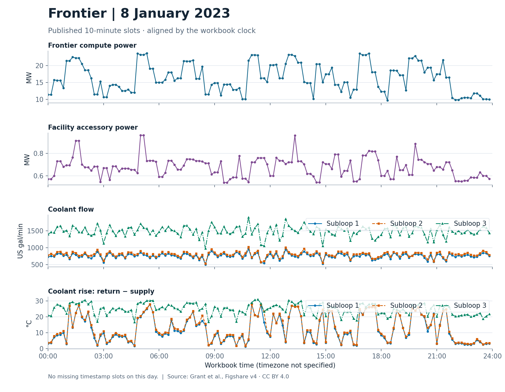
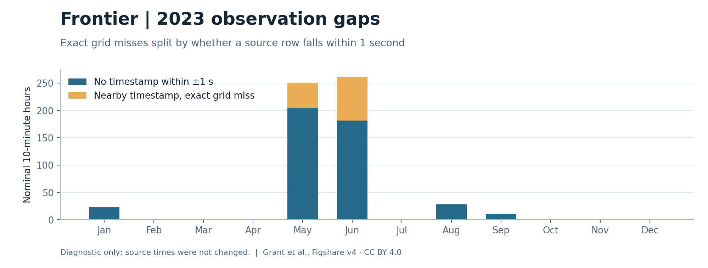

# 39r · Frontier 供电与冷却实测小样

**1 月 8 日的 144 个十分钟时点齐全。** 计算功率在 **9.639–23.599 MW** 之间，最大相邻点差为 **11.569 MW**；三条冷却支路的流量、供回液温差也在同一时间窗内变化。这里能看到发布采样粒度下的波动，不能由相邻点差推断设备响应时长、先后因果或服务缺额。

来源：[Grant 等，Frontier HPC & Facility Data，Figshare v4，CC BY 4.0](https://doi.org/10.6084/m9.figshare.24391240.v4) · [Sun 等，Scientific Data，图 7 及测点说明](https://doi.org/10.1038/s41597-024-03913-w)。按事先选定的图 7 日期 2023-01-08 读取 `Frontier2023`；时间使用原表的日期和钟面，未指定时区。供液温度是三条支路的共同测点；各支路温差用各自回液温度减去该值，保留正负。功率和水量不共用纵轴。

**原论文图版核对。** [图 7](https://pmc.ncbi.nlm.nih.gov/articles/PMC11450168/#Fig7) 与本交付使用同一天。目视抽查的总功率约 05:00 处在 24 MW 左右，22:00 后回到约 10–12 MW；对应 CSV 中 05:00 为 24.1204 MW、22:00 为 10.4031 MW。图 7 展示总功率、PUE、余热、合计流量和供／回液绝对温度。本交付拆开计算与辅助功率，画各支路流量和供回液温差。公开工作簿提供了数据；图 7 的图版没有提供逐点坐标或对应行索引，因此这里只核对日期、变量口径及抽查走势，不称为逐点复现。

| 量 | 该日实测／派生值范围 | 143 个连续 10 分钟对中的最大绝对点差 |
|---|---:|---:|
| 计算功率 | 9.639–23.599 MW | 11.569 MW |
| 辅助功率 | 0.5390–0.9634 MW | 0.3404 MW |
| 支路 1 流量／温差 | 503.50–960.00 gal/min；1.33–28.00 °C | 298.10 gal/min；23.94 °C |
| 支路 2 流量／温差 | 531.89–1022.40 gal/min；1.72–28.11 °C | 332.30 gal/min；23.61 °C |
| 支路 3 流量／温差 | 975.62–1898.40 gal/min；16.61–30.94 °C | 613.39 gal/min；11.56 °C |

流量单位是美制加仑／分钟。用工作簿的密度、比热、取整的体积转换和“负温差记零”规则复算余热，三支路合计 432 个配对的最大绝对残差约 `3.6×10⁻¹⁵ MW`。该日无负温差样本；图中温差仍按带符号差值绘制。这项复算核对公式和单位，不是独立热量计量。

单日 CSV 的 `slot_status` 以**原时标精确匹配**为准，取值如下；1 月 8 日的 144 行均为 `OBSERVED`。

| 值 | 含义 |
|---|---|
| `OBSERVED` | 恰有一条对应源行，所有绘图必需输入齐全。 |
| `INCOMPLETE_INPUT` | 恰有一条对应源行，但至少一个绘图必需输入缺失或无效。保留该源行的可用输入。 |
| `DUPLICATE_TIMESTAMP` | 同一时点有多条源行；不挑一条替代。 |
| `ABSENT_TIMESTAMP` | 没有原时标精确匹配的源行。前后 1 秒的邻近诊断只用于下述全年审计。 |

所选日内若出现非格点源时标，脚本会停止生成单日表，以免固定格点隐藏实际记录。

## 全年缺测：严格格点与邻近诊断

工作簿 2023 年有 **49,869 条唯一时标**，从 1 月 1 日 00:00 到 12 月 31 日 23:50。将原时间戳与 52,560 个名义整十分钟格点比较：

| 口径 | 无对应时标的格点 | 名义格点时数 | 连续缺口 |
|---|---:|---:|---:|
| 严格要求原时标恰在整十分钟 | 3,451 | 575.17 小时 | 130 段 |
| 另查格点前后 1 秒内是否有发布行 | 2,691 | 448.5 小时 | 51 段 |

相差的 760 个格点均有邻近时标，最大偏离 **0.635 秒**；邻近诊断无碰撞、无未归入的源时标。原时间戳未移动，空白未填零。邻近口径的缺口约 **86% 集中在 5、6 月**（分别 1,226、1,086 格点）。最长一段从 **5 月 26 日 23:50 到 5 月 29 日 15:40（不含右端）**，383 格点，折合 63 小时 50 分钟。每月口径与逐段数据见[结果](result.json)和[缺口 CSV](frontier-2023-absent-slots.csv)。

[论文 Data Records](https://doi.org/10.1038/s41597-024-03913-w) 给出的是**约 440 小时**。以 440 小时作数值参照，差约 8.5 小时；原文没有公开逐时点缺测判定与汇总口径。差异可能来自原文的近似报告，也可能来自计数口径，目前无法确认。760 个邻近格点对应 126 小时 40 分钟，解释的是本报告两种口径的差额。缺口成段且在月份间分布不均，可据此设计连续缺测的敏感性情景；公开记录没有逐段原因，无法把这些缺口对应到某次维护、故障或实际停机。

## 能用于什么

这是外部真实液冷设施的功率、温度和水量参照。论文描述发布表为 10 分钟，同时记载历史库以 15 分钟存档；工作簿支持“名义十分钟格点”，没有给出足以重建原采样或重采样过程的记录。发布间隔 600 秒、V6 最大数值积分步长 0.01 秒，两者相差 60,000 倍。发布间隔限定可见的动态，积分步长用于求解；不同步长本身不能判定参数能否识别。这个工作簿可供慢尺度或量级对照，不能单独识别秒级响应；它也没有同期服务需求与交付、人员到场、授权或复检时间。本次没有进行现场参数标定或现场检查收益估计。

论文当前建议先做匹配口径的量级对照。若以后走 [Marconi100 同站配对](../20261111-field-data-candidates.md#marconi100约束耦合的下一道门)，遥测和告警可帮助筛选候选事件；共享班组、授权或截止缺项时，排程演示的结论限于声明的约束。

## 复核与原件

- 输入为 Figshare v4 文件 `47812750`：20,164,974 字节，官方 MD5 `f1832f7215e529f12f38d4087620d6e2`；云端独立 SHA-256 见[结果](result.json)。原链直连及整件中转请求曾返回 403；最终通过官方范围读取逐段中转、整件校验后在云端分析。
- 云端保留两次描述性处理的原输入、冻结源码、日志和输出。初用容器在取件后断开，最终两次处理均在已授权 CPU 容器的私有目录完成。第一轮严格格点结果不变；第二轮只补一秒邻近诊断，单日 CSV 和统计一致。工作簿与详细原件留在私有盘。独立[复核回执](verification.json)由原始 worksheet XML 与 Decimal 时钟核对两种全年格点计数，并抽验单日首、中、末三行及图片格式。
- 复算入口是同目录 [analyze.py](analyze.py) 与 [protocol.json](protocol.json)。在与[结果](result.json)相符的 Python 和依赖环境中，执行 `python -B analyze.py frontier-v4.xlsx <新输出目录>`。查看[单日数据](frontier-jan08.csv)或下载[矢量图](frontier-jan08.svg)。本交付没有运行设施仿真、策略或注册研究，现场标定保持 `PENDING`。
