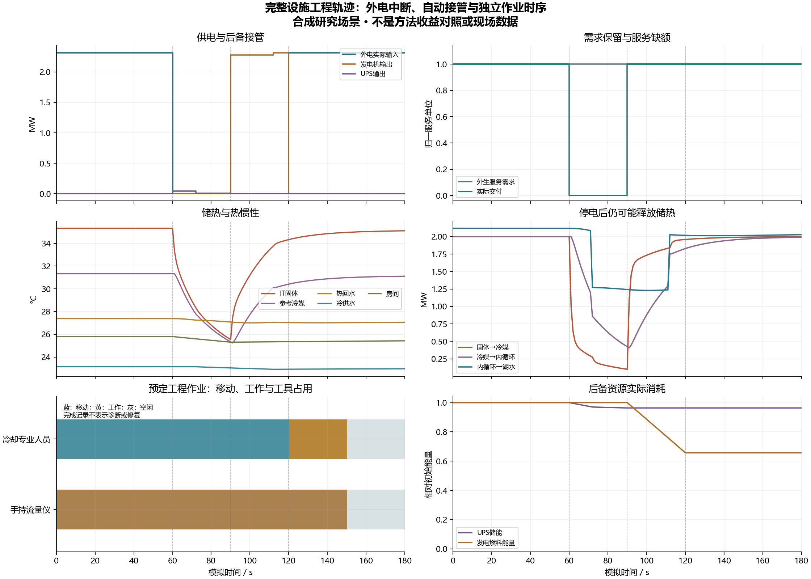

# 完整设施：根集成工程轨迹

来源代码提交`66696336`；物理实现为票03及schema/保护锁存修复，状态CLI同步了活跃主线。两次运行都标为私有设施/评价轨迹，没有上层风险策略、诊断结果或维修动作，不构成方法效果或现场数据。

|原件|设置|有限观察|
|---|---|---|
|`normal-600s/`|同一八域合成设施，600秒，默认工作点|正常稳态与服务交付；逐步能量/质量/容量账通过|
|`supply-and-work-180s/`|60秒外电中断，90秒发电机按模型自动接管，120秒外电恢复；0.25秒开始预定专业工程访问|服务缺额30秒；移动120秒、工作30秒，150.25秒完成；完成记录不产生诊断/修复|

这展示供电、储热、散热、服务与人员占用在同一时间轴上的关系。服务在90秒自动接管后恢复，早于人员完成；不能将这段恢复记成人工检查或策略增益。

[输入](coupling-inputs.json)与[汇总收据](receipt.json)标明研究设定、原件源码身份及未验证范围。每个运行目录的`run.json`给出`scenario.json`、`private-state.jsonl`、`balances.jsonl`的SHA和记录数；原件不覆盖。

[可编辑SVG](coupling-trace.svg) · [绘图数据/源码身份](coupling-trace.json)。图由`scripts/plot_mainline_engineering.py`在逐项核对输入SHA后生成；不是收益比较图。

`root-acceptance-66696336/`保存根启用Torch的完整工程/历史证据验收：179项执行、零失败/错误/跳过。原03作者的374/bc1原件及红例继续单独保留，不重写为当前源码执行。M1其他门槛及总研究目标仍为进行中。
