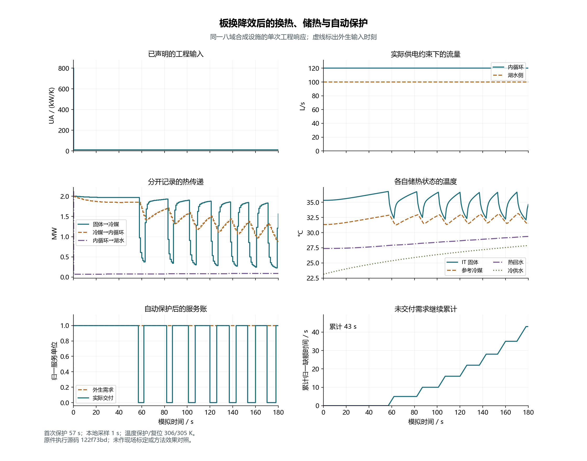
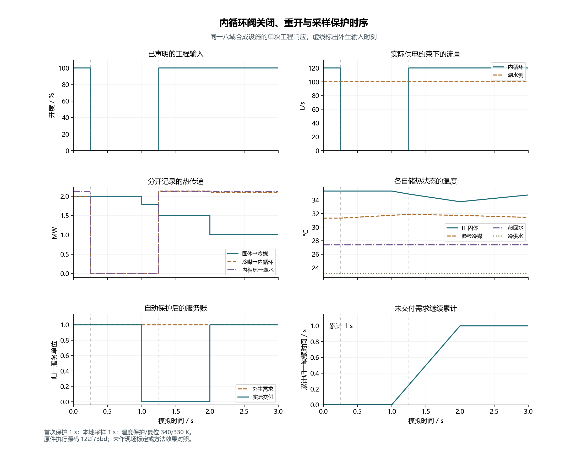

# Electrical, water and phase engineering milestone

Tickets 04–06 are accepted at combined source `02423809d20fcd4541e8a16177f0e10371fb6f09`.
The enabled-Torch root acceptance executed **217/217 tests**, with zero failures,
errors or skips, and verified 20 historical originals. The exact output remains in
[`acceptance-02423809/`](acceptance-02423809/summary.json); the
[root receipt](receipt.json) records its hashes and source files. Optional frozen
private neural checkpoints were not replayed. This is engineering acceptance,
not an effectiveness experiment or completion of M1.

Independent reviews found zero [Standards](../../../../docs/mainline/reviews/04-06-standards.md)
or [Spec](../../../../docs/mainline/reviews/04-06-spec.md) issues. They independently
ran the 38 targeted tests and checked 114 saved artifacts from 38 facility runs.
The integration fresh-read receipts retain the additional source/compatibility
checks and the original execution attribution of each run. Earlier failures,
configurations and records remain unchanged.

## Engineering response figures

The following figures use the **preserved `122f73bd` water runs**, rather than
claiming they were produced at the later combined source. Their adjacent JSON
receipts verify every input artifact and preserve that execution identity. PNG
and editable SVG exports share the same reviewed values. The figure author is
[`plot_mainline_water.py`](../../../../scripts/plot_mainline_water.py).

At 0.25 s the declared plate-HX conductance falls from 800 to 10 kW/K. Flow
continues, heat removal falls and stored temperatures evolve. With the explicit
306/305 K refrigerant protection/reset settings, the first sampled protection is
at 57 s. Subsequent protection/reset cycles give 43 s normalized service deficit
over 180 s. Those controller settings are engineering fixture inputs, not site
settings or a policy selected for a positive result.

[SVG](figures/hx-degradation.svg) · [data identity](figures/hx-degradation.json)

The valve closes at 0.25 s and reopens at 1.25 s. Its hardwired interlock stops
the internal pump immediately; the lake pump remains powered. The sampled
compute protection trips at 1 s and resets at 2 s. Three service-unit seconds of
demand remain in the account, two are delivered and the normalized deficit is
one second. Stored solid heat continues to transfer while cooling is stopped.

[SVG](figures/internal-valve-reopen.svg) · [data identity](figures/internal-valve-reopen.json)

Both exports were inspected for visible series, units, timing, legends and text
overlap. Line styles also distinguish the series without relying on color.
They describe two engineering inputs separately; they do not compare policies
or establish field failure times.

## Numerical qualification still pending

A separate 432-case frozen-row mixture representation probe found five
mass-scaled pure-vapor inputs whose encoded M/U/V reconstructs quality as
`1.0000000000000002` and is strictly refused. Exact decimal/hexadecimal inputs,
source/table identities and the [reproducer](endpoint-representation/endpoint_representation_probe.py)
are preserved with [all results](endpoint-representation/probe-result-01.json).
Ticket 12 must quantify this representation boundary alongside step convergence.
The finite endpoint correction does not claim all scaled nominal inputs work,
and the current admissibility rule has not been loosened.

The synthetic facility, fixed mainline and remaining acceptance gates are in
[MAINLINE](../../../../docs/MAINLINE.md) and
[progress](../../../../docs/mainline/progress.json). Environment/access, service,
control, reserve and full coupling remain pending M1 work. Registered effect
trials, training and agent calls are zero; site calibration and AI/RSI increments
remain unestablished.
