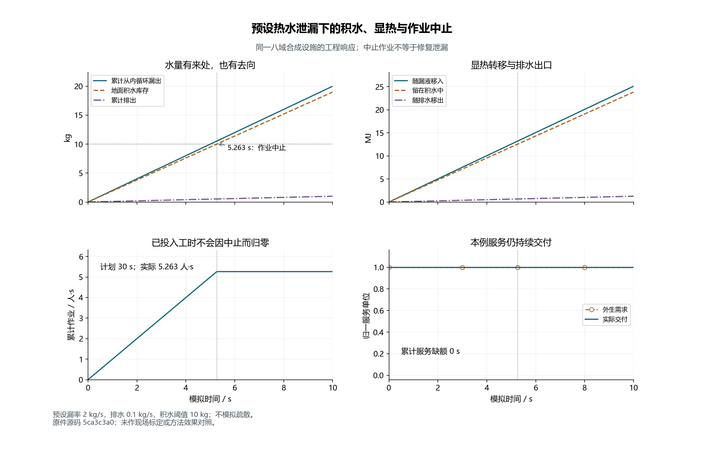
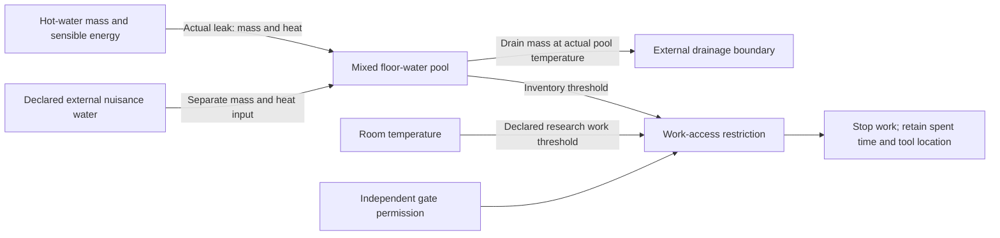

# Environment and work-access acceptance

Ticket 07 is accepted at source `d68425915d5a5d9308add320a22c96764db11812`.
Enabled-Torch root acceptance executed **247/247 tests**, with zero failures,
errors or skips; 20 historical originals passed. The [receipt](receipt.json)
and [raw acceptance](acceptance-d6842591/summary.json) preserve source identities.
The original author's 247 collected /245 executed /2 optional skips remains
separate from this later root run.

The figure uses the preserved `5ca3c3a0` engineering run. Its mass, heat and work
accounts reconcile with the saved intervals. At 10 s, 20 kg has left the internal
loop, 19 kg remains on the floor and 1 kg has drained out. PNG/SVG were inspected
for visible series, units and annotations; line styles distinguish the series.
[Editable SVG](figures/leak-and-work.svg) · [data identity](figures/leak-and-work.json)
· [figure author](../../../../scripts/plot_mainline_environment.py).

## What now acts in the facility

The diagram describes implemented research interfaces, rather than an as-built
site pipe layout. Hot-water loss decreases the actual hot inventory and transfers
its sensible energy into the floor pool once. Drainage exports heat at the
pool's evolving temperature. External nuisance water remains separately labeled.
Air heat and liquid heat have separate accounts.

For the preserved actual-leak work case, 2 kg/s leakage against 0.1 kg/s drainage
reaches the 10 kg floor threshold at `100/19 s`. Work stops at that instant and
retains 5.2631579 person-seconds already spent. The run still delivers its full
10 service-unit seconds: access restriction is not automatically an IT outage.
There is no modeled evacuation or instantaneous move out of the restricted area.

The prescribed-RH condensation result uses an explicitly declared cold-water bulk
temperature proxy. It calculates a risk boundary, without condensate, latent heat
or an outward dispatch alarm. The minimum remaining hot inventory is an explicit
validity boundary. Below that boundary, the run fails rather than inventing
low-inventory hydraulic behavior. The [model document](../../../../docs/mainline/environment-verification.md)
states the equations, formula domains, research access threshold and site gaps.

## Independent checks and retained failures

[Standards](../../../../docs/mainline/reviews/07-standards.md) and
[Spec](../../../../docs/mainline/reviews/07-spec.md) found zero issues in the
frozen candidate. Twenty-two target tests passed independently. The Spec review
also exercised 108 inlet/drain/threshold/step combinations; every work stop
matched the analytic crossing. A separate 70-digit Decimal mixed-water case
matched remaining hot mass, floor mass/temperature and exported drain energy.
Its [script](independent-environment-probe/environment_probe.py) and
[precise results](independent-environment-probe/probe-result-01.json) remain available.

During development, the root found that subtracting large stored energies could
misclassify zero drain heat as negative. Forty-nine of 108 finite zero-drain
inputs were refused. The original [red inputs](root-zero-drain-red.json) remain;
the [fresh green replay](root-zero-drain-green.json) records zero failures and
retains its actual pre-acceptance working-source status. The correction uses the
known zero-drain boundary and stable analytic positive-drain integration.
These failures are not erased by the later successful acceptance.

The [integration fresh read](integration-fresh-read.json) preserves nine successful
engineering runs, one expected domain refusal, the independent CLI, 146 original
file hashes, six frozen inputs and the original `5ca3c3a0` execution attribution.
Existing V1/V2/V3 configurations, defaults and historical results remain intact.

M1 still requires local-control faults, reserve behavior and full coupled
acceptance. Registered effect trials, training and agent calls remain zero.
Continue through the fixed [mainline](../../../../docs/MAINLINE.md) and
[progress](../../../../docs/mainline/progress.json).
