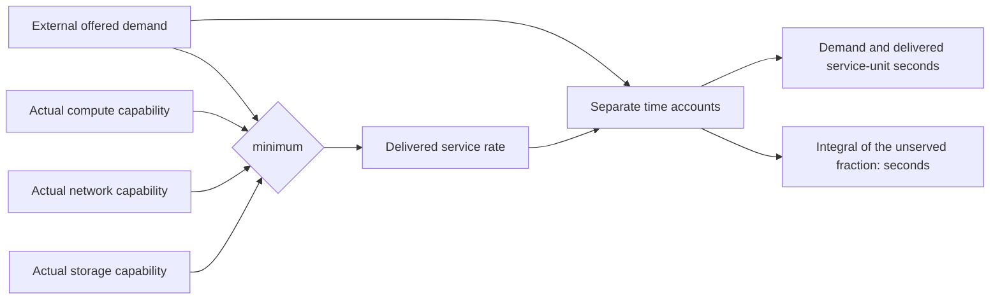

# Joint-service accounting acceptance

Ticket 08 is accepted at combined source
`1fb8981b970e1e120e64598c5ce95c566037dfed`. Root acceptance executed **225/225
tests**, with zero failures, errors or skips; 20 historical originals passed.
The [receipt](receipt.json) and [original output](acceptance-1fb8981b/summary.json)
retain source and artifact identities. Earlier worktree acceptance remains
225 collected /223 executed with its two optional Torch skips; it has not been
rewritten as the later enabled-Torch result.

## Service interface

All three component capabilities use the same declared normalized reference
rate. A required component can limit delivery while the other two remain
powered. Simultaneous losses are one joint-service shortfall, rather than a sum
of component penalties. Throttling or pausing execution does not change external
demand. Restoring execution resumes current delivery and retains earlier loss.

The [model definition and hand cases](../../../../docs/mainline/service-accounting.md)
state the assumed power-to-normalized-capacity coefficients and units. There is
no calibrated FLOP/s, IOPS or bit/s conversion, and service-unit seconds are not
job counts.

## Independent checks

Both [Standards](../../../../docs/mainline/reviews/08-standards.md) and
[Spec](../../../../docs/mainline/reviews/08-spec.md) reviews found zero issues.
Eight targeted public-interface tests passed independently. The integration
[fresh read](integration-fresh-read.json) verified 78 sealed files, 59 run
artifacts and the interval-by-interval service accounts for eleven saved runs.
The artifacts retain their actual `60f21f25` execution source.

An additional [six-interval probe](independent-accounting-probe/accounting_probe.py)
combines noninteger capacity-event times, changing offered demand, overlapping
component limits, zero demand and execution pause/restoration. Its literal hand
sums and both V2/V3 executions give 2.07 requested service-unit seconds, 0.495
delivered and 1.315 s normalized deficit. The [exact inputs and results](independent-accounting-probe/probe-result-01.json)
remain inspectable. In general, the deficit-time account cannot be reconstructed
by dividing total unserved work by one horizon-wide demand when demand changes.

This accepts one engineering slice. Environment/access, local-control faults,
reserve behavior and the coupled M1 gate remain in progress. Registered effect
trials, training and agent calls are zero; the fixed [research mainline](../../../../docs/MAINLINE.md)
continues through its later comparison and conclusion gates.
