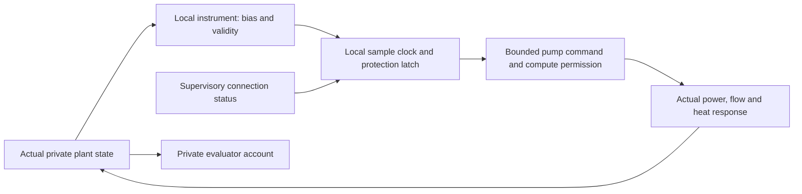

# Sampled local-control acceptance

Ticket 09 separates actual temperatures/flows from reported measurements. Bias
and invalid readings affect sampled automatic protection; supervisory loss leaves
local control autonomous. Restoration requires a fresh valid sample satisfying
the reset and flow conditions. Power or link restoration alone does not clear an
existing protection latch.

Root regression at `1ed66692` executed **263/263 tests**, with zero failures,
errors or skips and 20 historical originals verified. Delivery revision
`082547e2` adds the portable artifact correction; runtime, configuration and tests
are byte-identical to that tested source. The [receipt](receipt.json) and
[original regression output](acceptance-1ed66692/summary.json) retain both identities.
The successful engineering runs retain their actual execution source `363c5edf`.

## The local loop

This is a local automation loop. Outward evidence delivery and risk-driven human
dispatch remain later gates. New profile parameters have explicit SI units,
source notes and ranges; signed measurement offsets do not relax the bounds on
physical flow, absolute temperature or power.

An [independent compound timing probe](independent-control-probe/) uses a 0.7 s
sample period and a 0.37 s maximum integration step. It combines a high report,
the hysteresis band, supervisory loss, power loss, invalid sensing and recovery.
The latch clears only at the valid safe sample at 3.5 s; normalized deficit is
3.5 s and delivered work is 0.6 service-unit seconds. Sixteen targets and the
existing environment compatibility checks also passed independently.

## Portable evidence correction

Cross-worktree fresh reads exposed one delivery defect: the original 164-entry
author-local file observation included two untracked Python compiler caches.
The [initial root readback](initial-v1-root-readback.json) remains unchanged.
All 162 persistent originals matched their hashes and Git blobs.

The original inventory, receipt, tools, trajectories and failures are preserved.
The [V2 verifier](../09-control/verify_portable.py) classifies exactly those two
cache entries as non-delivery records, retaining their original hashes and
reasons. It verifies the 162 durable files, six legacy inputs, 74 saved artifacts,
twelve cases, six refusals, its own/manifest Git identities and the recorded
execution-source blobs. It does not exempt other failed hashes.

The [fresh root V2 check](portable-v2-root-readback.json) passes with one cache
different and the other absent. Real missing-cache and different-cache checkout
successes, the old verifier's failure and a tampered-new-verifier refusal remain
in [the correction evidence](../09-control/portable-v2-validation/receipt-v2.json).
No physical simulation or full regression was repeated for this metadata repair.

The original [Standards](../../../../docs/mainline/reviews/09-standards.md) and
[Spec](../../../../docs/mainline/reviews/09-spec.md) source reviews found zero issues.
Their later [portability Standards](../../../../docs/mainline/reviews/09-portability-standards.md)
and [Spec supplement](../../../../docs/mainline/reviews/09-portability-spec.md)
close the one root delivery finding. Source acceptance and portable-delivery
acceptance are recorded separately.

Reserve behavior and the full coupled M1 gate remain pending. Registered effect
trials, training and agent calls are zero; continue through the fixed
[mainline](../../../../docs/MAINLINE.md) and [progress](../../../../docs/mainline/progress.json).
