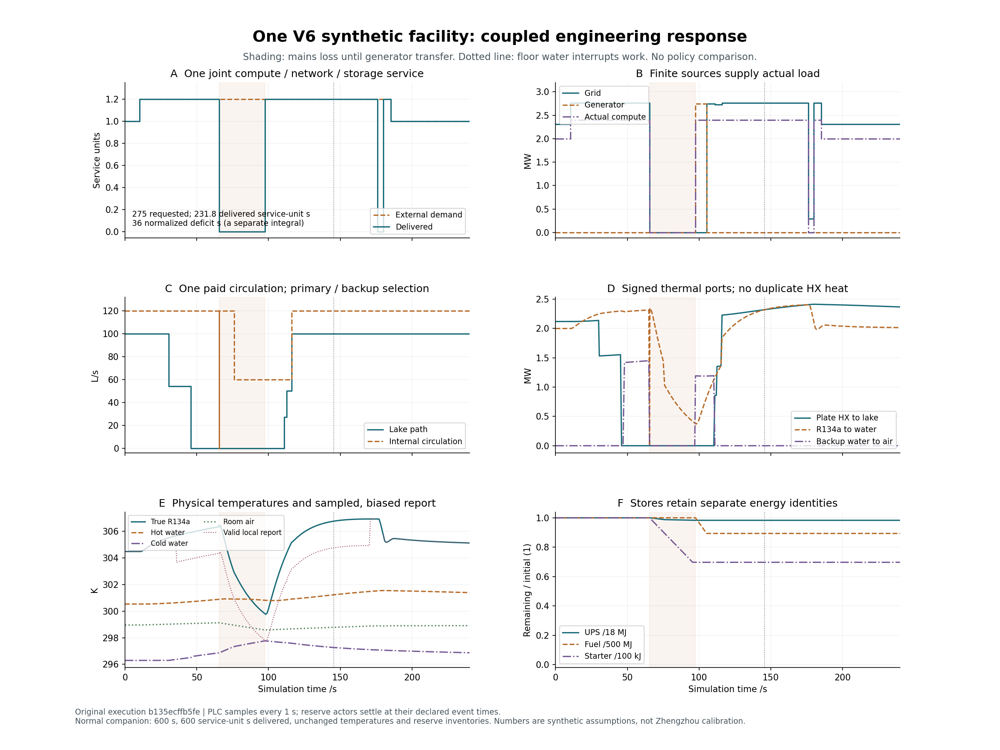
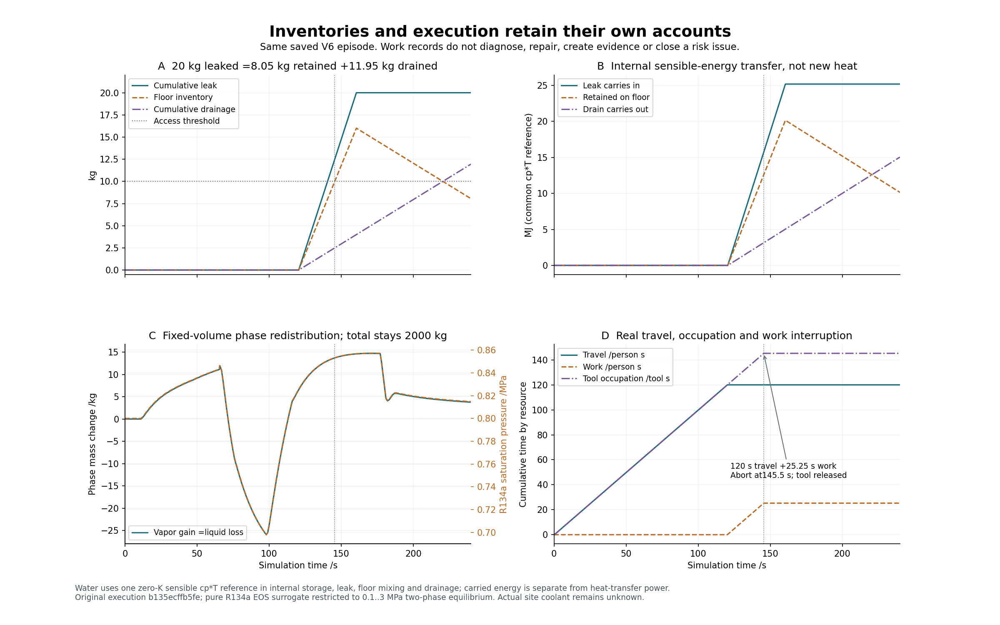
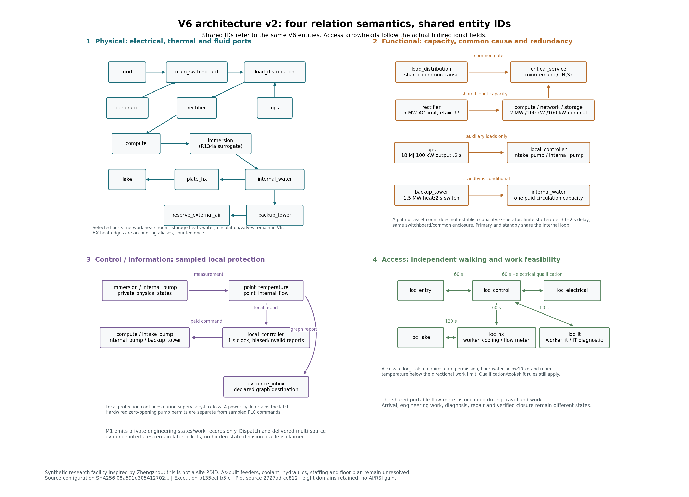

# 同一 V6 八域联合工程验收原件

正式执行 `b135ecffb5fe5c3fecaa44859afbf925b8549bb1`。同一合成设施在 600 s 正常工况稳定，并完成 17 个工程案例、129 条独立字面条件及 3 个域外/权限拒绝；保存 1272 个状态点和 1255 个区间。运行器及 V1–V6 配置未改，M1 等待根独立审查与接受，总研究继续。

[范围与八域反例矩阵](../../../../docs/mainline/11-coupled-acceptance.md) · [冻结 runbook](../../../../docs/mainline/11-coupled-runbook.json) · [初始执行收据](fixtures-b135ecff-01/receipt.json) · [耐久集合声明](fixtures-b135ecff-01/declaration.json) · [完整尝试账](fixtures-b135ecff-01/engineering-attempts.jsonl) · [独立保存账复核](fixtures-b135ecff-01/independent-checks.json) · [全套验收](fixtures-b135ecff-01/full-check/summary.json)



组合轨迹通过真实 CLI 保存。请求为 275 服务单位秒，交付为 231.8 服务单位秒，归一服务缺额为 36 s；变量需求下三种账分别积分。10.25..185.25 s 需求为 1.2，市电失去后经 30+2 s 自主启动/切换恢复发电；备用风机在 UPS 阶段没有 AC 供电。传感通道无效时本地保护仍限制计算。



20 kg 热水泄漏分为 11.95 kg 排出和 8.05 kg 积水；统一 `cp*T` 参考中的携能与传热功率分别显示。积水在 145.5 s 达 10 kg 阈值，中止已到场的工程作业，保留 120 人秒步行、25.25 人秒作业及 145.25 工具秒占用。该工作记录不表示诊断、修理、检查证据或验证关闭。



三图均有同名可编辑 SVG 和 JSON 收据。收据追溯实际保存源文件、源提交、参数/单位、绘图脚本和字体。架构只画选择的已声明边组，边 ID 全列在图收据中；重复 ID 指向同一实体，容量、共因、时延与资格条件分别说明。图不是郑州现场 P&ID；现场工质、馈线、P&ID、人员和空间数据仍未知。R134a 仅为 0.1..3 MPa 两相数值替代工质。

架构 v2 单独修正一项 Spec 可视语义 finding：原 V6 的 `a1..a5` 均为双向通行，旧图却用单向箭头。当前 v2 根据每条原边的 `bidirectional` 字段画双向箭头，并把 `a4` 移出 `loc_hx` 框。`plot_mainline_coupled_architecture_v2.py`、独立图收据与目录给出新的绘图源身份；仍读取同一 b135 实测保存轨迹，不重跑物理或全套。[旧架构图及收据](fixtures-b135ecff-01/figures/facility-architecture.json) 作为原始历史保留，b135 工具与 1625764d 交付字节不改写。

独立读回的最大差值为：全场储能/边界能量 `8.32e-6 J`，水质量 `7.22e-16 kg`，源/负载/损耗 `5.82e-11 W`，相质量 `2.27e-13 kg`，服务积分 `0`。这些是有限工程算例的记账误差，不是数值收敛、现场校准或方法效果结论。

唯一一轮全套：306 项收集，304 项执行，零失败/错误；两项既有 optional Torch 检查因本机未安装 Torch 跳过，unexpected skips 为 0。20 个旧原件验证通过。正式工具链为 Python 3.12.14、项目固定 NumPy 2.3.5、Matplotlib 3.10.7；执行器、88 个来源/工具文件和 15 个既有收据另有 Git/SHA 身份。

正式捕获命令，在本票 worktree 的 PowerShell 中执行：

```powershell
$env:PYTHONPATH='src'
& 'C:/Users/Donson/.cache/codex-runtimes/codex-primary-runtime/dependencies/python/python.exe' scripts/capture_coupled_engineering.py --output evidence/mainline/engineering/11-coupled/fixtures-b135ecff-01 --plot-dependencies C:/Users/Donson/Documents/ChatGPT/Renly/.work/paper-writing-deps
```

原输出已封存，不重复使用该目录。执行收据的初始 `PENDING_COMMIT_AND_FRESH_CHECKOUT` 状态保持原样；后续交付证明单独记录。新 checkout 读回需要执行与交付历史 Git 对象，不能用默认 shallow checkout 冒称历史源码核验。读回不重跑物理或全套。

`development/` 保留准备失败与纠正：缺 runbook、作者排水手算错误，以及作者读回器把外部 nuisance-water 携能字段误认为总流入。这些不是运行器缺陷。叶 `.gitattributes` 仅把原 PowerShell 日志 CRLF 认作行尾，并精确标记三张生成 SVG 的坐标空格；原字节与哈希保留，其他源码/文档空白检查继续。

本目录是工程证据，不是注册效果试验。研究试验、训练和 LLM 调用均为 0；现场标定 pending，研究收益和 AI/RSI 增量未建立。票 12/13 继续做数值资格与外生重放，证据、风险、处置、恢复和独立机制比较在后续任务。
