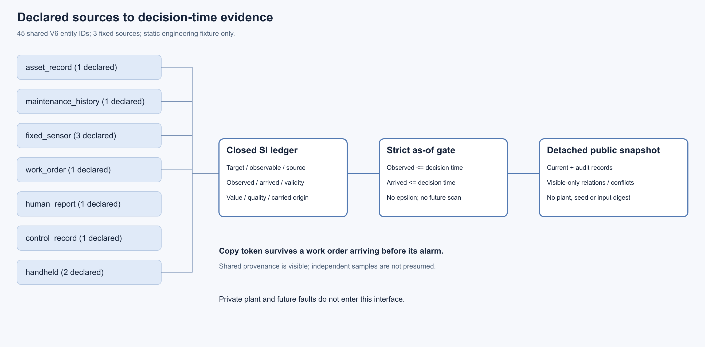
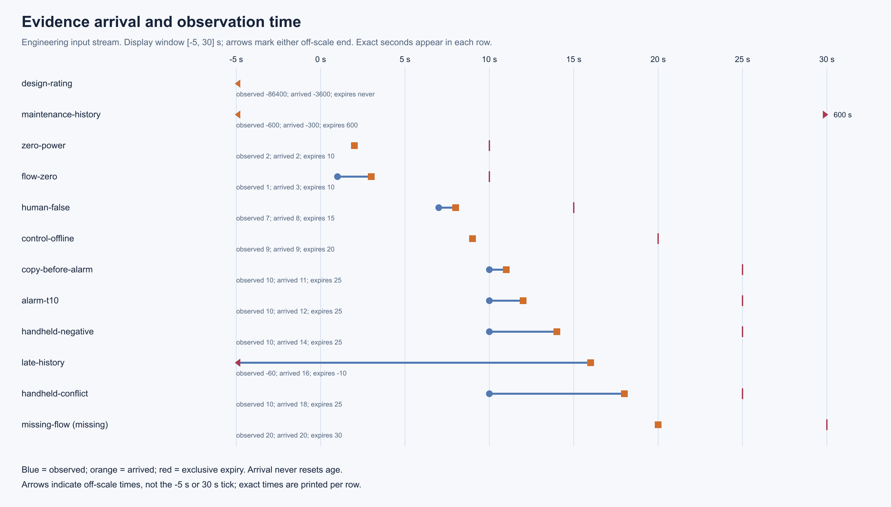

# 14 根接受：按可用时刻组织多源证据

证据账已在声明接口范围内接受：记录资产／设计、稀疏固定测点、历史维护、人工／工单和现场手持等来源，保存观测与到达时刻、共同来源、质量、过期、冲突及缺测。snapshot 只使用查询时刻已观测且已到达的记录，再形成可见记录间的关系；复制记录不被当成独立新来源。主场景含稀疏固定传感器，未覆盖位置不自动生成观察。

## 架构与时间图





这两件为根实际查看的 sharp0.35.5 本地栅格，不是 browser QA。新时间图对窗口两侧作 off-scale 标记，仍保留维护记录真实600s过期值。原版可视化1项发现、修订后1closed/open0/new0与两代PNG／render记录均惰性归档；原SVG字节不改。

## 实际根验收与历史身份

实际统一全检源为 `65eddd6908510371a6fcc913742b6c4197114270`：377/377，失败、错误、跳过均0；20份旧原件及166份Python／HEAD前后守卫通过。[原始日志](raw/tests.log)、[结果](raw/summary.json)、[守卫](raw/source-guard.json)保留原字节。本封装没有运行模型、目标批次或全套。

接口／工具执行源 f945、数据交付4b1997b7的[author候选索引](../../../../docs/mainline/evidence/14.json)和[CURRENT入口](../14-evidence/CURRENT.md)仍是原记录。最新9件产物＋收据、43旧原件、200前版来源以及50runtime／116tools／38inputs／20目标保留各自身份。原3c全检371/369及两旧可选跳过不追认为最新源全检。

## 评审、数学判别与范围

[Standards链](reviews/standards.zip)、[Spec最终与原发现](reviews/spec.zip)、[根独立数学诊断](reviews/math-probes.zip)、[两代视觉QA](reviews/visual-qa.zip)均为惰性ZIP。[每成员清单](reviews/preservation.json)逐项记录SHA／字节／原路径；其中脚本、属性或快照不会被解压为活动工作树。

最终Spec三项数值P2 closed3/open0/new0；Standards链接finding closed1/open0/new0，最终代码／格式无新增问题。区间、年龄、准入按已解码 finite int／binary64 的 Fraction 精确语义判别；派生数输出或不支持域遵循合同。这里没有引入EPS、修改原值／误差界，也不声称现场精度、真实概率或风险模型保证。

见[同一V6的证据fixture](../../../../configs/full-facility-evidence-v1.json)、[接口合同](../../../../docs/mainline/14-evidence-contract.md)及[14根权威](../../../../docs/mainline/evidence/14-root.json)。账本不替代15真值隔离、16稀疏渠道或17非固定检查机制的独立验收，也不构成诊断、修理、闭环恢复或方法收益。

## 只读交付复核

在封装提交的新checkout中用新的输出路径执行；仅核字节／Git／ZIP／状态，不调用证据或物理运行器：

```powershell
python -B evidence/mainline/engineering/14-root-acceptance/verify_packet.py --delivery-commit PACKET_COMMIT --output NEW_PROOF.json
```

独立fresh证明在后续metadata提交中单列，原packet收据保留pending状态。旧author fresh应在相应执行／交付revision核验，不能在任意新根下跳过哈希。

M3仍in_progress，当前primary15，15／16／17均ready且未分配。现场标定pending，注册效果、训练、LLM和AI／RSI资格尚未开启；完整研究目标保持active。M2sealed数据与既有站点设置保持原样。
