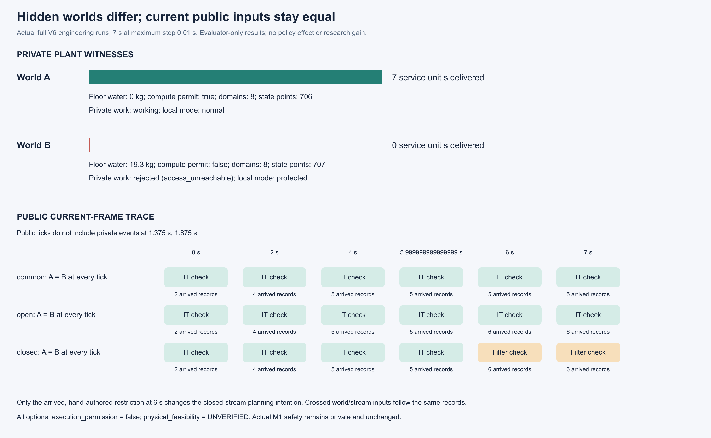
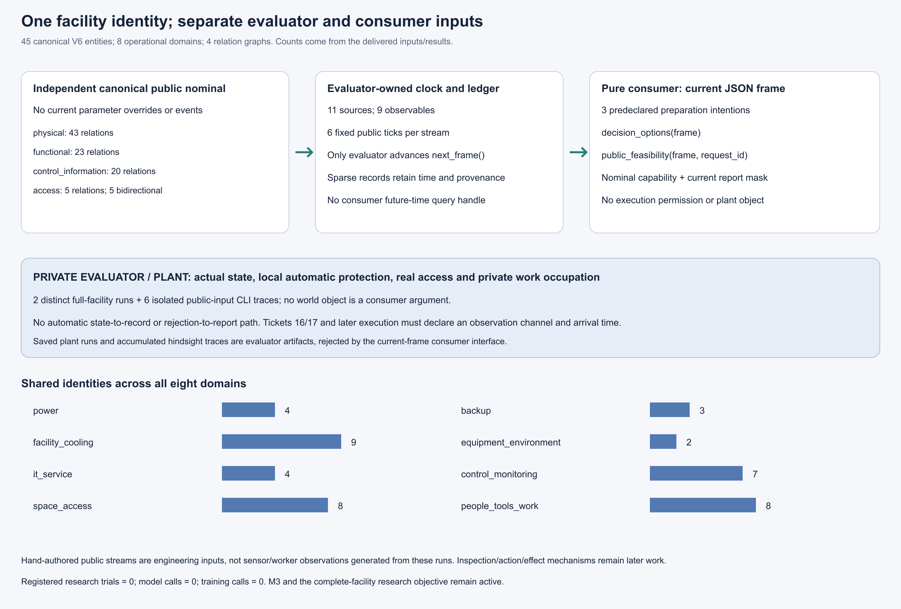
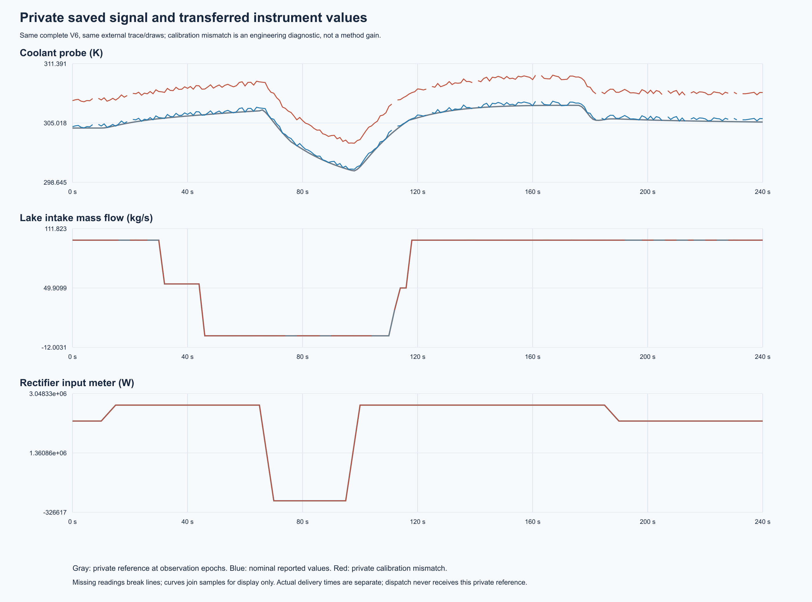
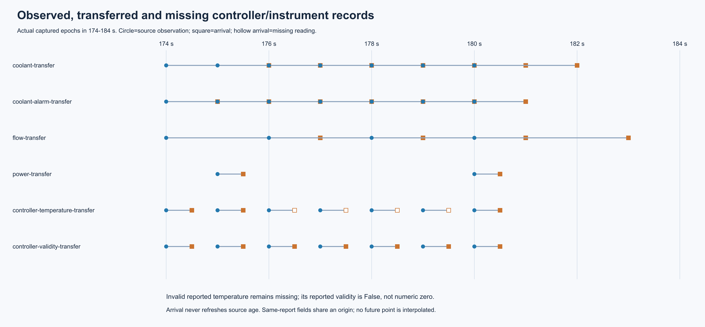
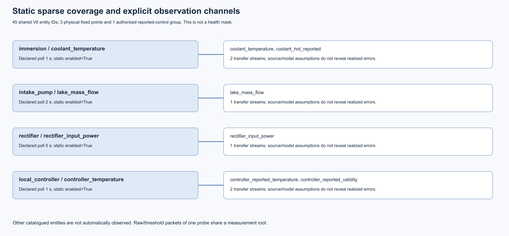
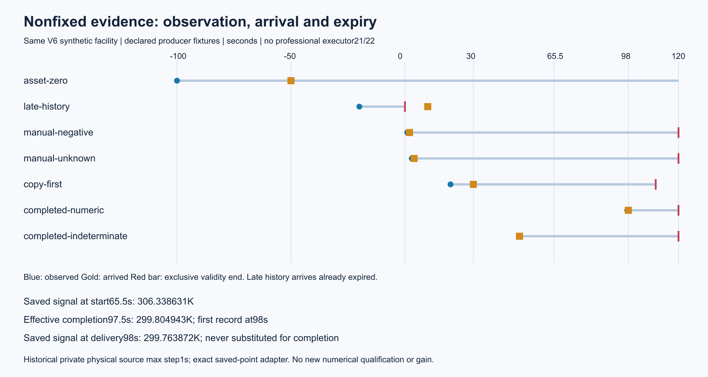
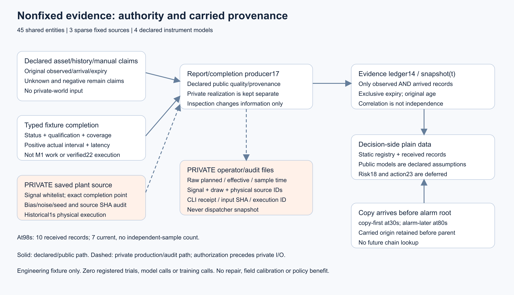

# M3 信息边界与观测通道验收

第 15–17 票在同一合成 V6 设施架构上完成验收。统一源码 `777ee58541a4cb2be2ff200de2ac135c6f13affe` 的 420 项回归全部执行，零失败、零错误、零跳过。20 份历史原件通过校验，190 个 Python 文件与执行提交通过前后字节守卫。原始结果见[测试摘要](raw/summary.json)及[测试日志](raw/tests.log)。

| 票据 | 验证结果 | 根验收记录 |
|---|---|---|
| 15 | 两个私有 V6 世界产生不同物理和安全结果。相同到达记录产生相同公开帧和计划候选，限制报告到达后才出现分歧。 | [15](../../../../docs/mainline/evidence/15-root.json) |
| 16 | 3 个固定测点和 1 组控制上报从原 240 秒轨迹生成 1,134 条记录。原作者全回归因两项旧 CLI 的环境导入失败记为 FAIL，后续两项定点复测与本次统一回归均通过，各自保留原执行身份。 | [16](../../../../docs/mainline/evidence/16-root.json) |
| 17 | 历史、人工及手持观测进入同一时标和来源账。手持样例在 97.5 秒取值，于 98 秒可用。专业人员执行接口仍由第 21–22 票接入。 | [17](../../../../docs/mainline/evidence/17-root.json) |

独立规格复核共通过 48 项断言。两轴报告与原始读回证据见[评审归档](reviews.zip)。[补充归档](support.zip)包含 11 个原始文件的 CRLF 分类闭环、图表渲染回执及字段衔接检查。三种保存数据来自独立工程样例，字段衔接的结论限于已到达观测在同一公开接口中的表现。

图由源 SVG 在本地渲染并逐张查看，源文件和 PNG 的身份记录在 [source-manifest.json](source-manifest.json)。使用 `verify_packet.py --delivery-commit COMMIT --output OUTSIDE_CHECKOUT.json` 在封存提交的干净检出中复核。第 18 票接下来研究如何随证据和时间更新对潜在原因的认识。现场标定、独立效果实验和 AI／RSI 资格仍按主线依赖推进。
