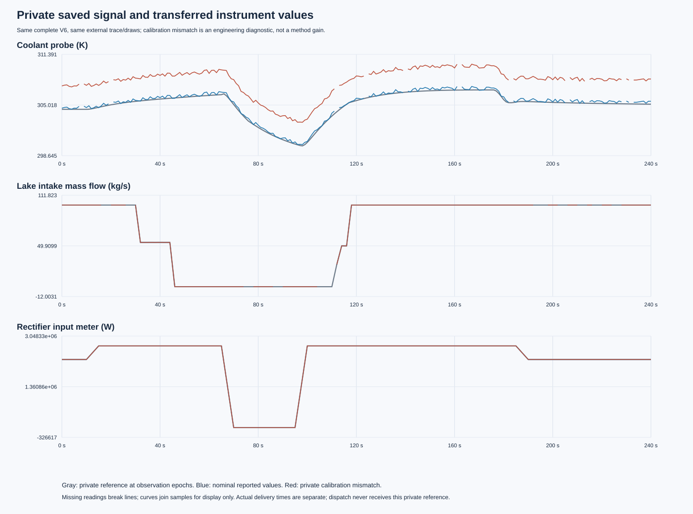
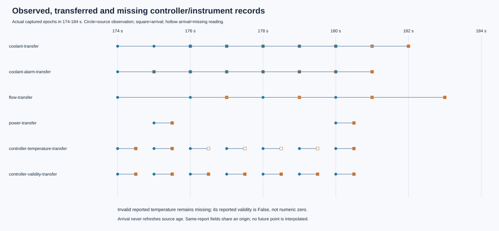
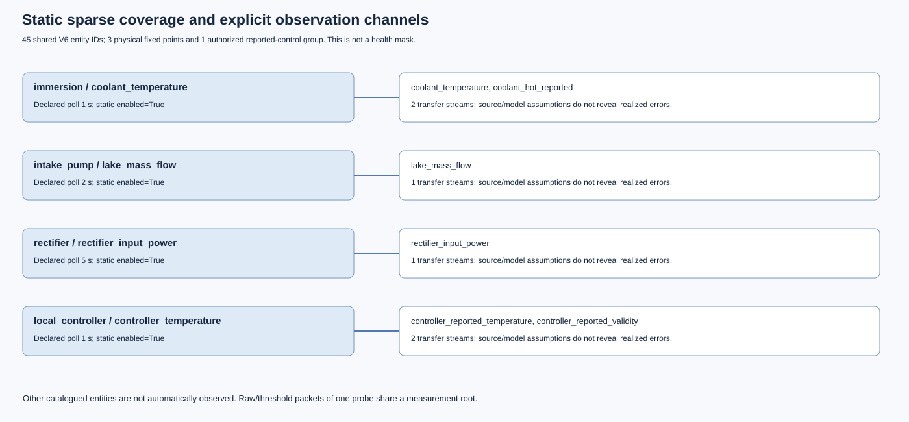

# Ticket 16: sparse fixed instruments and reported control records

Status: **IMPLEMENTED_PENDING_ROOT_ACCEPTANCE_WITH_RECORDED_ENVIRONMENT_FAILURE**.
The observation component passes its literal interface examples and saved-data
checks. The original author full regression remains failed. Root reviews and the
integrated regression remain pending; this is not M3 or research completion.

The static profile keeps all 45 V6 entity identities. It declares three physical
fixed measurement points (coolant, intake flow, rectifier input power), one
authorized reported-control group, and six transfer streams. Uncovered entities
produce no observations. Dispatch is given only an as-of ticket-14 snapshot and
the empty-record static public model. Private seed, realized error, full future
queue, physical input identity and diagnostic reference stay evaluator-only.

The actual observation execution is **842093460248167c0b8e4d9e37e74aebc9da034a**.
Its [frozen runbook](../../../../docs/mainline/16-sensor-runbook.json) reads the
original M2 combined 240 s / maximum-step 0.01 s full-V6 archive. That physical
trajectory still belongs to **89f47b6fdc61c14e8c9367fadfe33966e40f0926**.
No physical trajectory was rerun or reattributed. Nominal and private calibration
mismatch outputs each contain 1,134 records from 652 measurement polls, and ten
as-of snapshots are saved. These are engineering diagnostics, not method trials.

The data-driven figures are reproduced byte-for-byte from saved JSON by the fresh
reader. Root separately rendered and inspected all three using local Sharp at
2x scale, with zero open visual findings; the root QA package is separate from
the original capture. This was local raster review, not browser QA.

[Independent saved-data checks](capture-01/independent-checks.json) verify the
shared V6 identity, sparse targets, literal first arrival and one-ULP future
boundary, missing values, reported invalid control samples, stable noise and
availability, private calibration separation, public metadata exclusion, and
future-payload noninterference. The 13 sensor interface tests all passed in the
original full log. Their prior red/green originals, and root's polling-loop
counterexample and closure, remain in [development](development).

The complete [capture-01 receipt](capture-01/receipt.json) and
[attempt ledger](capture-01/attempt-ledger.json) remain **FAIL**. The full author
regression ran 390 tests: 388 executed, one failure, one error and two explicitly
optional Torch skips. The two failed legacy CLI children could not import
`aegis_dc` because the outer command omitted `PYTHONPATH`. The script's in-process
path did not propagate to those children. The source-guard role was not written
after that full-regression failure; the exact missing role stays recorded rather
than being inserted retrospectively. All 33 existing original durable files,
including the terminal receipt, are retained in their first delivery commit
**92e2960cf538801c1803a260084ba83bf2e07048**.

The additive [environment protocol](../../../../docs/mainline/16-sensor-delivery-addendum-v1.json)
freezes the two exact failed test identities, the original failure signature and
the sole missing artifact role. New tools execute only those two original real
CLI tests with declared `PYTHONPATH`; they do not modify the frozen capture tool.
Their execution is **a732b376578d690bc0883c69eebc985b8d3a39c6**, with
[two tests passed and actual child stderr preserved](environment-closure-01/receipt.json).
The narrow closure leaves the 390-test outcome failed. It adds zero adapter,
physical or full-regression reruns.

The [fresh proof](delivery-readback-01/fresh-proof.json) verifies exact artifact
sets, source/input/tool bytes against the recorded executions and committed
delivery blobs, saved-data checks and SVG reconstruction. It distinguishes
observation-component success, two-test environment closure and the pending root
integrated full regression. The [checkout invocation record](delivery-readback-01/fresh-invocation.json)
documents the Git fallback: the single desktop worktree request returned no usable
path or operation identifier, so its service outcome remains **OUTCOME_UNKNOWN**.
The distinct detached Git checkout was independently observed at the delivery
revision. No desktop worktree success or cancellation is claimed.

Research trials, AI/model calls, training and new physical runs are zero. Field
calibration, risk inference, inspection policy gain and RSI gain remain pending
or unestablished under the mainline gates.
