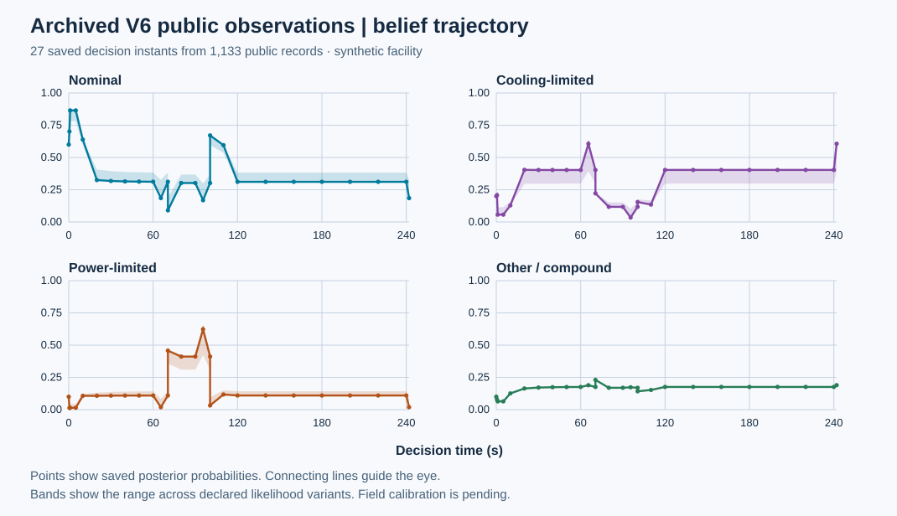
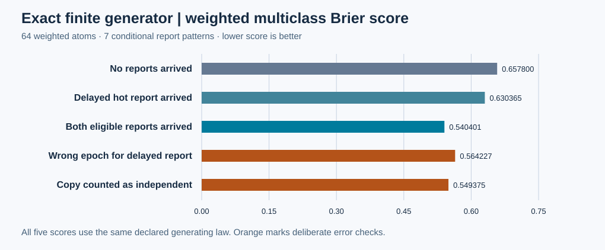

# 第18项：公开证据驱动的认识更新

本包交付四状态有限认知模型、公开接口和工程校验。它读取已经到达的公开证据与声明模型，输出后验、假设敏感性包络及逐条证据处理记录。信息更新不执行物理维修。当前为 **作者工程交付候选，待根集成验收**；M3与总研究目标继续进行。

## 数据图

27个已保存决策时点使用第16项242秒公开快照中的1,133条记录。每次仅纳入观察与到达均不晚于当前时刻的记录。曲线点之间的连线用于阅读；阴影是声明似然变体的范围，不表示置信区间。

独立64原子生成法则定义两个隐状态时点和两个二值报告。7组条件概率与公开接口输出的最大绝对差为0，低于冻结容差1e-14。概率加权四类Brier依次为：无报告0.657800、迟到热报告0.630365、两个独立报告0.540401；故意将迟到证据放错时点和将复制记录当独立证据，分别得到0.564227和0.549375。这些数值说明该有限生成法则下的实现行为，不说明现场校准或巡检收益。

## 实现与适用范围

模型围绕浸没排热及供电支持设置nominal、cooling-limited、power-limited和other四类。它们通过V6共享资产身份连接八域设施，但不枚举全设施每一种故障：泵能力与滤阻变化、低需求与供电限制存在未识别性，复合原因保留在other中。似然、转移、阈值和条件独立关系均为明确研究假设。

迟到根记录作用于原观察时段，再向当前投影；到达时已过期者仅留审计。复制、同源及声明依赖形成传递相关组，不能增加独立因子。阈值跨界、未知质量、来源歧义和未建模组合均显式保留。每帧重算允许新来源信息撤销旧因子。无可用证据时投影先验，而不是输出零风险。

- [接口与建模说明](../../../../docs/mainline/18-belief-updates.md)
- [冻结工程协议](../../../../docs/mainline/18-belief-engineering-protocol.json)
- [模型输入](../../../../configs/full-facility-belief-model-v1.json)
- [独立生成法则](reference/finite-generator.json)及[精确oracle](reference/exact-oracle.json)
- [原始执行收据](capture-01/receipt.json)、[尝试记录](capture-01/attempt.json)、[保存CLI输出](capture-01/cli-stdout.raw)
- [全新检出交付证明](../../../../docs/mainline/evidence/18-delivery.json)及[作者图像复核](../../../../docs/mainline/evidence/18-author-visual.json)

## 来源和执行身份

核心修复提交为0e97b1c3与65d857fd。正式作者工程执行源为`c2ef61baafba0dd538768526d88e5b6caad5f4e3`；原件交付提交为`6fc1d0eed811fd246403dc1c1a0ba14dbb12fdea`。执行前后HEAD及54个运行源、4个工具、31个冻结输入的字节保持一致。9个声明产物与一个终止收据已在交付提交的新检出中核对SHA-256、Git blobs、独立精确oracle、公开到达门槛与SVG数据生成；复核不再执行推断或物理仿真。

第16项公开快照到242秒含1,133条记录；原私有队列多出的流量记录在243秒到达，不属于该快照。本包没有重新生成物理轨迹。生成器与归档积分检查采用不同scope，防止把有限已知法则的校验解释为归档设施的统计校准。

正式工程尝试1次、失败0次。`development/`保留19份已有红/绿及烟测原件，其中红测试是开发见证，未改称通过。原第16项失败、旧NO-GO及其他历史原件保留在其原位置。本次无注册效果试验、LLM调用、训练或新增物理运行。作者完整回归按协议留给根集成源与隔离Torch环境，当前门槛仍为`PENDING_ROOT_INTEGRATED_FULL_WITH_TORCH`。后果、检查价值、异质行动与独立效果比较由后续依赖票据处理；现场标定仍待取得数据。
