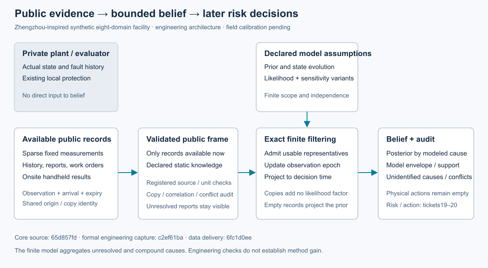
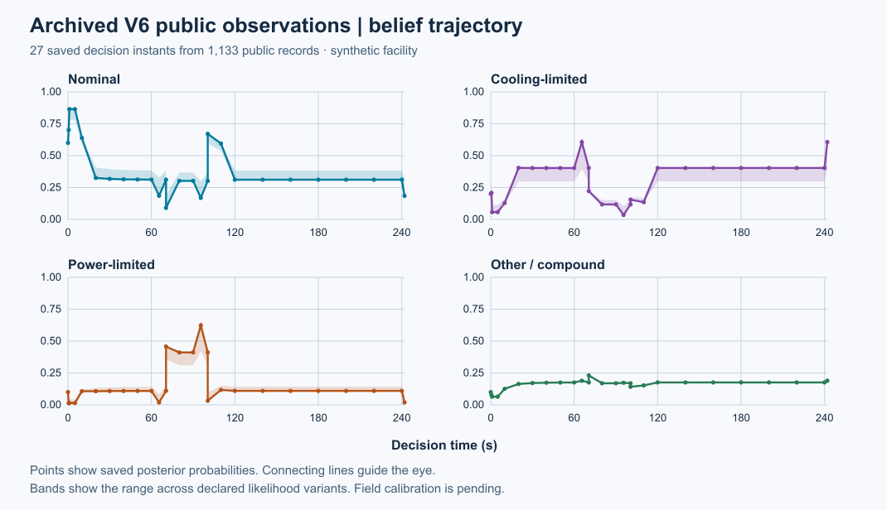
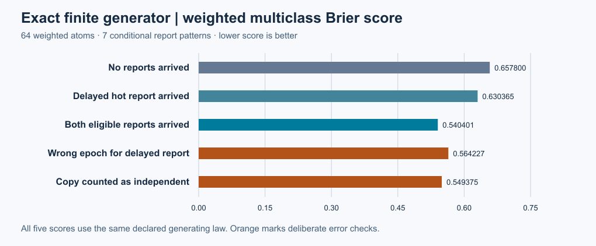

# 第18项根验收：公开证据与认识更新

第18项在已评审集成源码 `49a40b760e6bab1a89c884e3ef466a45337a5e26` 上通过统一根验收：434项全执行，零失败、零错误、零跳过。20份历史原件通过校验；229个Python与JSON源文件通过执行前后守卫，并逐一核对Git blobs。四份旧配置的LF到CRLF检出差异按精确路径记录，未改动历史原件。

## 两张数据图

27个时点使用第16项242秒公开快照的1,133条记录。阴影是声明似然变体的范围。它不是现场统计置信区间，模型没有枚举全设施所有故障。迟到记录作用于观察时段后向当前投影；复制、同源及相关记录不增添独立证据。

独立64原子法则的7组条件后验与公开推断最大绝对差为0，冻结容差1e-14。概率加权四类Brier为0.657800、0.630365、0.540401；故意错误的时点和复制独立性处理分别为0.564227和0.549375。这是有限生成法则下的工程校验，不代表巡检收益或现场校准。

## 来源与复核

作者执行源为`c2ef61baafba0dd538768526d88e5b6caad5f4e3`，原件交付为`6fc1d0eed811fd246403dc1c1a0ba14dbb12fdea`，候选为`4bce1defcd4b31d9062873d9e9b9e3c2b2c97142`。作者正式工程捕获1次、失败0次；未执行作者全回归。作者原件、pending收据与候选索引保持其原始身份。本次根验收用独立记录接受第18项。

两轴评审均为0项未关闭问题。Spec独立通过163项公开接口断言和436项保存原件断言，共599项；原未注册绑定缺陷、开发红测试及审查夹具错误/纠正均保留。报告和原件在[评审ZIP](reviews.zip)，根守卫、合并保护和实际图像复核在[支持ZIP](support.zip)，ZIP不含运行缓存。

- [根接受权威](../../../../docs/mainline/evidence/18-root.json)
- [作者工程报告](../18-beliefs/README.md)与[接口定义](../../../../docs/mainline/18-belief-updates.md)
- [原始根测试摘要](raw/summary.json)、[日志](raw/tests.log)、[源码守卫](raw/source-guard.json)
- [产物清单](declaration.json)、[来源身份](source-manifest.json)与[原始收据](receipt.json)

三张PNG均实际本地查看。架构图修正一次长标签越界，最终无未关闭视觉问题；未声称浏览器QA。数据SVG来自封存作者输出，架构SVG是独立说明图，二者分别记源。用`verify_packet.py --delivery-commit COMMIT --output OUTSIDE_CHECKOUT.json`在新检出中核对声明产物、ZIP成员、作者原件与根执行源码，无需重跑推断或全回归。

M3继续推进第19项风险情景及后果、第20项检查与处置价值。注册效果试验未开始，现场标定待补，AI/RSI增量未建立；完整研究目标仍active。
