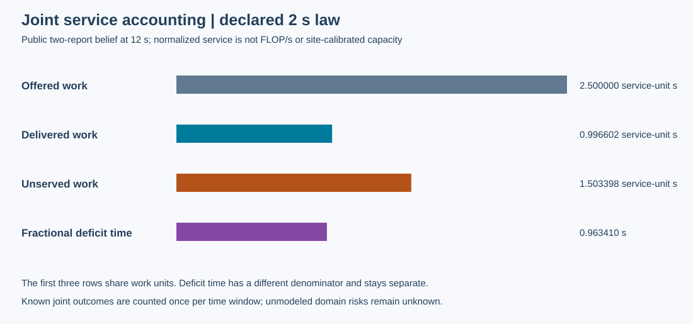
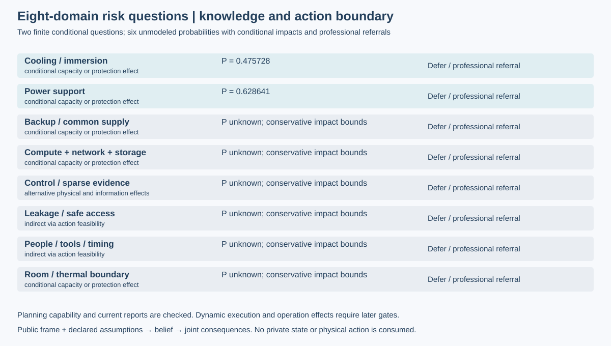

# 第19项：风险情景、后果与专业选项

本包是公开证据驱动的风险映射工程候选，仍待Root集成完整回归和独立接受。研究对象保持同一八域四图合成设施；稀疏固定测点、人工工单、历史和手持结果可用，后台真值私有。

## 结果与两张原始数据图

12秒公开帧中的两份独立报告给出当前认识。声明的2秒联合后果法则共用外生需求，完整时段的需求为2.5归一化service-unit·s，交付为2053/2060，未服务为3097/2060；缺额时间为15877/16480秒。四项与独立预先手算的最大绝对差为0，冻结容差1e-14。缺额时间的分母逐时取正需求，不能用全时段平均需求把它与工作量换算。图中前3项是工作量，第4项是时间，分开解释；Root将另给分面呈现以提高量纲可读性，原图和数据均保留。

2个热/电问题有有限条件模型，6个域内问题的事件概率和点估计保持未知。每个问题均有情景、时间窗、实际资产/关系、条件影响、证据缺口、保守后果边界、专业选项及关闭证据。未建模不等于零风险。备用关注UPS保护PLC/两泵、柴油启动/切换、冷塔及共享配电；IT关注计算/网络/存储串联需求；控制区分报告失联与实际控制变化；泄漏/门禁和人员工具主要影响作业可行性而非立即创造服务损失。房间条件可同时影响热边界和安全进入。

## 去重、选项与证据范围

多个问题可以覆盖同一复合结果。组合后果先按每个联合结果合并重叠时间窗，再按声明联合分布取期望，不能相加各问题损失，也不从边际概率擅自相乘推联合概率。独立复合结果见证中，两个问题各为119/400和19/80秒，组合为159/400秒；直接相加107/200秒会重复计入11/80秒。7个第08项原保存服务窗口复核通过，没有新增物理轨迹。

每个问题允许暂缓，也可列直接专业处置，无强制先检查。检查复用已接受的公开准备请求；处置转介绑定名义作业接口、对象、资格、工具和候选人员。当前报告限制和名义能力决定计划资格，实际位置、占用、工具可用、路线、授权及操作效果仍由第21/23项执行。所有执行许可为false、物理动作审计为空。后验敏感性范围不是置信区间；模型冲突不回退成零风险。

- [接口、条件模型与未知量](../../../../docs/mainline/19-risk-scenarios.md)
- [FEMA/DHS与近邻方法主来源适用性](../../../../docs/mainline/research/19-source-applicability.md)
- [冻结工程协议](../../../../docs/mainline/19-risk-engineering-protocol.json)及[风险目录](../../../../configs/full-facility-risk-scenarios-v1.json)
- [完整公开帧结果与独立手算检查](capture-01/check-results.json)、[CLI原件](capture-01/cli-stdout.raw)
- [正式尝试](capture-01/attempt.json)与[原始收据](capture-01/receipt.json)

核心初版46a0b090经独立评审发现检查转介目标、名义能力绑定和保守后果边界3处缺口，已逐项红/绿修正，旧探针由Root保留。12项定点公开接口测试通过；24份开发日志保留红测试和开发烟测的原始错误及修正。正式工程捕获1次、失败0次，执行源1939cb2ff375f7a0632a0a05ada68ae98afbdc1a；原件交付7069f2bee86ef7cdfd8d4849bb98bb5dacbf59cc。55个运行源、3个工具、34个冻结输入执行前后HEAD/字节守卫通过。CLI原生CRLF另按精确路径分类，未改原件。

本包无作者完整回归、物理运行、注册效果试验、LLM调用或训练。全设施整体风险尚未被这份有限条件法则定量识别；检查信息价值、实际处置效果、异质执行和独立机制收益按后续票据推进。现场标定仍待取得数据，RSI增量未建立，总目标保持active。

新检出交付门槛当前为`PENDING_ROOT_FRESH_CHECKOUT`：管理检出创建调用尚未返回身份，未宣称新检出通过。作者两张原图已本地实际查看，无裁切问题；异量纲分面可读性问题已记录，Root将以单独数据派生图关闭，原捕获图不改。见[候选索引](../../../../docs/mainline/evidence/19.json)及[作者视觉记录](../../../../docs/mainline/evidence/19-author-visual.json)。
