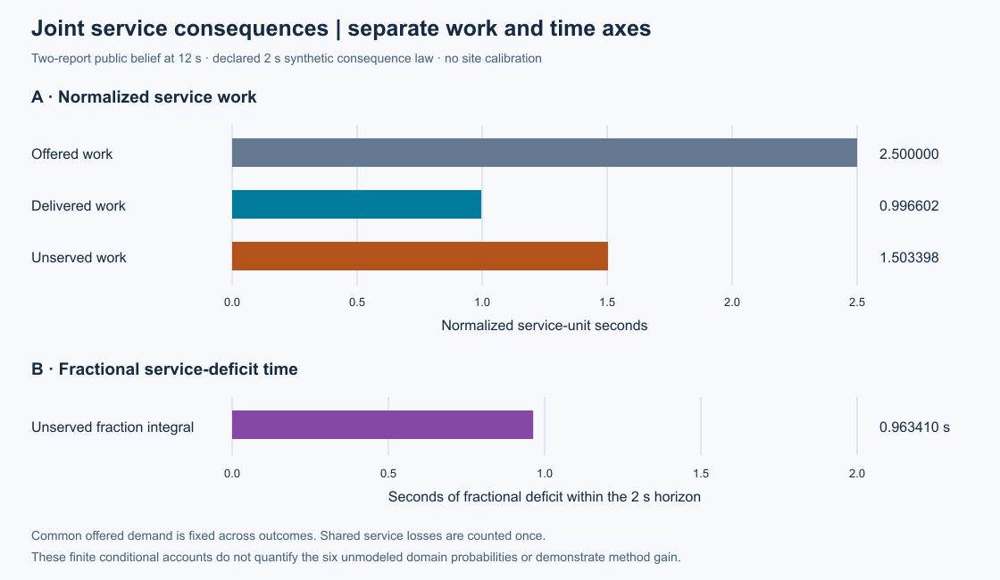
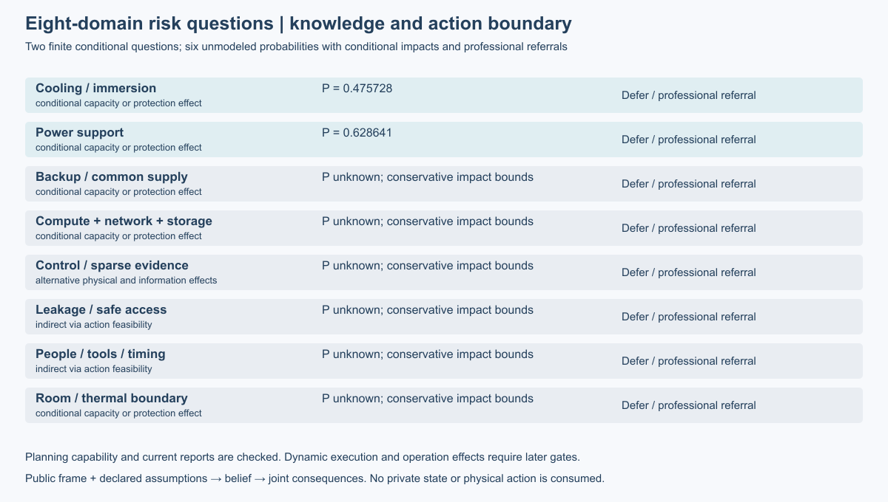

# 第19项根验收：风险情景与服务后果

修复后集成源码`6193cb24851e3ed435a78153ffb79a64da77ab63`通过450项完整回归：全部执行，零失败、零错误、零跳过。20份历史原件通过核对；238个Python与JSON源文件接受Git身份和前后字节守卫。主线仍为完整八域合成设施，本项不宣称现场风险校准或巡检收益。

两秒声明法则下，共同需求为2.5归一化service-unit·s，期望交付2053/2060、未服务3097/2060；缺额时间15877/16480s单独显示。多个问题共享联合后果时先合并结果和时间窗，不相加重复服务损失。上述数值是显式条件法则的工程结果，不是物理预测或真实设施测量。

两项有限热/供电问题使用第18项认识与声明联合后果模型。其余六项具体记录后备、IT、控制、访问、人员及房间的影响路径、条件后果、保守界、证据缺口和专业转介；概率及点风险仍未识别。未知不当零，已建模子集不当全设施总风险。暂缓和直接处置可进入规划，人员与物理执行门槛仍由21–24项验收。

## 原件、修复与评审

原执行1939／数据7069／候选c35保留。五项独立发现依次关闭：处置能力、核查对象、矛盾保守界、小数需求上界可表示性、完整时域溢出。第一次数值修复在9c源码执行，835保存7个案例与4帧一致性；第二次99源码／0b数据修复短问题窗和空问题列表绕过完整时域有限输出检查，并验证CLI正常拒绝。原7b9源码的448项回归PASS作为历史原件保留，未充当当前接受；本次6193新源全检单列。所有旧捕获、协议及收据不改写。最小有限向外binary64只解决表示问题，过小、任意放大和溢出均拒绝。

Spec共720项独立断言通过，独立Standards另完成3项API与1项CLI闭环，两轴未关闭问题均为0。[评审原件](reviews.zip)保留旧失败探针、修复闭环和来源清单。[支持原件](support.zip)保留精确算例、合并保护、两次新检出证明与图像复核。原正式捕获1次0失败，数值修复两次分别1次0失败；无新增物理轨迹、注册效果实验、LLM调用或训练。

- [根接受权威](../../../../docs/mainline/evidence/19-root.json)
- [当前运行身份及复核](../../../../docs/mainline/19-current-runtime-and-reproduction.md)
- [作者报告](../19-risk-scenarios/README.md)与[主来源适用性](../../../../docs/mainline/research/19-source-applicability.md)
- [根测试摘要](raw/summary.json)、[完整日志](raw/tests.log)、[源码守卫](raw/source-guard.json)
- [声明产物](declaration.json)、[来源清单](source-manifest.json)、[收据](receipt.json)

两张展示图均本地渲染后实际查看。原异量纲条形图保持封存，新增分面图从保存数据派生，并记录源SHA与生成器；没有重新推断。复算使用本包`verify_packet.py --delivery-commit COMMIT --output OUTSIDE_CHECKOUT.json`，在明确封存提交新检出中核对原件与源码，不重跑全检或物理。

当前主票20比较检查信息与处置价值；21独立推进人员执行，M3仍未完成，整体研究目标active。
