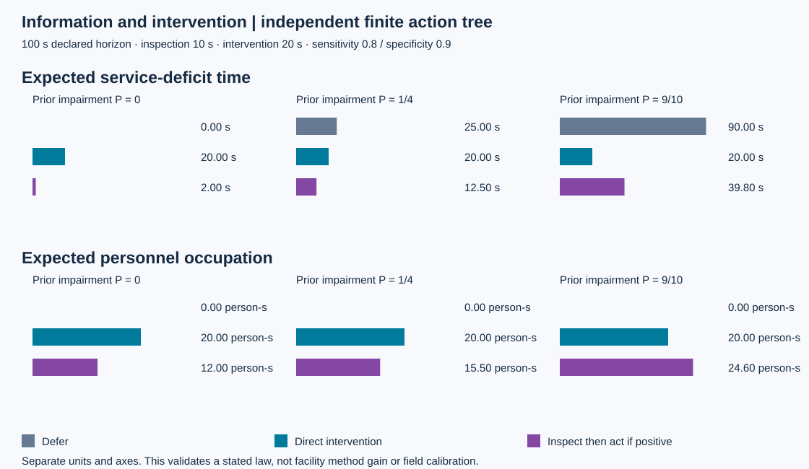
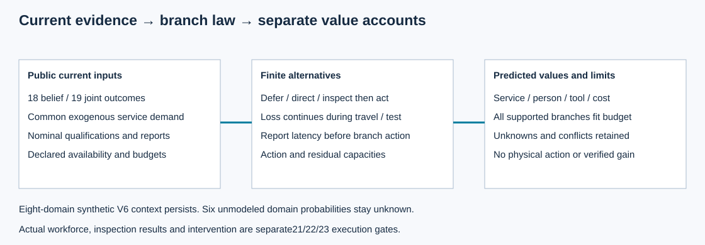

# 第20项：公开信息与处置价值

本包比较同一已知信息、权限和资源预算下的暂缓、直接处置、检查后条件处置。检查期间设施继续承担损失，改善只能来自声明的行动容量效果；移动、等待、作业、报告延迟及残余效果分别计算。实际人员、检查结果与物理处置由21–23项执行。当前是待根接受的工程候选。

100秒独立声明算例中，故障先验1/4时，暂缓、直接处置、检查后阳性处置分别预测25、20、12.5秒服务缺额；相应人员占用为0、20、15.5person·s。先验0时暂缓优先，先验9/10时直接处置优先。这些数值验证一个有限法则，不证明设施巡检收益。三种选择使用共同需求与同一资源预算，报告的不确定性不是现场统计置信区间。

每个有效分支都须满足完整承诺预算，不能用较小期望成本越过硬限制。未知可用性保持未知，未完成行动不提前恢复，零概率报告没有虚构后验。原六项未识别域风险保留，问题价值不能相加为全设施收益。

- [接口与模型约定](../../../../docs/mainline/20-action-value-contract.md)
- [冻结工程协议](../../../../docs/mainline/20-action-value-engineering-protocol.json)
- [原始收据](capture-01/receipt.json)、[尝试](capture-01/attempt.json)与[保存结果](capture-01/check-results.json)
- [新检出证明](../../../../docs/mainline/evidence/20-delivery.json)与[Root实际图像复核](../../../../docs/mainline/evidence/20-root-visual.json)
- [候选索引](../../../../docs/mainline/evidence/20.json)

核心6cc、执行83de、原数据2aea和原生CLI换行分类00fd各保留其身份。正式捕获1次0失败；57个运行源、3个工具和36个输入执行前后字节与HEAD一致。三个独立先验、五个边界算例及默认CLI通过，最大预期误差0。新检出核对6个产物加收据、执行源码和Git blobs，没有重复推断、物理或全回归。144项既有独立接口断言及528项保存原件检查通过，最后的Root统一验收仍待完成。

`development/`的24份原始红/绿和烟测日志保留其实际结果。代理停止后由Root接续交付，没有重跑已完成捕获。现场标定、注册效果实验、AI/RSI增益均未建立；完整研究目标持续。
