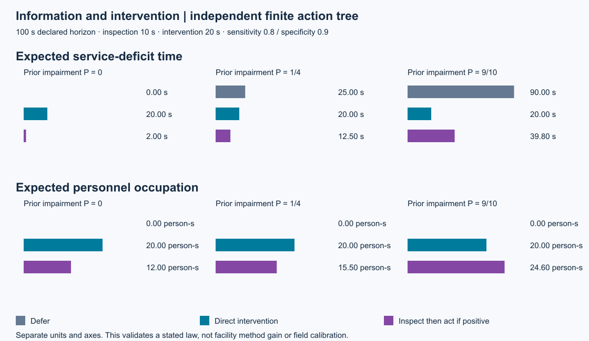
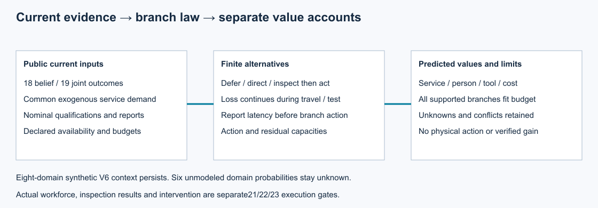

# 第20项根验收：检查信息与处置价值

集成执行源`08a7c6c05662434f8c8d9ae36a15c72040866990`通过476项完整回归，全部执行、零失败、零错误、零跳过。20份历史原件通过核对；248个Python与JSON源文件接受Git身份和前后字节守卫。已有144项独立接口断言与528项保存原件核对分别保留，两轴没有未关闭问题。

在明确声明的100秒二元有限法则中，先验1/4时，暂缓、直接处置、检查后阳性处置分别为25、20、12.5秒服务缺额；人员占用分别0、20、15.5person·s。先验0支持暂缓，先验9/10支持直接处置。这里只验证一个独立预定义计算法则，未据此声称合成设施比较收益或现场校准。

同一当前认识、联合后果、外生需求和资源约束进入各备选。检查期间和报告延迟继续承担损失；信息本身不修复物理状态。最坏正支持分支必须满足完整资源承诺；未知可用性不当可用，未完成操作不提前恢复。服务、人时、工具时和费用分列，不将问题值相加为全设施总增益。六项尚未识别域风险保留。

## 来源与复核

原作者83de执行、2aea数据及00fd原生CLI换行分类保留。正式工程捕获1次0失败，57个运行源、3个工具、36个输入执行前后相同；三个独立先验、五个边界和默认CLI通过。Root接续原作者交付只核对保存数据，没有重跑捕获、物理或训练。原开发红测试和审查夹具算术纠正保留在[评审ZIP](reviews.zip)；源码/输入/原件身份、解析预期、根守卫及实际图像复核在[支持ZIP](support.zip)。

- [根接受权威](../../../../docs/mainline/evidence/20-root.json)及[M3有限证据门槛](../../../../docs/mainline/evidence/M3.json)
- [作者报告](../20-action-value/README.md)与[模型约定](../../../../docs/mainline/20-action-value-contract.md)
- [原始摘要](raw/summary.json)、[日志](raw/tests.log)、[源码守卫](raw/source-guard.json)
- [声明产物](declaration.json)、[来源清单](source-manifest.json)及[收据](receipt.json)

两张PNG由原SVG本地渲染后实际查看；未声明浏览器QA。复算在本封存提交的新检出中使用`verify_packet.py --delivery-commit COMMIT --output OUTSIDE_CHECKOUT.json`，无全检/推断重跑。M3接受限于已声明的证据、风险及价值接口与有限算例；完整设施现场概率、物理干预效果、恢复闭环和独立机制比较继续由M4–M7验证。当前主票22，总目标active。
