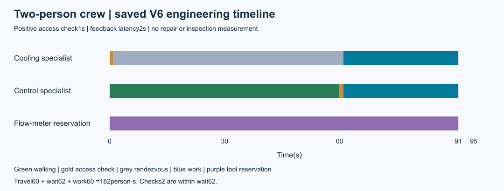
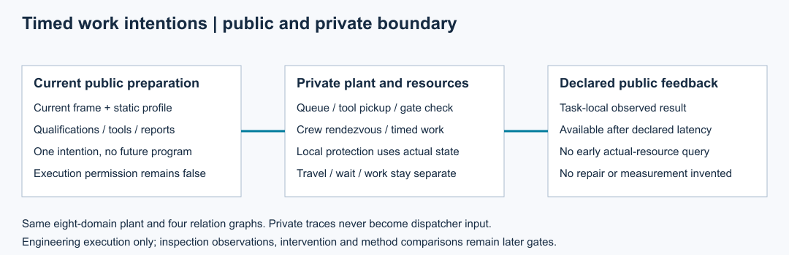

# 第21项根验收：异质人员与持续执行

集成执行源码`6fb25fc0a7c7d8fa47dbe14a04f129cd887eab4c`通过464项完整回归：全部执行、零失败、零错误、零跳过。20份历史原件通过核对；242个Python与JSON源文件接受Git身份及前后字节守卫。第19项已接受的完整时域数值修复保留，主票20仍在M3推进。

原正常工程见证使用同一V6设施95秒、最大步长.01：控制人员移动60秒，两人检查合计2person·s，汇合等待60person·s，工作60person·s；总等待62包含访问检查子集。两人61秒共同开工、91秒完成，公开完成记录93秒可用。工具预留91tool·s，实际工作30tool·s，二者不重复相加。

普通调度通过当前公开帧及声明能力发出意图；同一物理人员、工具和独立通行图执行移动、排队、汇合与作业。静态资格、当前已到达限制可以阻止规划；隐藏门禁须到安全访问点并完成正耗时检查后才能形成任务局部反馈。私有记录和资源快照不当作免费遥测。未来时刻反馈查询被拒绝。

## 安全修复与独立复核

原正常捕获4b9／710保留；后续65db／e393按独立协议验证等待中的区域危险和取消。现场活动立即停止，已上路人员完成当前边及安全点检查后才释放，工具同时保留。危险观察.5秒／1秒公开，最终取消1.25秒／1.75秒公开；未宣称实际疏散或恢复。两次正式工程捕获各1次0失败，原正常源不冒称验证新安全边界。

Spec27027项断言通过，包含先冻结协议的8个独立短时工程夹具（总21.25秒）和作者原件核验；没有重复95秒或2秒原捕获。两轴未关闭问题均为0。[评审ZIP](reviews.zip)保存探针、原始输出、源码守卫及规范报告；[支持ZIP](support.zip)保存计时解析、来源分类、合并保护和实际图像复核。人员是领域执行者，未调用LLM、训练或注册效果实验。

- [根接受权威](../../../../docs/mainline/evidence/21-root.json)
- [作者工程报告](../21-workforce/README.md)与[执行契约](../../../../docs/mainline/21-workforce-contract.md)
- [原始根摘要](raw/summary.json)、[日志](raw/tests.log)、[源码守卫](raw/source-guard.json)
- [声明产物](declaration.json)、[来源清单](source-manifest.json)和[收据](receipt.json)

图由封存SVG本地渲染后实际查看。复算在明确封存提交新检出中运行本包`verify_packet.py --delivery-commit COMMIT --output OUTSIDE_CHECKOUT.json`，核对包原件、两次作者运行身份及源码分类，不重跑物理或全检。检查结果生成、实际处置和验证关闭仍按22–24推进；M4和完整研究目标未完成。
