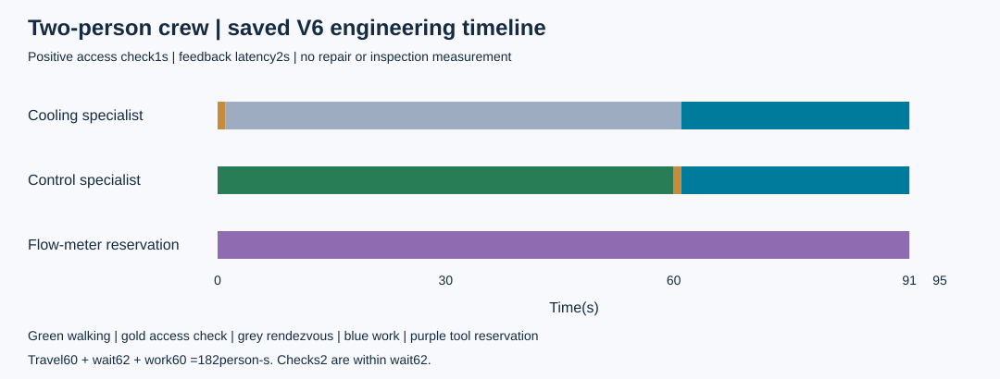
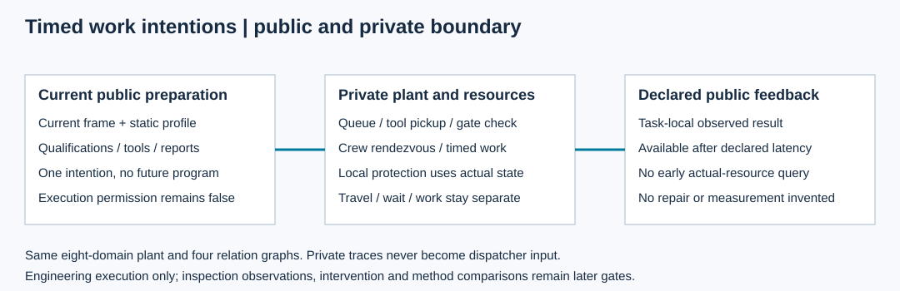

# 第21项：异质人员与持续资源执行

本包在既有八域V6设施上扩展人员执行。普通调度按当前证据提交工作意图；人员沿独立通行图领取工具、移动、核查访问、等待协作并共同作业。当前是作者候选，待根集成回归与正式接受；作业完成不代表获得检查结果、修复或恢复。

原60秒行程和30秒作业见证：控制人员行走60秒、核查1秒；冷却人员原位核查1秒、等待60秒。61秒共同开始作业，91秒结束，93秒反馈公开。人员60行走＋62等待＋60作业＝182人秒；2人秒核查包含于62等待。工具预留91工具秒，实际作业30工具秒分别报告。

准备接口只读取当前公开帧与声明静态条件。实际通行、资源忙闲、后台拒绝原因和未到达反馈不交给调度。工程程序是按既定时刻调用同一增量提交接口的重放输入；调度不需要预知未来程序。既有本地保护仍使用后台实际状态阻止危险操作。

14个定点公开设施/CLI切片通过，覆盖异质角色、独立并行、共享工具等待、重复开放任务、后续公开限制、班次/期限、静态路由资质、隐藏关闭及安全取消。开发原日志全部保留：03/04含测试夹具位置/时域错误，06暴露携带工具快照问题，08暴露队列过期遗漏，14暴露助手角色过严，18/20暴露等待安全及取消立即释放。文件名里的green不改变文件内真实FAIL状态。

|正式工程原件|实际执行源|交付提交|范围|
|---|---|---|---|
|capture-01|4b9caadec5f0ec91307f29d5619ce41648d6610c|710538a6eda8cf02ae99313c5c51881da7ea745d|95秒、步长上限.01、9545段边界账；8产物＋收据|
|safety-closure-01|65db38e45ebf6db44093b52f6ae72553b481c233|e39300451b6dc2a6cd39a6a7733e1e0b8bed8a0c|2秒显式缩放夹具；6产物＋收据|

第二份原件是独立冻结纠正，不升级第一份原件的执行身份。等待现场在0.5秒不安全后立即停工；正在行走人员完成已开始的边与核查，1.25秒在安全端点释放，工具随携带者移动且保持预留。危险观察与最终取消的反馈分别于1秒、1.75秒可用。已在现场人员停止活动，不声称完成撤离或安全恢复。

原正常执行55个运行源、1个工具、26个冻结输入前后字节不变；安全纠正固定59个源码/输入。两份交付均在各自提交的新检出验证Git blobs、SHA-256和保存数据，没有重跑物理或全回归。正式尝试2次、失败0次；开发红测试另列。作者完整回归留给根评审后的集成源。两张SVG均已本地渲染并实际查看，零项视觉问题。

- [接口契约](../../../../docs/mainline/21-workforce-contract.md)
- [正常协议](../../../../docs/mainline/21-workforce-engineering-protocol.json)及[纠正协议](../../../../docs/mainline/21-safety-closure-protocol.json)
- [正常收据](capture-01/receipt.json)和[时序检查](capture-01/checks.json)
- [纠正收据](safety-closure-01/receipt.json)和[纠正检查](safety-closure-01/checks.json)
- [正常新检出证明](../../../../docs/mainline/evidence/21-delivery.json)及[纠正新检出证明](../../../../docs/mainline/evidence/21-safety-delivery.json)
- [两处后续来源变化](../../../../docs/mainline/evidence/21-source-classification.json)及[作者图像复核](../../../../docs/mainline/evidence/21-author-visual.json)

正常原件私有状态约67MB、边界账约33MB，均属后台证据，不是调度输入。缓存不属于交付集合。正常原件核验命令是 scripts/workforce_delivery.py verify，必须在原交付710538a6的新检出使用；纠正核验命令是 scripts/workforce_safety_closure.py verify，使用e3930045的新检出。它们只读保存数据，不用后续源码替换旧原件。

现场标定仍待数据；本包没有注册效果试验、LLM或训练调用。检查观测由22连接，物理处置由23连接，恢复核验和独立效果比较继续按主线推进。此有限执行交付不构成M4或总研究完成。
