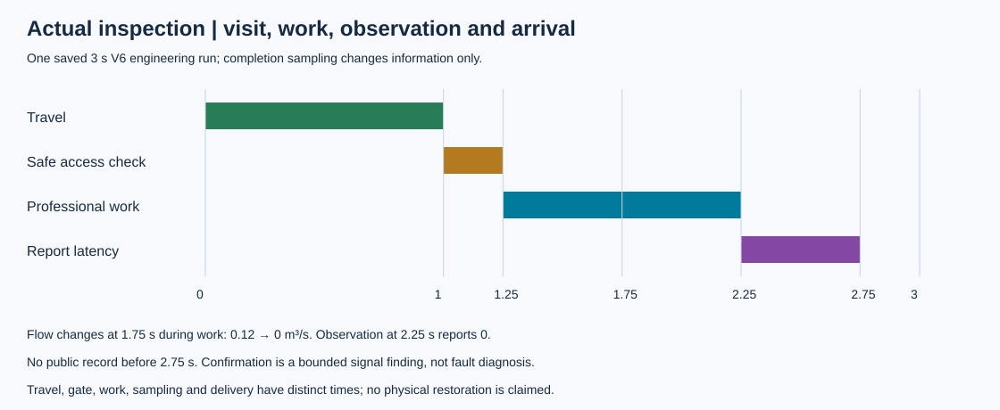
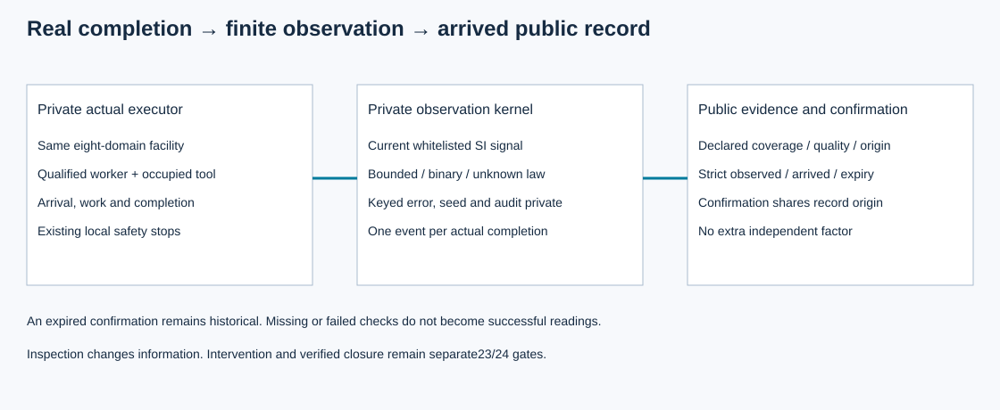

# 第22项：实际检查完成与有限观测

本包将同一全设施运行中的实际人员完成事件接到测量：具备资质、工具和目标覆盖的任务完成时，才从当前物理点读取白名单SI信号。派单、到访、作业、观察、上报与信号确认分别记账。当前为待Root接受的工程候选；没有物理修复或问题关闭。

三秒V6工程见证中，控制专业人员移动1秒、访问检查.25秒，1.25开工、2.25完成并采样、2.75上报可用。专业工作区间内1.75秒发生声明的泵压力改变，流量从.12降至0m³/s；记录使用完成时的0，未使用派单时读数或未来值。两个严格早于采样/上报的快照均无记录。

数值误差、二元检出与未知结果共享第17项纯观测规律，但第17项夹具完成token不能证明本票实际作业。局部保护先于同刻作业完成，取消或未完成不产生成功读数。条件不适用时按同一来源、质量说明与延迟发布未知值，私有误差、种子和TP/FP分类不进入公共字段。阈值确认只表明声明误差界下的命名信号关系，不是故障诊断或安全恢复；过期确认保持历史事实，并与支持记录同源，不增添独立因子。

- [契约](../../../../docs/mainline/22-inspection-contract.md)与[冻结协议](../../../../docs/mainline/22-inspection-engineering-protocol.json)
- [原始尝试](capture-01/attempt.json)、[收据](capture-01/receipt.json)、[保存检查](capture-01/checks.json)
- [Root新检出证明](../../../../docs/mainline/evidence/22-delivery.json)及[实际图像复核](../../../../docs/mainline/evidence/22-root-visual.json)
- [候选记录](../../../../docs/mainline/evidence/22.json)

执行5486与数据6812保持独立身份。正式工程捕获1次0失败，57个运行源、1个工具、30个输入前后守卫；11个声明产物加收据在新检出与Git blobs一致。14项实际设施/CLI/公开证据测试以及21项旧17行为兼容性通过。原开发失败及被误命名green的日志保留其实际失败内容，后续修正单列；不把文件名作为通过证据。

新检出第一次命令遗漏PYTHONPATH，纯保存数据核对阶段导入失败，原记录保留。设定`$env:PYTHONPATH=(Join-Path (Get-Location) src)`后，运行`python -B -X utf8 scripts/inspection_delivery.py verify --capture evidence/mainline/engineering/22-inspections/capture-01 --delivery 68127e11c73835ff4b984d0336885d22d2dc5d07`通过；须在对应封存提交的新检出中执行。未重跑物理或完整回归。最终独立Spec、Root集成验收与后续23/24物理行动/关闭仍待完成，研究总目标active。
