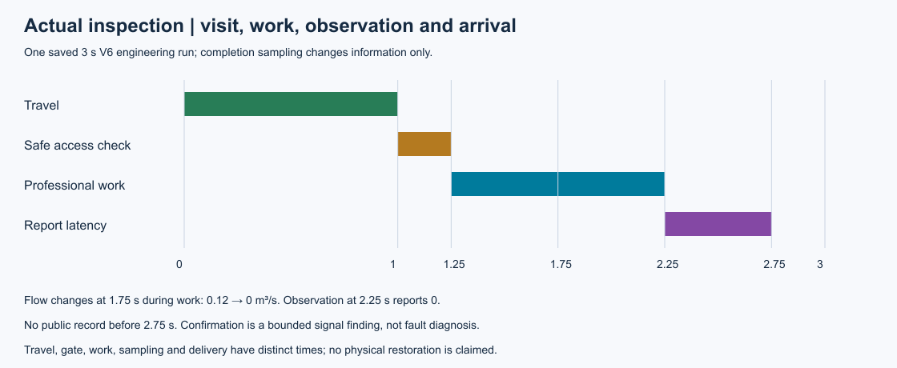
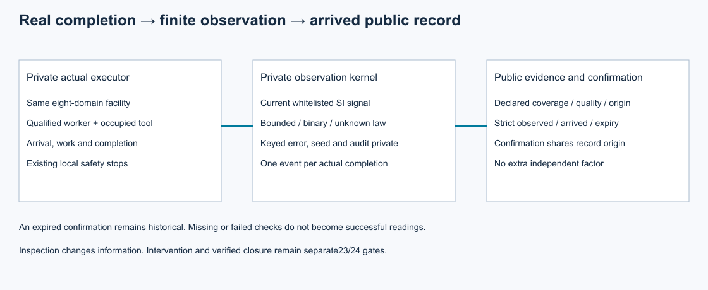

# 第22项根验收：实际检查、观测与确认

集成执行源`e33ff63a4a110a00cbce640fa267dff7c2da48bf`通过490项完整回归：全部执行，零失败、零错误、零跳过。20份历史原件通过核对；251个Python与JSON源文件接受Git身份及前后字节守卫。独立Spec通过1427项断言，两轴无未关闭问题；旧第17项观测规律及其他主线行为仍受统一回归检查。

正式三秒V6工程见证只运行一次：1秒移动、.25秒安全访问检查，1.25秒开工、2.25秒完成采样、2.75秒上报可用。工作区间内1.75秒的声明泵压力变化使流量从.12降至0m³/s；完成记录使用当前0。实际到访、作业、观察和送达各有时刻，两个严格早于完成/到达的公开快照均为空。

同一CrewWorkforce提供真实完成，调用方夹具token不能代替。局部保护先于同刻完成，取消、未完成和过短观测不产生成功记录。质量未知和条件不适用按声明来源、时标及固定说明保留。数值界能确认命名信号与阈值的关系；它不是故障诊断或恢复认证。确认与读数同源、同有效期且不增添独立证据，过期后只保留历史事实。

## 原件与独立复核

原5486执行源、6812交付、三秒尝试及收据保持独立身份。11个声明产物加收据、57运行源、1工具、30输入在新检出中与Git原件一致；303轨迹点和内部物理清单通过核对。只读快照由实际产生记录经14门槛重建，没有重复物理运行。

1427项独立断言包括1186保存数据、10完成门槛、30公开接口、17拒绝以及184守卫检查。[评审ZIP](reviews.zip)保留协议、导出源码、探针和原始读回结果；[支持ZIP](support.zip)保留来源、合并保护、解析时序、新检出与实际图像复核。审查脚本先误写图名control，原失败及仅改为control_information的修正版均保留；首次新检出命令漏PYTHONPATH的导入失败及随后显式src通过亦单列。两者不计为物理捕获失败，不重写旧记录。

- [根接受权威](../../../../docs/mainline/evidence/22-root.json)
- [作者候选报告](../22-inspections/README.md)及[实际检查契约](../../../../docs/mainline/22-inspection-contract.md)
- [根摘要](raw/summary.json)、[完整日志](raw/tests.log)、[源码守卫](raw/source-guard.json)
- [声明产物](declaration.json)、[来源清单](source-manifest.json)、[收据](receipt.json)

两图由源SVG本地渲染并实际查看，未声称浏览器QA。复算在本封存提交新检出中使用`verify_packet.py --delivery-commit COMMIT --output OUTSIDE_CHECKOUT.json`，不重跑推断、物理或全量回归。当前主票23继续完成实际处置，随后24核验恢复关闭；M4与完整研究目标仍active。无注册效果实验、LLM调用或训练，现场标定待取得。
