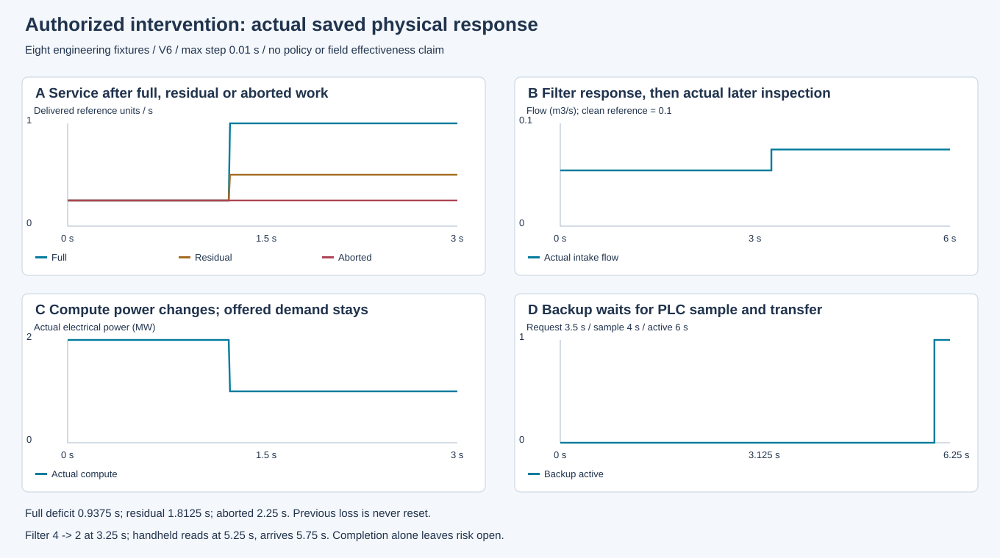
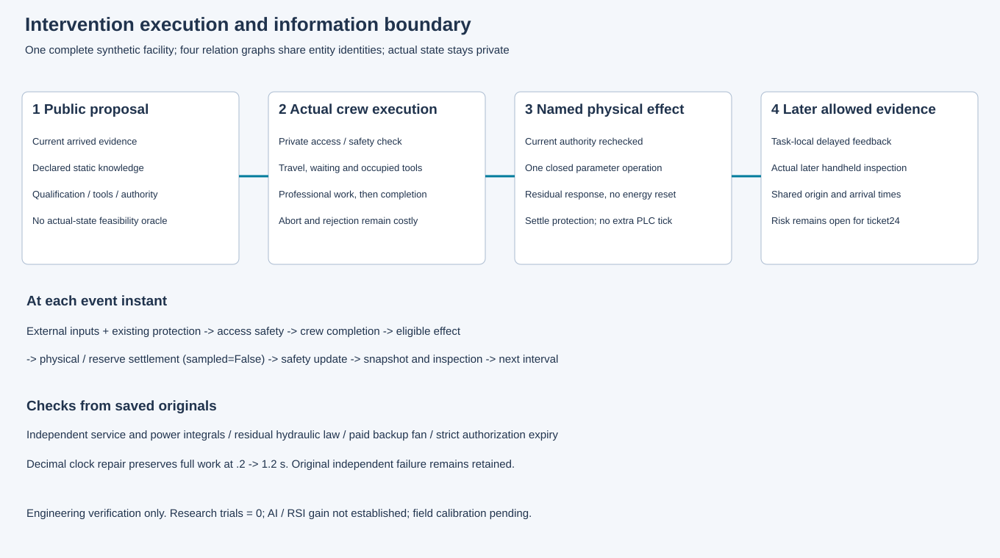

# 第23项候选：实际处置、延迟与残余响应

八个冻结工程案例各运行一次，合计30.25模拟秒、最大步长.01秒。执行源`15a940c0fec6c5d2f3ba6758b2a4d685f872b9b3`，原始数据交付`6f9eb41dbae1aaa8e956f8a41914bc0b5a687ec2`。当前候选仍待根集成验收；本包不构成策略收益、真实设施有效性或AI/RSI增量。

网络恢复在1.25秒真实工时完成后生效。全恢复、残余恢复和中断的三秒服务缺额分别为.9375、1.8125、2.25秒，既有损失不会被清零。过滤阻力4→2在3.25秒生效，流量上升但未达到全清洁；后续真实手持检查5.25秒采样、5.75秒到达。计算降载保留外生需求，实际电功率与发热同步变化，电能4250000J。备用冷却3.5秒请求后仍等待4秒PLC采样与6秒切换，风机耗能5000J。

原独立审查发现小数时刻.2→1.2的完整一秒工时被误拒绝。原失败和红/绿记录保留；修复使用与执行器相同的加法完成坐标，未放宽严格授权到期检查。正式小数案例通过，授权恰于1.25秒到期的案例仍无效果。所有处置反馈保持`risk_closed=False`。

- [冻结契约](../../../../docs/mainline/23-intervention-contract.md)与[协议](../../../../docs/mainline/23-intervention-engineering-protocol.json)
- [原始收据](capture-01/receipt.json)、[逐次台账](capture-01/attempts.jsonl)、[保存结果核查](capture-01/checks.json)
- [新检出交付验证](../../../../docs/mainline/evidence/23-delivery.json)

37个声明产物加终结收据、59运行源码、3工具、55输入在干净新检出中与Git原件一致，验证没有重跑物理、推断或全量回归。两幅源SVG已渲染并实际查看，清晰可读；未进行浏览器或移动端发布验收。根接受前第23票仍claimed，第24票保持阻塞。现场标定待取得，注册效果实验、LLM和训练调用均为零，完整研究目标持续active。
