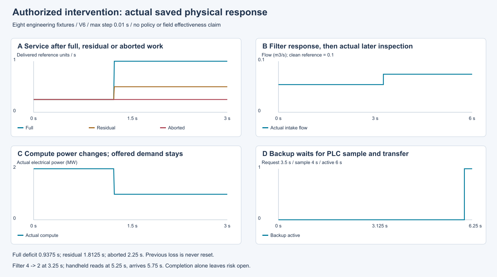
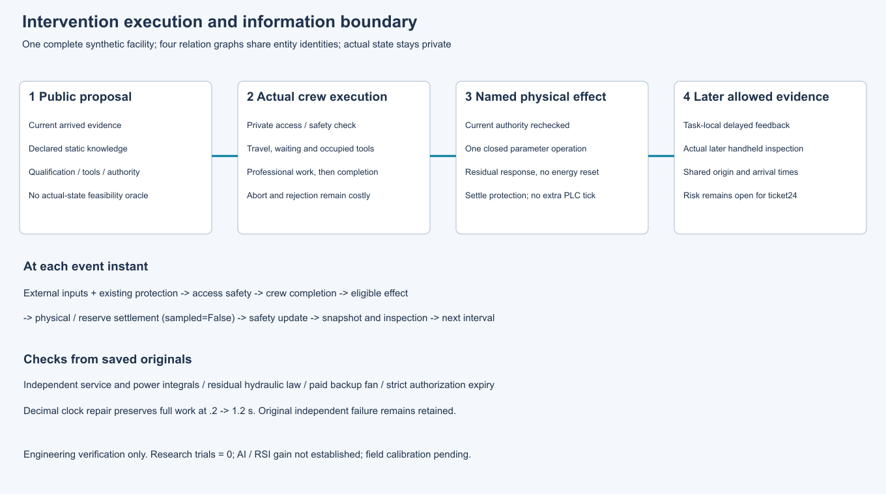

# 第23项根验收：真实处置、延迟与残余响应

集成执行源`80bfed982eb50b22b020e1a07e5fee1e4531d808`通过501项完整回归，全部执行、零失败、零错误、零跳过；20份历史原件与255个Python/JSON源文件身份通过守卫。独立Spec保存复核335项，两轴无未解决问题。

八个冻结工程案例各执行一次，合计30.25模拟秒：全恢复、残余恢复、中断、过滤后真实复检、计算功率调整、备用请求、小数工时及恰好到期授权。网络三秒缺额分别为.9375、1.8125、2.25秒；过滤4→2后仍有残余，5.25秒真实手持采样、5.75秒送达；计算电能4250000J且外生需求不变；备用3.5秒请求仍等待4秒PLC和6秒切换，风机消耗5000J。

原独立6次工程探针中的小数时间缺陷和失败保持封存：原45/46断言、5/6案例，不改成全通过。修复采用同一加法完成坐标；单独的正式小数案例通过，严格授权到期仍拒绝效果。捕获前两项打包缺陷、修复与红/绿日志均保留。反馈只覆盖本任务，保持risk_closed=False；第24项负责依据可用恢复证据关闭问题。

原作者源、原始交付、37声明产物及收据、59运行源/3工具/55输入在干净新检出中与Git原件一致，未重跑原捕获。两图由源SVG本地渲染并实际查看。

- [根摘要](raw/summary.json)、[完整日志](raw/tests.log)、[源码守卫](raw/source-guard.json)
- [两轴评审与原失败](reviews.zip)、[新检出和图像复核](support.zip)
- [作者原件](../23-interventions/README.md)、[冻结协议](../../../../docs/mainline/23-intervention-engineering-protocol.json)
- [权威记录](../../../../docs/mainline/evidence/23-root.json)、[清单](declaration.json)、[收据](receipt.json)

使用本提交新检出运行verify_packet.py --delivery-commit COMMIT --output OUTSIDE_CHECKOUT.json，仅复核保存原件。第23项接受后当前主票24；M4、完整42票研究主线持续active。注册效果实验、LLM和训练调用均为零，现场标定待取得，尚未证明策略或AI/RSI收益。
