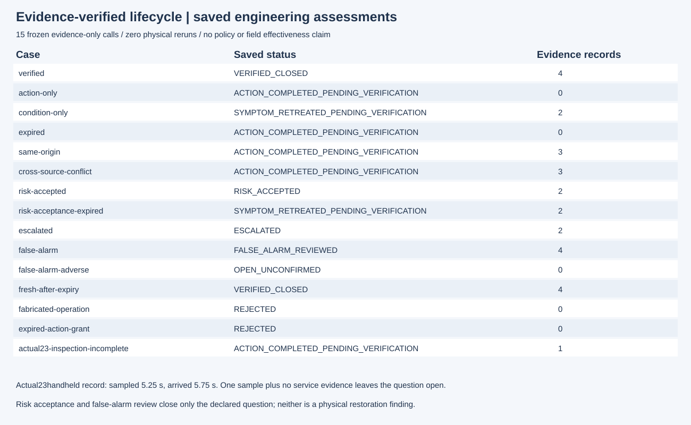
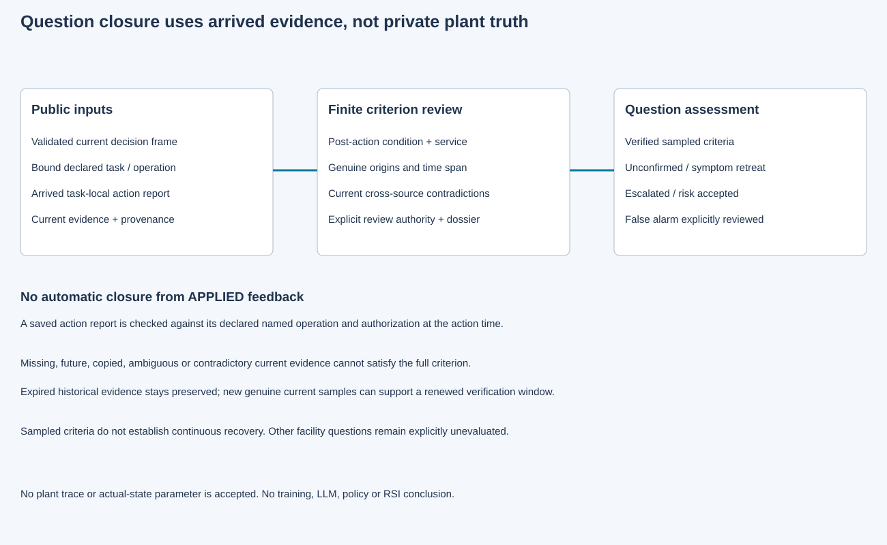

# 第24项候选：根据证据核验问题关闭

原15次冻结评估通过状态与身份检查后，独立最终Spec发现否决轨迹遗漏决定性反证和时刻。原执行`6ff98fb1644463b24f76eb28864ab374cf0f06cc`、数据`52ef152eb8e1e517e2a46e12f029ad464d618f0e`和全部原件保留。

按[显式修订](../../../../docs/mainline/24-closure-correction-01.md)，同样15个公开输入在新目录各评估一次，加强轨迹检查后全部通过。修订执行`78922bcb3cc290c924987c495118775827dd1c3b`，交付`cf90d9f5459eeea10cf9c4b767a6dfc6077bdcf1`；累计30次证据评估、零物理重跑。第24项仍待最终独立补充复核和根集成验收。

处置回报本身只能进入待核验。规则要求处置后的状态与服务记录、足够真实采样及时间跨度；复制、同一时刻重复、未来、质量不确定和当前矛盾证据都不能补齐条件。过期历史保留，但不永久阻碍新的有效复检窗口。有授权的风险接受、升级和带明确依据的误报复核分别记录，不冒充物理恢复。

实际第23项过滤处置后5.25秒采样、5.75秒到达的手持读数保持原件身份。本包读取该原记录后仍判断待核验：单次局部读数无法补成连续恢复，也没有凭空生成服务记录。

- [冻结契约](../../../../docs/mainline/24-closure-contract.md)与[协议](../../../../docs/mainline/24-closure-engineering-protocol.json)
- [尝试台账](capture-01/attempts.jsonl)、[保存核查](capture-01/checks.json)、[原始收据](capture-01/receipt.json)
- [新检出验证](../../../../docs/mainline/evidence/24-delivery.json)
- [修订协议](../../../../docs/mainline/24-closure-correction-01-protocol.json)、[修订收据](capture-02/receipt.json)、[修订结果](capture-02/checks.json)与[修订新检出](../../../../docs/mainline/evidence/24-correction-delivery.json)

原包20产物加收据、60运行源/3工具/126输入在新检出中核对。修订包20产物加收据、60运行源/4工具/152输入再次逐项核对，后者包含全部原产物和原协议；验证均未重跑评估、物理或全量回归。两版图均实际渲染查看。原独立12次无效夹具拒绝、显式修订后9次评估及反例分别保留；无效拒绝不计产品通过。原1044项最终Spec复核与P2缺项也完整保留。现场标定和完整研究效果均未建立，42票主线持续active。
