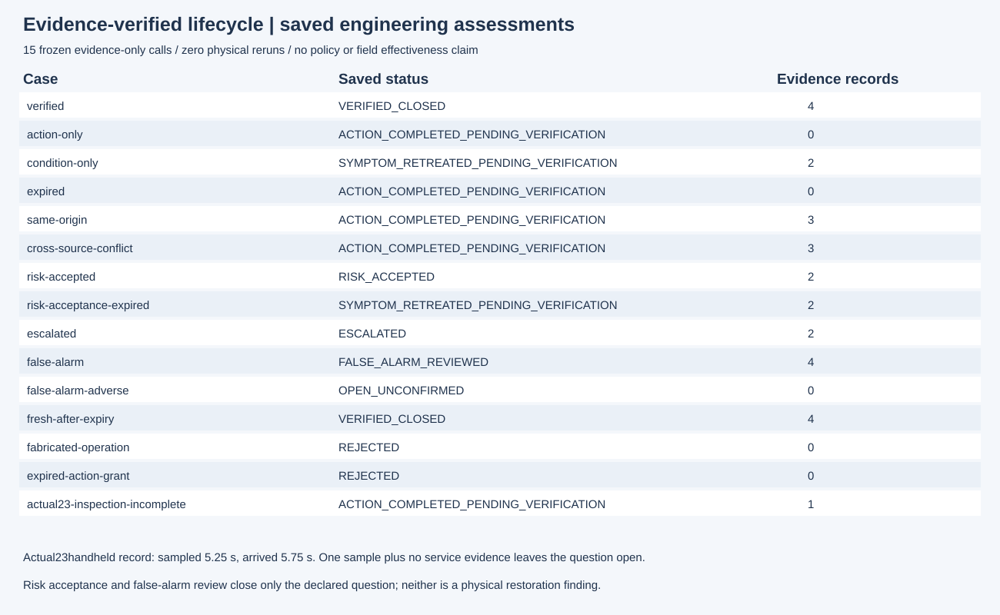
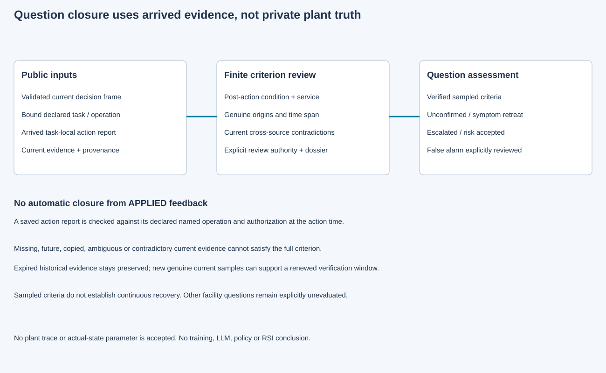

# 第24项候选：根据证据核验问题关闭

15个冻结评估各执行一次，包含两个应按指定原因拒绝的声明，全部通过。执行源`6ff98fb1644463b24f76eb28864ab374cf0f06cc`，数据交付`52ef152eb8e1e517e2a46e12f029ad464d618f0e`。这15次只消费公开证据，没有新增物理运行、模型调用或训练。第24项仍待独立最终审查和根集成验收。

处置回报本身只能进入待核验。规则要求处置后的状态与服务记录、足够真实采样及时间跨度；复制、同一时刻重复、未来、质量不确定和当前矛盾证据都不能补齐条件。过期历史保留，但不永久阻碍新的有效复检窗口。有授权的风险接受、升级和带明确依据的误报复核分别记录，不冒充物理恢复。

实际第23项过滤处置后5.25秒采样、5.75秒到达的手持读数保持原件身份。本包读取该原记录后仍判断待核验：单次局部读数无法补成连续恢复，也没有凭空生成服务记录。

- [冻结契约](../../../../docs/mainline/24-closure-contract.md)与[协议](../../../../docs/mainline/24-closure-engineering-protocol.json)
- [尝试台账](capture-01/attempts.jsonl)、[保存核查](capture-01/checks.json)、[原始收据](capture-01/receipt.json)
- [新检出验证](../../../../docs/mainline/evidence/24-delivery.json)

20个声明产物加收据、60运行源、3工具、126输入在干净新检出中逐项核对，没有重跑评估、物理或全量回归。两幅图由源SVG渲染并实际查看。原独立审查的12次无效夹具拒绝、显式修订后9次评估及反例分别保留；无效拒绝不计产品通过。两路复核的服务中断记录也保留，最终独立复核单独登记。现场标定和完整研究效果均未建立，42票主线持续active。
