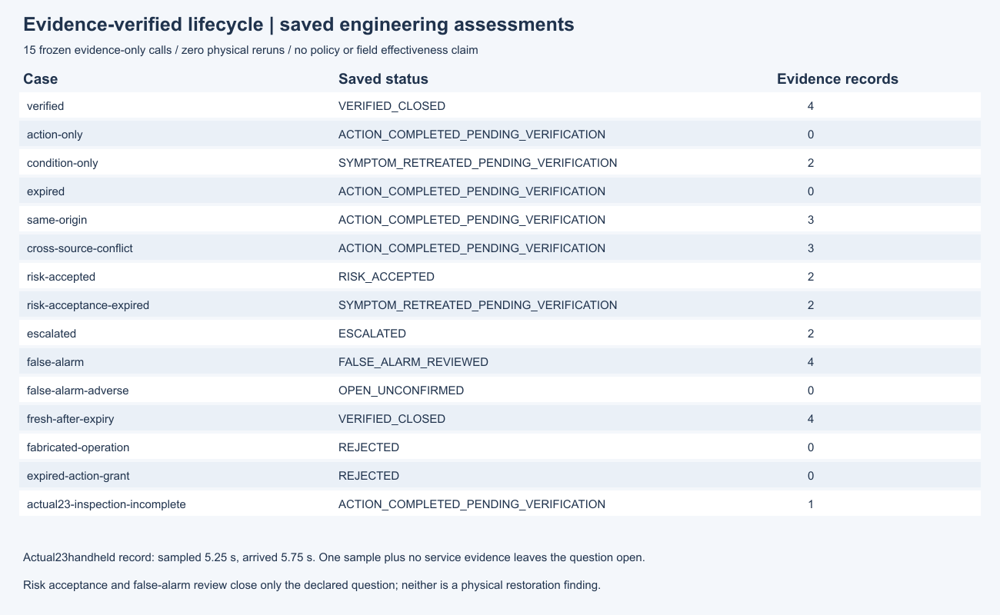
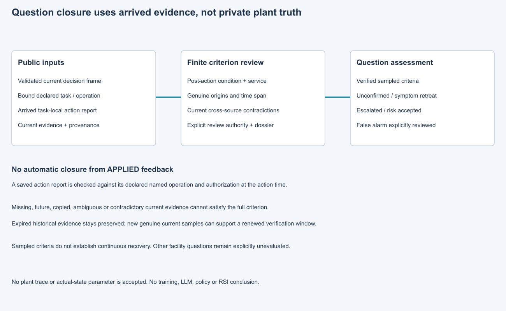

# 第24项根验收：基于证据的恢复核验和问题关闭

集成执行源`2b8d224a6d6605b2898117438573d738dae28023`通过512项完整回归，全部执行，零失败、零错误、零跳过。20份历史原件与260个Python/JSON源码身份通过守卫。独立Spec1267项、Standards453项保存复核通过，两轴无未解决发现。

处置完成本身不会关闭问题；有限采样规则要求处置后状态和服务记录、真实样本及时间跨度。当前跨来源反证、复制、未来、未知质量和冲突复核不能补成恢复。有时限授权的风险接受、升级、误报复核与恢复核验分别表示。实际第23项5.25秒采样、5.75秒到达的手持读数保持原身份，单次局部观察且没有服务记录时继续开放。

原15次证据评估通过原冻结状态检查，但独立最终审查发现否决轨迹遗漏。原6ff执行、52ef交付、1044项审阅及P2保持原样；显式修订协议下新15次评估补齐失败检查、阻断记录、观察/到达/有效期与来源。累计30次正式证据评估、零物理重跑。原12次独立无效夹具拒绝及修订9次中的4个反例也完整保留，未把它们记成全通过。

修订包20产物加收据、60运行源/4工具/152输入在干净新检出中逐项核对，包含原包全部21文件及原协议。两版图均实际渲染查看，未声称浏览器验收。41份原生CRLF开发日志只添加逐路径格式分类，字节未改。

- [根摘要](raw/summary.json)、[完整日志](raw/tests.log)、[源码守卫](raw/source-guard.json)
- [全部独立审阅与原反例](reviews.zip)、[新检出和图像复核](support.zip)
- [候选原件与两版捕获](../24-closure/README.md)、[显式修订](../../../../docs/mainline/24-closure-correction-01.md)
- [权威](../../../../docs/mainline/evidence/24-root.json)、[清单](declaration.json)、[收据](receipt.json)

本封存提交的新检出运行verify_packet.py --delivery-commit COMMIT --output OUTSIDE_CHECKOUT.json只复核保存证据。第24项接受后当前主票25，M4还需透明策略、候选方法和完整闭环负例。注册效果试验、LLM及训练调用均为零；现场校准和策略/AI/RSI收益仍待独立研究，完整42票目标持续active。
