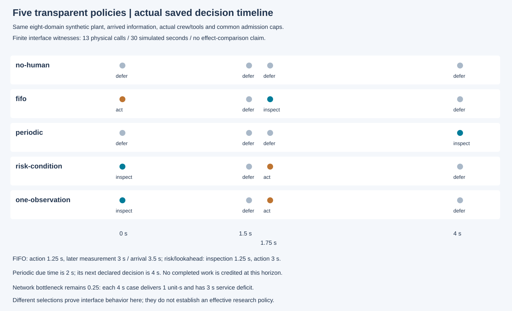
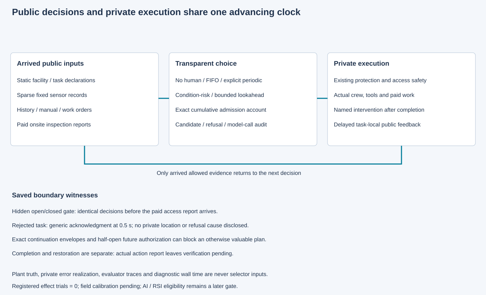

# 同一设施中的五种透明策略

本包验证无人工、FIFO、显式周期、条件风险优先适配和单次观察前瞻在同一八域合成设施中的实际运行。全部方法共用当前公开证据、人员工具、动作权限和累计准入预算。它们可以选择不同任务；提案本身不能授权执行。独立效果比较仍须在第30项先注册协议。

五个主见证使用完全相同的设施、稀疏固定测点、初始记录和资源声明。FIFO同可用时刻按候选标识排序，因此先处置、后复查；条件风险和前瞻先检查再处置。显式周期的到期时间为2秒，下一个声明决策为4秒，不能在运行结束前虚构完成。网络瓶颈维持0.25，五例4秒的实际交付均1单位秒、缺额均3秒。这是有限工程接口行为，不是算法增益结论。

检查结果1.25秒观察、1.75秒到达；FIFO后复查为3秒观察、3.5秒到达。当前功率代表记录把前瞻冷却后验更新为16/59；未声明功率/流量独立性时，手持记录保持到达可见但不会被重复当独立因子。隐藏访问开/闭在付费报告到达前给出相同选择。拒绝任务只在延迟确认中披露通用原因；累计准入使用精确公开数值，未来授权和完整后续资源亦限制前瞻计划。处置完成继续等待恢复证据。

原捕获在FIFO的第2例因预期并列顺序写反而停止。原[FAIL收据](capture-01/receipt.json)、[尝试账](capture-01/attempts.jsonl)和两例物理原件不改。[显式修订](../../../../docs/mainline/25-policy-engineering-correction-01.md)只更正FIFO字面预期，逐字节复用原两例，不重跑；[修订收据](capture-02/receipt.json)记录11个此前未试条件的新执行。累计13次物理调用、30模拟秒，零注册研究试验、训练或LLM调用，现场校准pending。

- [原冻结协议](../../../../docs/mainline/25-policy-engineering-protocol.json)、[修订冻结协议](../../../../docs/mainline/25-policy-engineering-correction-01.json)
- [保存检查与实际汇总](capture-02/checks.json)、[复用索引](capture-02/reused-originals.json)、[新尝试账](capture-02/attempts.jsonl)
- [策略接口与限制](../../../../docs/mainline/25-policy-execution.md)、[文献选择和适配差异](../../../../docs/research/20261105/baseline-selection.md)

第25项独立保存复核与[集成根验收](../25-root-acceptance/README.md)已通过。元数据更正及原字段分类见[单列说明](../../../../docs/mainline/25-policy-metadata-correction-01.md)；原538项完整检查与新两例元数据检查的执行源分开保留。第26项尚需实现，完整研究目标持续active。
