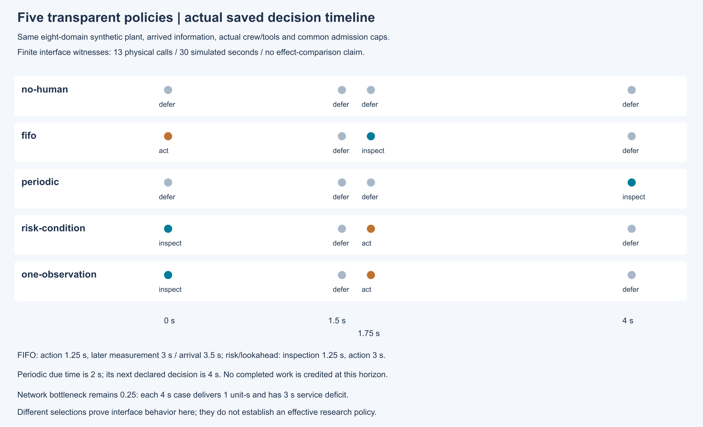
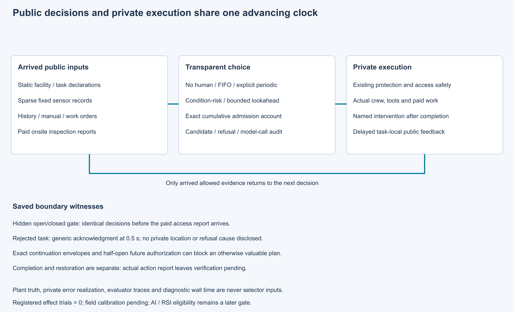

# 第25项根验收：同一设施中的透明策略

集成执行源`9d5aeceb5c653f0bd5b5e7b850a1afdf4e086af1`通过538项完整回归，全部执行，零失败、零错误、零跳过。20份历史原件与270个Python/JSON源码身份通过守卫。独立Spec5016项、Standards4573项保存复核通过，两轴无未解决发现。

无人工、FIFO、显式周期对照、条件风险优先适配和单次观察前瞻共用同一八域合成设施、真实时钟、公开证据及人员工具。选择/暂缓/不可行原因、精确累计准入账、模型调用和计算时间分别记录。固定测点覆盖稀疏；现场检查必须实际到场作业，记录到达后才可供决策。处置完成与恢复核验分别记账。

FIFO同可用时刻按标识排序，先处置、后复查；其效果1.25秒、手持3秒采样、3.5秒到达。条件风险和前瞻在1.25秒完成检查、1.75秒取得记录、3秒完成处置。主工程见证中网络瓶颈维持0.25，五种策略的4秒服务交付均1单位秒、缺额均3秒。这证明有限接口行为，不是效果比较或方法优越性证据。前瞻的功率证据后验为16/59，未声明独立的手持流量不再计因子；无固定通道开发见证的8/11另有范围。

另发现旧dispatch_interface遗留字段与策略运行矛盾，原15份运行原件保留，精确sidecar分类；新版本只改一行输出元数据。两个单列0.01秒工程运行验证启用/禁用状态，原538项针对9d源，未冒充新元数据源完整回归。策略包仍13次/30秒，含元数据检查的全部声明工程捕获15次/30.02秒。

原封存协议把FIFO并列顺序写反，执行至第2例后按协议停止。原11文件、FAIL收据、原静态PASS遗漏及失败账均保留。显式修订只更正FIFO预期；复用原两例8份物理原件，新执行11个未试条件，累计13次/30模拟秒，没有物理重试。修订包逐项钉住源码、工具、输入及原失败文件，干净新检出复核，图像实际渲染查看。

- [根摘要](raw/summary.json)、[完整日志](raw/tests.log)、[源码守卫](raw/source-guard.json)
- [独立审阅和原发现](reviews.zip)、[新检出和图像复核](support.zip)
- [候选交付和原失败](../25-baselines/README.md)、[显式修订协议](../../../../docs/mainline/25-policy-engineering-correction-01.md)
- [权威](../../../../docs/mainline/evidence/25-root.json)、[产物声明](declaration.json)、[收据](receipt.json)

第25项接受后，主票26实现可证伪的联合核查处置候选；M4仍需26–28。效果研究须到30先冻结协议，AI/RSI须通过38资格门槛。注册研究试验为零，现场标定pending，完整42票目标持续active。
